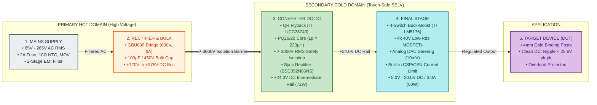

# VVDN Engineering Hub & Protocol Knowledge Base

Welcome to your central tracking workspace for embedded systems, hardware protocols, device bring-up, and issue resolution at VVDN.

---

## ⚡ Featured Project: Smart Programmable Power Supply (85–265V AC In, 5–20V / 3A DC Out)

An intelligent, digitally controlled bench and industrial power supply module engineered for precision DC regulation ($5.0\,\text{V} \dots 20.0\,\text{V}$ DC @ up to $3.0\,\text{A}$, $60\,\text{W}$ max continuous) from universal AC mains ($85\,\text{V} \dots 265\,\text{V}$ AC RMS, $47\text{--}63\,\text{Hz}$).

### Simplified 4-Stage Power Conversion Block Diagram
$$\text{Mains Supply } (85\text{--}265\,\text{V AC}) \longrightarrow \text{Rectifier } (+120\text{--}375\,\text{V DC}) \longrightarrow \text{Converter DC-DC (Flyback } +24\,\text{V}) \longrightarrow \text{Final Stage (Buck-Boost } 5\text{--}20\,\text{V}) \longrightarrow \text{Device (DUT)}$$

<p align="center">
  
</p>



### Internal Sub-Block Diagrams (The 4 Stages in Detail)

| Stage | Subsystem Architecture Diagram | Key Circuitry & Hardware Specifications |
| :---: | :--- | :--- |
| **Stage 1: Mains Supply** |  | 85V–265V AC In, 2A Fuse, 10Ω NTC, 14D471K MOV, 2-Stage CM Chokes (15mH, 4.7mH), X2/Y1 filter. |
| **Stage 2: Rectifier & Bulk** |  | GBU606 bridge (600V, 6A), 100µF/450V bulk cap (>10ms holdup), 100nF/630V HF cap, 3x 330kΩ bleeder. |
| **Stage 3: Converter DC-DC** |  | TI UCC28740 QR Flyback, 800V CoolMOS, PQ26/20 core, 3000V RMS barrier, Sync Rectifier (BSC052N06NS) -> +24V DC (72W). |
| **Stage 4: Final Stage** |  | TI LM5176 4-switch Buck-Boost, 10µH inductor, 10mV DAC steering (5V–20V), built-in CSP/CSN current limit, 4mm binding posts. |

- 📄 **Hardware PRD (High-Level Requirements)**: [PRODUCT_REQUIREMENT_DOCUMENT_PRD.md](smart_programmable_power_supply/PRODUCT_REQUIREMENT_DOCUMENT_PRD.md)
- 📐 **Hardware Design Document (HDD) Deep Technical Reference**: [HARDWARE_DESIGN_TECHNICAL_DETAILS_FOR_HDD.md](smart_programmable_power_supply/HARDWARE_DESIGN_TECHNICAL_DETAILS_FOR_HDD.md)
- 📂 **Full Hardware Architecture Dossiers**: [smart_programmable_power_supply/](smart_programmable_power_supply/)

---

## Workspace Structure

```text
.
├── README.md                          # Central dashboard and quick links
├── templates/
│   ├── issue-template.md              # Standard bug/issue logging format
│   └── device-bringup-checklist.md    # Bring-up checklist for serial interfaces
├── tools/
│   ├── baud_calc.py                   # CLI tool to calculate UART baud rate divisors & error %
│   ├── uart_calc.py                   # CLI tool for UART BRG divisors, frame throughput & RS-485 delays
│   ├── spi_calc.py                    # CLI tool for SPI timing budgets, round-trip delays & throughput
│   ├── nfc_calc.py                    # CLI tool for antenna inductance, matching network, Q & NDEF
│   ├── i2c_calc.py                    # CLI tool for I2C pull-up windows, bus capacitance & address decode
│   ├── can_calc.py                    # CLI tool for CAN/CAN-FD bit timing, sample points & arbitration
│   ├── lin_calc.py                    # CLI tool for LIN frame timing, PID parity, checksums & auto-baud
│   ├── ldo_calc.py                    # CLI tool for LDO thermal dissipation, feedback dividers & ESR stability
│   ├── mosfet_calc.py                 # CLI tool for MOSFET conduction/switching loss, gate drive & thermal
│   └── md_to_docx.py                  # Document styling and formatting utility
├── protocols/
│   ├── uart/
│   │   ├── README.md          # UART master hub, transceiver standards (TTL, RS-232/422/485) & roadmap
│   │   ├── uart-guide.md      # Complete guide on UART architecture, Linux subsystem & debugging
│   │   ├── uart-frame-and-protocol-analysis.md # Frame anatomy, 16x oversampling, 9-bit mode & DMA ring buffers
│   │   ├── uart-circuit-and-hardware-connections.md # Schematics: MCU-to-MCU, USB bridge, RS-232, RS-485, level shifters
│   │   └── baud-rate-calculations.md # Detailed baud rate theory, BRG formulas & error analysis
│   ├── spi/
│   │   ├── README.md          # SPI master hub, standards overview & 4-mode comparison
│   │   ├── spi-guide.md       # Complete guide on SPI architecture, CPOL/CPHA, Linux spidev & debugging
│   │   ├── spi-timing-and-modes.md # Detailed SPI modes, AC timing budgets & propagation delay analysis
│   │   ├── spi-frame-analysis.md # Detailed SPI data frames, packet structures, archetypes & CRC
│   │   └── spi-circuit-and-hardware-connections.md # Schematics: Star/daisy-chain, QSPI Flash, isolation & level shifting
│   ├── nfc/
│   │   ├── README.md          # NFC master hub, standards overview & transceiver comparison
│   │   ├── nfc-rf-and-physical-layer.md # 13.56 MHz RF physics, ASK modulations, antenna & matching
│   │   ├── spi-rfid-transceiver-interface.md # SPI bridge, pinout, register vs packet, LSB trap & FIFO
│   │   ├── iso14443-framing-and-anticollision.md # 7-bit REQA, cascade anti-collision walk & T=CL APDUs
│   │   ├── ndef-and-card-emulation.md # NFC Forum Types 1-5, NDEF framing, RTD types & HCE
│   │   └── nfc-firmware-and-driver-guide.md # Modular C driver, Linux subsystem, bring-up & RCA
│   ├── i2c/
│   │   ├── README.md                              # I2C master hub, speed modes & bus comparison
│   │   ├── i2c-working-and-architecture.md        # Working mechanism, open-drain, wired-AND, arbitration, clock stretching
│   │   ├── i2c-frame-and-protocol-analysis.md     # Frame formats, 7/10-bit addressing, packet archetypes & logic decoding
│   │   ├── i2c-circuit-and-hardware-connections.md# Schematics: Master/Slaves, MOSFET level-shifter, TCA9548A, P82B715
│   │   └── i2c-timing-calculations-and-hardware.md# AC timing specs, pull-up sizing math, bus capacitance & PCB design
│   ├── can/
│   │   ├── README.md                              # CAN master hub, standard comparisons & roadmap
│   │   ├── can-working-and-architecture.md        # Differential physical layer, arbitration, fault confinement & transceivers
│   │   ├── can-frame-and-protocol-analysis.md     # Frame formats (2.0A/B, FD), bit stuffing, J1939, CANopen, UDS & SocketCAN
│   │   ├── can-circuit-and-hardware-connections.md# Schematics: Transceiver VIO, split termination, CMC, TVS, ISO1042
│   │   └── can-timing-bitrates-and-hardware.md    # Bit timing budgets, Time Quanta, SJW, TDC, termination & RCA matrix
│   └── lin/
│       ├── README.md                              # LIN master hub, standard comparisons & roadmap
│       ├── lin-working-and-architecture.md        # Single-wire 12V physical layer, asymmetric pull-up, scheduling & sleep/wake
│       ├── lin-frame-and-protocol-analysis.md     # Frame anatomy (Break, Sync 0x55, PID parity, Classic/Enhanced Checksum)
│       ├── lin-circuit-and-hardware-connections.md# Schematics: Master/Slave nodes, ISO 7637-2 surge protection, harness wiring
│       └── lin-timing-synchronization-and-hardware.md# Auto-baud sync math, slave RC capture, duty cycles & bench RCA
├── ldo/
│   ├── README.md                              # LDO master hub, operating principles & pass element comparison
│   ├── pmos-ldo-working-and-architecture.md   # Common-Source topology, stability tunnel & MLCC compensation
│   ├── nmos-ldo-working-and-architecture.md   # Source-Follower topology, Vbias rails, charge pumps & fast transient
│   └── ldo-calculations-and-thermal-design.md # Thermal networks, heatsinks, feedback dividers, ESR zeros & RCA
├── mosfets/
│   ├── README.md                              # MOSFET master hub, taxonomy, physics, math & selection matrix
│   ├── n-channel-enhancement/                         # e-NMOS physics, inversion, low-side switching & flyback clamping
│   ├── p-channel-enhancement/                         # e-PMOS physics, hole mobility, high-side drive & reverse polarity
│   ├── depletion-mode/                                # Normally-ON d-MOSFET, pinch-off, offline startup & current sources
│   ├── power-trench-mosfet/                           # UMOS & SGT shielded trench, low Rdson, sync buck top/bottom FETs
│   ├── power-vdmos/                                   # Vertical planar DMOS, UIS avalanche Eas & linear mode SOA
│   ├── superjunction-mosfet/                          # CoolMOS charge balance, breaking Si limit, PFC & fast diodes
│   ├── sic-mosfet/                                    # 4H-SiC wide-bandgap, 1200V EV traction, EVSE & +18V/-4V drive
│   ├── logic-level-mosfet/                            # Low-Vth logic-level FETs, direct 3.3V/5V MCU GPIO drive & Qg sizing
│   ├── ldmos-rf/                                      # Lateral DMOS, grounded flange, GHz RF power & Doherty amplifiers
│   ├── finfet-and-gaafet/                             # 3D multi-gate, FinFET & GAA nanosheets, SCE & sub-3nm VLSI
│   └── dual-gate-mosfet/                              # Tetrode FET, cascode integration, ultra-low Crss, AGC & RF mixers
├── evse/
│   ├── README.md                              # EVSE master hub, system architecture & standards index
│   ├── evse-low-voltage-controller-working.md # LV controller board working, CP/PP, safety, metering & contactor
│   ├── evse-iot-and-communication-subsystem.md# IoT gateway, 4G/Wi-Fi/Ethernet, OCPP 1.6J/2.0.1 & DLM
│   └── evse-hardware-schematic-and-interfacing.md # Schematics, BOM selection, galvanic isolation & bring-up
├── dual_lift_controller/
│   ├── README.md                              # Dual lift master hub, architecture & design index
│   ├── 3-floor-dual-lift-logic-design.md      # Gate-level design for 3-floor building (27-state truth table, K-maps)
│   ├── 4-floor-dual-lift-logic-design.md      # Gate-level design for 4-floor building (64-state truth table, subtractors)
│   ├── gate-level-schematics-and-simulation.md# TTL 7400 IC schematics, gate counts & simulation waveforms
│   ├── dual_lift_controller.v                         # Synthesizable gate-level Verilog hardware description module
│   └── dual_lift_controller_tb.v                      # Verilog testbench validating all 64 state combinations
├── standards/
│   ├── README.md              # Standards hub, lifecycle mapping & comparison matrix
│   ├── rohs/
│   │   └── rohs-guide.md      # RoHS 1/2/3 directives, restricted substances, SAC305, exemptions
│   ├── reach/
│   │   └── reach-guide.md     # REACH, SVHC Candidate List, O5A rule, SCIP reporting
│   ├── aec/
│   │   └── aec-guide.md       # Automotive Electronics Council (AEC-Q100/101/200, grades)
│   └── msl/
│       └── msl-guide.md       # Moisture Sensitivity Levels (J-STD-020/033, popcorning, bake)
├── converters/                        # Power Electronics Converters Knowledge Base (DC-DC, AC-AC, DC-AC, AC-DC)
│   ├── README.md              # Master hub, 4-quadrant conversion matrix & selection benchmark
│   ├── dc-dc/                         # DC-to-DC Voltage Conversion (Isolated & Non-Isolated Topologies)
│   │   ├── README.md          # DC-DC master hub, taxonomy & 13-topology comparison
│   │   ├── isolated/                  # Forward, Flyback, DAB, Full-Bridge, Half-Bridge, Push-Pull, Resonant (LLC)
│   │   └── non-isolated/              # Buck, Boost, Buck-Boost, Cuk, SEPIC, Zeta
│   ├── ac-ac/                         # AC-to-AC Frequency & Voltage Conversion
│   │   ├── README.md          # AC-AC master hub & direct conversion taxonomy
│   │   ├── cycloconverters.md # Line-commutated cycloconverters (P/N banks, sub-fundamental drives)
│   │   └── ac-voltage-controllers.md # Phase angle & integral cycle control (TRIAC/SCR, soft-starters)
│   ├── dc-ac/                         # DC-to-AC Inversion (Single-Phase & Three-Phase Inverters)
│   │   ├── README.md          # DC-AC master hub & modulation comparison
│   │   ├── single-phase-inverters.md # Half/Full-Bridge, Bipolar/Unipolar SPWM, LC filter design
│   │   └── three-phase-inverters.md # 6-Switch VSI, 180°/120°, THIPWM & Space Vector PWM (SVPWM)
│   └── ac-dc/                         # AC-to-DC Rectification & Power Quality
│       ├── README.md          # AC-DC master hub, power quality metrics & standards (IEC 61000-3-2)
│       ├── uncontrolled-rectifiers.md # 1-Phase & 3-Phase diode bridges, conduction angle & capacitor ripple
│       ├── controlled-rectifiers.md # Phase-controlled SCR rectifiers (Semi/Full, Quadrant IV inversion)
│       └── active-pfc-rectifiers.md # Active Boost PFC, Bridgeless Totem-Pole GaN & Vienna Rectifier
├── active/                            # In-progress investigations & open device issues
└── resolved/                          # Documented fixes, post-mortems, and RCA
```

---

## Tools & Utilities

- **[tools/baud_calc.py](tools/baud_calc.py)**: Quickly calculate hardware divisor registers (integer & fractional) and error percentage for any MCU clock:
  ```bash
  python3 tools/baud_calc.py --clock 16MHz --baud 115200
  ```
- **[tools/uart_calc.py](tools/uart_calc.py)**: Calculate UART baud divisors, frame timing budgets, payload throughput, and RS-485 cable delays:
  ```bash
  python3 tools/uart_calc.py --baud --clock 16MHz --baudrate 115200
  python3 tools/uart_calc.py --frame --baudrate 115200 --data-bits 8 --parity N --stop-bits 1
  python3 tools/uart_calc.py --rs485 --cable-m 100 --baudrate 115200
  ```
- **[tools/spi_calc.py](tools/spi_calc.py)**: Calculate SPI round-trip propagation delays, safe maximum read clock frequencies, and throughput:
  ```bash
  python3 tools/spi_calc.py --clock 50MHz --trace-cm 5 --tco 7 --tsu 3
  ```
- **[tools/nfc_calc.py](tools/nfc_calc.py)**: Calculate PCB antenna inductance, resonance capacitors, Q-factor, matching network, and NDEF record encodings:
  ```bash
  python3 tools/nfc_calc.py --antenna --width-mm 45 --height-mm 35 --turns 4 --track-mm 0.5
  python3 tools/nfc_calc.py --matching --inductance-uh 1.85 --r-ant 1.1 --q-target 25 --r-load 50
  python3 tools/nfc_calc.py --ndef-uri "https://vvdntech.com"
  ```
- **[tools/i2c_calc.py](tools/i2c_calc.py)**: Calculate I2C pull-up resistor windows (R_p(min) and R_p(max)), bus capacitance budgets, rise time compliance, and 7-bit/8-bit address conversions:
  ```bash
  python3 tools/i2c_calc.py --mode full --vdd 3.3 --cap 180 --rp 2.2k --speed fast --address 0x68
  ```
- **[tools/can_calc.py](tools/can_calc.py)**: Calculate CAN and CAN FD bit timing registers, Sample Point %, bit-stuffing overhead, frame duration, and bitwise arbitration simulation:
  ```bash
  python3 tools/can_calc.py --clock 80MHz --baud 500000 --sp 87.5
  python3 tools/can_calc.py --fd --clock 80MHz --baud 500000 --data-baud 2000000
  python3 tools/can_calc.py --arbitrate --id1 0x120 --id2 0x124
  ```
- **[tools/lin_calc.py](tools/lin_calc.py)**: Calculate LIN frame slot durations (1.4* slot budget), PID parity bits (P0, P1), Classic & Enhanced checksums, auto-baud sync capture ticks, and bus RC parameters:
  ```bash
  python3 tools/lin_calc.py --baud 19200 --data-bytes 8 --slaves 8
  python3 tools/lin_calc.py --pid 0x23
  python3 tools/lin_calc.py --checksum --pid 0x23 --data 0x01 0x02 0x03 0x04
  ```
- **[tools/ldo_calc.py](tools/ldo_calc.py)**: Calculate LDO power dissipation, junction temperature (T_J), required heatsink thermal resistance, feedback resistor divider sizing (E96 1%), and ESR stability zero frequency:
  ```bash
  python3 tools/ldo_calc.py --thermal --vin 5.0 --vout 3.3 --iload 0.5 --theta-ja 45.0
  python3 tools/ldo_calc.py --feedback --vout 3.3 --vref 1.2
  python3 tools/ldo_calc.py --stability --cout 10.0 --esr 15.0 --cff 47.0 --r1 21.0 --r2 12.0
  python3 tools/ldo_calc.py --compare --vin 3.3 --vout 1.8 --iload 1.0
  ```
- **[tools/mosfet_calc.py](tools/mosfet_calc.py)**: Calculate MOSFET conduction loss, switching loss, gate drive resistor sizing, thermal junction temperatures, and body diode recovery:
  ```bash
  python3 tools/mosfet_calc.py --loss --vds 48 --id 15 --rdson 0.005 --trise 25n --tfall 20n --fsw 150k
  python3 tools/mosfet_calc.py --gate --vdrv 12 --vplat 4.2 --qgd 12n --target-dt 30n
  python3 tools/mosfet_calc.py --diode --vds 400 --iload 20 --vsd 1.2 --tdead 100n --qrr 450n --fsw 100k
  ```
- **[tools/evse_calc.py](tools/evse_calc.py)**: Calculate EVSE Control Pilot PWM duty cycles, allowable charging currents, grid power, and RCM response times:
  ```bash
  python3 tools/evse_calc.py --mode full --current 32 --phase 3 --voltage-grid 400
  ```
- **[tools/lift_sim.py](tools/lift_sim.py)**: Simulate and verify gate-level nearest-lift arbitration and motor direction logic across all floor combinations:
  ```bash
  python3 tools/lift_sim.py --floors 4 --verify
  ```
- **[tools/psu_calc.py](tools/psu_calc.py)**: Calculate QR Flyback transformer parameters (L_p, I_pk, turns ratio, air gap), primary RCD snubber values, 4-switch Buck-Boost L and C_OUT bank, DAC feedback summing network, and real-time efficiency:
  ```bash
  python3 tools/psu_calc.py --flyback --vin-min 85 --vin-max 265 --vout 24 --iout 3.0 --fsw 65000
  python3 tools/psu_calc.py --snubber --vin-max 265 --vout 24 --turns-ratio 4.0 --leakage-ind 3.3e-6 --ipeak 3.45 --fsw 70000
  python3 tools/psu_calc.py --buckboost --vin 24 --vout-min 5.0 --vout-max 20.0 --iout 3.0 --fsw 250000
  python3 tools/psu_calc.py --feedback --vout-min 5.0 --vout-max 20.0 --vdac-max 3.3 --vref 1.20
  python3 tools/psu_calc.py --efficiency --vac 230 --iac 0.35 --pac 72.5 --vdc 20.0 --idc 3.0
  ```
- **[tools/md_to_docx.py](tools/md_to_docx.py)**: Document styling and export utility for engineering deliverables:
  ```bash
  python3 tools/md_to_docx.py                 # Syncs all standards/ and protocols/ guides
  python3 tools/md_to_docx.py <path/to/file>  # Converts a specific .md file
  ```

---

## Protocol Guides & Quick Links

- [UART Master Architecture & Knowledge Base](protocols/uart/README.md): Master hub for UART protocols, transceiver standards (TTL, RS-232, RS-422, RS-485), protocol benchmark matrix, and CLI tools.
- [UART Complete Guide](protocols/uart/uart-guide.md): Complete architecture, Linux subsystem, C/Python code, and failure modes.
- [UART Frame & Protocol Analysis](protocols/uart/uart-frame-and-protocol-analysis.md): Bit-level frame anatomy, 16x oversampling clock recovery, majority voting, 9-bit multi-drop addressing, hardware flow control, and DMA circular ring buffers.
- [UART Hardware Connections & Circuit Schematics](protocols/uart/uart-circuit-and-hardware-connections.md): Circuit schematics for MCU cross-over, USB bridge (CP2102/FT232), bipolar RS-232 (MAX3232), half-duplex RS-485 (MAX485), and BSS138 level shifter.
- [UART Baud Rate Calculations](protocols/uart/baud-rate-calculations.md): In-depth look at baud vs bit rate, hardware BRG divisor formulas, 16x oversampling, error margins, and oscilloscope measurement.
- [SPI Master Architecture & Knowledge Base](protocols/spi/README.md): Master hub for SPI protocols, 4-mode truth table, multi-target topologies, Quad/Octal SPI extensions, and benchmark comparison.
- [SPI Complete Guide](protocols/spi/spi-guide.md): Complete architecture, CPOL/CPHA modes, QSPI/OSPI variants, Linux spidev, C/Python code, and failure modes.
- [SPI Timing & Modes Guide](protocols/spi/spi-timing-and-modes.md): In-depth look at CPOL/CPHA edge transitions, shift register mechanics, round-trip delay calculations, high-speed signal integrity, and logic analyzer debugging.
- [SPI Data Frame Analysis](protocols/spi/spi-frame-analysis.md): Deep dive on physical vs logical framing, command/address/dummy phases, Flash/IMU/ADC/Safe-SPI archetypes, CRC-8, and multi-segment Linux transfers.
- [SPI Hardware Connections & Circuit Schematics](protocols/spi/spi-circuit-and-hardware-connections.md): Circuit schematics for single-slave with damping, multi-slave star routing, shift-register daisy-chaining, QSPI Flash (W25Q128JV), and galvanic isolation.
- [NFC Knowledge Base Index](protocols/nfc/README.md): Master hub for NFC protocols, ISO/IEC standards map, transceiver comparison (PN532, MFRC522, ST25R3916, TRF7970A), and glossary.
- [NFC & SPI Interaction Guide (Mentor Briefing)](protocols/nfc/spi-rfid-nfc-interaction-guide.md): Conceptual explainer on how SPI and RFID frontends interact to create NFC, step-by-step transaction walkthrough, why SPI over I2C, and mentor defense Q&A.
- [NFC RF & Physical Layer Guide](protocols/nfc/nfc-rf-and-physical-layer.md): Near-field inductive coupling physics, Biot-Savart, 100% vs 10% ASK, 848 kHz subcarrier load modulation, antenna Q-factor, EMC filters, and ferrite shielding against metal surfaces.
- [NFC SPI Transceiver Interface Guide](protocols/nfc/spi-rfid-transceiver-interface.md): 4-wire SPI + sideband GPIOs (CS#, IRQ, RSTPD), Register-driven vs Packet-driven frontends, the critical LSB-first bit order trap, FIFO watermark interrupts, and AC timing budgets.
- [ISO/IEC 14443 Protocol & Anti-Collision Guide](protocols/nfc/iso14443-framing-and-anticollision.md): State machine, 5.0 ms guard delay, 7-bit unaligned REQA/WUPA short frames, ATQA decoding, Cascade Levels 1/2/3 bit-oriented collision walk, SAK resolution, and ISO 14443-4 T=CL APDU transport.
- [NFC NDEF & Card Emulation Guide](protocols/nfc/ndef-and-card-emulation.md): NFC Forum Tag Types 1–5, Capability Containers (CC), NDEF message framing, Record headers (TNF, RTD URI/Text/MIME), Peer-to-Peer (LLCP/SNEP), and Host Card Emulation (HCE) via SPI.
- [NFC Firmware, Driver & Debugging Guide](protocols/nfc/nfc-firmware-and-driver-guide.md): Production-grade modular C driver, Linux kernel NFC subsystem (`drivers/nfc`, Device Tree, `spidev`), 4-step oscilloscope/logic analyzer bring-up, and RCA troubleshooting matrix.
- [I2C Master Architecture & Knowledge Base](protocols/i2c/README.md): Master hub for I2C protocol standards, speed modes (100k, 400k, 1M, 3.4M), bus comparison matrix, and hardware quick references.
- [I2C Working Mechanism & Architecture](protocols/i2c/i2c-working-and-architecture.md): Physical open-drain layer, wired-AND logic, bidirectional MOSFET level shifters, clock synchronization, clock stretching, multi-master arbitration, spike filters, and stuck SDA bus recovery.
- [I2C Frame & Protocol Analysis](protocols/i2c/i2c-frame-and-protocol-analysis.md): Bit-level frame anatomy (START, STOP, Repeated START), 9-bit byte units, ACK/NACK signaling, 7-bit vs 8-bit addressing traps, 10-bit addressing frames, reserved addresses, 5 transaction archetypes, and logic analyzer frame decoding.
- [I2C Hardware Connections & Circuit Schematics](protocols/i2c/i2c-circuit-and-hardware-connections.md): Circuit schematics for multi-target bus, BSS138 bi-voltage level shifter, TCA9548A multiplexer for address conflicts, and P82B715 long-distance buffer.
- [I2C AC Timing, Pull-Up Calculations & Hardware](protocols/i2c/i2c-timing-calculations-and-hardware.md): AC timing parameter matrix, mathematical derivation of R_p(min) and R_p(max), bus capacitance budgeting (C_b), active bus accelerators, PCB layout & crosstalk shielding, and bench RCA troubleshooting matrix.
- [CAN Master Architecture & Knowledge Base](protocols/can/README.md): Master hub for CAN/CAN-FD standards, generational comparison matrix (2.0A/B, FD, XL), bus architecture, and CLI tools.
- [CAN Working Mechanism & Physical Layer](protocols/can/can-working-and-architecture.md): Physical differential signaling, Recessive/Dominant voltage levels, transceivers, non-destructive bitwise arbitration, error detection, fault confinement state machine (TEC/REC), and acceptance filters.
- [CAN Frame & Protocol Analysis](protocols/can/can-frame-and-protocol-analysis.md): Bit-by-bit frame anatomy (Standard 2.0A, Extended 2.0B, CAN FD), bit-stuffing overhead, SAE J1939, CANopen, UDS over CAN-TP (ISO 15765-2), and Linux SocketCAN C driver.
- [CAN Hardware Connections & Circuit Schematics](protocols/can/can-circuit-and-hardware-connections.md): Circuit schematics for TJA1051 VIO transceiver, split termination, common-mode choke (51µH), TVS ESD diodes, and ISO1042 galvanically isolated nodes.
- [CAN Timing, Bitrates & Hardware Engineering](protocols/can/can-timing-bitrates-and-hardware.md): Bit timing theory, Time Quanta, SJW, sample point optimization, CAN FD dual-bitrate timing, Transmitter Delay Compensation (TDC/SSP), bus length trade-offs, split termination, and bench RCA matrix.
- [LIN Master Architecture & Knowledge Base](protocols/lin/README.md): Master hub for LIN protocol standards (LIN 1.3, 2.0, 2.1, 2.2A, ISO 17987), vehicle sub-bus architecture, and comparison matrix.
- [LIN Working Mechanism & Electrical Architecture](protocols/lin/lin-working-and-architecture.md): Single-wire 12V physical layer, asymmetric termination (1kΩ Master, 30kΩ Slave), transceiver slew-rate control, deterministic schedule tables, sleep/wake-up protocol, and node configuration (NAD).
- [LIN Frame & Protocol Analysis](protocols/lin/lin-frame-and-protocol-analysis.md): Bit-level frame anatomy (Break >= 13 bits, Sync 0x55, PID parity equations P0/P1), Classic vs Enhanced Checksum algorithms, frame types, LIN TP, waveform decoding, and MCU UART driver.
- [LIN Hardware Connections & Circuit Schematics](protocols/lin/lin-circuit-and-hardware-connections.md): Circuit schematics for automotive Master Node (1kΩ + BAS21 diode), Slave Node (internal 30kΩ), ISO 7637-2 surge protection, and vehicle harness wiring.
- [LIN Timing Calculations, Synchronization & Hardware](protocols/lin/lin-timing-synchronization-and-hardware.md): Bit timing, 1.4* slot budget sizing, slave auto-baud clock synchronization math, timer input capture ISR, duty cycle timing budgets, bus RC capacitance, ISO 7637-2 surge protection, and bench RCA matrix.
- [LDO Master Architecture & Knowledge Base](ldo/README.md): Master hub for linear regulators, LDO operating principles, PMOS vs. NMOS pass element benchmark, performance metrics, and CLI tools.
- [PMOS LDO Working Mechanism & Architecture](ldo/pmos-ldo-working-and-architecture.md): Common-Source topology, gate drive physics (V_GATE < V_IN), two-pole loop dynamics, ESR stability tunnel, MLCC ceramic compensation, and parasitic body diode reverse current protection.
- [NMOS LDO Working Mechanism & Architecture](ldo/nmos-ldo-working-and-architecture.md): Source-Follower topology, intrinsic local feedback, gate headroom constraint (V_GATE > V_IN), dual-rail V_BIAS vs. internal charge pumps, wideband MLCC stability, and triple-well body effect elimination.
- [LDO Calculations, Feedback Sizing & Thermal Design](ldo/ldo-calculations-and-thermal-design.md): Power dissipation math, thermal resistance network (θ_JA, θ_JC), heatsink sizing, standard E96 feedback divider design, feedforward capacitor (C_FF) phase-lead zero, output capacitor dynamic sizing, and bench RCA troubleshooting matrix.
- [LDOs in Power Electronics: Architectures & Rugged Protection](ldo/ldo-in-power-electronics.md): Hybrid SMPS pre-regulator + LDO post-regulator architecture, dynamic headroom sizing, high-current paralleling (ballast resistors vs SET-pin current mirrors), reverse-current backfeeding protection under bus collapse, inrush soft-start, and industrial 24V-to-3.3V analog power stage schematic.
- [MOSFET Master Architecture & Study Guide](mosfets/README.md): Master hub covering MOSFET taxonomy, semiconductor physics, mathematical models, switching dynamics, Miller plateau, thermal sizing, and selection matrix.
- [Power MOSFETs in Power Electronics: Topologies, Gate Drives & Design](mosfets/mosfets-in-power-electronics.md): Synchronous buck/boost converters, half-bridge/inverters, high dV/dt Miller turn-on prevention (Active Miller Clamp & negative bias), isolated flyback RCD snubber design, LLC resonant ZVS, bootstrap gate drivers, Kelvin-Source connections, SOA Spirito limits, UIS avalanche energy (E_AS), and 48V/10A power stage schematic.
- [N-Channel Enhancement MOSFET Guide](mosfets/n-channel-enhancement/README.md): e-NMOS physics, inversion channel, low-side switching, gate pull-down/damping resistors, and inductive flyback clamping.
- [P-Channel Enhancement MOSFET Guide](mosfets/p-channel-enhancement/README.md): e-PMOS hole mobility penalty, high-side power switching, level shifter driver, and millivolt reverse polarity protection circuits.
- [Depletion-Mode MOSFET Guide](mosfets/depletion-mode/README.md): Normally-ON d-MOSFET physics, negative pinch-off, lossless high-voltage offline SMPS startup, and two-terminal constant current sources.
- [Power Trench MOSFET Guide](mosfets/power-trench-mosfet/README.md): UMOS & Shielded Gate Trench (SGT) architectures, JFET resistance elimination, and synchronous buck top vs bottom FET optimization.
- [Vertical Planar Power VDMOS Guide](mosfets/power-vdmos/README.md): Double-diffused planar power physics, high single-pulse avalanche energy (E_AS), and linear mode SOA immunity to Spirito hotspots.
- [Superjunction (CoolMOS) Guide](mosfets/superjunction-mosfet/README.md): Multi-epi charge balance physics, breaking the 1D Silicon limit, non-linear C_oss, high dv/dt handling, and fast recovery CFD body diodes.
- [Silicon Carbide (SiC) Power MOSFET Guide](mosfets/sic-mosfet/README.md): Wide-bandgap 3.26 eV physics, +18V/-4V asymmetric gate drive, Kelvin Source connection, DESAT protection, and EV traction inverters.
- [Logic-Level MOSFET Guide](mosfets/logic-level-mosfet/README.md): Thin-oxide 1-2 V V_TH engineering, direct 3.3 V/5 V MCU GPIO drive, inrush resistor sizing, and gate charge limitations.
- [Lateral DMOS (LDMOS) RF Guide](mosfets/ldmos-rf/README.md): RF power physics, grounded backside flange, ultra-low C_rss, 65:1 VSWR survival, and Doherty base station architectures.
- [Advanced Multi-Gate FinFET & GAAFET Guide](mosfets/finfet-and-gaafet/README.md): 3D FinFET tri-gate, Gate-All-Around (GAA) nanosheets, FD-SOI, short-channel effect mitigation, and sub-3nm VLSI scaling.
- [Dual-Gate (Tetrode) MOSFET Guide](mosfets/dual-gate-mosfet/README.md): Monolithic cascode integration, independent dual gates, Miller suppression (C_rss < 0.02 pF), AGC amplifiers, and active RF mixers.
- [EVSE Knowledge Base & Systems Hub](evse/README.md): Master hub for EV charging equipment architecture, high-voltage vs low-voltage domain separation, and international standards.
- [EVSE Low Voltage Controller Working & Architecture](evse/evse-low-voltage-controller-working.md): Complete working of the LV controller board, ±12V CP PWM bipolar generation, vehicle state machine (A..F), diode safety check, PP cable rating detection, 6mA DC / 30mA AC RCM leakage trip, welded contactor detection, precision energy metering, and coil economizer.
- [EVSE IoT Gateway & Communication Subsystem](evse/evse-iot-and-communication-subsystem.md): Dual-processor safety architecture, 4G LTE Cat-1 / Wi-Fi / BLE / Ethernet connectivity, complete OCPP 1.6-J / 2.0.1 transaction message flows, RS-485 Modbus Dynamic Load Management (DLM), RFID authentication, and A/B dual-bank secure OTA.
- [EVSE Hardware Schematics & Bring-Up Guide](evse/evse-hardware-schematic-and-interfacing.md): Component-level schematics (CP op-amp buffer, PP divider, contactor driver, H-bridge lock), reinforced creepage/clearance (>= 6-8mm), GDT/MOV surge protection, and bench RCA troubleshooting matrix.
- [Dual Lift Controller Master Hub](dual_lift_controller/README.md): Master hub for 3-floor and 4-floor dual lift dispatch system, architectural block diagrams, and subsystem interface specifications.
- [3-Floor Dual Lift Gate Logic Design](dual_lift_controller/3-floor-dual-lift-logic-design.md): Gate-level realization for 3 floors (Floors 0, 1, 2), 1-hot distance calculation, exhaustive 27-state truth table, K-maps, and motor direction logic (UP, DOWN, STOP).
- [4-Floor Dual Lift Gate Logic Design](dual_lift_controller/4-floor-dual-lift-logic-design.md): 2-bit binary arithmetic distance subtractors (|R - A|, |R - B|), 2-bit magnitude comparators, 64-state system analysis, nearest dispatch arbiter, and busy-state priority handling.
- [Gate-Level Schematics & Verilog Simulation](dual_lift_controller/gate-level-schematics-and-simulation.md): Standard 7400-series TTL IC Bill of Materials, pin-to-pin schematics, ULN2003 contactor drive, sub-80ns propagation delay analysis, and Verilog simulation test vectors.
- [Smart Programmable Power Supply Master Hub](smart_programmable_power_supply/README.md): Master hub for 85–265V AC universal input, 5–20V / 3A (60W) programmable DC output power supply module with real-time efficiency monitoring and data logging.
- [AC-DC Flyback Stage Design & Magnetics](smart_programmable_power_supply/ac-dc-flyback-stage-design.md): Universal AC frontend (fuse, NTC, MOV, 2-stage EMI filter, bridge, bulk cap), Quasi-Resonant (QR) valley-switching Flyback, PQ26/20 transformer design, 800V Superjunction FET, RCD snubber, secondary synchronous rectification (MP6908), and TL431/PC817 isolated regulation.
- [MCU-Controlled Synchronous Buck-Boost Post-Regulator](smart_programmable_power_supply/mcu-buck-boost-post-regulator.md): 4-switch synchronous Buck-Boost H-bridge (24 V -> 5-20 V @ 3 A), 10µH flat-wire inductor, output capacitor bank (< 25mV ripple), 12-bit DAC current-injection feedback network (10mV resolution), and analog fast Constant Current (CC) clamp loop.
- [Efficiency Monitoring, Data Logging & Telemetry](smart_programmable_power_supply/efficiency-monitoring-and-telemetry.md): Dual-domain power metering (isolated primary AC ΔSigma modulator AMC1311/CT and secondary DC INA226 I2C monitor), real-time efficiency engine (η = P_DC / P_AC at 10Hz), non-blocking FreeRTOS MicroSD FAT32 CSV logger, 1.3" OLED display, and USB-C SCPI command parser.
- [System Schematics, Safety & PCB Design](smart_programmable_power_supply/system-schematics-and-pcb-design.md): Complete end-to-end system interconnect schematic, reinforced isolation barrier rules (>= 6.4 mm creepage, 2.0mm PCB isolation slot, Y1 safety cap), 4-layer PCB stackup and layout guidelines, Bill of Materials (BOM), bring-up checklist, and RCA troubleshooting matrix.

---

## Power Electronics Converters Knowledge Base

- [Power Converters Master Hub](converters/README.md): Master hub for 4-quadrant power electronic converters (DC-DC, AC-AC, DC-AC, AC-DC) with taxonomy, 13-topology benchmark matrix, and component stress formulas.
- [DC-DC Converters Hub](converters/dc-dc/README.md): Master hub covering 7 Isolated topologies (Forward, Flyback, DAB, Full-Bridge, Half-Bridge, Push-Pull, Resonant) and 6 Non-Isolated topologies (Buck, Boost, Buck-Boost, Cuk, SEPIC, Zeta).
  - [Isolated Resonant Converters (SRC, PRC, LLC) [IMP]](converters/dc-dc/isolated/resonant-converters.md): Deep dive into Series, Parallel, and LLC Resonant Half-Bridge converters, FHA gain curves M(f_n, Q, L_n), and complete ZVS/ZCS design procedures.
  - [Phase-Shifted Full-Bridge (PSFB)](converters/dc-dc/isolated/full-bridge-converter.md): Soft-switching ZVS mechanisms, leading/lagging leg transitions, duty-cycle loss (Δ D), and secondary ringing suppression.
  - [Dual Active Bridge (DAB)](converters/dc-dc/isolated/dual-active-bridge.md): Bidirectional phase-shift modulation (SPS, EPS, DPS, TPS), leakage inductance power transfer, and EV battery charging design.
- [AC-AC Converters Hub](converters/ac-ac/README.md): Direct AC-AC frequency and voltage conversion.
  - [Cycloconverters](converters/ac-ac/cycloconverters.md): Multi-pulse naturally-commutated thyristor banks (P/N groups), circulating vs. non-circulating modes, and low-frequency mega-watt drives.
  - [AC Voltage Controllers](converters/ac-ac/ac-voltage-controllers.md): Phase-angle control vs. integral cycle burst firing, antiparallel SCR pairs/TRIACs, and induction motor soft-starters.
- [DC-AC Inverters Hub](converters/dc-ac/README.md): Stiff DC-bus inversion for grid-tied solar, UPS, and motor drives.
  - [Single-Phase Inverters & Filter Design](converters/dc-ac/single-phase-inverters.md): Half-bridge vs Full-bridge H-bridge, Bipolar vs Unipolar SPWM (2f_c harmonic cancellation), and second-order LC output low-pass filter design.
  - [Three-Phase Inverters & Space Vector PWM (SVPWM)](converters/dc-ac/three-phase-inverters.md): 6-Switch two-level VSI, 180°/120° six-step, THIPWM saddle modulation, and Space Vector PWM (SVPWM) mathematical deep dive (15.5\% higher DC utilization).
- [AC-DC Rectifiers Hub](converters/ac-dc/README.md): AC mains rectification, power quality metrics (PF, DPF, THD_i), and regulatory compliance (IEC 61000-3-2).
  - [Uncontrolled Diode Rectifiers](converters/ac-dc/uncontrolled-rectifiers.md): 1-Phase & 3-Phase diode bridges, conduction angle θ_c, crest factor, bulk capacitor sizing, and inrush surge protection.
  - [Controlled Phase-Rectifiers & Inversion](converters/ac-dc/controlled-rectifiers.md): Semi-converters, full-converters, firing delay α, and Quadrant IV line-commutated inversion for DC motor regenerative braking.
  - [Active PFC Rectifiers (Boost, Totem-Pole GaN, Vienna)](converters/ac-dc/active-pfc-rectifiers.md): Active Boost PFC (inner current + outer voltage loop), Bridgeless Totem-Pole GaN (99\% efficiency), 3-Phase Vienna Rectifier, and hold-up capacitor sizing.

---

## Hardware Compliance & Reliability Standards

All hardware compliance and engineering guides are maintained in Markdown (`.md`):

- [Standards Knowledge Base Index](standards/README.md): Master hub comparing RoHS, REACH, AEC, and MSL across the hardware lifecycle.
- [RoHS Complete Guide](standards/rohs/rohs-guide.md): 10 restricted substances, homogeneous materials, Annex III exemptions (6c, 7a, 7c-I), lead-free soldering (SAC305), tin whiskers, and CE DoC.
- [REACH Complete Guide](standards/reach/reach-guide.md): Regulation (EC) No 1907/2006, SVHC Candidate List, Article 33 communication, O5A ("Once an Article, Always an Article") rule, Annex XVII restrictions, and SCIP database.
- [AEC Qualification Guide](standards/aec/aec-guide.md): Automotive Electronics Council standards (AEC-Q100/101/102/103/104/200), temperature grades (0 to 4), stress test groups A–G, zero-defect (c=0), and PPAP integration.
- [MSL Handling Guide](standards/msl/msl-guide.md): Moisture Sensitivity Levels 1–6 (IPC/JEDEC J-STD-020/033), steam popcorning physics, dry packs, HIC cards, dry cabinet pausing, and baking matrix.

---

## Bringing Up a New Device

When you receive a new board or serial peripheral:
1. Follow the [Device Bring-Up Checklist](templates/device-bringup-checklist.md).
2. If communication fails or unexpected behavior occurs, copy [templates/issue-template.md](templates/issue-template.md) into `active/<issue-name>.md` to track and troubleshoot.
3. Once solved, move the file to `resolved/` with the Root Cause Analysis (RCA) and verified fix.
