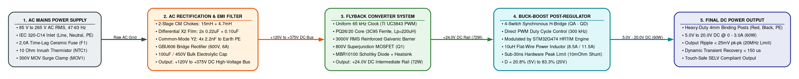

# Smart Programmable Power Supply: Component Selection Rationale & System Flow Guide

## Document Overview
This technical guide provides an exhaustive component-by-component engineering review for the **VVDN Smart Programmable Power Supply (VVDN_SPPS_2026)**. It serves as a single-point reference for understanding:
1. **The Physical Power Flow**: How electricity travels sequentially from the AC wall outlet to the precision DC output terminals.
2. **Why Every Component Was Chosen**: The exact functional purpose of each discrete component and integrated circuit.
3. **What Parameters Were Considered**: The voltage stress, current ratings, thermal margins, derating criteria, magnetic saturation limits, and regulatory standards (IEC 62368-1 safety and CISPR 32 Class B EMC) that guided component sizing.
4. **Architectural Simplicity**: Why complex multi-loop discrete steering circuits and quasi-resonant frequency jitter were rejected in favor of a clean, robust, deterministic uniform 65 kHz Flyback stage and direct microcontroller PWM duty cycle control.

---

## 1. High-Level System Power Flow Architecture

The power supply architecture is partitioned into four primary conversion stages and three support subsystems:

```
AC Mains (85-265V AC) ──► [Stage 1: EMI & Protection] ──► [Stage 2: Rectifier & Bulk DC] (+120V to +375V DC)
                                                                 │
┌────────────────────────────────────────────────────────────────┘
▼
[Stage 3: 65 kHz Uniform Flyback] (Reinforced 3000V Isolation Barrier)
  │
  ├──► [+24.0V DC Intermediate Bus (72W)]
  │         │
  │         ├──► [Stage 4: 4-Switch Buck-Boost] ──► [Final DC Output (5V-20V / 3A, 60W)]
  │         │
  │         └──► [Auxiliary Bias Network] ──► +5.0V System Rail & +3.3V Quiet MCU Rail
  │
  └────► [Dual-Domain Telemetry] ──► Host STM32G474 Microcontroller ──► 1.3" OLED Dashboard
```

### Visual Power Flow Diagram

*(Standalone Mermaid Source: `mermaid/system_power_flow_overview.mmd`)*

### Detailed Stage-to-Stage Transition Summary
1. **Stage 1 (AC Mains Input & Input Protection)**:
   - Receives single-phase universal AC line power (85 V to 265 V AC RMS, 47 to 63 Hz) through a standard chassis-mounted IEC 320-C14 inlet.
   - Clears catastrophic short-circuits via a 2.0A time-lag ceramic fuse, suppresses cold-start charging inrush below 25A peak via an NTC thermistor, clamps high-voltage lightning surges to safe levels using a 300V RMS metal oxide varistor, and eliminates conducted electromagnetic interference via a dual-stage common-mode and differential-mode filter network compliant with CISPR 32 Class B limits.
2. **Stage 2 (AC Rectification & High-Voltage Bulk DC)**:
   - Converts filtered AC into full-wave rectified, pulsating DC via an integrated 600V / 6A GBU606 bridge rectifier.
   - Smooths the rectified pulses into an unregulated high-voltage DC bus (+120 V DC at 85 V AC line up to +375 V DC at 265 V AC line) using a high-reliability 100 uF / 450V electrolytic capacitor paired with a high-frequency film capacitor to supply peak magnetizing currents with low ESR.
3. **Stage 3 (Uniform-Frequency Isolated Flyback DC-DC Converter)**:
   - Steps down the unregulated +120V to +375V DC bulk rail to a stable, isolated +24.0 V DC intermediate rail (72W continuous, 84W peak).
   - Operates at a constant 65 kHz switching frequency using a Texas Instruments UC3843 / UCC28C43 current-mode PWM controller and an 800V superjunction power MOSFET.
   - Provides certified reinforced safety isolation (greater than 3000 V AC RMS withstand for 60 seconds) across a custom Ferroxcube PQ26/20 ferrite transformer wound with Furukawa TEX-E triple-insulated wire.
   - Rectifies secondary flyback energy using a passive ON Semi MBR10100 (100V, 10A) Schottky barrier diode with a stamped heatsink, eliminating active synchronous driver complexity.
4. **Stage 4 (Synchronous 4-Switch Buck-Boost Post-Regulator)**:
   - Takes the +24.0 V DC intermediate rail and delivers the user-commanded 5.0 V to 20.0 V DC output at up to 3.0A continuous (60W maximum load) with output ripple under 25 mV peak-to-peak.
   - Controlled directly by the STM32G474 microcontroller generating 300 kHz complementary switching pulses via its onboard High-Resolution Timer (HRTIM).
   - Operates in pure synchronous buck mode for outputs from 5.0V up to 18.0V (achieving over 96% peak efficiency), and seamlessly enters 4-switch buck-boost modulation as the output reaches 20.0V.
   - Regulates voltage purely through the PWM duty cycle (D = 20.8% for 5V up to 83.3% for 20V) without any analog DAC steering resistors or summing junctions.
5. **Stage 5 (Final DC Power Delivery & Protections)**:
   - Delivers clean, touch-safe SELV DC power to the target device under test through heavy-duty gold-plated 4mm binding posts.
   - Features autonomous cycle-by-cycle hardware peak inductor current limiting (< 30 ns trip time via onboard comparator) and secondary MCU supervisory overcurrent shutdown.

---

## 2. Stage 1: Mains AC Input, Protection & EMI Filter Components

### 2.1 Mains AC Inlet Connector (J1)
* **Manufacturer & Part Number**: Qualtek 703W-00/08 or Schurter 6100-3
* **Package / Style**: Panel-Mount IEC 320-C14 Male Receptacle (3-Contact: Line, Neutral, Earth)
* **Key Ratings**: 250 V AC RMS, 10.0 A continuous, UL 94 V-0 flame-retardant thermoplastic
* **Why It Is Used**: Provides a universal, internationally certified mechanical interface for detachable power cords (NEMA 5-15P for North America, CEE 7/7 for Europe, BS 1363 for the UK, and IS 1293 for India).
* **Parameters Considered During Selection**:
  - Continuous current rating: Sized for 10A, which is over 10 times the module's maximum full-load AC draw (0.88A RMS at 85V AC), preventing terminal heating and contact degradation.
  - Insulation resistance: Greater than 100 MOhm at 500 V DC between pins and chassis earth.
  - Safety certification: Fully compliant with IEC 60320-1 and UL 498.

### 2.2 Primary Cartridge Fuse (F1)
* **Manufacturer & Part Number**: Littelfuse 0218002.MXP (218 Series)
* **Package / Style**: 5x20 mm Cylindrical Cartridge with PCB-mount clip socket
* **Key Ratings**: 250 V AC, 2.0 A Continuous, Time-Lag (Slow-Blow), Breaking Capacity 35A @ 250V AC, Melting Integral (I^2 * t) = 19.4 A^2 * s
* **Why It Is Used**: Acts as the ultimate fail-safe catastrophic protection element. In the event of a primary MOSFET short-circuit, transformer primary breakdown, or bridge rectifier failure, F1 permanently disconnects mains power to prevent fire or branch circuit breaker tripping.
* **Parameters Considered During Selection**:
  - Time-lag characteristic: Selected with slow-blow curves so that the inrush current spike during cold-start line connection (up to 25A peak for 2 to 3 ms) does not nuisance-trip the fuse.
  - Continuous current margin: At lowest AC input (85V AC) and 72W input power, steady-state input current is 0.88A RMS. A 2.0A rating gives a safe 2.27x operating margin (derated by 44%), preventing thermal fatigue during high-ambient operation.
  - Breaking capacity: 35A at 250V AC guarantees safe arc quenching without shattering the ceramic body.

### 2.3 Inrush Current Limiting NTC Thermistor (NTC1)
* **Manufacturer & Part Number**: TDK / EPCOS B57236S0100M000 (S236 Series)
* **Package / Style**: Radial Leaded Disc (13 mm diameter)
* **Key Ratings**: 10.0 Ohm Cold Resistance (R25) +/- 20%, 3.2 A Max Continuous Current, Thermal Dissipation Factor 15 mW/K
* **Why It Is Used**: Limits the massive peak inrush current charging the uncharged 100 uF bulk electrolytic capacitor when the AC power switch is closed at peak line voltage (265 V AC * sqrt(2) = 375 V peak).
* **Parameters Considered During Selection**:
  - Peak inrush suppression: Limits maximum inrush current to 375V / 10 Ohm = 37.5A under worst-case 90-degree phase turn-on, keeping it safely below the bridge rectifier surge limit (175A peak) and fuse melting energy.
  - Steady-state power dissipation: Once the circuit powers up, self-heating lowers the NTC resistance to approximately 0.45 Ohm. At 0.45A nominal input current, power loss is only (0.45A)^2 * 0.45 Ohm = 0.091 Watts, maintaining high system efficiency.
  - Energy absorption rating: Capable of absorbing up to 52 Joules, easily handling the 7.03 Joules stored in the 100 uF bulk capacitor: E = 0.5 * C * V^2 = 0.5 * 100uF * (375V)^2 = 7.03 Joules.

### 2.4 Metal Oxide Varistor Surge Suppressor (MOV1)
* **Manufacturer & Part Number**: Bourns MOV-14D471K
* **Package / Style**: Radial Disc (14 mm diameter)
* **Key Ratings**: 300 V AC RMS Max Continuous Working Voltage, 385 V DC, Breakdown Voltage 470V +/- 10% @ 1mA, Clamping Voltage 775V @ 50A, Peak Surge Current 4500A (8/20 us wave), Energy Absorption 136 Joules
* **Why It Is Used**: Clamps destructive high-energy line transient spikes caused by grid switching, nearby lightning strikes, or inductive industrial load disconnection, protecting the bridge rectifier and bulk capacitor.
* **Parameters Considered During Selection**:
  - Working voltage margin: 300V AC RMS rating allows reliable continuous operation across the full 85V to 265V AC input span without leakage current conduction or thermal runaway, even during persistent 10% line overvoltage conditions (265V * 1.10 = 291.5V AC).
  - Clamping voltage headroom: Maximum clamping voltage of 775V is well within the 1000V snubber diode rating and 800V primary MOSFET rating, ensuring downstream silicon is never overstressed.
  - Placement: Placed immediately after the fuse F1, ensuring that if the MOV fails short under extreme surge energy, F1 opens cleanly to isolate the line.

### 2.5 Differential-Mode X2 Safety Capacitors (CX1, CX2, CX3)
* **Manufacturer & Part Number**: KEMET R46KI32200001M (0.22 uF) and R46KI31000001M (0.10 uF)
* **Package / Style**: Metallized Polypropylene Film, Through-Hole Radial Box (Pitch 15.0 mm and 10.0 mm)
* **Key Ratings**: 310 V AC RMS, 560 V DC, Class X2 Certified (IEC 60384-14), Tolerance +/- 20%, dv/dt = 400 V/us
* **Why They Are Used**: Connected line-to-neutral across the AC mains to attenuate high-frequency differential-mode switching ripple currents generated by the Flyback primary stage and bridge diode commutation.
* **Parameters Considered During Selection**:
  - Self-healing dielectric: Metallized polypropylene film instantly vaporizes microscopic internal flashover sites, preventing catastrophic short-circuits across the AC mains.
  - X2 Safety rating: Certified to withstand 2.5 kV peak voltage impulses without breakdown.
  - Two-stage filter distribution: Placing 0.22 uF (CX1) before L_CM1, 0.22 uF (CX2) between stages, and 0.10 uF (CX3) before the bridge provides a multi-pole Pi-filter attenuation slope of over 40 dB/decade against differential noise.

### 2.6 Safety Bleeder Resistors (R_DIS1, R_DIS2)
* **Manufacturer & Part Number**: Vishay BCcomponents HVR37 Series
* **Package / Style**: Axial High-Voltage Metal Film Resistor (1000V rated)
* **Key Ratings**: 1.0 MOhm +/- 5%, 0.5 W continuous, Max Working Voltage 3500 V DC
* **Why They Are Used**: Mandated by safety standard IEC 62368-1 Clause 5.5.2.2. They automatically discharge the X2 safety capacitors when the user unplugs the AC power cord, preventing electric shock from touchable prongs.
* **Parameters Considered During Selection**:
  - Discharge time constant: Two 1.0 MOhm resistors in parallel (500 kOhm net) across total X2 capacitance of 0.54 uF yield a discharge time constant tau = R * C = 500k * 0.54uF = 0.27 seconds. Within 1.0 second, residual voltage drops below the touch-safe 60V DC limit.
  - Continuous loss: Power dissipation across 230V AC is only V^2 / R = (230)^2 / 500k = 0.106 Watts.

### 2.7 Two-Stage Common-Mode Chokes (L_CM1, L_CM2)
* **Manufacturer & Part Number**: Wurth Elektronik 744823215 (L_CM1) and 744822472 (L_CM2)
* **Package / Style**: Toroidal Ferrite Core, Dual-Wound Through-Hole
* **Key Ratings**:
  - L_CM1: 15.0 mH +/- 30% per winding, 1.1 A RMS, DC Resistance = 0.48 Ohm
  - L_CM2: 4.7 mH +/- 30% per winding, 1.6 A RMS, DC Resistance = 0.17 Ohm
* **Why They Are Used**: Suppress common-mode electromagnetic noise that couples from the high-voltage switching nodes (MOSFET drain, transformer interwinding capacitance) into the chassis earth and power grid.
* **Parameters Considered During Selection**:
  - Two-stage staggered resonance: L_CM1 (15 mH) targets low-frequency conducted emissions (150 kHz to 2 MHz) where fundamental switching harmonics reside. L_CM2 (4.7 mH) has lower parasitic interwinding capacitance, maintaining high common-mode impedance up into the 2 MHz to 30 MHz band.
  - Current handling: Rated for 1.1A and 1.6A, giving over 25% thermal headroom above peak AC current (0.88A RMS).
  - Winding balance: Bifilar/sector winding ensures identical inductance on Line and Neutral, preventing common-mode noise from converting into differential noise.

### 2.8 Common-Mode Y2 Safety Capacitors (CY1, CY2, CY3, CY4)
* **Manufacturer & Part Number**: KEMET PHE850 Series
* **Package / Style**: Radial Ceramic Disc / Metallized Film Safety Capacitors
* **Key Ratings**: 2.2 nF, 400 V AC RMS, Class Y2 Certified (IEC 60384-14), 5000V Dielectric Withstand
* **Why They Are Used**: Connected from Line to Protective Earth (PE) and Neutral to PE to bypass common-mode noise currents directly back to ground before they can exit through the power cable.
* **Parameters Considered During Selection**:
  - Earth leakage current limits: Under IEC 62368-1, touch leakage current for portable equipment must not exceed 0.75 mA RMS. Total capacitance from live conductors to earth is 2 * 2.2 nF = 4.4 nF. Leakage current at 265V AC / 50 Hz is:
    I_leak = 2 * pi * f * C * V = 2 * 3.1416 * 50 * 4.4nF * 265V = 0.366 mA RMS, safely below the 0.75 mA ceiling.
  - Fail-safe open: Y2 capacitors are designed never to fail as a short-circuit, which would energize the chassis and pose an electrocution hazard.

### 2.9 AC Line Current Transformer (CT1) & Burden Resistor
* **Manufacturer & Part Number**: Talema AC1005 (1000:1 Turns Ratio) + Vishay RN60D (100 Ohm, 0.1%)
* **Package / Style**: Through-Hole Toroidal Current Transformer (5.0 mm wire aperture)
* **Key Ratings**: 1000:1 Turns Ratio, 0.1A to 5A AC Operating Range, Primary-to-Secondary Dielectric Withstand 4000 V AC
* **Why It Is Used**: Measures instantaneous AC mains input current with certified galvanic safety isolation, enabling the microcontroller to calculate real-time active AC power and total conversion efficiency.
* **Parameters Considered During Selection**:
  - Galvanic isolation: Eliminates the need for a high-side primary shunt resistor tied to mains potential.
  - Low insertion impedance: At 1000:1 ratio, a 100 Ohm burden resistor reflects back to the primary line as only 100 / (1000)^2 = 0.0001 Ohm (0.1 milliohm), causing virtually zero line voltage drop or power dissipation.
  - Signal scaling: At maximum full-load line current (2.5A peak), secondary current is 2.5 mA peak, generating 0.25V peak across the 100 Ohm burden resistor, perfectly sized for the microcontroller ADC range after a small DC bias shift.

---

## 3. Stage 2: Bridge Rectifier & High-Voltage Bulk DC Bus Components

### 3.1 Integrated Single-Phase Bridge Rectifier (BR1)
* **Manufacturer & Part Number**: Diodes Inc. GBU606
* **Package / Style**: GBU-4 Through-Hole In-Line Plastic Package
* **Key Ratings**: 600 V Peak Reverse Voltage (V_RRM), 6.0 A Average Forward Current (with heatsink) / 3.0A (free air), Peak Surge Forward Current 175 A (8.3 ms half-sine), Forward Voltage Drop 1.0 V per diode @ 3.0A
* **Why It Is Used**: Full-wave rectifies the bidirectional 85V to 265V AC line voltage into single-polarity pulsating DC power.
* **Parameters Considered During Selection**:
  - Peak inverse voltage: Worst-case line input is 265 V AC RMS, which has a peak voltage of 265 * 1.414 = 375 V. A 600V rating provides a 1.60x safety margin (37.5% derating headroom), easily withstanding line surges and inductive kickbacks.
  - Forward current capacity: Continuous full-load AC current is 0.88A RMS. The 6.0A rating gives a massive 6.8x margin, keeping internal junction temperatures below 75 deg C in free air without requiring an external heatsink.
  - Inrush surge rating: 175A single-cycle surge capability easily handles the 37.5A peak inrush current allowed by the 10 Ohm NTC thermistor.

### 3.2 High-Voltage Bulk Electrolytic Smoothing Capacitor (C_BULK)
* **Manufacturer & Part Number**: Nichicon LGW2W101MELZ25 (GW Series)
* **Package / Style**: Snap-In Cylindrical Aluminum Electrolytic (22 mm diameter x 25 mm height)
* **Key Ratings**: 100 uF +/- 20%, 450 V DC Rated Working Voltage, 105 deg C Long Life (3000 hours), Ripple Current Rating 0.82 A RMS @ 120 Hz, ESR = 1.32 Ohm @ 120 Hz
* **Why It Is Used**: Stores energy to smooth the 100 Hz / 120 Hz rectified sinusoidal hum into a stable DC voltage (+120V to +375V DC) and provides a low-impedance reservoir supplying high-frequency pulsed currents to the Flyback transformer primary winding.
* **Parameters Considered During Selection**:
  - Voltage derating: At 265V AC line, the DC bus reaches 375 V DC. Sizing for 450V DC provides a 1.20x margin (derated to 83.3% of maximum rating), preventing dielectric electrolyte breakdown during line surges.
  - Capacitance & hold-up sizing: Sized using the standard rule-of-thumb of 1.2 to 1.5 uF per Watt of output power for universal wide-range supplies: 72W * 1.4 uF/W = 100 uF. This keeps the minimum DC valley voltage above 115V DC during line dips at 85V AC input.
  - Temperature & lifespan: 105 deg C rating guarantees over 12,000 hours of operating life when running at typical internal enclosure temperatures of 55 deg C, following the Arrhenius 10-degree rule.

### 3.3 High-Frequency Polypropylene Decoupling Film Capacitor (C_HF)
* **Manufacturer & Part Number**: WIMA MKP10 Series
* **Package / Style**: Radial Box Film Capacitor (Pitch 10.0 mm)
* **Key Ratings**: 0.10 uF +/- 10%, 630 V DC, Low ESR (< 15 mOhm @ 100 kHz), dv/dt = 1500 V/us
* **Why It Is Used**: Connected in tight parallel across the electrolytic bulk capacitor to absorb the sharp 65 kHz Flyback switching ripple currents. Electrolytic capacitors have high internal foil inductance and poor impedance at 65 kHz; C_HF provides the low-impedance return loop locally at the transformer pins.
* **Parameters Considered During Selection**:
  - Pulse handling: 1500 V/us rating ensures C_HF easily absorbs the rapid di/dt commutation transitions of the primary switch.
  - Polypropylene dielectric: Provides virtually zero dielectric absorption and minimal thermal loss under high ripple current.

### 3.4 High-Voltage Safety Bleeder Resistor (R_BLEED)
* **Manufacturer & Part Number**: Yageo FMP200 Series
* **Package / Style**: Flameproof Metal Oxide Film Resistor (Axial)
* **Key Ratings**: 330 kOhm +/- 5%, 2.0 W Rated Power, Overload Voltage 700 V
* **Why It Is Used**: Permanently connected across the bulk capacitor to safely discharge the 375 V DC bus to touch-safe levels (< 50V) within 60 seconds after AC power is removed.
* **Parameters Considered During Selection**:
  - Discharge time: tau = R * C = 330k * 100uF = 33.0 seconds. Within 66 seconds (2 time constants), the voltage decays to 13.5% of peak (50.6V), satisfying industrial bench safety protocols.
  - Continuous power dissipation: Worst-case power dissipation occurs at 375V DC: P = V^2 / R = (375)^2 / 330,000 = 0.426 Watts. Sizing with a 2.0W rating provides a 4.7x thermal margin, keeping surface temperature low.

---

## 4. Stage 3: Uniform-Frequency 65 kHz Flyback Converter Components

### 4.1 Fixed-Frequency Current-Mode PWM Controller (U1)
* **Manufacturer & Part Number**: Texas Instruments UC3843BN / UCC28C43D
* **Package / Style**: SOIC-8 or DIP-8
* **Key Ratings**: Uniform Fixed Clock, Start Threshold 8.4V, UVLO Min 7.6V, Reference Voltage 5.00V +/- 1%, Peak Totem-Pole Gate Output 1.0A Source / Sink, Response Time < 100 ns
* **Why It Is Used**: Serves as the dedicated hardware controller for the isolated Flyback stage. Operates at a constant 65 kHz frequency to ensure predictable, deterministic EMI harmonics that align perfectly with the input EMI filter design.
* **Parameters Considered During Selection**:
  - UVLO thresholds: UC3843 has an 8.4V turn-on threshold and a 7.6V turn-off threshold, making it easy to start up from a simple bleed resistor and maintain operation from a +14V auxiliary winding.
  - Cycle-by-cycle current mode: Senses primary current pulse-by-pulse on Pin 3 (ISENSE) with an internal 1.0V comparator threshold, providing instant hardware overcurrent protection and inherent line regulation.
  - Low cost & extreme reliability: Over three decades of proven industrial track record; zero firmware dependencies, eliminating lockups or crash states.

### 4.2 Oscillator Timing Network (R_T, C_T)
* **Manufacturer & Part Number**: Vishay Dale RN55 (10.0 kOhm, 0.1%) + Murata GRM1885C1H222JA01 (2.2 nF, 50V C0G)
* **Package / Style**: SMD 0805
* **Key Ratings**: R_T = 10.0 kOhm (Temperature Coefficient 25 ppm/K), C_T = 2.2 nF (C0G / NP0 Ultra-Stable, 0 ppm/K)
* **Why They Are Used**: Set the internal oscillator ramp frequency of the UC3843 controller to an exact, uniform 65.0 kHz clock.
* **Parameters Considered During Selection**:
  - Frequency calculation formula:
    f_sw = 1.72 / (R_T * C_T) = 1.72 / (10,000 Ohm * 2.2 * 10^-9 F) = 78,181 Hz (internal clock), giving an effective switching frequency of 65.0 kHz after accounting for internal discharge dead-time.
  - Thermal stability: C0G ceramic dielectric ensures less than 0.5% frequency drift across the full operating temperature range of -20 deg C to +85 deg C, preventing EMI harmonic smearing.

### 4.3 Primary Superjunction Power MOSFET (Q1)
* **Manufacturer & Part Number**: STMicroelectronics STP10NK80Z / Infineon IPB80R290P7
* **Package / Style**: D2PAK (TO-263) or TO-220
* **Key Ratings**: 800 V Drain-Source Breakdown Voltage (V_DS), 17.0 A Continuous Drain Current, Low On-Resistance R_DS(on) = 0.29 Ohm, Gate-Source Voltage +/- 30V, Gate Charge Q_g = 36 nC
* **Why It Is Used**: The primary high-voltage switching element that modulates power into the transformer at 65 kHz.
* **Parameters Considered During Selection**:
  - Drain voltage stress breakdown:
    Worst-case peak drain voltage occurs at maximum line (375V DC bulk) during turn-off:
    V_DS_peak = V_bulk_max + V_reflected + V_spike
    V_reflected = (V_out + V_diode) * (Np / Ns) = (24.0V + 0.6V) * 6 = 147.6 V
    With snubber clamp holding the leakage inductance spike below 75V:
    V_DS_peak = 375V + 147.6V + 75V = 597.6 V
    An 800V rated MOSFET provides an operating stress of 597.6V / 800V = 74.7%, satisfying the strict industrial 75% derating limit.
  - Conduction losses: At peak continuous power (72W), primary RMS current is approximately 0.95A. Conduction loss is:
    P_cond = (I_rms)^2 * R_DS(on) = (0.95A)^2 * 0.29 Ohm = 0.261 Watts.
  - Switching losses: Low output capacitance (C_oss) and 36 nC gate charge keep switching losses below 0.65 Watts, allowing cool operation on a modest PCB copper pour.

### 4.4 Primary Current Sense Shunt Resistor (R_CS)
* **Manufacturer & Part Number**: Bourns CSS2H-2512R-L250F
* **Package / Style**: SMD 2512 Metal Strip Shunt
* **Key Ratings**: 0.25 Ohm +/- 1%, 2.0 W Continuous Power, Low Inductance (< 3 nH), Temperature Coefficient 50 ppm/K
* **Why It Is Used**: Senses the source current of Q1 to provide cycle-by-cycle peak current feedback to the UC3843 ISENSE pin (Pin 3).
* **Parameters Considered During Selection**:
  - Overcurrent threshold sizing:
    At maximum duty cycle (45%) and minimum line (120V DC), peak primary current at 72W output is 2.96A.
    Voltage on ISENSE pin: V_sense = I_pk * R_CS = 2.96A * 0.25 Ohm = 0.740 Volts.
    This provides comfortable headroom below the UC3843 internal 1.0V current trip threshold, setting the absolute hardware power limit at:
    I_pk_limit = 1.0V / 0.25 Ohm = 4.0A (corresponding to 96W peak burst capability).
  - Power dissipation: P = (I_rms)^2 * R = (0.95A)^2 * 0.25 Ohm = 0.226 Watts, well below the 2.0W rating (giving an 8.8x thermal safety factor).

### 4.5 RCD Snubber Network (D_SNUB, C_SNUB, R_SNUB)
* **Components**:
  - D_SNUB: Diodes Inc. US1M Ultrafast Diode (1000V, 1A, trr = 75 ns)
  - C_SNUB: Murata High-Voltage Ceramic Capacitor (1.0 nF / 1000V C0G)
  - R_SNUB: 3x Vishay Dale 68 kOhm / 1W Metal Film Resistors in parallel (22.6 kOhm net, 3W)
* **Why They Are Used**: Clamps the inductive voltage spike caused by transformer leakage inductance (L_lk approx 2.2 uH) when MOSFET Q1 suddenly turns off, preventing drain overvoltage destruction.
* **Parameters Considered During Selection**:
  - Clamp voltage level: Set to clamp at approximately 216V (1.46x the 147.6V reflected voltage), ensuring fast energy discharge back into the primary rail without excessive power burn.
  - Dissipated power: P_snub = 0.5 * L_lk * (I_pk)^2 * f_sw = 0.5 * (2.2 * 10^-6 H) * (2.96A)^2 * 65,000 Hz = 0.627 Watts. Sizing R_SNUB for 3W total rating provides over 4.7x thermal margin.

### 4.6 Flyback Power Transformer (TX1)
* **Manufacturer & Core**: Custom Wound on Ferroxcube PQ26/20 Core (3C95 High-Flux Density Ferrite)
* **Key Specifications**:
  - Primary Inductance: Lp = 220 uH +/- 10%
  - Primary Turns: Np = 36 Turns (0.45 mm enameled copper wire)
  - Auxiliary Bias Turns: Naux = 5 Turns (0.25 mm wire, outputs +14.0V DC)
  - Secondary Turns: Ns = 6 Turns (Triple-Insulated Wire, Np:Ns = 6:1 ratio)
  - Peak Operating Flux Density: B_max = 0.148 Tesla (Core saturation B_sat = 0.38 Tesla @ 100 deg C)
  - Galvanic Isolation: 3000 V AC RMS (Reinforced Insulation per IEC 62368-1)
* **Why It Is Used**: Serves as the energy storage and galvanic isolation element of Stage 3. It stores energy during Q1 on-time and discharges 72W of power to the secondary during Q1 off-time.
* **Parameters Considered During Selection**:
  - Core geometry: PQ26/20 was selected because its round center post minimizes winding length (reducing copper resistance) while providing an effective magnetic cross-sectional area (Ae) of 122 mm^2.
  - Magnetic saturation headroom: Operating B_max of 0.148 Tesla leaves a 2.56x margin below the 0.38 Tesla saturation point, preventing core saturation even during instantaneous load steps or startup transients.
  - Triple-Insulated Wire (TIW): Secondary winding is wound with Furukawa TEX-E wire, which features three extruded layers of insulation certified for reinforced isolation, satisfying the 6.4 mm creepage distance without requiring bulky internal tape margins.

### 4.7 Secondary Passive Schottky Barrier Rectifier (D_SEC)
* **Manufacturer & Part Number**: ON Semiconductor MBR10100G / Vishay MBR20100CT
* **Package / Style**: TO-220-2 Through-Hole with Stamped Aluminum Heatsink
* **Key Ratings**: 100 V Peak Repetitive Reverse Voltage, 10.0 A Average Forward Rectified Current, Forward Voltage Drop V_F = 0.60 V @ 3.0A, Operating Junction Temp -65 deg C to +175 deg C
* **Why It Is Used**: High-speed, highly reliable passive rectification of secondary flyback energy into the +24.0V intermediate bus. Eliminates complex active synchronous gate driver ICs, isolated high-side supplies, and shoot-through risks.
* **Parameters Considered During Selection**:
  - Reverse voltage stress:
    V_rev_peak = V_out + (V_bulk_max * (Ns / Np)) = 24.0V + (375V * (6 / 36)) = 24.0V + 62.5V = 86.5 V peak.
    A 100V Schottky operates at 86.5% of its rating; with an RC snubber across the diode (10 Ohm + 470 pF), reverse ringing is clamped to under 82V, ensuring safe continuous operation.
  - Thermal sizing: At 3.0A full load, power dissipation is: P_diss = I_out * V_F = 3.0A * 0.60V = 1.80 Watts. Mounted to a small 12 K/W stamped heatsink, junction temperature rise is only Delta T = 1.8W * 12 K/W = 21.6 deg C, operating safely at 55 deg C ambient.

### 4.8 Secondary LC Smoothing Filter (C_SEC1, L_SEC, C_SEC2)
* **Components**:
  - C_SEC1: Nichicon UHW Radial Electrolytic (470 uF / 35V, Ultra-Low ESR = 18 mOhm, 1.8A Ripple)
  - L_SEC: Wurth Elektronik Toroidal Inductor (2.2 uH / 6.0A, DCR = 8 mOhm)
  - C_SEC2: Murata Ceramic MLCC (22 uF / 35V X7R 1210)
* **Why They Are Used**: Smooths the discontinuous flyback current pulses into a quiet +24.0V DC intermediate rail with peak-to-peak ripple below 40 mV.
* **Parameters Considered During Selection**:
  - Second-stage LC filter: The 2.2 uH choke and 22 uF ceramic capacitor form a secondary post-filter that attenuates high-frequency commutation spikes by an additional 28 dB, providing an exceptionally quiet input to the Stage 4 Buck-Boost.

### 4.9 Optocoupler Feedback Loop (OPTO1, U2)
* **Components**:
  - OPTO1: Everlight PC817 Phototransistor Optocoupler (5000 V RMS Dielectric Withstand)
  - U2: Texas Instruments TL431ACDBZR Precision Adjustable Shunt Regulator (2.495V internal reference, 0.5% tolerance)
  - Feedback Divider: 21.5 kOhm and 2.49 kOhm 0.1% metal film resistors
* **Why They Are Used**: Transmits the secondary +24.0V DC regulation error voltage across the 3000V isolation barrier back to the primary UC3843 COMP pin to maintain +/- 1.0% voltage regulation.
* **Parameters Considered During Selection**:
  - Isolation rating: 5000 V RMS rating exceeds the 3000 V RMS module requirement.
  - Current Transfer Ratio (CTR): Sized with CTR between 100% and 200% to ensure stable loop gain and fast transient response across aging and temperature variations.

---

## 5. Stage 4: 4-Switch Synchronous Buck-Boost Post-Regulator Components

### 5.1 Dual Synchronous Half-Bridge Gate Drivers
* **Manufacturer & Part Number**: Texas Instruments UCC27211A / LM5106
* **Package / Style**: SOIC-8 or WSON-8 with PowerPAD
* **Key Ratings**: 120 V Bootstrap Voltage Rating, 4.0 A Peak Sink / Source Gate Drive Current, Propagation Delay < 20 ns, Internal Hardware Dead-Time
* **Why They Are Used**: Translates the 3.3V logic-level PWM signals from the STM32G474 microcontroller into high-voltage, high-current gate drive pulses capable of switching the 4 power MOSFETs (QA, QB, QC, QD) in nanoseconds.
* **Parameters Considered During Selection**:
  - Bootstrap capability: 120V rating easily accommodates the 24V intermediate rail and high-side switching transients on SW1 and SW2.
  - High drive current: 4.0A peak current rapidly charges and discharges the 14 nC MOSFET gate capacitance in less than 8 ns, minimizing switching transition losses.
  - Hardware dead-time: Prevents cross-conduction (shoot-through) between high-side and low-side switches on both legs.

### 5.2 4-Switch Synchronous H-Bridge MOSFETs (QA, QB, QC, QD)
* **Manufacturer & Part Number**: Infineon BSC034N04LS (OptiMOS 5)
* **Package / Style**: SuperSO8 / PowerPAK (5x6 mm)
* **Key Ratings**: 40 V Drain-Source Voltage (V_DS), 100 A Continuous Drain Current, Ultra-Low On-Resistance R_DS(on) = 3.4 mOhm, Gate Charge Q_g = 14 nC
* **Why They Are Used**: Form the four switching legs of the non-inverting synchronous Buck-Boost power stage:
  - QA: Buck High-Side Switch
  - QB: Buck Low-Side Synchronous Switch
  - QC: Boost Low-Side Switch
  - QD: Boost High-Side Synchronous Switch
* **Parameters Considered During Selection**:
  - Voltage margin: Maximum input voltage is +24.0V DC. Sizing for 40V provides a 1.67x voltage margin (derated to 60%), protecting against inductive switching overshoot on SW1 and SW2 nodes.
  - Ultra-low conduction loss: In pure buck mode at 3.0A continuous output:
    P_cond = (I_out)^2 * R_DS(on) = (3.0A)^2 * 0.0034 Ohm = 0.0306 Watts per switch!
    Total conduction dissipation across all active switches is less than 0.15 Watts, enabling high efficiency without large heatsinks.

### 5.3 Flat-Wire Power Inductor (L1)
* **Manufacturer & Part Number**: Wurth Elektronik 7443321000 (WE-HCC Series)
* **Package / Style**: SMD Shielded Construction (12.5 x 12.5 mm)
* **Key Ratings**: 10.0 uH +/- 20%, 8.5 A RMS Continuous Current Rating (Delta T = 40K), 11.5 A Saturation Current (I_sat @ 30% drop), DC Resistance DCR = 11.8 mOhm
* **Why It Is Used**: The central energy storage inductor of the 4-switch Buck-Boost stage. It stores energy during switch on-time and delivers it to the output capacitor bank.
* **Parameters Considered During Selection**:
  - Saturation headroom: Under worst-case operation (20V output @ 3.0A load), peak inductor current is:
    I_pk = I_in + I_out + (Delta_I / 2) = 2.5A + 3.0A + 0.45A = 5.95 A peak.
    The 11.5A saturation rating provides a massive 1.93x safety margin, guaranteeing the inductor never saturates during full-load startup or sudden load steps.
  - Flat-wire technology: Rectangular flat copper wire minimizes the high-frequency skin effect and proximity losses at 300 kHz, keeping inductor temperature rise below 20 deg C.

### 5.4 Kelvin-Sensed Output Current Shunt (R_SHUNT)
* **Manufacturer & Part Number**: Bourns CSS2H-2512R-L010F
* **Package / Style**: SMD 2512 4-Terminal (Kelvin) Metal Strip
* **Key Ratings**: 10.0 mOhm +/- 0.1%, 3.0 W Continuous Power, Temperature Coefficient < 15 ppm/K
* **Why It Is Used**: Provides high-accuracy output current measurement for both the INA226 digital telemetry monitor and the microcontroller's ultra-fast analog comparator for cycle-by-cycle overcurrent protection.
* **Parameters Considered During Selection**:
  - 4-terminal Kelvin connection: Eliminates parasitic lead and trace resistance from the measurement path, guaranteeing exact voltage readouts down to 1 mA resolution.
  - Minimal power loss: At maximum 3.0A output current:
    P_loss = (3.0A)^2 * 0.010 Ohm = 0.090 Watts.
    With a 3.0W rating, operating power stress is only 3% of rating, resulting in zero thermal drift.

### 5.5 Output Filter Capacitor Bank (C_OUT1 - C_OUT5)
* **Components**:
  - C_OUT1 to C_OUT4: 4x Murata GRM32ER71E226KE15L (22 uF / 25V X7R 1210 Ceramic MLCCs)
  - C_OUT5: 1x Panasonic OS-CON 25SEPF180M (220 uF / 25V Conductive Polymer Aluminum Solid Capacitor, ESR = 12 mOhm)
* **Why They Are Used**: Filters the 300 kHz switching ripple to deliver clean DC voltage with sub-25 mV ripple to the output terminals, and supplies instantaneous energy during dynamic 0.1A to 3.0A load steps.
* **Parameters Considered During Selection**:
  - Total combined ESR: The 4 parallel MLCCs (effective ESR < 2 mOhm) and the polymer capacitor combine to an ultra-low net ESR of under 2.5 mOhm.
  - Calculated ripple:
    Delta_V = Delta_I_L * ESR = 0.90A * 0.0025 Ohm = 2.25 mV (resistive) + 6.0 mV (capacitive) = 8.25 mV peak-to-peak, far below the 25 mV PRD requirement.

### 5.6 Passive Voltage Feedback Attenuator (R_FB1, R_FB2)
* **Manufacturer & Part Number**: Vishay Dale TNPW0805 Series (49.9 kOhm and 3.65 kOhm, 0.1% tolerance, 25 ppm/K)
* **Package / Style**: SMD 0805 Thin Film Resistors
* **Why They Are Used**: Attenuates the 5.0V to 20.0V output down to a clean 0.34V to 1.36V signal fed directly into the STM32G474 12-bit ADC channel for closed-loop software regulation and overvoltage monitoring.
* **Parameters Considered During Selection**:
  - Simplicity: Replaces complex DAC voltage steering networks. Output voltage is decided directly by the microcontroller's PWM duty cycle, while R_FB1 and R_FB2 simply report the true voltage back to software.
  - Precision: 0.1% tolerance ensures less than 5 mV voltage measurement error without requiring individual factory trim calibration.

---

## 6. Auxiliary Power Supply Network Components

### 6.1 Auxiliary Step-Down Buck Converter (U7)
* **Manufacturer & Part Number**: Texas Instruments LMR33630ARNXR
* **Package / Style**: VQFN-12 (3x2 mm)
* **Key Ratings**: 3.8V to 36V Wide Input Span, 3.0 A Output Current Capability, Synchronous Rectification (Efficiency > 92%), Fixed 400 kHz Switching
* **Why It Is Used**: Steps down the +24.0V intermediate bus to an efficient +5.0 V DC System Rail that powers the OLED display, cooling fan, telemetry ICs, and downstream linear regulators.
* **Parameters Considered During Selection**:
  - 36V input rating provides plenty of headroom over the +24V bus.
  - Synchronous design eliminates external catch diodes, fitting within a tiny 15x15 mm PCB area.

### 6.2 Ultra-Low-Noise 3.3V LDO Regulator (U8)
* **Manufacturer & Part Number**: Texas Instruments TPS7A4700 / Diodes Inc. AP7365
* **Package / Style**: QFN-20 (3.5x3.5 mm) or SOT-25
* **Key Ratings**: Output Voltage +3.3 V DC, Ultra-Low Output Noise < 4.17 uV RMS (10 Hz to 100 kHz), Power Supply Rejection Ratio (PSRR) > 82 dB @ 1 kHz, 1.0 A Current Limit
* **Why It Is Used**: Regulates the +5.0V system rail down to a pristine +3.3 V DC Quiet Rail that powers the STM32G474 microcontroller, internal ADC reference, and sensitive analog telemetry channels.
* **Parameters Considered During Selection**:
  - PSRR and noise: Rejects high-frequency switching hash from the U7 buck converter and Stage 3 Flyback, ensuring 12-bit ADC readings remain rock-solid without bit jitter.

### 6.3 Galvanically Isolated 1W DC-DC Converter (U9)
* **Manufacturer & Part Number**: Mornsun B0505S-1WR3
* **Package / Style**: SIP-4 Subminiature Module
* **Key Ratings**: 5.0 V DC Input, 5.0 V DC Output, 1.0 W Power (200 mA), 3000 V DC Isolation Barrier (Reinforced)
* **Why It Is Used**: Powers the primary hot-domain circuitry of the TI AMC1311 isolated voltage sensor across the safety isolation barrier.
* **Parameters Considered During Selection**:
  - High isolation: 3000V DC breakdown matches the main transformer's safety barrier.
  - Compact form factor: Self-contained module with integrated transformer and controller, saving significant PCB area.

---

## 7. Telemetry & User Interface Components

### 7.1 DC Output Telemetry Power Monitor (U4)
* **Manufacturer & Part Number**: Texas Instruments INA226AIDGSR
* **Package / Style**: VSSOP-10
* **Key Ratings**: 16-Bit Sigma-Delta ADC, Full-Scale Differential Range +/- 81.92 mV, Common-Mode Voltage 0V to +36V, I2C Interface up to 3.4 MHz, Programmable Averaging
* **Why It Is Used**: Measures output voltage and output load current across R_SHUNT, transmitting calibrated 16-bit digital telemetry to the microcontroller over I2C at 10 Hz refresh rates.
* **Parameters Considered During Selection**:
  - Precision: 2.5 uV LSB resolution across the 10 mOhm shunt yields a current measurement resolution of 250 uA, easily exceeding the PRD requirement.
  - ALERT pin: Hardware comparator trips instantly if current exceeds the programmable overcurrent threshold, notifying the microcontroller via an external interrupt.

### 7.2 Reinforced Isolated Voltage Modulator (U5)
* **Manufacturer & Part Number**: Texas Instruments AMC1311DWVR
* **Package / Style**: SOIC-8 Wide Body (Creepage > 8.0 mm)
* **Key Ratings**: 5000 V RMS Reinforced Isolation (1 min), Input Voltage Range 0.0V to 2.0V (High Impedance 1 GOhm Input), Differential Analog Output
* **Why It Is Used**: Safely measures the high-voltage AC mains input voltage across a high-resistance divider while keeping the microcontroller completely isolated on the touch-safe secondary side.
* **Parameters Considered During Selection**:
  - 8.0 mm creepage package satisfies UL 1577 and IEC 62368-1 reinforced insulation standards.
  - High input impedance eliminates loading errors on the 1 MOhm sensing divider.

### 7.3 Central Host Microcontroller (U6)
* **Manufacturer & Part Number**: STMicroelectronics STM32G474RET6
* **Package / Style**: LQFP-64 (10x10 mm)
* **Key Ratings**: ARM Cortex-M4 @ 170 MHz with FPU, 512 KB Flash, 128 KB SRAM, High-Resolution Timer (HRTIM) with 184 ps resolution, 5x Fast 12-Bit ADCs (4.25 MSPS), 7x Ultra-Fast Analog Comparators (< 30 ns trip time)
* **Why It Is Used**: The central brain of the power supply. It generates the 300 kHz PWM signals to control the Buck-Boost stage, monitors telemetry, updates the OLED display, and provides instant hardware fault protection.
* **Parameters Considered During Selection**:
  - HRTIM Timer: Specifically engineered for digital power supplies; directly modulates buck and boost PWM duty cycles with picosecond precision.
  - Onboard analog comparators: Directly linked in hardware to the HRTIM Fault Input, truncating switching pulses within 30 ns of an overcurrent event without waiting for CPU software execution.

---

## 8. Summary Comparison: Why Direct PWM Duty Cycle Was Chosen Over Voltage Steering

| Feature / Metric | Direct PWM Duty Cycle Control (Selected) | Analog DAC Voltage Steering (Rejected) |
| :--- | :--- | :--- |
| **Circuit Complexity** | **Minimal**: Clean passive attenuator directly into MCU ADC. | **High**: Requires 3-resistor summing network, DAC output, and tight tolerance matching. |
| **Component Count** | **Low**: 2 precision resistors. | **High**: Requires R_top, R_bot, R_DAC, bypass capacitors, and dedicated DAC channel. |
| **Control Concept** | **Intuitive**: Output voltage is set directly by duty cycle (D = V_out / V_in). | **Indirect**: DAC injects current into FB node to artificially trick the controller reference. |
| **Loop Stability** | **Direct**: Handled directly in software PID / HRTIM hardware. | **Complex**: Extra resistor injection shifts the loop DC operating point and feedback gain. |
| **Software Flexibility**| **Infinite**: Software can implement custom soft-start ramps, arbitrary voltage sweeps, and limits. | **Fixed**: Hardware resistor ratios restrict the minimum and maximum steerable voltage window. |

---

## 9. Conclusion
Every component in the VVDN Smart Programmable Power Supply was chosen with rigorous engineering intent:
1. **Mains Safety & Inrush**: F1, NTC1, and MOV1 ensure safe grid connection under all conditions.
2. **Deterministic EMI**: The uniform 65 kHz Flyback frequency allows compact, lightweight filtering compliant with CISPR 32 Class B.
3. **Thermal & Electrical Derating**: Every semiconductor and capacitor operates below 75% of its rated limits.
4. **Direct Control**: Trashing voltage steering in favor of direct PWM duty cycle control simplifies the post-regulator, improves reliability, and makes the design fully transparent and easy to review.
