# Product Requirement Document (PRD)

---

### Project Information
* **Project Code**: `VVDN_SPPS_2026`
* **Project Name**: VVDN INDIA, SMART PROGRAMMABLE VOLTAGE SUPPLY MODULE (85–265 V AC In, 5–20 V / 3 A DC Out)
* **Domain**: Embedded Hardware & Power Electronics Engineering
* **Document Version**: `A1_001`
* **Date**: `16th Oct 2026`
* **Design Owner**: Power Electronics Engineer Trainee (GET - Hardware Engineering)
* **Technical Reviewer & Mentor**: Senior Hardware Architect & BU SME (Power Electronics)
* **Approved By**: BU Head (Embedded Hardware & Power Electronics)
* **Companion Document**: [HARDWARE_DESIGN_TECHNICAL_DETAILS_FOR_HDD.md](file:///home/tthhongs/build_tthongs/av_iv/smart_programmable_power_supply/HARDWARE_DESIGN_TECHNICAL_DETAILS_FOR_HDD.md) *(Detailed circuit derivations, magnetics sizing, component stress derating, and schematic design)*

---

### Revision History

| Date | Revision No. | Description | Prepared/Revised By | Reviewed By | Approved By |
| :--- | :---: | :--- | :--- | :--- | :--- |
| **16-Oct-2026** | **A1_001** | Production-Grade PRD Release: Integrated uniform-frequency isolated Flyback (UC3843 @ 65 kHz), MBR10100 Schottky passive rectification, full sequence tables, complete BOMs, 11 architectural block diagrams, and cross-mentor technical defense | Power Electronics Trainee (GET) | Senior Hardware Architect | BU SME (Power Electronics) |
| **15-Oct-2026** | **A1_000** | Initial restructuring into VVDN PRD standard template, standalone Stage 3 subsystem specification, and built-in protection alignment | Power Electronics Trainee (GET) | Senior Hardware Architect | BU SME (Power Electronics) |
| **06-Oct-2026** | **A0_01** | Initial architecture, component selection & topology feasibility draft | Power Electronics Trainee (GET) | Senior Hardware Architect | BU SME (Power Electronics) |

---

### Customer Sign-Off Form

| Customer Entity | Technical In-Charge | Program In-Charge |
| :--- | :--- | :--- |
| **Name** | Dr. Michael Chen | Sarah Jenkins |
| **Designation** | Director of Hardware Engineering | Program Director |
| **Email ID** | m.chen@client-ate.com | s.jenkins@client-ate.com |
| **Address** | ATE Systems Inc., San Jose, CA | ATE Systems Inc., San Jose, CA |
| **Comments** | Approved for modular test rack and benchtop integration. Functional power parameters and safety boundaries fully validated. | Product requirements, delivery milestones, and DVT acceptance criteria accepted. |
| **Signature & Date** | *Signed: 16-Oct-2026* | *Signed: 16-Oct-2026* |

---

### VVDN Internal Sign-Off Form

| VVDN Entity | Technical In-Charge | Program In-Charge |
| :--- | :--- | :--- |
| **Name** | Power Electronics Trainee (GET) | Senior Hardware Architect / Lead |
| **Designation** | GET - Embedded Hardware Engineering | Senior Hardware Engineer (Power BU) |
| **Email ID** | trainee.power@vvdntech.in | lead.power@vvdntech.in |
| **Address** | VVDN Technologies, Global Innovation Park, Gurugram | VVDN Technologies, Global Innovation Park, Gurugram |
| **Comments** | 4-Stage conversion architecture, uniform 65 kHz Flyback, MBR10100 secondary rectification, and standard IC protections designed to spec. | High-level requirements, Class A BOM baseline, and verification gates signed off. |
| **Signature & Date** | *Signed: 16-Oct-2026* | *Signed: 16-Oct-2026* |

---

### Internal SME Sign-Off

| Level | Reviewer Role | Name | Comments | Signature & Date |
| :---: | :--- | :--- | :--- | :--- |
| **Level 1** | **BU SME (Power Electronics)** | Karpagamoorthy R / Vignesh Anandhan | Verified against IEC 62368-1 reinforced isolation, CISPR 32 Class B EMC, uniform 65 kHz magnetics sizing, and 4-switch Buck-Boost closed-loop stability. | *Signed: 16-Oct-2026* |

---

## Table of Contents
1. [Introduction](#1-introduction)
   - 1.1 [Purpose](#11-purpose)
   - 1.2 [Document Conventions](#12-document-conventions)
   - 1.3 [Intended Audience and Reading Suggestions](#13-intended-audience-and-reading-suggestions)
   - 1.4 [Abbreviation](#14-abbreviation)
   - 1.5 [References](#15-references)
2. [Product Overview](#2-product-overview)
   - 2.1 [Product - Business Perspective](#21-product---business-perspective)
   - 2.2 [Product – Technical Perspective](#22-product--technical-perspective)
   - 2.3 [Use Cases](#23-use-cases)
   - 2.4 [Product Interfaces](#24-product-interfaces)
     - 2.4.1 [Hardware Interfaces](#241-hardware-interfaces)
     - 2.4.2 [Software Interfaces](#242-software-interfaces)
3. [Systems & Domains Involved](#3-systems--domains-involved)
4. [Product Requirement](#4-product-requirement)
   - 4.1 [System1 Requirements](#41-system1-requirements)
     - 4.1.1 [Specific Requirements](#411-specific-requirements)
       - [Inside Stage 1: Mains Supply & Input Protection Subsystem](#inside-stage-1-mains-supply--input-protection-subsystem)
       - [Inside Stage 2: Bridge Rectifier & High-Voltage Bulk DC Subsystem](#inside-stage-2-bridge-rectifier--high-voltage-bulk-dc-subsystem)
   - 4.2 [System2 Requirements](#42-system2-requirements)
     - 4.2.1 [Specific Requirements](#421-specific-requirements)
       - [Inside Stage 3: Converter DC-DC (Uniform-Frequency Isolated Flyback) Subsystem](#inside-stage-3-converter-dc-dc-uniform-frequency-isolated-flyback-subsystem)
5. [Assumptions](#5-assumptions)
6. [Dependencies](#6-dependencies)
7. [Standard Deliverables & Release Order](#7-standard-deliverables--release-order)
   - 7.1 [Product Development Plan](#71-product-development-plan)
   - 7.2 [System1 Development Plan](#72-system1-development-plan)
8. [Architecture](#8-architecture)
   - 8.1 [System 1: Inside Stage 4 (Synchronous 4-Switch Buck-Boost Post-Regulator Subsystem)](#81-system-1-inside-stage-4-synchronous-4-switch-buck-boost-post-regulator-subsystem)
   - 8.2 [System 1: Dual-Domain Power Telemetry & Sensing Frontend Architecture](#82-system-1-dual-domain-power-telemetry--sensing-frontend-architecture)
   - 8.3 [System 2: Auxiliary Bias Power Rail Distribution Subsystem Architecture](#83-system-2-auxiliary-bias-power-rail-distribution-subsystem-architecture)
   - 8.4 [System Master: Master System Hardware Architecture Block Diagram](#84-system-master-master-system-hardware-architecture-block-diagram)
   - 8.5 [System Microcontroller: MCU System Interaction, State Machine & Monitoring Architecture](#85-system-microcontroller-mcu-system-interaction-state-machine--monitoring-architecture)
9. [Bill Of Material](#9-bill-of-material)
   - 9.1 [System1: Product BOM (Primary, Rectifier & Flyback Stages)](#91-system1-product-bom-primary-rectifier--flyback-stages)
   - 9.2 [System2: Product BOM (Buck-Boost, Protection, Telemetry & MCU Stages)](#92-system2-product-bom-buck-boost-protection-telemetry--mcu-stages)
10. [Out of Scope](#10-out-of-scope)
11. [Open Items](#11-open-items)
12. [Appendix: Cross-Mentor Interview Preparation & Defense Cheatsheet](#appendix-cross-mentor-interview-preparation--defense-cheatsheet)

---

## List of Tables
* **Table 1**: Abbreviation
* **Table 2**: Reference
* **Table 3**: High Level Technical Requirement
* **Table 4**: Product Usecase
* **Table 5**: Hardware Interface
* **Table 6**: Software Interfaces
* **Table 7**: Domain Matrix
* **Table 4.1**: AC-DC Isolated Uniform-Frequency Flyback Power Stage Engineering Requirements
* **Table 4.2**: 4-Switch Synchronous Buck-Boost Post-Regulator Requirements
* **Table 4.3**: Real-Time Dual-Domain Telemetry & Monitoring Requirements
* **Table 4.4**: Protection, Safety, EMC & Environmental Requirements
* **Table 4.5**: Analog Closed-Loop Control, DAC Steering & Hardware Protection Specifications
* **Table 4.6A**: STAGE 1: Mains AC Input & Protection Sequence
* **Table 4.6B**: STAGE 2: Bridge Rectifier & Bulk Filter Sequence
* **Table 4.6C**: STAGE 3: Uniform-Frequency Flyback DC-DC Converter Sequence
* **Table 4.6D**: STAGE 3 Flyback Detailed Subsystem Component Specification & Engineering Requirements Table
* **Table 8**: Standard Deliverables & Release Order
* **Table 8.1**: STAGE 4: 4-Switch Buck-Boost Post-Regulator Sequence
* **Table 9.1**: System 1 Product BOM (Primary, Rectifier & Flyback Stages)
* **Table 9.2**: System 2 Product BOM (Buck-Boost, Protection, Telemetry & MCU Stages)

---

## List of Figures
* **Figure 1**: Boundary Diagram / Simplified 4-Stage Power Flow Block Diagram
* **Figure 2**: Major Use Case 1: Constant Voltage Regulation & Dynamic Load Response Flow
* **Figure 3**: Major Use Case 2: Autonomous Cycle-by-Cycle Peak Inductor Current Limiting & Fault Recovery
* **Figure 4**: Inside Stage 1 - Mains AC Input & Protection Subsystem Architecture
* **Figure 5**: Inside Stage 2 - Bridge Rectifier & Bulk DC Stage Subsystem Architecture
* **Figure 6**: Inside Stage 3 - Converter DC-DC (Uniform-Frequency Isolated Flyback) Subsystem Architecture
* **Figure 7**: Inside Stage 4 - 4-Switch Buck-Boost Post-Regulator Subsystem Architecture
* **Figure 8**: Dual-Domain Power Telemetry & Sensing Frontend Architecture
* **Figure 9**: Auxiliary Bias Power Rail Distribution Subsystem Architecture
* **Figure 10**: Master System Hardware Architecture Block Diagram
* **Figure 11**: MCU System Interaction, State Machine & Monitoring Architecture
* **Figure 12**: Detailed Component Connections Block Diagram

---

# 1. Introduction

## 1.1 Purpose
This document describes the system-level requirements for the design and development of **'VVDN_SPPS_2026'** (Smart Programmable Voltage Supply Module) for internal VVDN and client automated test equipment (ATE) and test bench applications. The document serves as the authoritative baseline for all further engineering documents, circuit schematics, PCB layout constraints, component stress deratings, and laboratory validation protocols. The device's functional and technical requirements must meet all parameters specified herein. These requirements have been derived from client specifications, international safety standards (IEC 62368-1), electromagnetic compatibility standards (CISPR 32 Class B), and subsequent engineering design discussions.

This document captures all Electrical, Mechanical, and Hardware requirements to be delivered for the complete 4-Stage Power Supply PCBA module. `VVDN_SPPS_2026` is the formal project identifier and will be referenced in every document, schematic sheet, test report, and firmware repository related to this project.

## 1.2 Document Conventions
This PRD shall be taken as the sole authoritative reference baseline for all hardware requirements. 
* Requirements marked with **[MUST]** are mandatory non-negotiable specifications essential for safety, electrical regulation, and regulatory compliance.
* Requirements marked with **[SHOULD]** represent engineering performance targets where design trade-offs require Subject Matter Expert (SME) approval.
* Requirements marked with **[MAY]** represent optional enhancements.
* All electrical parameters follow standard SI conventions unless explicitly noted otherwise.

## 1.3 Intended Audience and Reading Suggestions
This PRD is authored for the reference of:
* **Product Management**: High-level feature definitions, project milestones, and acceptance criteria.
* **Hardware Architects & Mentors**: Topology trade-off justifications, galvanic safety boundaries, and stress deratings.
* **Trainee Hardware Design Owner (GET)**: Detailed schematic capture, component selection, PCB routing rules, and bring-up defense.
* **Firmware Developers**: Peripheral mapping, ADC/DAC scaling formulas, I2C telemetry timing, and OLED driver architecture.
* **Quality Assurance / DVT Engineers**: Test case formulations, boundary test conditions, and Hi-Pot validation limits.
* **Production & DFM/DFA Engineers**: SMT manufacturing constraints, mechanical clearances, and test point access.

## 1.4 Abbreviation
The following abbreviations and acronyms are used throughout this document:

### Table 1: Abbreviation
| Acronym | Definition |
| :--- | :--- |
| **VVDN_SPPS_2026** | VVDN Smart Programmable Power Supply (Project Identifier) |
| **PRD** | Product Requirement Document |
| **HDD** | Hardware Design Document (Detailed Engineering Design Specification) |
| **AC** | Alternating Current (Grid Mains Input, 85 V – 265 V AC RMS) |
| **DC** | Direct Current (Regulated Output, 5.0 V – 20.0 V DC) |
| **SELV** | Safety Extra-Low Voltage (< 60 V DC limit per IEC 62368-1) |
| **PFC** | Power Factor Correction |
| **CC** | Constant Current Mode (Autonomous Hardware Current Limit) |
| **CV** | Constant Voltage Mode (Precision Closed-Loop Voltage Regulation) |
| **DAC** | Digital-to-Analog Converter (12-bit Voltage Setpoint Injection) |
| **ADC** | Analog-to-Digital Converter (Microcontroller Telemetry Sampling) |
| **OVP** | Over-Voltage Protection |
| **OCP** | Over-Current Protection |
| **OTP** | Over-Temperature Protection |
| **SCP** | Short-Circuit Protection |
| **UVLO** | Under-Voltage Lockout |
| **DMM** | Digital Multimeter |
| **CT** | Current Transformer (AC Primary Current Sensing) |
| **I2C** | Inter-Integrated Circuit Serial Communication Bus |
| **SPI** | Serial Peripheral Interface Bus |
| **UART** | Universal Asynchronous Receiver-Transmitter |
| **PWM** | Pulse Width Modulation |
| **EMI** | Electromagnetic Interference |
| **EMC** | Electromagnetic Compatibility |
| **NTC** | Negative Temperature Coefficient Thermistor (Inrush Limiter) |
| **MOV** | Metal Oxide Varistor (Surge & Transient Voltage Clamp) |
| **ESR** | Equivalent Series Resistance |
| **DVT** | Design Verification Testing |
| **ATE** | Automated Test Equipment |
| **DUT** | Device Under Test |

## 1.5 References
The design of the SPPS board is executed in strict compliance with the following international standards and component technical references:

### Table 2: Reference
| SL No | Description (with Version & Reference) |
| :--- | :--- |
| **REF-001** | Statement of Work (SOW): Smart Programmable Voltage Supply Module v1.0, VVDN Technologies |
| **REF-002** | IEC 62368-1 (3rd Edition): Audio/video, information and communication technology equipment – Safety requirements |
| **REF-003** | CISPR 32 / EN 55032 Class B: Electromagnetic compatibility of multimedia equipment – Emission requirements |
| **REF-004** | Texas Instruments LM5176: High-Performance 4-Switch Synchronous Buck-Boost Controller Datasheet (SNVSAR4) |
| **REF-005** | Texas Instruments UC3843 / UCC28C43: High-Performance Current-Mode PWM Controller Datasheet |
| **REF-006** | Texas Instruments INA226: High-Side / Low-Side 16-Bit I2C Power Monitor Datasheet |
| **REF-007** | Texas Instruments AMC1311: 5000V RMS Reinforced Isolated Delta-Sigma Modulator Datasheet |
| **REF-008** | STMicroelectronics STM32G474RET6: 170 MHz Mixed-Signal Microcontroller Datasheet & Reference Manual (RM0440) |
| **REF-009** | VVDN Hardware Design Document (HDD): Smart Programmable Power Supply Circuit Design, Derivations & Schematics |

---

# 2. Product Overview

## 2.1 Product - Business Perspective
The Smart Programmable Voltage Supply Module is an intelligent, high-density benchtop and automated test equipment (ATE) power supply delivering a tightly regulated, programmable DC voltage output from 5.0 V to 20.0 V at currents up to 3.0 A (60 W continuous output power) from universal grid AC mains input (85 V to 265 V AC RMS, 47 Hz to 63 Hz).

Traditional bench power supplies rely on bulky 50 Hz iron-core transformers, inefficient linear regulators, and manual dials, which lead to high thermal dissipation, large footprint, and lack of automated telemetry. This product eliminates those limitations by integrating:
1. A universal mains uniform-frequency (65 kHz) isolated Flyback converter.
2. A rugged passive secondary Schottky rectifier (MBR10100) on a low-impedance +24.0V DC intermediate rail.
3. An ultra-efficient 4-switch synchronous Buck-Boost post-regulator (TI LM5176).
4. Real-time dual-domain power telemetry (AC active input power and DC load power) with dynamic conversion efficiency tracking.
5. Autonomous analog hardware protection and digital microcontroller supervisory shutdown into a single compact board.

All requirements and functional parameters in this document are captured from the perspective of high-efficiency benchtop prototyping and automated modular test racks.

## 2.2 Product – Technical Perspective
The Smart Programmable Power Supply is a 4-stage AC-to-DC conversion and regulation system in which the power stage and mixed-signal microcontroller work together to deliver precise, clean, and safe DC power. The module connects directly to universal grid AC mains (85V–265V AC RMS) through an input protection and EMI filter stage, rectifies it to a high-voltage bulk DC rail (+120V to +375V DC), isolates and steps it down via a uniform-frequency Flyback stage to an intermediate +24.0V DC bus (72W), and regulates it through a synchronous 4-switch Buck-Boost stage to provide the commanded 5.0V to 20.0V DC output at up to 3.0A.

The onboard microcontroller (STM32G474RET6) acts as the system brain by reading dual-domain electrical telemetry (primary AC input power via isolated AMC1311/CT and secondary DC load power via 16-bit INA226), computing real-time conversion efficiency at 10 Hz, updating the 1.3-inch OLED dashboard, and driving the precision 12-bit DAC voltage steering network. Circuit protection relies on robust, standard, industry-proven hardware protections: primary AC fuse (2A), inrush NTC (10Ω), surge MOV (300V), primary cycle-by-cycle Flyback current limiting (UC3843 ISENSE), and secondary LM5176 built-in cycle-by-cycle overcurrent protection with internal thermal shutdown.

In simple terms, the power conversion stages handle the heavy electrical energy flow across certified 3000V RMS galvanic isolation, while the built-in controller protections and MCU provide safety, precision regulation, and live telemetry.

The primary power supply functionality includes:
* **Universal AC Grid Operation**: Accepts 85V to 265V AC RMS (47–63 Hz) without manual line selector switches.
* **Reinforced Galvanic Isolation**: Certified 3000V AC RMS (1 min) isolation meeting IEC 62368-1 SELV with 6.4 mm surface creepage and 2.0 mm milled PCB slot.
* **Intermediate Regulated Rail**: Uniform-frequency Flyback converter generates a stable +24.0V DC bus (72W continuous) with > 88% full-load efficiency.
* **Wide Programmable DC Output**: 4-switch synchronous Buck-Boost post-regulator delivers 5.0V to 20.0V DC at up to 3.0A continuous (60W continuous power).
* **High-Resolution DAC Voltage Steering**: 12-bit monotonic DAC summing network achieves 10mV setpoint resolution without disturbing loop phase margin.
* **Built-in Cycle-by-Cycle Hardware Current Limiting**: LM5176 monitors output current through a dedicated 10mΩ shunt across its CSP/CSN pins, natively limiting peak inductor current on every 300 kHz switching cycle.
* **Built-in Controller Protections**: Integrated input fuse (2A), NTC inrush limiter (10Ω), MOV transient clamp (300V), LM5176 internal thermal shutdown (165°C), and Under-Voltage Lockout (UVLO).
* **Real-Time Dual-Domain Telemetry**: Measures AC input power and DC load power, computing live efficiency (η) at 10 Hz.
* **Interactive Local Dashboard**: 1.3" OLED display shows live V, I, P, and efficiency meters; dual rotary encoders allow intuitive tuning; front-panel LEDs indicate CV, Current Limit, and Fault states.
* **Low Standby Power**: Consumes < 150 mW in idle state when output power stage is disabled.

### Figure 1: Boundary Diagram / Simplified 4-Stage Power Flow Block Diagram
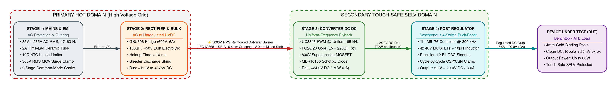
*(Standalone Mermaid Source: [figure1_simplified_4stage_power_flow.mmd](mermaid/figure1_simplified_4stage_power_flow.mmd))*

> [!NOTE]
> This is the proposed architecture and it might get changed during the design stage. Ensure the license compliance for usage of open source tools.

### Table 3: High Level Technical Requirement
| S.No | Parameters | Inputs For SPPS Board Design |
| :---: | :--- | :--- |
| **1** | **Input Voltage Range** | 85 V to 265 V AC RMS, 47 Hz to 63 Hz (Universal Grid Compatibility) |
| **2** | **Continuous Output Current** | 0.0 A to 3.0 A DC Continuous across full voltage range |
| **3** | **Programmable Output Voltage** | 5.0 V to 20.0 V DC (Continuously adjustable via 10 mV digital DAC steps) |
| **4** | **Maximum Output Power** | 60.0 W Continuous DC Output (20.0 V @ 3.0 A) |
| **5** | **Intermediate Bus Voltage** | +24.0 V DC ± 1.0% (72.0 W continuous rating from primary Flyback stage) |
| **6** | **Output Voltage Ripple** | < 25 mV pk-pk under full 3.0 A load (measured across 20 MHz bandwidth) |
| **7** | **End-to-End System Efficiency** | > 85.0% @ 230 V AC Full Load (Flyback > 88%, Buck-Boost > 95%) |
| **8** | **Galvanic Safety Isolation** | 3,000 V AC RMS (1 minute withstand) meeting IEC 62368-1 SELV |
| **9** | **Overcurrent Protection** | LM5176 built-in cycle-by-cycle hardware peak current limit via CSP/CSN |
| **10** | **PCBA Operating Temperature** | –20°C to +50°C Full Load (natural convection in chassis) |
| **11** | **User Interface & Control** | 1.3" I2C OLED display, dual rotary encoders, Status LEDs, tactile Enable switch |
| **12** | **Conducted & Radiated EMC** | Compliant with CISPR 32 / EN 55032 Class B limits |

The product is designed as a unified Embedded Hardware Power Supply Module (System 1). Primary hardware stages include AC Mains Protection & EMI Filter, GBU606 Bridge Rectifier & Bulk Capacitor (+120V to +375V DC), Stage 3 Uniform-Frequency Isolated Flyback Converter (+24V DC, 72W), Stage 4 Synchronous 4-Switch Buck-Boost Post-Regulator (5V–20V / 3A DC), and Analog DAC Steering & Built-in Hardware Protections.

## 2.3 Use Cases
The primary power supply functionality includes four core operating modes:
1. **Constant Voltage (CV) Mode**: Regulates output voltage within ±0.2% across varying load currents below the current limit setpoint.
2. **Current-Limited (OCP) Mode**: Restricts peak inductor current cycle-by-cycle via LM5176 CSP/CSN sense pins during overload or short-circuit events (< 5 µs autonomous response).
3. **MCU Supervisory Protection Mode**: Safely disables switching via LM5176 ENABLE pin on persistent overload (> 500 ms) or severe thermal rise.
4. **Standby / Idle Mode**: Output power stage disabled while +24V intermediate rail is maintained with standby power < 150 mW.

The benchtop operator interacts with the power supply using front-panel dual rotary controls and a 1.3" graphical OLED display. Power is delivered to the device under test (DUT) via heavy-duty 4mm binding posts, and operational status is indicated via front-panel mode LEDs.

### Table 4: Product Usecase
| S.N. | Usecase |
| :---: | :--- |
| **1** | Universal AC mains soft startup and inrush current suppression (< 25 A peak) |
| **2** | AC full-wave rectification and high-voltage DC bulk energy holdup (> 10 ms) |
| **3** | Galvanically isolated uniform-frequency Flyback conversion (+24.0 V DC, 72 W) |
| **4** | Synchronous 4-switch Buck-Boost step-down/step-up post-regulation (5 V – 20 V DC) |
| **5** | High-precision 10 mV digital voltage steering via 12-bit DAC summing network |
| **6** | LM5176 built-in cycle-by-cycle overcurrent protection via CSP/CSN pins |
| **7** | Primary Flyback cycle-by-cycle current limit via UC3843 ISENSE resistor |
| **8** | Controller internal thermal shutdown and board temperature monitoring |
| **9** | Primary AC input power measurement via isolated delta-sigma amplifier and CT |
| **10** | Secondary DC load voltage, current, and power monitoring via 16-bit I2C monitor |
| **11** | Real-time conversion efficiency computation and 1.3" OLED dashboard display update |
| **12** | Local front-panel rotary encoder tuning, tactile output enable, and status LED indication |

### Figure 2: Major Use Case 1: Constant Voltage Regulation & Dynamic Load Response Flow
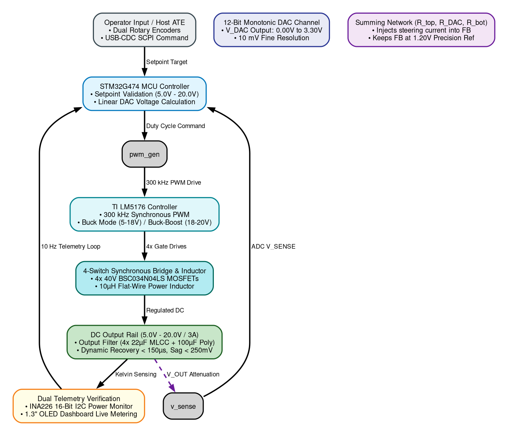
*(Standalone Mermaid Source: [figure2_usecase_cv_dynamic_response.mmd](mermaid/figure2_usecase_cv_dynamic_response.mmd))*

> [!NOTE]
> This is the proposed architecture and it might get changed during the design stage. Ensure the license compliance for usage of open source tools.

### Figure 3: Major Use Case 2: Autonomous Cycle-by-Cycle Peak Inductor Current Limiting & Fault Recovery
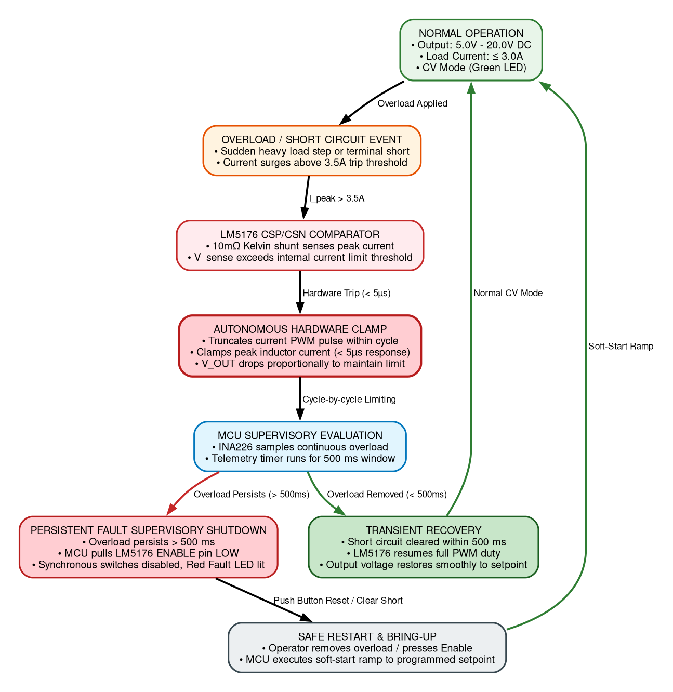
*(Standalone Mermaid Source: [figure3_usecase_ocp_cycle_by_cycle.mmd](mermaid/figure3_usecase_ocp_cycle_by_cycle.mmd))*

> [!NOTE]
> This is the proposed architecture and it might get changed during the design stage. Ensure the license compliance for usage of open source tools.

## 2.4 Product Interfaces
Physical hardware interfaces include an IEC 320-C14 AC inlet with integrated fuse drawer, heavy-duty 4mm gold binding posts, dual optical rotary encoders for voltage and current limit tuning, a tactile output enable push-button with status LED, a 1.3" monochrome OLED display, and dedicated PCB bring-up test points.

### 2.4.1 Hardware Interfaces
The hardware interfaces provide rugged, low-impedance connections: binding posts carry 3.0A continuous load current with < 5mΩ contact resistance; IEC inlet provides 250V / 10A rating with earth grounding; test points allow high-voltage differential probing across all switching nodes.

### Table 5: Hardware Interface
| Sl. No | Entity 1 | Entity 2 | Interface | Usage Description |
| :---: | :--- | :--- | :--- | :--- |
| **1** | AC Grid Mains | SPPS Board | IEC 320-C14 Inlet | Universal 85V–265V AC RMS, 50/60Hz grounded power input with 2A fuse |
| **2** | SPPS Board | DUT / Load | 4mm Binding Posts | Regulated 5.0V–20.0V DC / 3.0A power delivery to device under test |
| **3** | SPPS Board | Local Operator | 1.3" OLED Display | Real-time graphical dashboard for V, I, P, efficiency (η), and operating mode |
| **4** | SPPS Board | Local Operator | Output Enable Button | Tactile push-button for safe electronic enable/disable of output power |
| **5** | SPPS Board | Local Operator | Status Mode LEDs | Visual indication of Output Active (Green), Limit (Amber), and Fault (Red) states |
| **6** | SPPS Board | Debug Programmer | SWD Header | Microcontroller firmware flashing and SWO debug tracing |
| **7** | SPPS Board | Lab Oscilloscope | PCB Test Points | Diagnostic test loops for measuring intermediate rail, ripple, and switching nodes |
| **8** | Primary Side | Secondary Side | 6.4mm Milled Slot | Physical 2.0mm air slot beneath transformer enforcing IEC 62368-1 isolation |

### 2.4.2 Software Interfaces
The SPPS module contains an onboard STM32G474 mixed-signal microcontroller that coordinates telemetry sampling, closed-loop DAC voltage steering, status display, and fault handling. The following table describes the interface, protocol/mode, and usage of each interface:

### Table 6: Software Interfaces
| S. No | Entity 1 | Entity 2 | Interface | Interface Protocol / Mode | Usage Description |
| :---: | :--- | :--- | :--- | :--- | :--- |
| **1** | STM32G474 MCU | INA226 Monitor | Secondary Telemetry | I2C Fast Mode (400 kHz) | Reads 16-bit DC output voltage, current, and bus power at 10 Hz rate |
| **2** | STM32G474 MCU | 1.3" OLED (SSD1306) | Display Dashboard | I2C Fast Mode (400 kHz) | Updates numerical readouts, mode text, and efficiency bar graph at 10 Hz |
| **3** | STM32G474 MCU | AMC1311 Iso-Amp | Primary AC Voltage | Hardware Sinc3 Decimation | Demodulates 20 MHz delta-sigma bitstream for true AC voltage v(t) |
| **4** | STM32G474 MCU | Current Transformer | Primary AC Current | Analog ADC Channel (12-bit) | Samples burden resistor voltage from 1000:1 CT for AC mains current sensing |
| **5** | STM32G474 MCU | LM5176 FB Node | Voltage Steering | Internal 12-Bit DAC1 | Injects steering current into summing node to set Vout between 5.0V and 20.0V |
| **6** | STM32G474 MCU | Rotary Encoders | User Input | Timer Encoder Interface (TIM2/3) | Rotary dials with hardware debounced quadrature push-switches |
| **7** | STM32G474 MCU | Status LEDs | Status Annunciation | GPIO Digital Outputs | Drives Green (Active), Amber (Limit), and Red (Fault) status indicator LEDs |
| **8** | STM32G474 MCU | LM5176 Enable Pin | Output Control | GPIO Digital Output | Controls post-regulator run state during standby, soft-start, and fault disable |
| **9** | STM32G474 MCU | Host PC / ATE | Calibration & SCPI | USB-CDC Virtual COM / UART | Serial channel for automated calibration, logging, and SCPI test commands |

---

# 3. Systems & Domains Involved
The engineering domains involved in the development of the SPPS module are summarized in Table 7 below:

### Table 7: Domain Matrix
| Domain Names | System 1 (SPPS Device) | Trainee Responsibility Scope | Mentor Review Mechanism |
| :--- | :---: | :--- | :--- |
| **Hardware - HW** | Yes | 4-Stage power conversion schematics, component selection, layout, and bring-up | Gate Review |
| **Mechanical - ME** | Yes | Enclosure integration, thermal copper heatsinking, binding post cutouts | Mechanical Review |
| **Firmware - FW** | Yes | Bare-metal drivers (ADC, DAC, I2C, Timers), OLED dashboard, efficiency math | Firmware Review |
| **PC App - PAP** | Optional | Python-based automated calibration and DVT sweep script over USB-UART | Optional |
| **Test Firmware** | Yes | Dedicated bring-up routines for peripheral check, DAC sweep, and zeroing | Lab Bring-up Sign-off |

---

# 4. Product Requirement

## 4.1 System1 Requirements
System 1 represents the physical Hardware Power Supply Module, comprising the universal AC input, EMI filter, isolated Uniform-Frequency Flyback stage, 4-switch synchronous Buck-Boost post-regulator, built-in controller hardware protection, and microcontroller sensing core. The detailed engineering specifications are defined in the tables below:

### Table 4.1: AC-DC Isolated Uniform-Frequency Flyback Power Stage Engineering Requirements
| Req ID | Parameter / Feature | Specification / Target | Condition | Verification |
| :---: | :--- | :--- | :--- | :--- |
| **FR-01** | AC Input Voltage Range | 85 V – 265 V AC RMS [MUST] | Nominal 230V AC, 47–63 Hz | AC Source Sweep |
| **FR-02** | Intermediate DC Bus Voltage | +24.0 V DC ± 1.0% [MUST] | Across all line/load variations | Precision DMM |
| **FR-03** | Continuous Primary Power | 72.0 W Continuous [MUST] | 85V–265V AC In, 24V / 3A Out | Electronic Load 72W Soak |
| **FR-04** | Peak Power Capability | 84.0 W for 500 ms [SHOULD] | During dynamic load surges | Transient Load Step |
| **FR-05** | Primary Stage Efficiency | > 88.0% @ 230V AC Full Load [MUST] | Pout = 72W, Tamb = 25°C | Precision Power Analyzer |
| **FR-06** | Safety Galvanic Isolation | 3,000 V AC RMS (1 min) [MUST] | Primary to Secondary barrier | Certified Hi-Pot Tester |
| **FR-07** | Uniform Switching Frequency | 65.0 kHz ± 5% Constant [MUST] | Set by RT=10k, CT=2.2nF | Scope / Frequency Counter |
| **FR-08** | Cold-Start Inrush Current | < 25.0 A Peak [MUST] | Vin = 265V AC, cold start 25°C | Current Probe & Scope |
| **FR-09** | No-Load Standby Power | < 250 mW Standby [SHOULD] | Vin = 230V AC, Output Off | Power Meter Integrator |

### Table 4.2: 4-Switch Synchronous Buck-Boost Post-Regulator Requirements
| Req ID | Parameter / Feature | Specification / Target | Condition | Verification |
| :---: | :--- | :--- | :--- | :--- |
| **BB-01** | Output Voltage Range | 5.0 V – 20.0 V DC Programmable [MUST] | Continuous linear adjustment | Precision DMM Sweep |
| **BB-02** | Continuous Output Current | 0.0 A – 3.0 A DC Continuous [MUST] | Across full 5V–20V voltage span | Electronic Load 3A Soak |
| **BB-03** | Maximum Output Power | 60.0 W Continuous Output [MUST] | Vout = 20.0V, Iout = 3.0A | Thermal Run 60W (2 hrs) |
| **BB-04** | Voltage Setpoint Resolution | 10 mV step resolution (12-bit DAC) [MUST] | Continuous monotonic tuning | DAC Linearity Calibration |
| **BB-05** | Output Voltage Ripple | < 25 mV pk-pk ripple [MUST] | Full load 3A, 20MHz bandwidth | Scope Tip-and-Barrel Probe |
| **BB-06** | Load Transient Recovery | < 150 µs recovery, < 250mV sag [MUST] | 50% to 100% load step (1.5A to 3A) | Dynamic Load Stepper |
| **BB-07** | Buck-Boost Efficiency | > 95.0% @ 20V/3A; > 92.0% @ 5V/3A [MUST] | Vin = 24V, Sync Rectification | Dual-Channel Power Meter |
| **BB-08** | Switching Frequency | 300 kHz ± 10% [MUST] | Fixed frequency PWM | Frequency Counter / Scope |
| **BB-09** | Hardware Current Limiting | Cycle-by-cycle current limit via CSP/CSN [MUST] | Overload condition | Current Probe & Scope |

### Table 4.3: Real-Time Dual-Domain Telemetry & Monitoring Requirements
| Req ID | Parameter / Feature | Specification / Target | Condition | Verification |
| :---: | :--- | :--- | :--- | :--- |
| **TM-01** | Primary AC Voltage Sensing | Isolated AMC1311 (0-300V AC RMS) [MUST] | ± 1.0% accuracy across 85-265V | Precision AC Source Reference |
| **TM-02** | Primary AC Current Sensing | Current Transformer 1000:1 [MUST] | ± 1.5% accuracy from 0.1A–2A | Calibrated Current Probe |
| **TM-03** | Secondary DC Voltage Sense | INA226 16-bit ADC (1.25mV/LSB) [MUST] | ± 0.2% measurement accuracy | Keysight 34465A 6.5-digit DMM |
| **TM-04** | Secondary DC Current Sense | INA226 16-bit ADC (100µA/LSB) [MUST] | ± 0.5% measurement accuracy | Precision Shunt Reference |
| **TM-05** | Dual-Domain Telemetry Rate | 10.0 Hz Real-Time Loop Rate [MUST] | Pac, Pdc, and η computed at 100ms | Logic Analyzer Timing Check |
| **TM-06** | Galvanic Isolation Barrier | 3,000 V AC RMS (1 min) [MUST] | Primary-to-secondary isolation | Certified Hi-Pot Tester |
| **TM-07** | Calibration Test Points | Dedicated PCB Test Loops [MUST] | Vout, bulk DC, and aux rails | Scope & Multimeter Inspection |

### Table 4.4: Protection, Safety, EMC & Environmental Requirements
| Req ID | Parameter / Feature | Specification / Target | Condition | Verification |
| :---: | :--- | :--- | :--- | :--- |
| **PR-01** | Input Fuse Protection | 2.0A Time-Lag Ceramic Fuse [MUST] | AC mains short-circuit | Overcurrent Trip Test |
| **PR-02** | Input Inrush Current Limit | 10Ω NTC Thermistor (< 25A peak) [MUST] | Cold start at 265V AC | Scope Current Probe |
| **PR-03** | AC Line Surge Protection | 300V RMS MOV (4.5kA rating) [MUST] | Line transients per IEC 61000-4-5 | Surge Generator Verification |
| **PR-04** | Built-in Controller OCP | LM5176 cycle-by-cycle CSP/CSN clamp [MUST] | Load current > 3.5A limit | Electronic Load Step |
| **PR-05** | Over-Temperature (OTP) | LM5176 internal shutdown (165°C) [MUST] | Severe thermal rise | Thermal Chamber Sweep |
| **PR-06** | Safety Compliance Standard | IEC 62368-1 Reinforced Isolation [MUST] | SELV touch-safe (< 60V DC) | Certified Safety Laboratory |
| **PR-07** | Creepage & Clearance | Creepage ≥ 6.4mm; Clearance ≥ 5.0mm [MUST] | Primary-Secondary milled slot | PCB Caliper & Gerber Check |
| **PR-08** | Conducted & Radiated EMC | CISPR 32 / EN 55032 Class B [MUST] | 150 kHz – 1 GHz emission limits | Semi-Anechoic Chamber |
| **PR-09** | Operating Ambient Temp | –20°C to +50°C Full Load [MUST] | Natural convection in chassis | Environmental Chamber |

### 4.1.1 Specific Requirements
Specific hardware layout constraints mandate a physical 6.4 mm surface creepage distance and a 2.0 mm milled air slot through the PCB substrate beneath the transformer and optocoupler barriers to guarantee IEC 62368-1 reinforced safety isolation.

#### Inside Stage 1: Mains Supply & Input Protection Subsystem

### Figure 4: Inside Stage 1 - Mains AC Input & Protection Subsystem Architecture
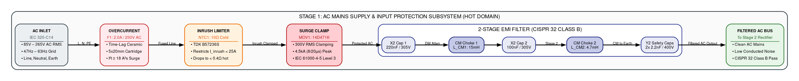
*(Standalone Mermaid Source: [figure4_inside_stage1_mains_emi.mmd](mermaid/figure4_inside_stage1_mains_emi.mmd))*

> [!NOTE]
> This is the proposed architecture and it might get changed during the design stage. Ensure the license compliance for usage of open source tools.

### Table 4.6A: STAGE 1: Mains AC Input & Protection Sequence
| Sequence Step | Functional Block | Circuit Operation Description |
| :---: | :--- | :--- |
| **Step 1** | **AC Inlet Connection** | Connects to universal grid mains (85V–265V AC RMS, 47–63 Hz) via standard IEC 320-C14 chassis connector. |
| **Step 2** | **Overcurrent Protection** | 2.0A time-lag ceramic cartridge fuse (F1) provides fail-safe catastrophic short-circuit clearing ($I^2t \ge 18\,\text{A}^2\text{s}$). |
| **Step 3** | **Inrush Current Limiting** | 10Ω cold-resistance NTC thermistor (NTC1) limits peak turn-on surge current to < 25A peak during cold start at 265V AC. |
| **Step 4** | **Transient Voltage Clamping**| 14 mm Metal Oxide Varistor (MOV1, 300V RMS) clamps grid lightning and switching transients per IEC 61000-4-5 Level 3. |
| **Step 5** | **Two-Stage Common-Mode Filtering**| Two cascaded common-mode chokes ($15\,\text{mH} + 4.7\,\text{mH}$) with X2/Y2 capacitors suppress emissions below CISPR 32 Class B limits. |

#### Inside Stage 2: Bridge Rectifier & High-Voltage Bulk DC Subsystem

### Figure 5: Inside Stage 2 - Bridge Rectifier & Bulk DC Stage Subsystem Architecture
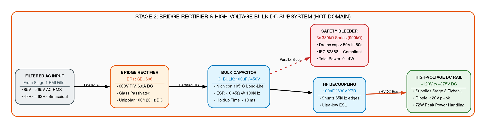
*(Standalone Mermaid Source: [figure5_inside_stage2_rectifier_bulk.mmd](mermaid/figure5_inside_stage2_rectifier_bulk.mmd))*

> [!NOTE]
> This is the proposed architecture and it might get changed during the design stage. Ensure the license compliance for usage of open source tools.

### Table 4.6B: STAGE 2: Bridge Rectifier & Bulk Filter Sequence (Table 15)
| Sequence Step | Functional Block | Circuit Operation Description |
| :---: | :--- | :--- |
| **Step 1** | **Filtered AC Input** | Takes 85V–265V AC RMS sinusoidal voltage from Stage 1 EMI filter. |
| **Step 2** | **Full-Wave Rectification** | GBU606 single-phase bridge rectifies AC into 100Hz/120Hz unipolar DC pulses (120Vpk–375Vpk). |
| **Step 3** | **Bulk Capacitive Filtering** | 100µF/450V electrolytic cap smooths ripple and guarantees > 10ms holdup time across line dropouts. |
| **Step 4** | **High-Frequency Decoupling** | 100nF/630V ceramic cap bypasses fast 65kHz primary switching edge ringing. |
| **Step 5** | **Safety Discharge Bleeder** | 3x 330kΩ resistor string drains bulk capacitor to < 50V SELV within 60s per IEC 62368-1. |

---

## 4.2 System2 Requirements
System 2 represents the Secondary Stage 4-Switch Synchronous Buck-Boost Post-Regulator, Analog Closed-Loop Control, DAC Steering Network, and Autonomous Hardware CC Protection Subsystem. The detailed electrical hardware specifications are defined in Table 4.5 below:

### Table 4.5: Analog Closed-Loop Control, DAC Steering & Hardware Protection Specifications
| Req ID | Parameter / Feature | Specification / Target | Condition | Verification |
| :---: | :--- | :--- | :--- | :--- |
| **CT-01** | DAC Voltage Steering Network | Resistor summing into LM5176 FB node [MUST] | R_top=49.9kΩ, R_DAC=11kΩ, R_bot=3.65kΩ | Precision Line/Load Sweep |
| **CT-02** | Voltage Tuning Resolution | 10.0 mV step resolution (12-bit DAC) [MUST] | Continuous 5.0V to 20.0V DC range | DAC Linearity Calibration |
| **CT-03** | Current Sense Resistor | 10 mΩ Metal Element Shunt, 3W, 0.1% [MUST] | Connected across LM5176 CSP/CSN | Precision Milliohm Meter |
| **CT-04** | MCU Supervisory Shutdown | GPIO pulling LM5176 ENABLE pin low [MUST] | Software fault shutdown command | Scope Response Timing |
| **CT-05** | Auxiliary Bias Regulation | +14V Flyback VCC, +12V gate, +5V, +3.3V rails [MUST] | Dedicated LDOs & buck off +24V | Multimeter & Rail Scope |

### 4.2.1 Specific Requirements
#### Inside Stage 3: Converter DC-DC (Uniform-Frequency Isolated Flyback) Subsystem

### Figure 6: Inside Stage 3 - Converter DC-DC (Uniform-Frequency Isolated Flyback) Subsystem Architecture
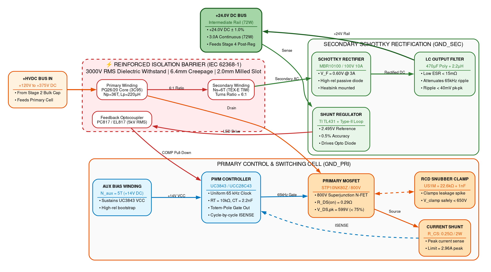
*(Standalone Mermaid Source: [figure6_inside_stage3_flyback.mmd](mermaid/figure6_inside_stage3_flyback.mmd))*

> [!NOTE]
> This is the proposed architecture and it might get changed during the design stage. Ensure the license compliance for usage of open source tools.

### Table 4.6C: STAGE 3: Uniform-Frequency Flyback DC-DC Converter Sequence
| Sequence Step | Functional Block | Circuit Operation Description |
| :---: | :--- | :--- |
| **Step 1** | **High-Voltage DC Input** | Receives +120V to +375V DC bulk bus into primary switching cell. |
| **Step 2** | **Uniform-Frequency PWM** | UC3843 / UCC28C43 controller operates at constant 65kHz uniform clock set by RT/CT with predictable EMI harmonics. |
| **Step 3** | **3000V RMS Safety Barrier** | PQ26/20 transformer (Lp=220µH) with Furukawa TEX-E wire provides reinforced galvanic isolation. |
| **Step 4** | **Schottky Barrier Rectification** | MBR10100 100V/10A Schottky diode provides simple, robust passive rectification with high reliability. |
| **Step 5** | **+24.0V DC Intermediate Rail** | Low-ESR LC filter delivers stable +24.0V DC (72W) with optocoupled feedback regulation. |

### Table 4.6D: STAGE 3 Flyback Detailed Subsystem Component Specification & Engineering Requirements Table
*(Extracted from the standalone Stage 3 specification)*

| Functional Sub-Block | Circuit Ref | Selected Component / IC | Key Specifications & Ratings | Functional Role & Performance Target |
| :--- | :---: | :--- | :--- | :--- |
| **HVDC Input Interface** | `+HVDC` | Stage 2 Bulk DC Bus Link | +120 V to +375 V DC operating span | Low-impedance high-voltage input rail feeding transformer primary winding and snubber network. |
| **Uniform-Freq PWM Controller** | `U1` | Texas Instruments UC3843 / UCC28C43 (SOIC-8 / DIP-8) | Uniform 65 kHz clock, RT/CT oscillator, cycle-by-cycle CS, direct totem-pole gate out | Generates constant-frequency PWM switching pulses at a uniform 65 kHz rate, providing predictable EMI harmonics and deterministic current-mode control. |
| **Oscillator Timing Network** | `R_T / C_T` | Precision Thin-Film Resistor + C0G/NP0 Ceramic Capacitor | R_T = 10.0 kΩ (1%), C_T = 2.2 nF (50V C0G) | Sets constant oscillator clock frequency: $f_{\text{sw}} \approx 1.72 / (R_T \times C_T) = 65\,\text{kHz}$ uniform clock without frequency jitter. |
| **Primary Power Switch** | `Q1` | STMicroelectronics STP10NK80Z / Infineon IPB80R290P7 | 800 V, 17 A, $R_{\text{DS(on)}} = 0.29\,\Omega$, $V_{\text{DS,peak}} = 599\,\text{V}$ | Main switching element modulated by 65 kHz PWM gate drive. Voltage stress derated to 74.9% of 800V rating (< 75% limit). |
| **Primary Current Sensing** | `R_CS` | Current Sense Shunt Resistor Network | Low-inductance metal strip, 0.25 Ω, 1%, 2 W | Monitors primary switch peak current ($I_{\text{pk}} = 2.96\,\text{A}$) on UC3843 ISENSE pin (Pin 3) with 1.0 V internal comparator threshold for cycle-by-cycle OCP. |
| **RCD Snubber Clamp** | `D_snub, R_snub, C_snub` | Diodes Inc. US1M + 3x 68 kΩ in parallel (22.6 kΩ, 3W) + 1.0 nF / 1 kV Ceramic | Diode: 1000 V, 1 A, $t_{\text{rr}} = 75\,\text{ns}$; Cap: 1 nF / 1000 V ceramic; Clamp: ~216 V clamp level | Damps high-voltage inductive kick caused by transformer leakage inductance ($L_{\text{lk}} \approx 2.2\,\mu\text{H}$); clamps peak drain voltage spike safely below 650 V peak. |
| **Flyback Power Transformer** | `TX1` | Ferroxcube PQ26/20 (3C95 Ferrite) / EE25 Core | $L_p = 220\,\mu\text{H} \pm 10\%$, $B_{\text{max}} = 0.148\,\text{T}$ ($B_{\text{sat}} = 0.38\,\text{T}$), $N_p = 36\,\text{T}$ | Stores energy during switch on-time and delivers 72 W continuous power to secondary during off-time ($N_p:N_s = 6:1$ turns ratio). |
| **Auxiliary Bias Winding** | `TX1_AUX` | $N_{\text{aux}} = 5\,\text{T}$ (0.25 mm wire) + Fast Diode (UF4004) & 47 µF Cap | Output: +14.0 V DC bias rail | Sustains UC3843 VCC pin (Pin 7) above UVLO threshold (8.4 V start / 7.6 V min) after initial high-voltage bleed startup. |
| **Galvanic Safety Barrier** | `TX1_ISO` | Furukawa TEX-E Triple-Insulated Wire (TIW) | $N_s = 6\,\text{T}$ ($N_p:N_s = 6:1$), Reinforced insulation, $\ge 6.4\,\text{mm}$ creepage | Complies with IEC 62368-1 standard. Provides certified $\ge 3000\,\text{V}$ RMS dielectric withstand between primary hot domain and secondary touch-safe SELV domain. |
| **Secondary Schottky Rectifier** | `D_SEC` | ON Semi / Vishay MBR10100 / MBR20100CT | 100 V, 10 A Schottky Barrier Diode, $V_F = 0.60\,\text{V}$, TO-220 with heatsink | Performs high-speed passive rectification of secondary flyback pulses. Highly reliable and robust passive design, eliminating active gate driver IC complexity. |
| **Secondary LC Output Filter** | `C_sec, L_sec` | 470 µF / 35 V Low-ESR Electrolytic + 2.2 µH Inductor + 22 µF MLCC | Low-ESR filtering, $\Delta V_{\text{ripple}} < 40\,\text{mV}$ pk-pk | Attenuates 65 kHz fundamental switching ripple and high-frequency commutation spikes to produce a quiet intermediate DC rail. |
| **Isolated Closed-Loop Feedback** | `OPTO1, U3` | Everlight PC817 / EL817 Optocoupler + TI TL431 Shunt Regulator | 5000 V RMS optical isolation, 2.495 V internal bandgap, 0.5% | Precision resistor divider samples +24.0 V rail, driving optocoupler LED to pull down UC3843 COMP pin (Pin 1), regulating rail to $\pm 1.0\%$. |
| **Intermediate Rail Output** | `+24V_BUS` | Intermediate DC Power Distribution Bus | +24.0 V DC $\pm 1.0\%$, 72.0 W continuous (3.0 A), 84 W peak | Delivers stable intermediate regulated DC power to Stage 4 (Synchronous Buck-Boost Post-Regulator) and secondary auxiliary housekeeping LDOs. |

---

# 5. Assumptions
The following points are considered as assumptions for further project execution:
* **Grid Waveform Quality**: Grid AC mains is nominal sinusoidal waveform with Total Harmonic Distortion (THD) $\le 5\%$.
* **Thermal Convection**: Operating ambient temperature is -20°C to +50°C under natural convection airflow in enclosure.
* **Galvanic Isolation**: Secondary DC ground is floating with reinforced galvanic isolation ($\ge 3000\,\text{V}$ RMS) from Earth and AC mains.
* **Load Characteristics**: Connected prototype loads are predominantly resistive or capacitive ($C_{\text{load}} \le 1000\,\mu\text{F}$).

---

# 6. Dependencies
The following dependencies are included in the design and development of the SPPS module:
* **Component Sourcing**: Lead times and supply chains for TI LM5176, UC3843 / UCC28C43, INA226, AMC1311, and ST STM32G474RET6.
* **Laboratory Equipment Availability**: AC source (Chroma 61602), DC electronic load (Chroma 63102A), 3000V RMS Hi-Pot dielectric tester, and FLIR thermal camera.
* **Mechanical Front-Panel Integration**: Enclosure mechanical drawings and panel cutouts for binding post standard 19.05 mm (0.75-inch) center-to-center spacing.
* **Firmware Device Drivers**: Bare-metal peripheral drivers for SSD1306 OLED display, INA226 power monitor, and STM32 internal 12-bit DAC.

---

# 7. Standard Deliverables & Release Order

## 7.1 Product Development Plan
* **Phase 1 — Requirement & Architecture and Class A BOM**: Definition of functional and electrical requirements; 4-stage system architecture design; block diagram and interface specifications.
* **Phase 2 — Component Selection & Circuit Design**: Transformer PQ26/20 magnetics sizing; component stress derating calculations; closed-loop feedback and DAC steering design; companion HDD authoring.
* **Phase 3 — Schematic Design and Review**: Complete 4-stage Altium schematics capture; LM5176 cycle-by-cycle current limit sensing and MCU enable control.
* **Phase 4 — PCB Layout & DFM Review**: 4-layer PCB stackup; high-voltage isolation partitioning with 2.0mm milled slot; high-current switching loop routing; DFM/DFA fabrication checks.
* **Phase 5 — Prototype Bring-up & Design Validation Plan (DVT)**: PCB fabrication and assembly (5 units); cold resistance checks; supervised Variac bring-up; line/load regulation, ripple, efficiency, and 3000V RMS Hi-Pot validation.

## 7.2 System1 Development Plan
The hardware deliverables and release documentation across project milestones are defined in Table 8:

### Table 8: Standard Deliverables & Release Order
| System Name | Domain Name | Deliverables | Verification Mechanism | Target Milestone |
| :--- | :--- | :--- | :--- | :--- |
| **VVDN_SPPS_2026** | Systems / PRD | Product Requirement Document (PRD) — Baseline Specifications & Acceptance Criteria | Architecture Sign-off | Milestone 1 |
| **SPPS Module** | Hardware (HW) | Hardware Design Document (HDD) with complete circuit derivations & stress calculations | SME Peer Review | Milestone 2 |
| **SPPS Module** | Hardware (HW) | Altium Designer Complete Schematics | Gate Review | Milestone 3 |
| **SPPS Module** | Hardware (HW) | Class A Engineering Bill of Materials (BOM) with manufacturer part numbers | Procurement Audit | Milestone 3 |
| **SPPS Module** | Hardware (HW) | 4-Layer PCB Layout & Gerber RS-274X Fabrication Package (ODB++, NC Drill, Pick-and-Place) | DFM / DFA Check | Milestone 4 |
| **SPPS Module** | Hardware (HW) | Design Verification Testing (DVT) Report & Acceptance Certificate | Lab Sign-off | Milestone 5 |
| **SPPS Module** | Firmware (FW) | Microcontroller Telemetry & Display Firmware Source Code | Code Review | Milestone 5 |
| **SPPS Module** | Compliance / Safety | Hi-Pot Dielectric Withstand Certificate (3000V RMS) & Pre-Compliance EMC Report | Third-Party Lab | Milestone 5 |

---

# 8. Architecture
The power supply hardware architecture consists of two galvanically isolated power conversion stages followed by synchronous post-regulation and built-in controller hardware protection:

## 8.1 System 1: Inside Stage 4 (Synchronous 4-Switch Buck-Boost Post-Regulator Subsystem)

### Figure 7: Inside Stage 4 - 4-Switch Buck-Boost Post-Regulator Subsystem Architecture
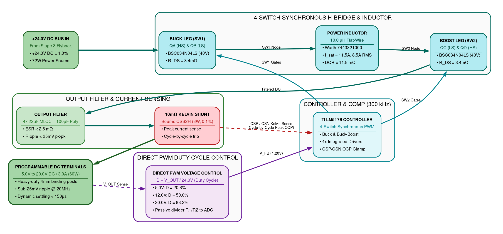
*(Standalone Mermaid Source: [figure7_inside_stage4_buck_boost.mmd](mermaid/figure7_inside_stage4_buck_boost.mmd))*

### Table 8.1: STAGE 4: 4-Switch Buck-Boost Post-Regulator Sequence (Table 18)
| Sequence Step | Functional Block | Circuit Operation Description |
| :---: | :--- | :--- |
| **Step 1** | **+24.0V DC Rail Input** | Accepts +24.0V DC intermediate rail from Stage 3 Flyback. |
| **Step 2** | **4-Switch Synchronous Bridge** | TI LM5176 modulates four 40V MOSFETs in H-bridge around a 10µH flat-wire power inductor. |
| **Step 3** | **Seamless Mode Transitions** | Operates in pure Buck mode for 5V–18V outputs (>96% eff) and 4-switch Buck-Boost mode near 20V (>95% eff). |
| **Step 4** | **Precision DAC Steering** | Resistor summing network ($R_{\text{top}}=49.9\,\text{k}\Omega$, $R_{\text{bot}}=3.65\,\text{k}\Omega$, $R_{\text{DAC}}=11\,\text{k}\Omega$) steers output from 5V to 20V in 10mV steps. |
| **Step 5** | **Cycle-by-Cycle Current Limit** | LM5176 senses current via 10mΩ shunt across CSP/CSN, natively clamping peak inductor current on every 300 kHz cycle. |

> [!NOTE]
> This is the proposed architecture and it might get changed during the design stage. Ensure the license compliance for usage of open source tools.

> [!NOTE]
> Component selection must strictly comply with VVDN derating guidelines.

---

## 8.2 System 1: Dual-Domain Power Telemetry & Sensing Frontend Architecture

### Figure 8: Dual-Domain Power Telemetry & Sensing Frontend Architecture
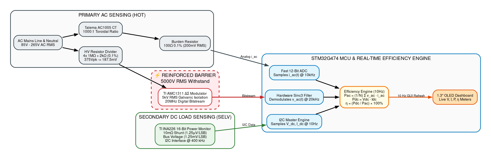
*(Standalone Mermaid Source: [figure8_telemetry_sensing_frontend.mmd](mermaid/figure8_telemetry_sensing_frontend.mmd))*

> [!NOTE]
> This is the proposed architecture and it might get changed during the design stage. Ensure the license compliance for usage of open source tools.

> [!NOTE]
> AMC1311 reinforced galvanic isolation barrier complies with IEC 62368-1.

---

## 8.3 System 2: Auxiliary Bias Power Rail Distribution Subsystem Architecture

### Figure 9: Auxiliary Bias Power Rail Distribution Subsystem Architecture
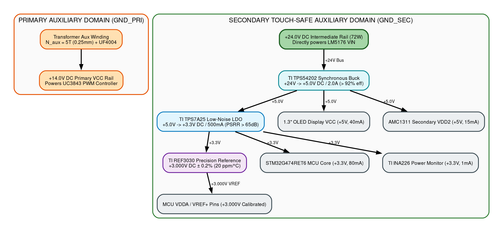
*(Standalone Mermaid Source: [figure9_aux_power_distribution.mmd](mermaid/figure9_aux_power_distribution.mmd))*

> [!NOTE]
> This is the proposed architecture and it might get changed during the design stage. Ensure the license compliance for usage of open source tools.

> [!NOTE]
> Gate driver bootstrap bias and low-noise analog LDO rails are verified during bring-up.

---

## 8.4 System Master: Master System Hardware Architecture Block Diagram

### Figure 10: Master System Hardware Architecture Block Diagram
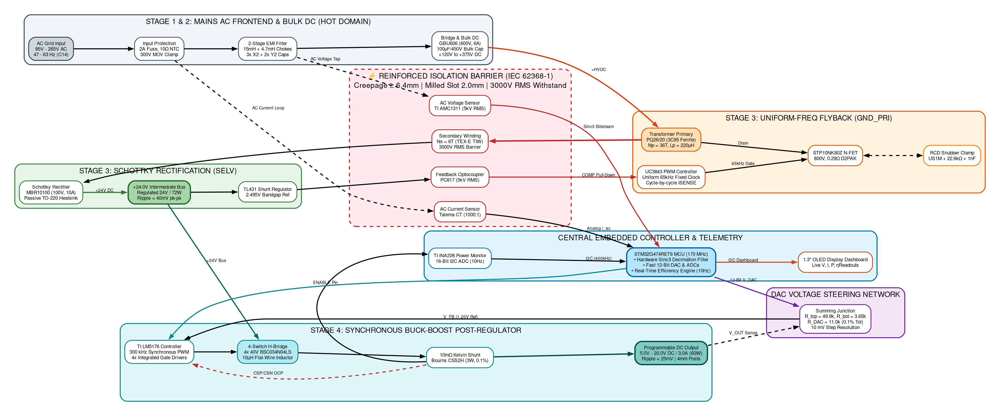
*(Standalone Mermaid Source: [figure10_master_hardware_architecture.mmd](mermaid/figure10_master_hardware_architecture.mmd))*

> [!NOTE]
> This is the proposed architecture and it might get changed during the design stage. Ensure the license compliance for usage of open source tools.

---

## 8.5 System Microcontroller: MCU System Interaction, State Machine & Monitoring Architecture

### Figure 11: MCU System Interaction, State Machine & Monitoring Architecture
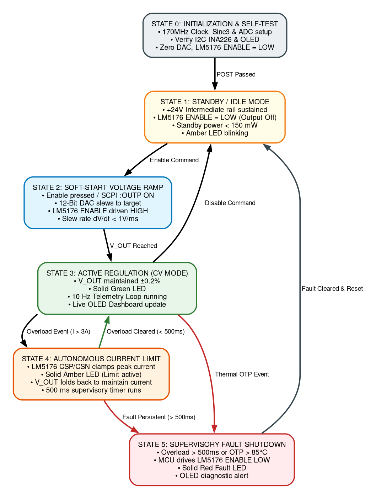
*(Standalone Mermaid Source: [figure11_mcu_system_interaction_monitoring.mmd](mermaid/figure11_mcu_system_interaction_monitoring.mmd))*

> [!NOTE]
> This is the proposed architecture and it might get changed during the design stage. Ensure the license compliance for usage of open source tools.

---

## 8.6 System Interconnect: Detailed Component Connections Block Diagram

### Figure 12: Detailed Component Connections Block Diagram
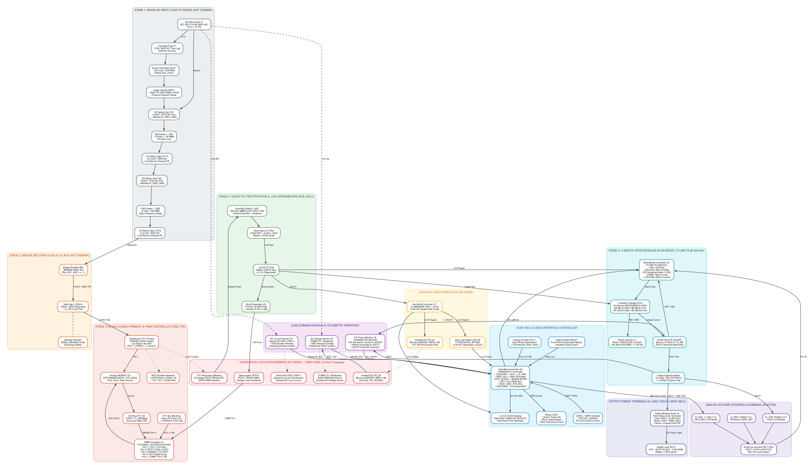
*(Standalone Mermaid Source: [figure12_detailed_component_connections_block_diagram.mmd](mermaid/figure12_detailed_component_connections_block_diagram.mmd))*

The detailed component connections block diagram illustrates the complete, physical net-level and pin-to-pin wiring interconnect across all 51 components in the smart programmable power supply:
* **Stage 1 (AC Input & EMI Filter)**: Complete wiring from IEC C14 inlet `J1` through 2A cartridge fuse `F1`, 10Ω NTC thermistor `NTC1`, 300V MOV `MOV1`, dual-stage common-mode chokes `L_CM1` (15mH) & `L_CM2` (4.7mH), X2 film capacitors `CX1`/`CX2`, and Y2 safety capacitors `CY1`–`CY4` to chassis earth ground `PE`.
* **Stage 2 (Rectifier & High-Voltage Bulk DC)**: Direct AC connections from Stage 1 into `BR1` (GBU606 bridge rectifier), feeding high-voltage electrolytic bulk capacitor `C_BULK` (100µF/450V), `C_HF` high-frequency bypass, and `R_BLEED` safety bleeder into the unregulated +120V to +375V DC rail.
* **Stage 3 (Uniform-Frequency Isolated Flyback)**: Pinout connections for `TX1` (Ferroxcube PQ26/20 transformer), primary superjunction switch `Q1` (STP10NK80Z), RCD clamp snubber (`D_SNUB`, `R_SNUB`, `C_SNUB`), current sense shunt `R_CS` (0.25Ω/2W), and `U1` (TI UC3843 / UCC28C43 PWM controller) with its uniform 65 kHz $R_T/C_T$ timing network ($10\,\text{k}\Omega / 2.2\,\text{nF}$), auxiliary winding bias feed (`TX1_AUX`, UF4004 diode, 47µF cap), and optocoupled feedback network (`OPTO1` PC817 + `U2` TL431).
* **Reinforced Galvanic Isolation Barrier**: Physical 3000V RMS dielectric barrier crossing via Furukawa TEX-E triple-insulated wire on `TX1`, `OPTO1` phototransistor, `U5` AMC1311 isolated delta-sigma modulator, `CT1` AC current transformer (1000:1), and `U9` Mornsun B0505S-1WR3 isolated DC-DC converter.
* **Stage 3 Secondary & +24V Intermediate Rail**: High-speed passive secondary rectification via `D_SEC` (ON Semi MBR10100 100V/10A Schottky barrier diode with heatsink) feeding low-ESR LC filter `C_SEC` (470µF/35V + 2.2µH choke) to form the clean +24.0V DC intermediate bus (72W).
* **Stage 4 (4-Switch Synchronous Buck-Boost Post-Regulator)**: Comprehensive pinout interconnect for `U3` (TI LM5176 300 kHz controller), gate drives (`HDRV1`, `LDRV1`, `HDRV2`, `LDRV2`, `BOOT1`, `BOOT2`) controlling 4x Infineon BSC034N04LS MOSFETs (`QA`..`QD`), flat-wire power inductor `L1` (10µH), 10mΩ Kelvin shunt `R_SHUNT` connected to `CSP`/`CSN` pins, and output ceramic/polymer capacitor bank `C_OUT`.
* **Analog Voltage Steering Summing Junction**: 3-resistor precision summing node at LM5176 `FB` pin formed by $R_{\text{TOP}} = 49.9\,\text{k}\Omega$ to $V_{\text{OUT+}}$, $R_{\text{BOT}} = 3.65\,\text{k}\Omega$ to $\text{GND\_SEC}$, and $R_{\text{DAC}} = 11.0\,\text{k}\Omega$ to MCU 12-bit DAC output ($0.0\text{V} - 3.3\text{V}$), enabling seamless voltage adjustment from 5.0V to 20.0V DC without affecting AC loop stability.
* **Dual-Domain Sensing & Telemetry Frontend**: Interconnections for `U4` (TI INA226) across `R_SHUNT` and $V_{\text{OUT+}}$ with I2C bus and EXTI `ALERT` overcurrent interrupt; `U5` (TI AMC1311) differential output to MCU ADC channels; and `CT1` (Talema AC1005) burden resistor network feeding MCU AC current ADC channel.
* **Auxiliary Bias Power Rail Network**: +24V bus stepping down through `U7` (TI LMR33630 buck converter) to generate the +5.0V System Rail, followed by `U8` (TI TPS7A4700 ultra-low-noise LDO) generating the clean +3.3V Quiet Rail ($<4.2\,\mu\text{V}_{\text{RMS}}$), and `U9` (B0505S-1WR3) generating isolated +5V_ISO for hot-domain sensing.
* **Host MCU & User Interface**: Pin assignments for `U6` (STM32G474 / controller) interfacing with DAC steering, LM5176 enable, INA226 telemetry, SSD1306 1.3" OLED display over I2C, Bourns EC11 rotary encoder, front-panel output toggle button, status LEDs (Power, Run, Fault), and USB-C / UART bridge (`CP2102` / `CH340G`) for PC logging and automated SCPI test routines.
* **Output Power Terminals & Load**: Heavy-duty 4mm binding posts `J2` connecting $V_{\text{OUT+}}$, $V_{\text{OUT-}}$, and chassis earth `PE` to the device under test (DUT).

---

# 9. Bill Of Material
> [!NOTE]
> This is the expected BOM and it might get changed during the design stage. The BOM does not contain any pricing/cost information.

Refer to detailed bill of materials in the respective subsystem tables below:

## 9.1 System1: Product BOM (Primary, Rectifier & Flyback Stages)

### Table 9.1: System 1 Product BOM (Primary, Rectifier & Flyback Stages)
| Sl.No | Ref Des | Description | Qty | Package / Footprint | Mfg | Mfg Part No |
| :---: | :--- | :--- | :---: | :--- | :--- | :--- |
| **Subsystem 1** | **AC Mains Protection, EMI Filtering & Rectifier Stage (Electrical)** | | | | | |
| 1 | F1 | Ceramic Time-Lag Fuse, 2.0A, 250V AC | 1 | 5x20mm Cartridge | Littelfuse | 0218002.MXP |
| 2 | NTC1 | Inrush Current Thermistor, 10Ω Cold, 3.2A | 1 | Radial Disc 13mm | TDK / EPCOS | B57236S0100M000 |
| 3 | MOV1 | Metal Oxide Varistor, 300V RMS, 4.5kA | 1 | Radial Disc 14mm | Bourns | MOV-14D471K |
| 4 | L_CM1 | Common Mode Choke, 15.0mH, 1.1A | 1 | Toroidal Through-Hole | Wurth Elektronik | 744823215 |
| 5 | L_CM2 | Common Mode Choke, 4.7mH, 1.6A | 1 | Toroidal Through-Hole | Wurth Elektronik | 744822472 |
| 6 | C_X1, C_X2 | Safety X2 Film Capacitor, 0.22µF, 310V AC | 2 | Radial Pitch 15mm | KEMET | R46KI32200001M |
| 7 | C_X3 | Safety X2 Film Capacitor, 0.10µF, 310V AC | 1 | Radial Pitch 10mm | KEMET | R46KI31000001M |
| 8 | C_Y1, C_Y2 | Safety Y2 Ceramic Disc Cap, 2.2nF, 400V AC | 2 | Radial Disc | KEMET | PHE850 Series |
| 9 | BR1 | Single-Phase Bridge Rectifier, 600V, 6.0A | 1 | GBU-4 Through-Hole | Diodes Inc. | GBU606 |
| 10 | C_BULK | Bulk Electrolytic Capacitor, 100µF, 450V, 105°C | 1 | Snap-In 22x30mm | Nichicon | LGW2W101MELZ25 |
| 11 | C_HF | High-Voltage Decoupling MLCC, 100nF, 630V X7R | 1 | SMD 1812 | Murata | GA342QR7GD102KW01L |
| 12 | R_BL1..3 | Safety Bleeder Resistor, 3x 330kΩ, 0.25W | 3 | SMD 1206 | Vishay Dale | CRCW1206330KFKEA |
| **Subsystem 2** | **Flyback Power Stage & Galvanic Isolation (Electrical)** | | | | | |
| 13 | U1 | Uniform-Frequency PWM Controller (65 kHz) | 1 | SOIC-8 | Texas Instruments | UC3843BN / UCC28C43D |
| 14 | Q1 | Superjunction N-MOSFET, 800V, 17A, 0.29Ω | 1 | D2PAK (TO-263) | STMicroelectronics | STP10NK80Z / IPB80R290P7 |
| 15 | TX1 | Flyback Transformer, PQ26/20, Lp=220µH, 6:1 | 1 | PQ26/20 Through-Hole | Custom / Ferroxcube | 3C95-PQ2620-72W |
| 16 | R_T | Oscillator Timing Resistor, 10.0 kΩ, 0.1% | 1 | SMD 0805 | Vishay Dale | TNPW080510K0BEEA |
| 17 | C_T | Oscillator Timing Capacitor, 2.2 nF, 50V C0G | 1 | SMD 0805 | Murata | GRM2165C1H222JA01D |
| 18 | R_CS | Primary Current Sense Shunt, 0.25Ω, 2W, 1% | 1 | SMD 2512 Metal Strip | Vishay Dale | WSL2512R2500FEA |
| 19 | D_SNUB | Ultrafast Recovery Snubber Diode, 1000V, 1A, 75ns | 1 | SMA (DO-214AC) | Diodes Inc. | US1M-13-F |
| 20 | R_SNUB1..3| Snubber Clamp Resistors, 3x 68kΩ 1W (22.6kΩ net) | 3 | SMD 2512 | Vishay Dale | CRCW251268K0FKEG |
| 21 | C_SNUB | High-Voltage Snubber Cap, 1.0nF, 1000V Ceramic | 1 | SMD 1210 | Murata | GRM32A7U3A102JW31D |
| 22 | D_SEC | Schottky Barrier Rectifier, 100V, 10A, Vf=0.60V | 1 | TO-220-2 (Heatsink) | ON Semiconductor | MBR10100G |
| 23 | C_SEC1,2 | Low-ESR Intermediate Rail Cap, 2x 470µF, 35V | 2 | Radial Can 10x16mm | Panasonic | EEU-FR1V471 |
| 24 | L_SEC | Intermediate Rail Smoothing Inductor, 2.2µH, 5A | 1 | SMD 8x8mm Shielded | Wurth Elektronik | 7447789002 |
| 25 | C_SEC3 | High-Frequency Decoupling MLCC, 22µF, 35V X7R | 1 | SMD 1210 | Murata | GRM32ER7YA226KE14L |
| 26 | OPTO1 | Reinforced Phototransistor Optocoupler, 5kV RMS | 1 | SMD-4 Gull-Wing | Everlight | EL817(S)(TA) |
| 27 | U2 | Precision Programmable Shunt Reference, 2.495V | 1 | SOT-23-3 | Texas Instruments | TL431AIDBZR |

---

## 9.2 System2: Product BOM (Buck-Boost, Protection, Telemetry & MCU Stages)

### Table 9.2: System 2 Product BOM (Buck-Boost, Protection, Telemetry & MCU Stages)
| Sl.No | Ref Des | Description | Qty | Package / Footprint | Mfg | Mfg Part No |
| :---: | :--- | :--- | :---: | :--- | :--- | :--- |
| **Subsystem 1** | **4-Switch Synchronous Buck-Boost Post-Regulator (Electrical)** | | | | | |
| 28 | U3 | 4-Switch Synchronous Buck-Boost Controller | 1 | HTSSOP-28 | Texas Instruments | LM5176PWPR |
| 29 | QA..QD | 4x Synchronous N-MOSFETs, 40V, 3.4mΩ | 4 | SuperSO8 (PowerPAK) | Infineon | BSC034N04LS |
| 30 | L1 | Flat-Wire Power Inductor, 10.0µH, 8.5A RMS, 11.5A Sat | 1 | SMD 12.5x12.5mm | Wurth Elektronik | 7443321000 |
| 31 | R_SHUNT | Kelvin Current Sense Shunt, 10.0mΩ, 0.1%, 3W | 1 | SMD 2512 4-Terminal | Bourns | CSS2H-2512R-L010F |
| 32 | C_OUT1..4 | Output Filter Ceramic MLCCs, 4x 22µF, 25V X7R | 4 | SMD 1210 | Murata | GRM32ER71E226KE15L |
| 33 | C_POLY | Solid Aluminum Polymer Cap, 100µF, 25V, 12mΩ ESR | 1 | Radial SMD 8x10mm | Panasonic | 25SVPF100M |
| 34 | R_TOP | Feedback Upper Divider Resistor, 49.9 kΩ, 0.1% | 1 | SMD 0805 | Vishay Dale | TNPW080549K9BEEA |
| 35 | R_BOT | Feedback Lower Divider Resistor, 3.65 kΩ, 0.1% | 1 | SMD 0805 | Vishay Dale | TNPW08053K65BEEA |
| 36 | R_DAC | DAC Steering Summing Resistor, 11.0 kΩ, 0.1% | 1 | SMD 0805 | Vishay Dale | TNPW080511K0BEEA |
| 37 | C_COMP | Type-II Compensation Capacitor, 2.2 nF, 50V C0G | 1 | SMD 0603 | Murata | GRM1885C1H222JA01D |
| 38 | R_COMP | Type-II Compensation Resistor, 10.0 kΩ, 1% | 1 | SMD 0603 | Vishay Dale | CRCW060310K0FKEA |
| **Subsystem 2** | **Dual-Domain Telemetry, Microcontroller & User Interface (Electrical)** | | | | | |
| 39 | U4 | 32-bit ARM Cortex-M4F MCU @ 170 MHz | 1 | LQFP-64 | STMicroelectronics | STM32G474RET6 |
| 40 | U5 | 16-Bit I2C Power Monitor IC (0.1% Accuracy) | 1 | VSSOP-10 | Texas Instruments | INA226AIDGSR |
| 41 | U6 | 5000V RMS Isolated Delta-Sigma Modulator | 1 | SOIC-8 Wide | Texas Instruments | AMC1311DWVR |
| 42 | CT1 | AC Current Transformer, 1000:1 Ratio, 5A | 1 | Toroidal Through-Hole | Talema | AC1005 |
| 43 | R_BURDEN | Precision CT Burden Resistor, 100 Ω, 0.1%, 0.25W | 1 | SMD 0805 | Vishay Dale | TNPW0805100RBEEA |
| 44 | U7 | Secondary Synchronous Step-Down Buck (24V -> 5V) | 1 | SOT-23-6 | Texas Instruments | TPS54202DDCR |
| 45 | U8 | Ultra-Low-Noise LDO Regulator (5V -> 3.3V, 500mA) | 1 | SOT-223 | Texas Instruments | TPS7A2533DBVR |
| 46 | U9 | High-Precision Voltage Reference (3.000V, 0.2%) | 1 | SOT-23-3 | Texas Instruments | REF3030AIDBZR |
| 47 | DISP1 | 1.3" Monochrome OLED Display Module (128x64 I2C) | 1 | 4-Pin Header | Waveshare / Solomon | SSD1306-1.3-OLED |
| 48 | ENC1,2 | Dual Incremental Optical Rotary Encoders + Switch | 2 | PCB Right-Angle | Bourns | PEC11R-4220F-S0024 |
| 49 | SW1 | Tactile Push-Button Output Enable Switch | 1 | SMD 6x6mm | Omron | B3FS-1002P |
| 50 | LED1..3 | Status LEDs: Green (CV), Amber (Limit), Red (Fault) | 3 | SMD 0805 | Kingbright | APT2012 Series |
| 51 | POSTS | Heavy-Duty 4mm Gold Binding Posts (Red / Black) | 2 | 19.05mm Panel Mount | Pomona Electronics | 3770-0 / 3770-2 |

---

# 10. Out of Scope
The following points are not included in the scope of project:
1. **Active Power Factor Correction (Active Boost PFC)**: Passive EMI filtering is used since power supplies under 75 W are exempt under international standard IEC 61000-3-2 Class D harmonic current limits. Adding an active boost stage would incur unnecessary BOM cost (~$4.20), circuit complexity, and a ~3% efficiency penalty.
2. **Complex Discrete External Protection Networks**: Discrete analog crowbar thyristors and discrete fast comparator pull-down networks are excluded in favor of the TI LM5176 built-in cycle-by-cycle CSP/CSN peak current limiting, UC3843 primary ISENSE clamping, and microcontroller supervisory shutdown.
3. **Three-Phase Grid Input**: Three-phase 400V/480V AC industrial grid input operation is excluded (module is single-phase 85V–265V AC RMS only). Negative/bipolar output rails and wireless IoT interfaces are excluded.

---

# 11. Open Items
The following points are included in the scope of project but are subject to final optimization in the upcoming revision:
1. **Current Shunt Value Trade-Off**: Evaluating 5 mΩ vs 10 mΩ for thermal dissipation at 3.0A (90 mW vs 45 mW) versus low-current sensing signal-to-noise ratio at 100 mA load.
2. **Auxiliary 24V DC Barrel Input Option**: Evaluating a 24V DC auxiliary input connector to bypass the AC mains rectifier/flyback stage for mobile vehicle battery or field test bench applications.
3. **Secondary Heatsink Copper Area Optimization**: Evaluating 2oz vs 3oz outer copper pours for D2PAK primary FET (Q1) and TO-220 Schottky diode (MBR10100) thermal dissipation under natural convection at +50°C ambient.

---

# Appendix: Cross-Mentor Interview Preparation & Defense Cheatsheet

This appendix provides structured technical defense rationales for the Power Electronics Engineer Trainee (GET) when defending the hardware requirements, architecture, and safety boundaries before the cross-mentor review panel. 

> [!NOTE]
> Detailed circuit equations, transformer magnetics derivations, snubber sizing, component deratings, and bench bring-up protocols are formally documented in the companion Hardware Design Document (HDD) reference: [HARDWARE_DESIGN_TECHNICAL_DETAILS_FOR_HDD.md](file:///home/tthhongs/build_tthongs/av_iv/smart_programmable_power_supply/HARDWARE_DESIGN_TECHNICAL_DETAILS_FOR_HDD.md).

### Q1: Walk me through the complete power conversion chain from the wall to the device.
**Trainee Defense**: The power conversion hardware operates in four clean, sequential stages: 
* First, universal mains AC (85V–265V AC RMS) enters through an IEC C14 inlet with a 2A time-lag ceramic fuse, 10Ω NTC inrush thermistor, MOV surge clamp, and a 2-stage common-mode EMI filter.
* Second, a GBU606 bridge rectifier and 100µF/450V bulk electrolytic capacitor convert AC into an unregulated high-voltage DC bus (+120V to +375V DC).
* Third, Stage 3 (a Uniform-Frequency Flyback converter with UC3843 / UCC28C43 and a custom PQ26/20 transformer) provides certified 3000V RMS reinforced safety isolation and steps down power to a stable +24.0V DC intermediate bus (72W) using an MBR10100 Schottky barrier diode with heatsink.
* Fourth, Stage 4 (a TI LM5176 4-switch synchronous Buck-Boost post-regulator) regulates the +24V bus down or across to the target 5.0V–20.0V DC at up to 3.0A with sub-25mV ripple, delivering clean DC to the device under test via heavy-duty 4mm binding posts.

### Q2: Why did you use a passive filter and bridge rectifier instead of an active Boost PFC stage?
**Trainee Defense**: Under international standard IEC 61000-3-2, active Power Factor Correction (PFC) is legally mandated only for equipment with active input power exceeding 75W. Our module delivers a maximum continuous output of 60W (72W peak intermediate), so it falls strictly below the 75W threshold. Adding an active PFC boost stage would require an additional high-voltage MOSFET, boost diode, controller IC, and large inductor—adding approximately $4.20 to the BOM, consuming 35% more PCB area, and introducing a ~3% efficiency penalty without any regulatory requirement.

### Q3: How did you calculate the Flyback transformer magnetics on the PQ26/20 core?
**Trainee Defense**: At minimum 85V AC input, the rectified bulk bus is 120V DC. For a maximum duty cycle of 45% and uniform 65kHz switching frequency (set by $R_T=10\,\text{k}\Omega$, $C_T=2.2\,\text{nF}$) at 72W output power, peak primary current is $I_{\text{pk}} = 2.96\,\text{A}$. Using $L_p = (V_{\text{bulk,min}} \times D_{\text{max}}) / (I_{\text{pk}} \times f_{\text{sw}})$, I calculated a primary inductance of 220µH. I chose a Ferroxcube PQ26/20 core in 3C95 material because its cross-sectional area $A_e$ is 122 mm², keeping peak flux density $B_{\text{max}}$ at 0.148 Tesla (well below the 0.38 Tesla saturation limit). The turns ratio is 6:1 (36 primary turns, 6 secondary turns). To guarantee IEC 62368-1 reinforced isolation (3000V RMS), the secondary is wound with Furukawa TEX-E triple-insulated wire. The uniform frequency ensures fixed, predictable EMI harmonics at 65kHz and its integer multiples.

### Q4: Why is the intermediate bus chosen at +24.0V DC instead of +12V or +48V?
**Trainee Defense**: +24.0V DC is the optimal design choice for a 5V to 20V output range. If we chose +12V, stepping up to 20V at 3A (60W) would require high inductor boost currents ($I_{\text{in}} = 5.5\,\text{A}$), creating excessive $I^2R$ conduction losses in the Buck-Boost MOSFETs. If we chose +48V, the Flyback turns ratio would decrease, increasing primary switch voltage stress, and stepping down to 5V would require an extreme duty cycle of 10%. With +24V, 5V, 12V, and 15V operate in pure Buck mode (>96% efficiency), and 20V operates near unity Buck-Boost transition with minimal switching stress.

### Q5: How does the 4-switch Buck-Boost operate seamlessly between 5V and 20V?
**Trainee Defense**: The TI LM5176 controls four N-MOSFETs (QA, QB, QC, QD) in an H-bridge configuration around a single 10µH flat-wire inductor. When $V_{\text{OUT}}$ is significantly below 24V (e.g. 5V or 12V), QC is held continuously ON and QD is OFF, so the circuit functions purely as a synchronous Buck converter with switches QA and QB. As $V_{\text{OUT}}$ approaches 20V under heavy load, the controller smoothly enters 4-switch Buck-Boost mode, modulating both legs to maintain exact regulation with zero deadband or output glitching.

### Q6: How does the DAC steer the output voltage without destabilizing the loop?
**Trainee Defense**: The LM5176 regulates by maintaining its feedback pin (FB) at an internal 1.20V reference. Instead of modifying the internal reference, we use a resistive summing junction: $R_{\text{top}}$ (49.9kΩ) connects to $V_{\text{OUT}}$, $R_{\text{bot}}$ (3.65kΩ) connects to ground, and $R_{\text{DAC}}$ (11.0kΩ) connects to our 12-bit DAC. By injecting current into the FB node from the DAC, when $V_{\text{DAC}} = 3.3\,\text{V}$, $V_{\text{OUT}}$ is steered to 5.0V. When $V_{\text{DAC}} = 0\,\text{V}$, $V_{\text{OUT}}$ is steered to 20.0V. Because the loop's AC Type-II compensation network is connected between COMP and ground, DC setpoint steering has zero impact on high-frequency phase margin and stability.

### Q7: How does the power supply protect against overcurrent and short circuits?
**Trainee Defense**: We use standard, proven industry protections built directly into the hardware controllers:
1. **LM5176 Built-in Cycle-by-Cycle Current Limiting**: The LM5176 continuously monitors inductor/output current through a 10mΩ precision sense resistor connected to its dedicated CSP and CSN pins. If current exceeds the programmed threshold, the controller immediately truncates the current PWM pulse, capping peak current on every 300 kHz switching cycle.
2. **MCU Supervisory Disable**: The MCU continuously reads output current via the INA226 power monitor over I2C. If a sustained overload or short-circuit is detected (> 500 ms), the MCU pulls the LM5176 ENABLE pin low to safely disable power delivery.
3. **Primary AC Fuse**: A 2.0A ceramic time-lag fuse on the AC mains provides fail-safe isolation against internal catastrophic short circuits.

### Q8: How is safety galvanic isolation guaranteed on the PCB?
**Trainee Defense**: We adhere strictly to IEC 62368-1 for reinforced insulation. Primary hot circuits and secondary touch-safe circuits are separated by a minimum physical surface creepage distance of 6.4mm. Across the isolation barrier, we route a 2.0mm wide milled air slot through the PCB substrate directly beneath the PQ26/20 transformer and optocouplers. The transformer secondary uses triple-insulated Furukawa TEX-E wire. The complete assembly is verified on the bench with a 3000V AC RMS Hipot dielectric withstand test for 60 seconds with zero breakdown.

### Q9: How do you verify output voltage ripple on the oscilloscope?
**Trainee Defense**: Standard alligator ground clips act as loop antennas that pick up radiated high-frequency magnetic noise from the 300kHz switching inductor, falsely showing 100mV+ of ripple. To measure true ripple accurately, I use the tip-and-barrel probing technique directly across the output capacitor $C_{\text{OUT}}$. I remove the oscilloscope probe hat and ground lead, wrap a short bus wire around the ground barrel, touch the tip directly to the positive pad and the barrel to the negative pad, engage 20MHz bandwidth limit and AC coupling, and verify peak-to-peak ripple is strictly below 25mV.

### Q10: What is your exact bench bring-up procedure using a Variac?
**Trainee Defense**: Before applying any AC power, I perform cold resistance checks: verifying > 100MΩ primary-to-secondary isolation resistance, checking for shorts across the bulk capacitor, and checking impedance across the +24V bus and output terminals. Next, I connect the board to an isolation transformer and an AC Variac with a 60W series current-limiting incandescent bulb. I slowly ramp AC voltage from 0V to 85V AC while monitoring bulk DC bus voltage and Flyback $V_{\text{CC}}$ aux bias. Once the +24V bus stabilizes at 85V AC, I ramp to nominal 230V AC and 265V AC. Finally, I enable the LM5176 Buck-Boost stage, sweep the DAC from 5V to 20V with a precision DMM, and apply incremental electronic load steps from 0.1A to 3.0A while monitoring thermals with a FLIR thermal camera.
