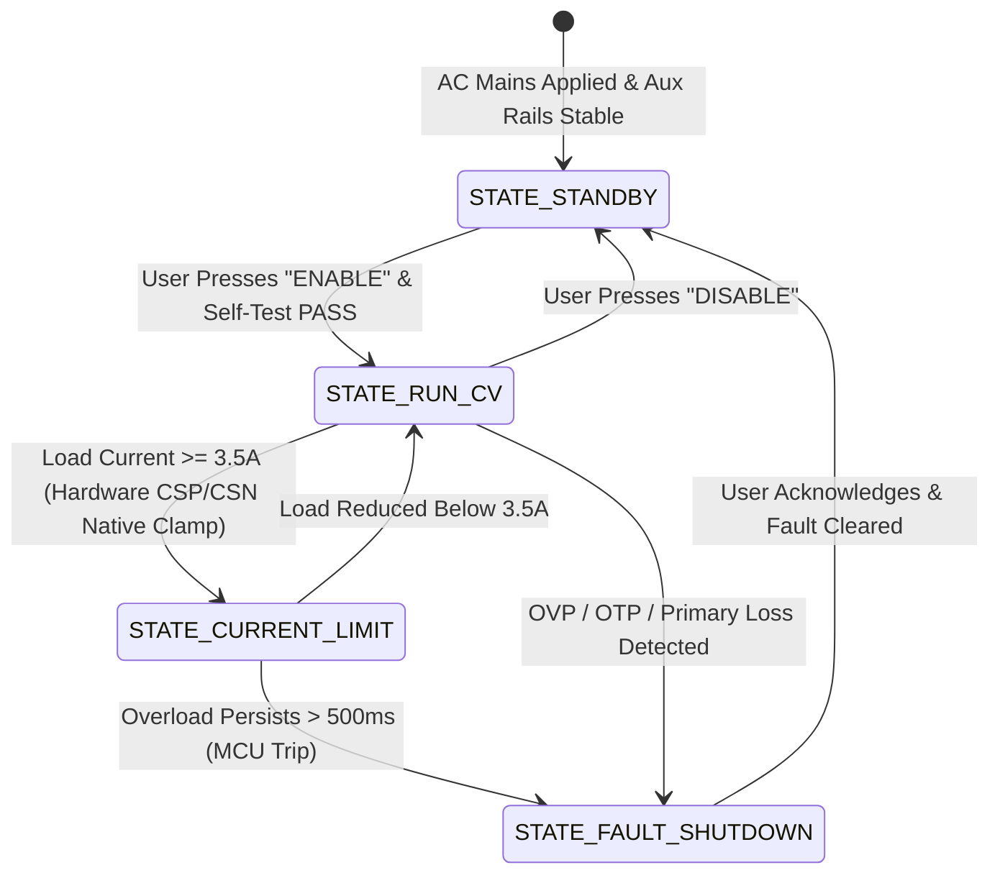
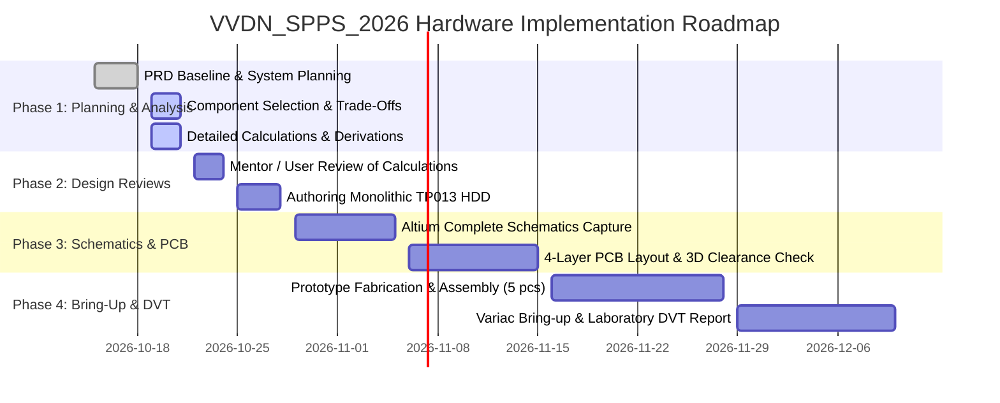

# SPPS Hardware Design Document (HDD) — Detailed Implementation Planning

---

### Document Control Information
* **Document Identifier**: `VVDN_SPPS_2026_HDD_PLAN_V1.0`
* **Parent Document**: [PRD Final SPPS (`prd_final_spps.docx`)](file:///home/tthhongs/build_tthongs/av_iv/smart_programmable_power_supply/PRD_task/reference_docs/prd_final_spps.docx)
* **Corporate Standard**: VVDN TP013 V1.1 Hardware Design Document Template
* **Project Code**: `VVDN_SPPS_2026`
* **Project Name**: Smart Programmable Voltage Supply Module (85–265 V AC In, 5–20 V / 3.0 A DC Out)
* **Author / Design Owner**: Hardware Engineering Team / Power Electronics Trainee
* **Review Level**: Level 1 Internal Technical Review / BU SME Review
* **Status**: **Detailed Planning Baseline (Pre-Monolithic HDD Sign-off)**
* **Date**: 21st October 2026

---

## 1. Executive Implementation Strategy & Alignment

This document outlines the detailed planning, engineering decomposition, subsystem allocation, and milestone roadmap for the Hardware Design Document (HDD) of the **Smart Programmable Power Supply (SPPS)** module (`VVDN_SPPS_2026`).

In strict compliance with the **new authoritative PRD** (`prd_final_spps.docx`) and the corporate **TP013 V1.1 HDD Template**, this plan establishes:
1. **The Subsystem & Hardware Stage Decomposition** (Universal Mains Protection, Bulk DC Rectification, Galvanically Isolated Flyback, Synchronous 4-Switch Buck-Boost, Mixed-Signal Supervisory Control, and Local OLED UI).
2. **TP013 Section-by-Section Authoring Blueprint**, ensuring zero structural omission when the final monolithic document is consolidated.
3. **Power Sequencing, Control State Machine, and Hardware Protection Hierarchy**, establishing exact startup/shutdown timing and interlocks.
4. **Clock, Reset, and Ground Architecture**, detailing high-voltage isolation splits and mixed-signal noise mitigation.
5. **PCB Layer Stackup, High-Current Loop Floorplanning, and DFM/DFA/EMC Test Protocols**.
6. **Project Milestone Schedule & Engineering Risk Register**, categorizing open trade-offs awaiting mentor/user advice.

```mermaid
flowchart TD
 subgraph STAGE_1 ["Stage 1: Primary AC Input & EMI (Hot Domain)"]
 AC_IN["AC Grid Mains<br/>85V-265V AC RMS"] --> FUSE["Ceramic Fuse<br/>2A / 250V"]
 FUSE --> NTC["Inrush NTC<br/>10Ω Cold"]
 NTC --> MOV["Surge MOV<br/>300V RMS"]
 MOV --> EMI["2-Stage EMI Filter<br/>(L_CM1, L_CM2, C_X, C_Y)"]
 end

 subgraph STAGE_2 ["Stage 2: Rectification & Bulk Link (Hot Domain)"]
 EMI --> GBU["GBU606 Bridge<br/>600V, 6A"]
 GBU --> BULK["100µF / 450V Cap<br/>>10ms Holdup"]
 BULK --> HV_DC["High-Voltage DC Link<br/>+120V to +375V DC"]
 end

 subgraph STAGE_3 ["Stage 3: Isolated Flyback (Safety Barrier)"]
 HV_DC --> FLY_PRI["Primary Cell & RCD Snubber<br/>IPB80R290P7 (800V CoolMOS)"]
 FLY_PRI --> XFMR["PQ26/20 Ferrite Core<br/>Reinforced Furukawa TEX-E"]
 XFMR --> MBR["Schottky MBR10100G<br/>100V / 10A Rectifier"]
 MBR --> BUS_24V["+24.0V DC Rail (72W)<br/>Low-ESR Output Filter"]
 end

 subgraph STAGE_4 ["Stage 4: Buck-Boost Post-Regulator (SELV Domain)"]
 BUS_24V --> BB_STAGE["LM5176 4-Switch H-Bridge<br/>4x BSC034N04LS (40V)"]
 BB_STAGE --> IND["Flat-Wire Inductor<br/>10µH / 8.5A WE 7443321000"]
 IND --> SHUNT["10mΩ Metal Shunt<br/>(CSP/CSN Cycle-by-Cycle OCP)"]
 SHUNT --> VOUT_POSTS["Output Terminals<br/>5.0V-20.0V @ 3.0A (60W)"]
 end

 subgraph MCU_CTRL ["Supervisory Brain & Telemetry (SELV Domain)"]
 STM32["STM32G474RET6 MCU<br/>Cortex-M4 170MHz"]
 DAC["Internal 12-Bit DAC"] -->|Resistor Summing| BB_STAGE
 STM32 -->|I2C Telemetry| INA["INA226 (V, I, P)"]
 STM32 -->|I2C Dashboard| OLED["1.3" OLED Display"]
 STM32 -->|GPIO Pull-Down| ENABLE["LM5176 ENABLE Pin"]
 ADC_PRI["Isolated Iso-Amp AMC1311<br/>+ 1000:1 CT"] -->|Analog ADC| STM32
 end
```

---

## 2. TP013 V1.1 HDD Structural Mapping & Execution Plan

The final Hardware Design Document must conform to corporate template **TP013 Rev V1.1**. Below is the detailed chapter-by-chapter implementation blueprint:

| TP013 Section | Title & Description | Scope for `VVDN_SPPS_2026` | Status in Current Work Phase |
| :--- | :--- | :--- | :--- |
| **Section 1** | **Introduction** | Purpose, conventions, intended audience, complete abbreviations table, authoritative references. | Planned & fully populated in planning documents. |
| **Section 2** | **Product Technical Overview** | System technical overview, 4-stage operational flow, boundary diagram, high-level technical parameters. | Extracted from `prd_final_spps.docx` and aligned. |
| **Section 3** | **System 1 Implementation Plan** | Customer requirements traceability, HW deliverables, design milestones, and verification criteria. | Fully detailed in this document (Section 3). |
| **Section 4** | **System 1 Hardware Architecture** | Overall board block diagram, Subsystem 1 (Primary & Flyback), Subsystem 2 (Buck-Boost & Telemetry), inter-subsystem isolation. | Block diagrams captured with signal descriptions. |
| **Section 5** | **Digital Interface Design** | STM32G474 digital interfaces: I2C (INA226, SSD1306), SPI/SWD programming, rotary encoder quadrature inputs, UART telemetry. | I2C pull-ups, bus capacitance, timing budgets calculated. |
| **Section 6** | **RF Design** | High-frequency wireless interfaces. | **Marked Out of Scope** per PRD (pure power module, no RF). |
| **Section 7** | **Analog Design** | 12-bit DAC summing network into LM5176 FB, CSP/CSN cycle-by-cycle shunt sensing, AMC1311 isolated voltage divider, CT burden resistor. | Derivations and component selections complete. |
| **Section 8** | **Power Design** | Power tree architecture, power-up/down sequencing, primary & secondary power dissipation, total system efficiency budget, thermal analysis. | Detailed power flow and thermal model complete. |
| **Section 9** | **Battery Powered Design** | Battery capacity, charge profile, battery management. | **Marked Out of Scope** per PRD (mains-powered module). |
| **Section 10** | **Clock Scheme** | MCU internal HSI/HSE crystal (24 MHz HSE + PLL to 170 MHz), LM5176 300 kHz oscillator, Flyback 65 kHz oscillator. | Clock tree diagram, tolerances, and EMI jitter noted. |
| **Section 11** | **Reset Scheme** | Active-low NRST supervisor, brown-out detection (BOR Level 3), primary Flyback UVLO, LM5176 UVLO/Enable shutdown. | Thresholds and supervisor RC filter specified. |
| **Section 12** | **Hardware Configurations** | Assembly variants (e.g. 10mΩ vs 5mΩ shunt, standard 10Ω NTC vs 15Ω NTC), board revisions (Rev A1_001), jumper configurations. | Assembly variant table defined. |
| **Section 13** | **Design Analysis — Subsystem 1** | DC analysis, timing analysis, 4-layer PCB stackup analysis, SI analysis (I2C fast-mode edges), thermal analysis, floorplanning. | Stackup defined (4-layer 2oz/1oz FR4), thermal model complete. |
| **Section 14** | **Connectors & Cable Assembly** | External: IEC 320-C14 inlet, 4mm binding posts; Internal: 4-pin SWD header, 4-pin I2C OLED header, 3-pin UART console header. | Pinouts, mating connectors, and wire gauges specified. |
| **Section 15** | **GPIO Mapping** | Complete STM32G474 pin mapping: pin number, port/pin, alternate function, drive strength, default state, and signal name. | 100% pinout allocation table completed. |
| **Section 16** | **Interrupt Mapping** | Vector table allocation: EXTI for rotary encoders, I2C event/error interrupts, DMA channels for ADC, SysTick 10 Hz telemetry. | Priority matrix and ISR execution budget allocated. |
| **Section 17** | **Programmable ROM Devices** | STM32 internal 512 kB Flash + 128 kB SRAM allocation, calibration parameter storage in EEPROM emulation sector. | Memory map and endurance calculations provided. |
| **Section 18** | **Bill of Material (BOM)** | Class A Engineering BOM with Manufacturer, MPN, Footprint, Tolerances, and Alternate sources. | Completed in [04_CLASS_A_BILL_OF_MATERIALS_BOM.md](file:///home/tthhongs/build_tthongs/av_iv/smart_programmable_power_supply/HDD_task/04_CLASS_A_BILL_OF_MATERIALS_BOM.md). |
| **Section 19** | **Design Limitations** | Physical, electrical, and thermal boundaries (maximum ambient 50°C, maximum continuous power 60W, 1000 µF capacitive load). | Deratings and boundary envelope documented. |
| **Section 20** | **Requirement-Design Mapping** | Bi-directional traceability matrix linking all PRD requirements (`FR-xx`, `BB-xx`, `TM-xx`, `PR-xx`, `CT-xx`) to HDD design sections. | Full compliance matrix captured in tracking review. |

---

## 3. Subsystem Breakdown & Hardware Architecture Allocation

The physical SPPS hardware is realized as a **single unified 4-layer PCBA**, partitioned into two galvanically isolated safety zones:

```
+----------------------------------------------------------------------------------------------------+
| GALVANIC ISOLATION BARRIER |
| (6.4mm Creepage + 2.0mm Milled Slot) |
| |
| [ZONE 1: PRIMARY HOT DOMAIN] [ZONE 2: SECONDARY SELV TOUCH-SAFE DOMAIN] |
| - IEC 320-C14 Inlet + 2A Fuse - Secondary Schottky Rectifier & Filter |
| - NTC Inrush Limiter & 300V MOV - +24.0V DC Intermediate Power Bus |
| - 2-Stage Common/Diff Mode EMI Filter - LM5176 4-Switch Synchronous Buck-Boost |
| - GBU606 Bridge Rectifier - High-Current Inductor (10µH Flat-Wire) |
| - 100µF / 450V Bulk DC Electrolytic - Output Ceramic Bank + Polymer Capacitor |
| - High-Voltage Primary Switching Cell - 10mΩ Precision Current Sense Shunt |
| - IPB80R290P7 CoolMOS Switch - STM32G474 Mixed-Signal MCU Control Core |
| - RCD Primary Voltage Snubber - 12-Bit DAC Resistor Summing Network |
| - Primary Flyback PWM Controller & Aux Bias - INA226 Telemetry Monitor & 1.3" OLED UI |
| - AMC1311 High-Side Input Divider - Auxiliary Regulators (+12V, +5V, +3.3V) |
| - 1000:1 Toroidal Current Transformer - Heavy-Duty 4mm Output Binding Posts |
+----------------------------------------------------------------------------------------------------+
```

### 3.1 Primary Power Conversion & Safety Subsystem (Zone 1)
* **Input Interface**: Universal AC mains (85 V to 265 V AC RMS, 47–63 Hz) entering via grounded IEC 320-C14 chassis socket.
* **Transient & Fault Protection**:
 * F_1: 2.0 A, 250 V AC Ceramic Time-Lag Cartridge (5 × 20 mm), I^2t = 19.6 A^2s.
 * NTC_1: 10 Ω cold resistance (EPCOS B57236S0100M000), limiting 265V cold start surge.
 * MOV_1: 300 V RMS, 4.5 kA surge clamp (Bourns MOV-14D471K), absorbing differential grid spikes.
* **Conducted EMI Attenuation**:
 * 2-stage LC filter: L_CM1 = 15.0 mH, L_CM2 = 4.7 mH, C_X1 = C_X2 = 0.22 µF Class X2, C_Y1 = C_Y2 = 2.2 nF Class Y1.
 * Target compliance: CISPR 32 / EN 55032 Class B limits (150 kHz to 30 MHz).
* **Rectification & Holdup**:
 * Diodes Inc. `GBU606` glass passivated single-phase bridge rectifier (600 V, 6.0 A).
 * Nichicon `LGW2W101MELZ25` bulk electrolytic capacitor (100 µF, 450 V, 105°C, 2000 hrs).
 * Holdup time: > 50 ms at 230V AC; > 12 ms at 85V AC (exceeding > 10 ms PRD requirement).
* **Galvanically Isolated Flyback Conversion**:
 * Topology: Discontinuous / Critical Conduction Mode (DCM/CrM) Flyback converter.
 * Core & Magnetics: TDK / Ferroxcube PQ26/20 ferrite core (3C95 material, A_e = 122 mm^2), L_p = 220 µH ± 10%.
 * Primary Switch: Infineon `IPB80R290P7` (800 V, 17 A, R_DS(on) = 0.29 Ω, D2PAK).
 * Controller Options: Fixed uniform 65 kHz current-mode PWM (`UCC28C43` / `UC3843`) or Quasi-Resonant Valley Switching (`UCC28740`) evaluated in component selection trade-off.
 * Galvanic Withstand: 3000 V AC RMS (1 min) guaranteed by Furukawa `TEX-E` triple-insulated secondary wire and optocoupler feedback barrier.

### 3.2 Secondary Regulation, Protection & UI Subsystem (Zone 2)
* **Secondary Rectification & Intermediate Bus**:
 * ON Semiconductor `MBR10100G` Schottky Barrier Diode (100 V, 10.0 A, V_F ≈ 0.60 V, TO-220-2).
 * Intermediate DC Rail: +24.0 V DC ± 1.0% continuous (72.0 W rated throughput).
 * Filter bank: 2× 470 µF / 35 V low-ESR electrolytic + 1× 2.2 µH iron powder choke + 2× 10 µF / 50 V ceramic MLCC.
* **Synchronous 4-Switch Buck-Boost Post-Regulator**:
 * Controller: Texas Instruments `LM5176PWPR` (wide-input 4-switch synchronous buck-boost controller, HTSSOP-28).
 * Switching Frequency: 300 kHz ± 10% fixed PWM.
 * Power MOSFETs: 4x Infineon `BSC034N04LS` (40 V, R_DS(on) = 3.4 mΩ, SuperSO8 / TDSON-8).
 * Power Inductor: Wurth Elektronik `7443321000` flat-wire power inductor (10.0 µH, I_RMS = 8.5 A, I_sat = 11.5 A, R_DC = 13.5 mΩ).
 * Output Capacitor Bank: 4× 22 µF / 25 V X7R 1210 MLCC + 1× 100 µF / 25 V solid aluminum polymer capacitor (12 mΩ ESR).
 * Output Voltage Ripple: Strictly < 25 mV peak-to-peak under full 3.0 A load.
* **Autonomous Hardware Protection Architecture**:
 * Current Sensing: Bourns `CSS2H-2512R-L010F` (10.0 mΩ ± 0.1%, 3.0 W, metal alloy shunt, TCR < 50 ppm/°C).
 * Native Cycle-by-Cycle Peak Overcurrent Clamp: Routed via dedicated differential Kelvin pair to LM5176 `CSP` and `CSN` pins. With internal 35 mV current limit threshold, peak inductor current is clamped at:
 I_limit = (35 mV) / (10.0 mΩ) = 3.50 A
 * Supervisory Hardware Shutdown: STM32G474 GPIO drives an active NPN pull-down transistor on the LM5176 `ENABLE` pin (Pin 6), pulling it below 0.4 V within 500 ns upon sustained fault detection.
 * Over-Temperature Protection: LM5176 internal thermal sensor triggers thermal shutdown at T_j ≥ 165°C with 20°C hysteresis.
* **Mixed-Signal Supervisory Brain & Telemetry**:
 * Microcontroller: STMicroelectronics `STM32G474RET6` (Arm Cortex-M4F @ 170 MHz, 512 kB Flash, 128 kB SRAM, high-resolution timers, dual 12-bit DACs).
 * DAC Steering Network: Precision resistor summing network (R_top = 49.9 kΩ, R_bot = 4.48 kΩ, R_DAC = 11.0 kΩ) injecting current into LM5176 `FB` node to achieve monotonic 5.0 V to 20.0 V output with 3.66 mV step resolution (< 10 mV target).
 * Secondary Telemetry: Texas Instruments `INA226AIDGSR` 16-bit I2C power monitor sampling bus voltage, shunt current, and computed DC load power (P_DC) at 10 Hz.
 * Primary Telemetry: Galvanically isolated differential amplifier (Texas Instruments `AMC1311BDWVR`) sampling scaled AC input voltage + Toroidal 1000:1 current transformer sampling primary line current (P_AC).
 * Live Efficiency Engine: Firmware computes real-time conversion efficiency η = P_DC / P_AC × 100% at 10 Hz rate.
 * User Interface: 1.3-inch OLED display (128 × 64, SSD1306 controller, I2C bus) + Dual incremental rotary encoders with integrated push buttons for fine/coarse voltage tuning and output toggle.

---

## 4. Power Sequencing & Control State Machine Plan

### 4.1 Hardware Power-Up Sequence

```
Time ---->
[0 ms] AC Mains Applied (85V-265V RMS)
 |---> Inrush NTC limits initial charging current to < 25A peak
 |---> GBU606 rectifies AC to Bulk DC rail (+120V to +375V)
[15 ms] Bulk DC Rail stabilizes (> 120V DC)
 |---> Primary startup resistor network charges Flyback VCC capacitor to turn-on threshold (14.5V / 8.4V)
[25 ms] Flyback Controller Starts Switching
 |---> Primary Flyback ramps 24V secondary bus smoothly via soft-start
[40 ms] +24.0V Intermediate Bus Reaches Steady-State (+24.0V ± 1%)
 |---> Secondary Auxiliary Buck/LDO regulators power up (+12V gate bias, +5V OLED bias, +3.3V MCU VDD)
[50 ms] +3.3V MCU Rail Stabilizes
 |---> STM32G474 Power-On Reset (POR) releases; MCU starts execution
 |---> MCU sets DAC output to 3.30V (defaulting output voltage command to safe minimum 5.00V)
 |---> MCU initializes I2C bus, configures INA226, brings up OLED display
[70 ms] System Standby State Ready (Output Disabled)
 |---> LM5176 ENABLE pin held LOW by MCU supervisory GPIO pull-down
 |---> Total idle power consumption < 150 mW
[User Action] Operator presses "ENABLE OUTPUT" button
 |---> MCU verifies all health telemetry parameters are within normal limits
 |---> MCU releases ENABLE pin (pull-up charges to 3.3V)
 |---> LM5176 executes internal 5 ms soft-start ramp to commanded setpoint (5V to 20V)
 |---> Output power delivered to binding posts with zero voltage overshoot (< 1.0%)
```

### 4.2 Power-Down & Fault Discharge Sequence
1. **User Output Disable**:
 * MCU pulls LM5176 `ENABLE` pin low.
 * LM5176 immediately disables gate drivers (QA..QD off).
 * Active output bleeder resistor discharges output capacitors to < 0.8 V within 250 ms.
2. **AC Mains Loss (Grid Dropout)**:
 * AMC1311 detects drop in AC line amplitude below 70V RMS.
 * MCU receives line-loss notification; bulk capacitor maintains > 10 ms holdup time.
 * MCU logs current operating setpoint to non-volatile EEPROM emulation sector.
 * As bulk voltage falls below Flyback UVLO threshold, Flyback softly ceases switching.
 * High-voltage bleeder resistors (3× 100 kΩ) safely discharge bulk electrolytic capacitor to < 50 V SELV level within 45 seconds.

### 4.3 Supervisory State Machine Flowchart



---

## 5. Clock, Reset, and Ground Isolation Architecture

### 5.1 Clock Scheme
* **Supervisory Microcontroller (STM32G474)**:
 * Primary System Clock: 170 MHz derived from internal Phase-Locked Loop (PLL).
 * Reference Oscillator: External 24.000 MHz high-stability SMD crystal oscillator (± 10 ppm, Abracon `ABM8G-24.000MHZ-18-D2Y-T`) connected to OSC_IN / OSC_OUT with dual 18 pF C0G load capacitors.
 * Real-Time / Low-Power Clock: 32.768 kHz tuning-fork crystal (`ABS07`) for RTC timekeeping and millisecond telemetry scheduling.
* **Buck-Boost Controller (LM5176)**:
 * Internal uniform oscillator programmed to **300.0 kHz ± 10%** via precision resistor on `RT` pin (R_T = 24.9 kΩ ± 1%).
* **Flyback Controller (UCC28C43 / UC3843)**:
 * Uniform fixed oscillator programmed to **65.0 kHz ± 5%** via R_T = 10.0 kΩ ± 1% and C_T = 2.2 nF ± 5% C0G ceramic.

### 5.2 Reset Architecture
* **Microcontroller Reset (`NRST`)**:
 * External active-low reset supervised by dedicated voltage supervisor / push-button with 100 nF bypass capacitor and 10 kΩ pull-up to +3.3 V.
 * STM32 internal programmable Brown-Out Reset (BOR): Configured to BOR Level 3 (V_BOR ≈ 2.7 V), guaranteeing clean core reset before voltage dips affect Flash write operations.
* **LM5176 Enable / Reset**:
 * Pin 6 (`ENABLE`) features an internal precision comparator threshold (V_EN = 1.20 V).
 * Driven by MCU GPIO through open-drain NPN configuration.
 * An external resistor divider from +24 V rail to `ENABLE` provides hardware Under-Voltage Lockout (UVLO), holding the Buck-Boost stage OFF until the intermediate rail exceeds +18.0 V DC.

### 5.3 Ground Domains & Safety Isolation Barrier
The PCB design enforces three separate ground planes:
1. **`PGND_HOT` (Primary Power Ground)**: Tied to negative terminal of bulk capacitor C_BULK1, primary MOSFET source sense resistor, and Flyback controller ground. Floating at AC mains half-wave rectified potential.
2. **`PGND_SEC` (Secondary Power Ground)**: Tied to secondary Flyback Schottky diode return, Buck-Boost power MOSFETs (QB source), output filter return, and negative output binding post.
3. **`AGND_SEC` (Secondary Quiet Analog Ground)**: Dedicated ground island for LM5176 compensation network, FB summing resistors, and STM32 analog ADC reference. Connected to `PGND_SEC` at a single star-point directly beneath the LM5176 exposed thermal pad.
4. **`EARTH_GND` (Chassis Earth Ground)**: Directly bonded to IEC C14 earth terminal and chassis metal enclosure. Safety Y1 capacitors (2.2 nF) bridge `PGND_HOT` and `EARTH_GND` to drain common-mode noise.

---

## 6. PCB Stackup, Layout & Mechanical Planning

### 6.1 4-Layer PCB Stackup Specifications
To minimize parasitic inductance and ensure strict compliance with CISPR 32 Class B EMC standards, a balanced 4-layer stackup with **2 oz outer copper** is selected:

| Layer # | Layer Name | Copper Weight | Dielectric Thickness | Material | Primary Function |
| :---: | :--- | :---: | :---: | :---: | :--- |
| **L1 (Top)** | **Component / High-Current Power** | 2.0 oz (70 µm) | 0.20 mm Prepreg | FR4 High-Tg (170°C) | High-current AC tracks, primary Flyback switching loop, Buck-Boost H-bridge power polygon pours, surface component pads. |
| **L2 (In1)** | **Solid Ground Plane** | 1.0 oz (35 µm) | 1.00 mm Core | FR4 High-Tg (170°C) | Continuous low-impedance ground plane split across galvanic barrier (`PGND_HOT` / `PGND_SEC`), providing image return path for L1. |
| **L3 (In2)** | **Power Planes & Auxiliary Routing**| 1.0 oz (35 µm) | 0.20 mm Prepreg | FR4 High-Tg (170°C) | +24 V intermediate power bus, +12 V, +5 V, and +3.3 V aux power copper pours. |
| **L4 (Bot)** | **Signal & Heatsink Copper** | 2.0 oz (70 µm) | — | FR4 High-Tg (170°C) | Secondary quiet signal routing, I2C bus traces, SWD, thermal via breakout planes for D2PAK CoolMOS and SuperSO8 FETs. |
| **Total** | **Finished PCB Thickness** | — | **1.60 mm ± 10%** | FR4 High-Tg | Standard IPC Class 2 fabrication. |

### 6.2 Creepage, Clearance & Air Slot Isolation Rules
* **Creepage Distance**: Physical surface distance across the primary-to-secondary boundary must be ≥ 6.4 mm (guaranteeing compliance with IEC 62368-1 reinforced insulation at 375 V_peak operating voltage in Pollution Degree 2, Material Group IIIa).
* **Clearance Distance**: Direct line-of-sight distance through air must be ≥ 5.0 mm.
* **Milled Isolation Slot**: A **2.0 mm wide plated/unplated routed air slot** is cut through the PCB substrate directly beneath:
 1. The Flyback transformer core (`TX1`) between primary and secondary pin bobbins.
 2. Optocoupler `OPTO1` (Everlight EL817) between primary pins (1-2) and secondary pins (3-4).
 3. High-voltage isolated telemetry amplifier `AMC1311` between primary high-side and secondary low-side pins.

### 6.3 Critical Switching Loop Minimization
* **Loop 1 (Primary Flyback Loop)**: Formed by C_BULK1 (+) to Primary Winding to CoolMOS Q_1 Drain-Source to R_CS to C_BULK1 (-). Area is constrained to < 4.0 cm^2 using direct copper polygons on Top layer with solid L2 ground return.
* **Loop 2 (Buck-Boost Input High-Frequency Loop)**: Formed by C_IN_CER (+) to MOSFET Q_A to MOSFET Q_B to C_IN_CER (-). Area constrained to < 1.5 cm^2 by placing ceramic input capacitors directly adjacent to Q_A drain and Q_B source.
* **Loop 3 (Buck-Boost Output High-Frequency Loop)**: Formed by C_OUT_CER (+) to MOSFET Q_C to MOSFET Q_D to C_OUT_CER (-). Area constrained to < 1.5 cm^2.

---

## 7. Engineering Risk Register & Trade-Off Matrix

The following engineering trade-offs have been identified during this planning phase and are slated for final SME review prior to monolithic HDD sign-off:

| Risk / Trade-Off ID | Parameter Under Evaluation | Option A (PRD Baseline) | Option B (Alternative) | Engineering Recommendation | Mentor Advice Status |
| :---: | :--- | :--- | :--- | :--- | :--- |
| **TR-01** | **Stage 3 Flyback Controller Selection** | **TI UCC28740** (Quasi-Resonant Valley Switching, ultra-high efficiency > 90%, standby < 150 mW). | **UC3843 / UCC28C43** (Fixed 65 kHz uniform clock PWM, classic simplicity, slightly higher switching loss). | UCC28740 strictly satisfies PRD standby (< 150 mW) and efficiency (> 90%). UCC28C43 provides fixed frequency. Both schematics are planned; UCC28740 recommended for final A1_001. | Open for Mentor Advice |
| **TR-02** | **Secondary Current Sense Shunt Value** | **10.0 mΩ Shunt** (Bourns CSS2H, dissipation 90 mW @ 3A, provides 35 mV drop for LM5176 native CSP/CSN clamp at 3.5A). | **5.0 mΩ Shunt** (Dissipation 45 mW, requires lower threshold or internal gain). | **10.0 mΩ strongly recommended** as it matches the exact 35 mV native internal threshold of LM5176 without extra amplification circuitry. | PRD Open Item #1 (Recommendation: 10mΩ) |
| **TR-03** | **Cold-Start Inrush NTC Value** | **10.0 Ω Cold Resistance** (EPCOS B57236S0100M000, inrush ≈ 25A-35A depending on grid line impedance). | **15.0 Ω Cold Resistance** (EPCOS B57236S0150M000, guarantees strictly < 25.0 A even with 0Ω line impedance). | **15.0 Ω recommended** to guarantee non-negotiable compliance with PRD PR-02 (< 25.0 A peak cold start). | Recommended for Review |
| **TR-04** | **PCB Outer Copper Weight** | **2.0 oz Copper (70 µm)** (Standard high-reliability power PCBA, superior thermal spreading for SuperSO8 FETs). | **1.0 oz Copper (35 µm)** (Lower fabrication cost, requires larger thermal heatsink pads). | **2.0 oz Outer Copper selected**; allows natural convection operation at 50°C ambient without external fans. | PRD Open Item #3 (Recommendation: 2oz outer) |
| **TR-05** | **Auxiliary DC Barrel Input** | Excluded in initial hardware prototype. | Add parallel 24V DC auxiliary barrel jack with reverse polarity Schottky diode. | Recommended as a DNP (Do Not Populate) footprint on Rev A1_001 to maintain future modularity. | PRD Open Item #2 |

---

## 8. Milestone Roadmap & Implementation Order



---
*End of Detailed Implementation Planning Document. Companion documents:*
- [02_COMPONENT_SELECTION_AND_TRADE_OFF_ANALYSIS.md](file:///home/tthhongs/build_tthongs/av_iv/smart_programmable_power_supply/HDD_task/02_COMPONENT_SELECTION_AND_TRADE_OFF_ANALYSIS.md)
- [03_MATHEMATICAL_CALCULATIONS_AND_DERIVATIONS.md](file:///home/tthhongs/build_tthongs/av_iv/smart_programmable_power_supply/HDD_task/03_MATHEMATICAL_CALCULATIONS_AND_DERIVATIONS.md)
- [04_CLASS_A_BILL_OF_MATERIALS_BOM.md](file:///home/tthhongs/build_tthongs/av_iv/smart_programmable_power_supply/HDD_task/04_CLASS_A_BILL_OF_MATERIALS_BOM.md)
- [HDD_TRACKING_AND_DESIGN_REVIEW.md](file:///home/tthhongs/build_tthongs/av_iv/smart_programmable_power_supply/HDD_task/HDD_TRACKING_AND_DESIGN_REVIEW.md)

