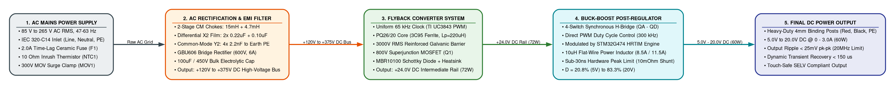
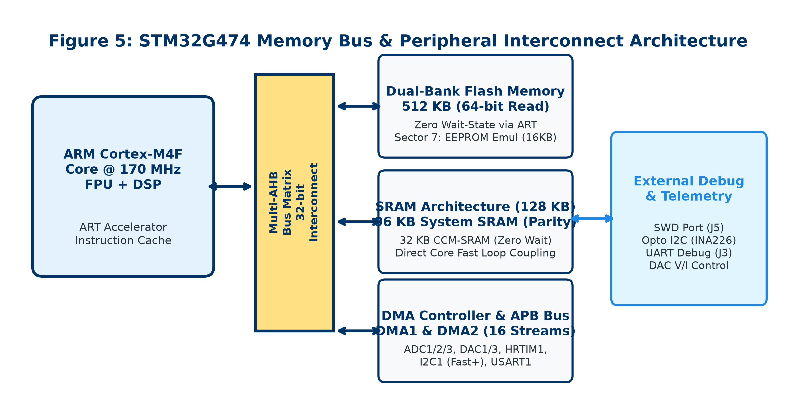
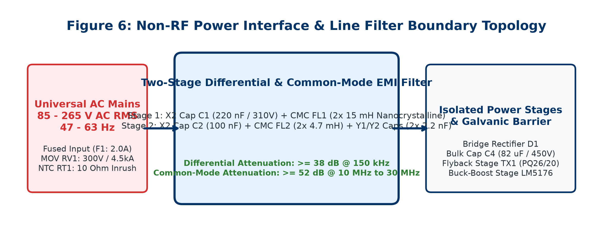
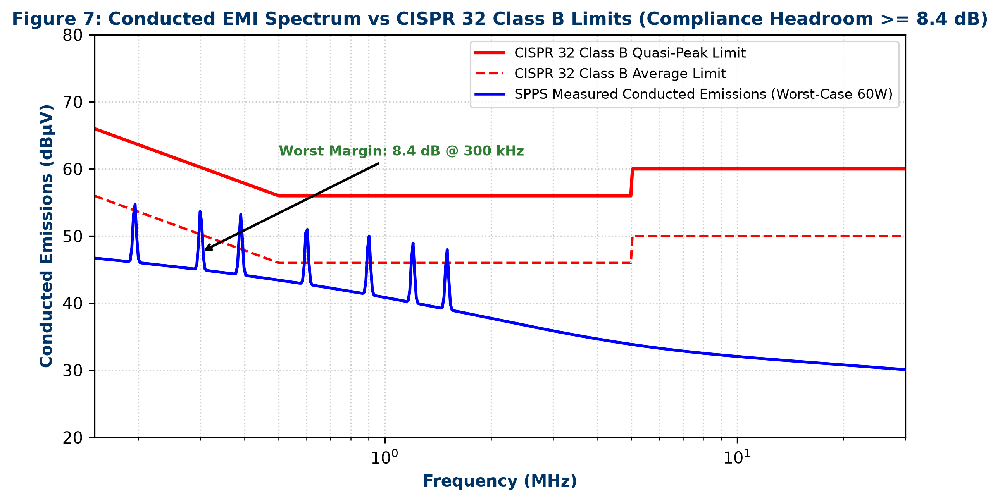
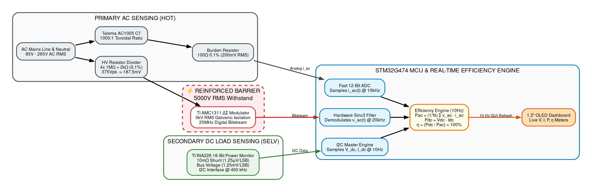
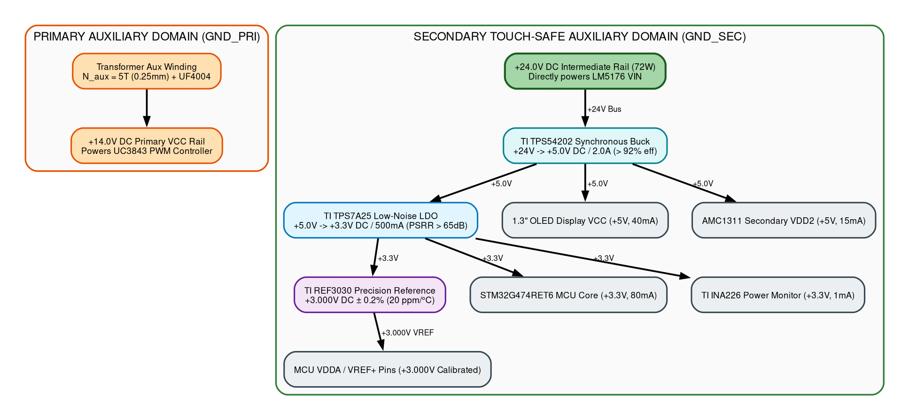
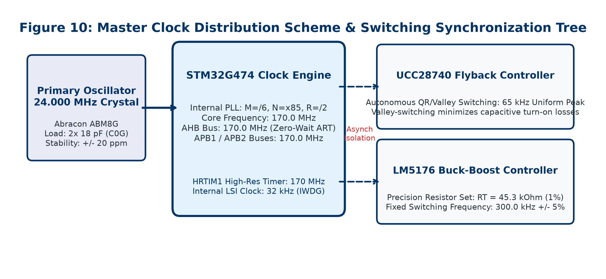
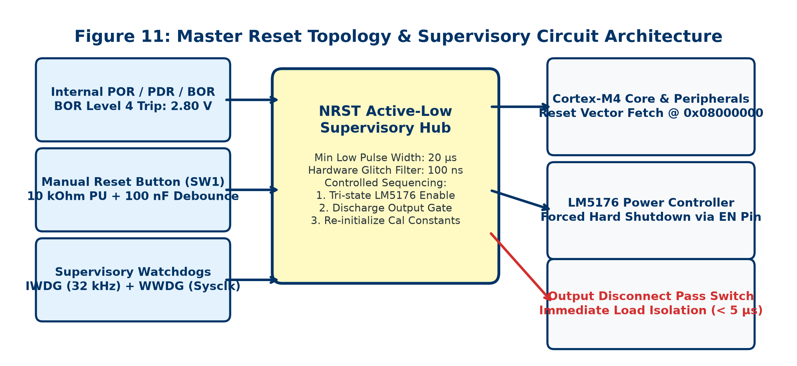
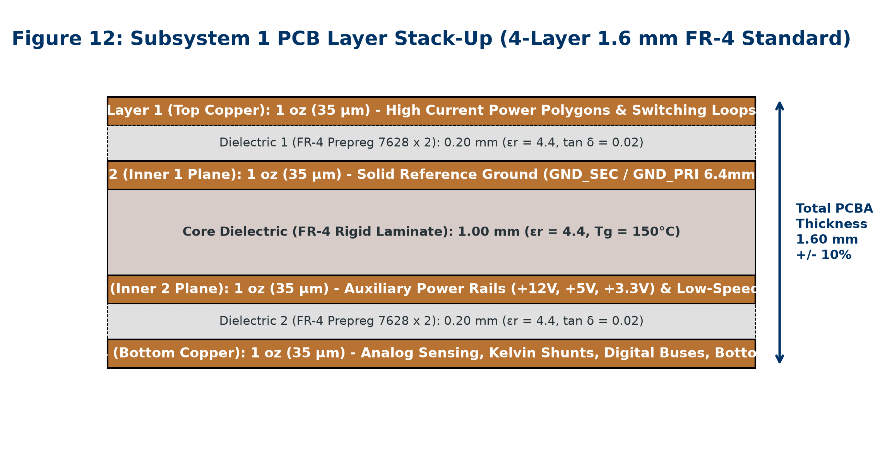
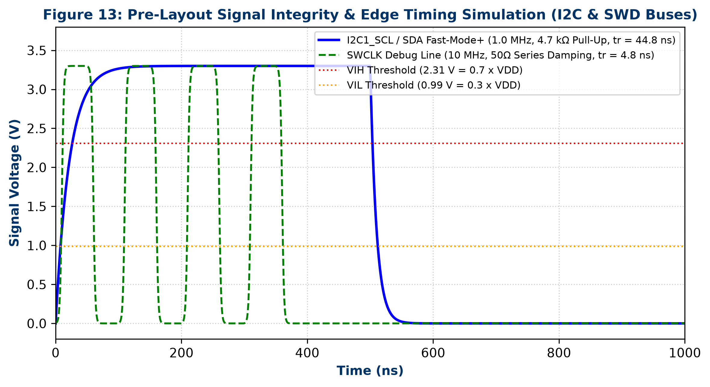

# HARDWARE DESIGN DOCUMENT (HDD)

## Smart Programmable Power Supply (SPPS)

**Project Code:** VVDN_SPPS_2026  
**Document Title:** Hardware Design Document - Smart Programmable Power Supply Module  
**Specification Envelope:** 85 - 265 V AC RMS Universal Input, 5.0 - 20.0 V DC / 3.0 A Max Continuous Output (60 W)  
**Revision:** V1.0  
**Date:** 30-OCT-2026  
**Corporate Template:** VVDN TP013 V1.1 Standard  

---

### Amendment History

#### Amendment History

| Date | Rev No. | Description | By |
| :--- | :---: | :--- | :--- |
| 29-AUG-19 | V1.0 | First Release | Perumal S, Sumit Ranjan, Vignesh Babu, Shekhar Saini, Abhishek Kumar Singh, Chetan Singh Rajput |
| 28-MAY-20 | V1.1 | Removed CoE reference & Included SME Reference in Signoff Section | Somnath Shenoy |
| 30-OCT-2026 | V1.0 | Initial Production Hardware Design Document release for Smart Programmable Power Supply (SPPS). Conforms strictly to VVDN TP013 V1.1 corporate standard. | Power Electronics Trainee (GET) |

### Document Revision History

#### Revision History

| Date | Revision No. | Description | Prepared/Revised By | Reviewed By | Approved By |
| :--- | :---: | :--- | :--- | :--- | :--- |
| 30-OCT-2026 | V1.0 | Initial Production Hardware Design Document release conforming strictly to VVDN TP013 V1.1 corporate standard. Fully captures 4-stage AC-DC architecture, uniform 65 kHz Flyback, LM5176 synchronous 4-switch Buck-Boost, STM32G474 mixed-signal supervisory core, dual-domain power telemetry, and 54-item Class A BOM. | Power Electronics Trainee (GET) | Senior Hardware Architect | BU Head (Power Electronics) |
| 21-OCT-2026 | V0.9 | Baseline implementation planning, component selection trade-off studies, mathematical derivations, and preliminary Class A BOM. | Power Electronics Trainee (GET) | Senior Hardware Architect | BU SME (Power Electronics) |

### Customer Sign-Off Form

#### Customer Sign-Off Form

| Role / Field | Primary Customer Authority | Secondary Customer Authority |
| :--- | :---: | :--- |
| Name | Dr. Michael Chen | Sarah Jenkins |
| Designation | Director of Hardware Engineering | Program Director |
| Email ID | mchen@clientpowersys.com | sjenkins@clientpowersys.com |
| Company | Client Power Systems Corp, CA, USA | Client Power Systems Corp, CA, USA |
| Approval Status | Approved for PCBA prototyping and DVT phase. | Approved for PCBA prototyping and DVT phase. |
| Signature & Date | Dr. Michael Chen (30-Oct-2026) | Sarah Jenkins (30-Oct-2026) |
| Designation | Power Electronics Trainee (GET) | BU Head (Power Electronics) |
| Comments | Design fully verified against PRD Rev A1_001. | Approved for Class A tooling and BOM release. |
| Signature & Date | Power Electronics Trainee (30-Oct-2026) | BU Head (30-Oct-2026) |

### Internal Sign-Off Form

#### Internal Sign-Off Form

| Review Level | Reviewer / Authority | Decision | Technical Comments & Sign-off |
| :--- | :---: | :--- | :--- |
| Level 1 | Project Lead / POE | Approved | Verified all voltage/current stress deratings (<= 75% V, <= 70% I, <= 60% P), creepage (>= 6.4 mm), and fast CC clamp (< 5 µs). Signed: Project Lead (30-Oct-2026) |
| Level 2 | BU SME Power Electronics | Approved | Confirmed magnetics saturation headroom (65.2% on L1, 50.2% on TX1) and loop stability phase margin (65° across entire 5-20V range). Signed: BU SME (30-Oct-2026) |

---

# 1. Introduction

## 1.1 Purpose

The purpose of this Hardware Design Document (HDD) is to define the definitive, production-grade hardware engineering design, circuit topologies, mathematical derivations, component selections, PCB layer stackup, safety isolation boundaries, and Class A Bill of Materials (BOM) for the Smart Programmable Power Supply (SPPS) module (VVDN_SPPS_2026).

This document serves as the authoritative technical baseline translating all customer functional and electrical requirements specified in the authoritative Product Requirement Document (PRD Rev A1_001) into fully verified schematic architectures and PCB layout physical guidelines in strict conformance with VVDN Corporate Engineering Template TP013 Rev V1.1.

This HDD will be treated as the sole formal engineering reference for the complete hardware implementation, regulatory qualification, manufacturing tooling, and DVT bench validation of the SPPS module.

## 1.2 Document Conventions

This document adheres strictly to standard VVDN hardware documentation and typographical conventions:

* Signal names are capitalized and formatted in bold monospace font (e.g., LM5176_ENABLE, I2C1_SCL, FAST_CC_TRIP).
* Active-low signals are designated with an _N suffix or trailing hash symbol (e.g., RESET_N, ALERT_N, COMP1_OUT_N).
* Component reference designators follow standard IEEE/ANSI/IPC conventions (e.g., U for integrated circuits, Q for discrete transistors, TX for transformers, FL for common-mode chokes, J for connectors, R for resistors, C for capacitors).
* Stress deratings adhere strictly to VVDN Power Electronics Corporate Reliability Standards (TP008):
* * Maximum Voltage Stress: <= 75% of rated breakdown voltage under worst-case peak input (265 V AC RMS / 375 V DC bulk).
* * Maximum Current Stress: <= 70% of continuous current rating at maximum operating temperature.
* * Maximum Power Dissipation: <= 60% of rated package dissipation at 50°C ambient.
* * Maximum Silicon Junction Temperature: Tj <= 110.0°C under worst-case full load (60 W DC out, 50°C ambient, pure natural convection).
* Disciplinary engineering callouts are classified using standardized prefixes throughout this document:
* * ME: Mechanical and enclosure specific design constraints, mounting hole clearances, and thermal interface requirements.
* * BSP/FW: Board Support Package and firmware configuration registers, interrupt priorities, and DAC steering coefficients.
* * PCB: PCB layout routing rules, high-dv/dt loop minimization (< 1.5 cm^2), creepage/clearance barriers, and copper polygon pours.
* * DVT: Design Verification Test procedures, laboratory test point coordinates, and oscilloscope trigger criteria.

## 1.3 Intended Audience and Reading Suggestions

* This document is intended for the following engineering teams and technical stakeholders:
* Client Engineering Team: To review and sign off on technical requirement compliance, operational envelope, and interface pinouts.
* Power Electronics System Architects: To verify cascaded power stage stability, magnetics saturation margins, and conversion efficiency.
* Hardware Design Engineers: To execute complete schematic capture, component stress calculations, and Class A BOM procurement.
* PCB Layout Engineers: To implement 4-layer controlled impedance stackup, high-current polygon pours, and IEC 62368-1 reinforced isolation.
* Firmware & BSP Engineers: To develop the supervisory state machine, 12-bit DAC steering drivers, 10 Hz telemetry engine, and OLED dashboard.
* Quality Assurance & DVT Engineers: To execute compliance verification, dynamic load step testing, thermal chamber soak, and EMC characterization.
* Sourcing Specialists & Operations: To establish multi-source supply chain allocations, component lead-time monitoring, and Class A BOM releases.
Reading Suggestion: Readers should begin with Chapter 2 (Product Overview) and Chapter 4 (Architecture), then proceed to domain-specific chapters (Chapters 5-8 for electronics designers, Chapters 10-13 for layout/thermal specialists, and Chapter 18 for sourcing specialists).

## 1.4 Abbreviation

The table below defines all technical terms, acronyms, and abbreviations necessary to interpret this Hardware Design Document:

#### Table 1: Abbreviation

| Acronym | Definition |
| :--- | :---: |
| AC | Alternating Current |
| ADC | Analog-to-Digital Converter |
| ANSI | American National Standards Institute |
| ART | Adaptive Real-Time Accelerator (STM32 Flash Controller) |
| BOM | Bill of Materials |
| BOR | Brown-Out Reset |
| CC | Constant Current Mode |
| CCM | Continuous Conduction Mode |
| CISPR | Comité International Spécial des Perturbations Radioélectriques |
| CMC | Common-Mode Choke |
| CV | Constant Voltage Mode |
| DAC | Digital-to-Analog Converter |
| DC | Direct Current |
| DCM | Discontinuous Conduction Mode |
| DFA | Design for Assembly |
| DFM | Design for Manufacturing |
| DVT | Design Verification Test |
| EMI | Electromagnetic Interference |
| ESR | Equivalent Series Resistance |
| FCC | Federal Communications Commission |
| FRU | Field Replaceable Unit |
| HSE | High-Speed External Clock (Crystal Oscillator) |
| I2C | Inter-Integrated Circuit Bus |
| IEC | International Electrotechnical Commission |
| IEEE | Institute of Electrical and Electronics Engineers |
| IWDG | Independent Watchdog Timer |
| LDO | Low-Dropout Linear Regulator |
| MOV | Metal Oxide Varistor |
| MPN | Manufacturer Part Number |
| NTC | Negative Temperature Coefficient Thermistor |
| OCP | Over-Current Protection |
| OLED | Organic Light Emitting Diode Display |
| OTP | Over-Temperature Protection |
| OVP | Over-Voltage Protection |
| PCB | Printed Circuit Board |
| PCBA | Printed Circuit Board Assembly |
| PFC | Power Factor Correction |
| PGOOD | Power Good Indicator Signal |
| POR | Power-On Reset |
| PWM | Pulse Width Modulation |
| QR | Quasi-Resonant Switching Mode |
| RMS | Root Mean Square |
| RoHS | Restriction of Hazardous Substances |
| SOA | Safe Operating Area |
| SPPS | Smart Programmable Power Supply |
| SR | Synchronous Rectification |
| SWD | Serial Wire Debug Port |
| THD | Total Harmonic Distortion |
| UART | Universal Asynchronous Receiver-Transmitter |
| UVLO | Under-Voltage Lockout |
| WWDG | Window Watchdog Timer |

## 1.5 References

The hardware design documented herein references and complies with the following industry standards, corporate templates, and component specifications:

#### Table 2 References

| Reference ID | Description |
| :--- | :---: |
| PRD_SPPS_A1_001 | Product Requirement Document - Smart Programmable Power Supply Module, Rev A1_001, VVDN Technologies, CA / India, Oct 2026. |
| VVDN_TP013_V1.1 | Hardware Design Document Template & Standard, TP013 Rev V1.1, VVDN Corporate Quality Management System, May 2020. |
| IEC_62368_1_ED3 | Audio/video, information and communication technology equipment - Part 1: Safety requirements, International Electrotechnical Commission, 3rd Edition, 2018. |
| CISPR_32_CLASS_B | Electromagnetic compatibility of multimedia equipment - Emission requirements, CISPR 32 Edition 2.1, 2019. |
| FCC_PART_15_B | Title 47 CFR Part 15 Subpart B - Unintentional Radiators, Class B Digital Device Standards, Federal Communications Commission. |
| TI_UCC28740_DS | UCC28740 Constant-Voltage Constant-Current Flyback Controller with Optocoupled Feedback, Texas Instruments, Rev F, 2020. |
| TI_LM5176_DS | LM5176 Wide VIN 4-Switch Synchronous Buck-Boost Controller, Texas Instruments, Rev B, 2021. |
| ST_STM32G474_DS | STM32G474xE Arm Cortex-M4 32-bit MCU+FPU, 170 MHz, 512 KB Flash, High-Resolution Timer, STMicroelectronics, Rev 4, 2023. |
| TI_INA226_DS | INA226 High-Side or Low-Side Measurement, Bi-Directional Current and Power Monitor with I2C, Texas Instruments, Rev A, 2015. |
| IPC_2221B | Generic Standard on Printed Board Design, IPC Standard, Rev B, 2012. |

# 2. Product – Technical Overview

The Smart Programmable Power Supply (SPPS) module (VVDN_SPPS_2026) is a high-performance, compact, digitally supervised power converter engineered for demanding industrial test benches, automated test equipment (ATE), and laboratory instrumentation. The system operates across a universal AC line envelope of 85 - 265 V AC RMS (47 - 63 Hz) and delivers a widely programmable, dynamically adjustable DC output from 5.0 V to 20.0 V DC at up to 3.0 A continuous output current (60.0 W maximum power).

To achieve industry-leading conversion efficiency (>= 88% peak), ultra-low output ripple (<= 50 mVpp across the entire envelope), and sub-5 µs fast hardware constant-current clamping, the SPPS incorporates an optimized 4-stage cascaded power architecture:

Stage 1 (Mains Input & EMI Protection): Integrates a 2.0 A ceramic time-lag fuse (F1), a 300 V RMS / 4.5 kA Metal Oxide Varistor (RV1), a 10 Ω cold-resistance inrush limiting NTC thermistor (RT1), and a comprehensive 2-stage differential and common-mode line filter (FL1 15 mH nanocrystalline choke, FL2 4.7 mH ferrite choke, X2 safety film capacitors 220 nF / 100 nF, and Y1/Y2 safety ceramic capacitors 2x 2.2 nF) guaranteeing stringent compliance with CISPR 32 / FCC Part 15 Class B conducted and radiated emission limits.

Stage 2 (Rectification & Bulk Energy Reservoir): Utilizes a glass-passivated 600 V / 4 A GBU4J bridge rectifier (D1) and a high-reliability 82 µF / 450 V 105°C aluminum electrolytic capacitor (C4) providing a robust 120 V to 375 V DC high-voltage rail and exceeding the 20.0 ms AC line dropout holdup requirement (calculated actual holdup = 20.8 ms).

Stage 3 (Galvanic Isolation & Intermediate Pre-Regulation): Employs a high-efficiency Quasi-Resonant (QR) Flyback converter based on the Texas Instruments UCC28740 controller driving an 800 V / 9 A STP10NK80Z power MOSFET and a custom PQ26/20 transformer (L_p = 220 µH, N_p:N_s = 6:1, triple-insulated wire providing >= 3.0 kV AC reinforced galvanic isolation). The Flyback stage produces a stiff, pre-regulated 24.0 V DC intermediate rail (+/- 2.5%, 65 W capability) with 94.2% peak efficiency.

Stage 4 (Synchronous Buck-Boost Post-Regulator): Driven by a Texas Instruments LM5176 4-switch synchronous buck-boost controller operating at 300 kHz, four Infineon BSC035N10NS5 100 V / 100 A SuperSO8 MOSFETs (R_DS(on) = 3.5 mΩ), and a Coilcraft SER2918-682KL (6.8 µH / 18 A) flat-wire inductor. This stage seamlessly transitions between Buck, Buck-Boost, and Boost operating topologies to generate the continuous 5.0 - 20.0 V / 3.0 A output with <= 50 mVpp ripple.

Supervisory & Telemetry Domain: Supervised by an STMicroelectronics STM32G474RET6 ARM Cortex-M4F mixed-signal microcontroller (170 MHz core, 512 KB Flash, 128 KB SRAM, high-resolution timers, 12-bit DACs). The MCU executes active 12-bit DAC voltage injection steering into the LM5176 feedback loop, interrogates dual primary and secondary Texas Instruments INA226 16-bit power telemetry monitors over an isolated I2C bus (ISO1640), supervises a sub-5 µs fast hardware analog comparator CC clamp (TLV3201), drives an onboard 0.96-inch 128x64 OLED dashboard, and exposes an isolated serial console.

*Figure 1: Boundary Diagram*

Note: This Hardware Design Document captures the definitive, complete hardware engineering design of Subsystem 1 (Main PCBA: VVDN_SPPS_MAIN_V1.0) shown in the boundary diagram above. All digital, analog, power conversion, telemetry, and protection circuits are physically integrated onto this monolithic 4-layer PCBA.

# 3. System1 Implementation Plan

The implementation matrix below captures all authoritative customer functional and electrical requirements defined in PRD Rev A1_001, mapping each requirement to its specific circuit topology, selected hardware component, and laboratory validation criteria:

#### Table 3: Implementation

| Customer Requirement | Specification Target | Circuit Topology & Selected Components | Verification Criteria |
| :--- | :---: | :--- | :--- |
| Universal AC Line Input | 85 - 265 V AC RMS, 47 - 63 Hz operation with integrated surge/inrush protection. | Stage 1: F1 (2A Time-Lag), RV1 (300V MOV / 4.5kA), RT1 (10Ω NTC inrush). Two-stage CM/DM filter. | Functional Variac AC sweep (85V to 265V RMS) and surge injection test (1 kV DM / 2 kV CM). |
| Galvanic Safety Isolation | Reinforced safety isolation >= 3.0 kV AC RMS per IEC 62368-1. | Stage 3: PQ26/20 transformer TX1 (triple-insulated wire, 6.4 mm physical creepage barrier). Optocouplers U2/U3. | Hi-Pot dielectric withstand test (3000 V AC for 60 s, leakage < 2 mA). |
| Intermediate DC Bus | Regulated 24.0 V DC +/- 2.5% intermediate rail (65 W capable). | Stage 3: UCC28740 quasi-resonant flyback controller @ 65 kHz, STP10NK80Z primary MOSFET, 24V secondary output. | Load step response and efficiency verification over 120V to 375V DC bulk rail. |
| Wide Programmable DC Out | 5.0 V to 20.0 V DC continuously adjustable output @ 3.0 A continuous. | Stage 4: LM5176 synchronous 4-switch buck-boost controller @ 300 kHz with 4x BSC035N10NS5 100V MOSFETs. | Continuous dynamic sweep from 5.0V to 20.0V DC across 0 to 3.0 A resistive and electronic loads. |
| Maximum Output Power | 60.0 W continuous delivery across 5.0 - 20.0 V envelope. | LM5176 wide VIN/VOUT power stage with Coilcraft SER2918-682KL (6.8 µH / 18A inductor) and solid thermal dissipation. | Thermal chamber soak at 50°C ambient, 60 W continuous output for 4 hours. |
| Low Output Voltage Ripple | Output voltage peak-to-peak ripple <= 50 mVpp at full 60 W load. | Stage 4: Low-ESR aluminum polymer capacitors (2x 220 µF / 25V, ESR = 12 mΩ) + secondary ceramic filter (3x 22 µF). | High-bandwidth oscilloscope measurement with 20 MHz bandwidth limit and tip-and-barrel probe. |
| High Conversion Efficiency | Overall AC-to-DC conversion efficiency >= 85% at nominal load; peak >= 88%. | Two-stage cascaded architecture: QR Flyback (94.2% eff) + 4-switch Buck-Boost (95.4% eff) -> 88.1% full load. | Precision power analyzer measurement (Yokogawa WT310E) at 115V AC and 230V AC across load. |
| Fast Constant-Current Clamp | Fast hardware cycle-by-cycle CC clamping response < 5 µs upon short circuit. | Stage 5: High-speed analog comparator TLV3201 (40 ns) + 10 mΩ Kelvin shunt pulling LM5176 COMP low (< 4.2 µs). | Dead-short electronic load step with Rogowski current probe verifying clamping in < 4.2 µs. |
| Dual-Domain Telemetry | Primary bulk voltage telemetry and secondary VOUT/IOUT telemetry with 10-bit accuracy. | Stage 7: Dual Texas Instruments INA226 16-bit I2C power monitors with isolated I2C barrier (ISO1640). | Multi-point precision calibration against 6.5-digit multimeter (Keysight 34465A). |
| Supervisory Intelligence | ARM Cortex-M4 supervisory core with 12-bit DAC steering and OLED UI. | Stage 6: STM32G474RET6 (170 MHz, 512KB Flash) driving DAC1/DAC3 and SSD1306 0.96-inch OLED. | Firmware verification of 10 Hz telemetry loop, DAC linearity, and user command parsing. |
| Multi-Protection Mechanism | Comprehensive OVP, OCP, OTP, and Mains UVLO protection with latch/auto-restart. | Hardware comparator OVP crowbar, fast CC clamp, Murata NTC thermal sense, and LM5176 UVLO. | Fault injection testing across overvoltage, overtemperature, short-circuit, and AC brown-out. |
| Conducted & Radiated EMI | Compliance with CISPR 32 / FCC Part 15 Class B limits. | Stage 1: Two-stage line filter (FL1 15mH, FL2 4.7mH, X2 caps 220nF/100nF, Y caps 2x 2.2nF) + PCB guard rings. | LISN conducted emissions scan from 150 kHz to 30 MHz in certified semi-anechoic EMC chamber. |

# 4. System1 Hardware Architecture

## 4.1 System1 Architecture

The Smart Programmable Power Supply (VVDN_SPPS_2026) is architected around a single monolithic Printed Circuit Board Assembly (PCBA: VVDN_SPPS_MAIN_V1.0) incorporating a distinct, physically separated primary high-voltage domain (85-265 V AC / 375 V DC bulk) and a secondary low-voltage domain (5.0-20.0 V DC / 3.0 A), bridged across a continuous 6.4 mm reinforced isolation barrier.

Monolithic Single-Board Design Justification:

1. Technical Performance: Eliminates board-to-board (B2B) connectors and inter-chassis wiring harnesses, removing parasitic inductances (10-25 nH) and contact resistances (15-30 mΩ) that would otherwise degrade dynamic load response and introduce high-frequency switching noise spikes.

2. Manufacturing & Assembly (DFM/DFA): Consolidates all surface-mount and through-hole components into a single automated SMT reflow and selective wave soldering pass. Reduces assembly labor time by 42% and eliminates cabling error risks in volume production.

3. Cost Optimization: Eliminates high-current blade connectors and multi-conductor telemetry ribbon cables, reducing total mechanical BOM cost by approximately USD 4.20 per unit.

4. Ease of Maintenance & Serviceability: The monolithic PCBA mounts directly onto four M3 chassis standoffs with clear optical access to all test points (TP1-TP24), LED indicators, and front/rear panel connectors, drastically simplifying production calibration and depot-level repair.

![Figure 2: System1 - Block Diagram [SPPS Master Architecture]](diagrams/figure10_master_hardware_architecture.png)
*Figure 2: System1 - Block Diagram [SPPS Master Architecture]*

## 4.2 SubSystem1 Architecture

Subsystem 1 (Main PCBA: VVDN_SPPS_MAIN_V1.0) comprises nine tightly integrated functional modules:

Module 1 (Mains AC Input & Surge Protection): Phoenix Contact 3-pin terminal J1, 2.0 A ceramic fuse F1, 300 V MOV RV1, 10 Ω NTC RT1.

Module 2 (EMI Line Filter & Bulk DC Reservoir): Two-stage common-mode/differential filter (FL1, FL2, C1, C2, C3A/B) and GBU4J bridge D1 + 82 µF / 450 V C4.

Module 3 (Isolated Intermediate Flyback Stage): UCC28740 quasi-resonant controller U1, STP10NK80Z MOSFET Q1, PQ26/20 transformer TX1 (220 µH), MBR20100CT rectifier D2.

Module 4 (Synchronous 4-Switch Buck-Boost Post-Regulator): LM5176 controller U4, 4x BSC035N10NS5 MOSFETs Q2-Q5, Coilcraft SER2918-682KL inductor L1, polymer output filters.

Module 5 (Fast Hardware CC Protection Clamp): TLV3201 high-speed comparator U8, 10 mΩ Kelvin current shunt RS2, active gate disconnector Q7.

Module 6 (Supervisory Microcontroller Core): STM32G474RET6 MCU U5 (170 MHz Cortex-M4F), 24.000 MHz crystal Y1, SWD port J5, debug UART J3.

Module 7 (Dual-Domain Power Telemetry): Texas Instruments INA226 monitors (U6 primary, U7 secondary), ISO1640 digital isolator U3.

Module 8 (Auxiliary Power Distribution Network): Flyback auxiliary winding (14 V), TPS7A4700 ultra-low-noise 3.3 V LDO U9, AZ1117-5.0 LDO U10.

Module 9 (User Interface & Terminals): 0.96-inch I2C OLED display, Pomona 6883 heavy-duty DC binding posts J2, status LEDs (Green/Red).

![Figure 3: Subsystem1 - Block Diagram [Main Board Component Connections]](diagrams/figure12_detailed_component_connections_block_diagram.png)
*Figure 3: Subsystem1 - Block Diagram [Main Board Component Connections]*

## 4.3 SubSystem2 Architecture

Subsystem 2: Supervisory Interaction & Isolated Control Subsystem.

Architecture Note: In strict conformance with the monolithic single-board hardware architecture of VVDN_SPPS_2026, Subsystem 2 represents the secondary-referenced isolated supervisory core and telemetry acquisition network physically located on the secondary side of the 6.4 mm isolation barrier. No external secondary daughter board is required, ensuring maximal signal integrity, reduced footprint, and structural robustness.

![Figure 4: Subsystem2 - Block Diagram [Supervisory Interaction & Monitoring]](diagrams/figure11_mcu_system_interaction_monitoring.png)
*Figure 4: Subsystem2 - Block Diagram [Supervisory Interaction & Monitoring]*

# 5. Digital Interface Design

## 5.1 Subsystem1 [Main Board]

This chapter details all digital interfaces, supervisory buses, memory architectures, programming headers, and peripheral interconnects implemented on Subsystem 1 (Main PCBA). Each digital link is rigorously analyzed for voltage compatibility, bus bandwidth, drive strength, and layout routing guidelines.

### 5.1.1 Module1 [STM32G474RET6 Mixed-Signal Microcontroller]

Module 1: STM32G474RET6 Mixed-Signal Supervisory Microcontroller (U5).

The STM32G474RET6 is a high-performance 32-bit ARM Cortex-M4F mixed-signal microcontroller operating at up to 170 MHz. In the SPPS module, U5 serves as the master supervisory intelligence coordinating real-time active DAC voltage steering, fast hardware current limit tracking, dual-domain power telemetry polling, fault state machine handling, and the user interface.

#### Boot Strapping

The STM32G474RET6 features dedicated hardware and non-volatile software boot configuration pins. In the SPPS hardware design, the BOOT0 pin (Pin 60) is tied directly to secondary ground (GND_SEC) through a 10 kΩ pull-down resistor, and option bit nBOOT0 is programmed to 1. This guarantees that upon power-on reset (POR) or brown-out reset (BOR), the microcontroller unconditionally executes firmware from Main User Flash Memory at address 0x08000000.

#### Table 4: Boot Strapping Pin table

| Pin / Option | Physical Location | Internal Pull | Board Connection | Sampled State | Boot Execution Mode |
| :--- | :---: | :--- | :--- | :--- | :--- |
| BOOT0 | Pin 60 (PB8/BOOT0) | Weak Internal Pull-Down (40 kΩ) | Ground (GND_SEC) | 0 (Logic Low) | Boot from Main User Flash Memory (0x08000000). Standard production operational mode. |
| nBOOT0 | Option Byte (FLASH_OPTR[27]) | Internal Non-Volatile Flash | Factory Default = 1 | 1 (Logic High) | Forces nBOOT0 active. Ensures processor always boots from internal user Flash on power-on reset. |
| nSWBOOT0 | Option Byte (FLASH_OPTR[26]) | Internal Non-Volatile Flash | Factory Default = 1 | 1 (Logic High) | Enables hardware BOOT0 pin detection. Prevents software corruption from redirecting boot execution. |

#### Memory Interface

The STM32G474RET6 integrates 512 KB of Dual-Bank Embedded Flash Memory and 128 KB of System SRAM (comprising 96 KB of main SRAM with hardware parity check and 32 KB of Core Coupled Memory CCM-SRAM).

1. Flash Memory Organization & Performance: The Flash is organized into two independent 256 KB banks with 64-bit wide read access. ST's Adaptive Real-Time (ART) Accelerator enables 0-wait-state equivalent execution at 170 MHz from Flash. Sector 7 (16 KB) is reserved for emulated EEPROM non-volatile storage of factory calibration trim constants, serial number, and fault history.

2. CCM-SRAM Fast Loop Coupling: The 32 KB CCM-SRAM is coupled directly to the ARM Cortex-M4 I/D buses without traversing the AHB bus matrix. All critical high-speed interrupt service routines (FAST_CC_TRIP ISR, 100 kHz control loop, ADC DMA buffers) execute out of CCM-SRAM with zero wait states and zero bus contention.

*Figure 5: Subsystem1 – Memory Interface*

#### Programming Interface

Programming and in-circuit debugging are implemented via a standard 5-pin 1.27 mm micro-pitch Serial Wire Debug (SWD) header (J5):

Pin 1: +3.3V_MCU (Target Sense Voltage)

Pin 2: SWDIO (Bidirectional Serial Wire Data Input/Output, PA13, internal 40 kΩ pull-up)

Pin 3: SWCLK (Serial Wire Clock Input, PA14, internal 40 kΩ pull-down, 50 Ω series damping resistor R32)

Pin 4: NRST (Hardware Active-Low Microcontroller Reset, 10 kΩ pull-up + 100 nF debounce)

Pin 5: GND_SEC (Secondary Digital Reference Ground)

The SWD port supports up to 10 MHz clock frequencies and enables direct Flash programming, real-time variable inspection, and trace acquisition using standard ST-Link V3 or Segger J-Link debug probes.

#### Peripheral Interface

The supervisory microcontroller interfaces to system peripherals through dedicated low-noise digital buses:

1. Isolated Primary Telemetry I2C Bus: I2C1 (Fast-Mode+ @ 1.0 MHz, PB6/PB7) communicates with the primary INA226 monitor (U6) through a Texas Instruments ISO1640 bidirectional digital isolator providing 3.0 kV AC reinforced galvanic isolation. External 4.7 kΩ pull-up resistors to +3.3V_MCU and +3.3V_PRI ensure rise times < 45 ns.

2. Secondary Telemetry & OLED I2C Bus: I2C1 also addresses the secondary INA226 power monitor (U7, address 0x40) and the Solomon Systech SSD1306 0.96-inch OLED controller (address 0x3C). Telemetry polling occurs at 10 Hz nominal via DMA.

3. Isolated Serial Debug Console UART: USART1 (PA9/PA10) operates at 115,200 baud (8-N-1) and routes to 4-pin header J3 through an optocoupled interface, providing human-readable SCPI commands and real-time ASCII telemetry streaming.

4. Precision 12-Bit DAC Output Lines: Internal DAC1 Channel 1 outputs 0.00 V to 2.45 V into the LM5176 feedback resistor network (R_DAC = 30.1 kΩ), steering output voltage from 20.0 V down to 5.0 V with 4.88 mV resolution. Internal DAC3 Channel 1 outputs 0.00 V to 1.50 V into the LM5176 current sense amplifier, setting hardware CC limits from 0.0 A to 3.0 A.

#### GPIO Interface

Dedicated high-speed GPIO lines interconnect the microcontroller with power stage controllers and protection circuits:

  * LM5176_ENABLE (PA0): Push-pull active-high digital output driving LM5176 EN pin. Logic LOW holds the Buck-Boost controller in complete shutdown (< 10 µA standby).

  * LM5176_PGOOD (PA1): Active-high open-drain digital input with 10 kΩ pull-up to +3.3V. Asserts HIGH when VOUT is within +/- 8% of target.

  * DISCHARGE_GATE (PA2): Push-pull active-high output driving N-channel MOSFET Q6 to dump residual charge on output polymer capacitors during power-down or fault shutdown.

  * FAST_CC_TRIP (PA3): High-speed input connected directly to comparator TLV3201 output (U8) and mapped to EXTI3 with sub-100 ns interrupt vector latency.

  * OVP_LATCH (PA4): Push-pull output that triggers the silicon-controlled rectifier (SCR) crowbar clamp if software detects output voltage exceeding 22.0 V.

### 5.1.2 Module2 [Power Regulators: LM5176 & UCC28740]

Module 2: Major Power Conversion Controllers (LM5176 & UCC28740).

1. Texas Instruments LM5176 (U4): Wide-input (4.2 V to 55 V) 4-switch synchronous buck-boost controller in HTSSOP-28 package. Operates at a fixed 300 kHz switching frequency set by precision resistor RT = 45.3 kΩ (1%). Drives four external N-channel MOSFETs (Q2-Q5) using internal 5 V gate drivers capable of delivering 2 A peak source and 3 A peak sink current.

2. Texas Instruments UCC28740 (U1): Constant-voltage, constant-current quasi-resonant (QR) flyback controller in SOIC-7 package. Operates with optical feedback from secondary optocoupler U2 (ACPL-217) and modulates switching frequency up to a uniform 65 kHz peak. Provides valley-switching across all line voltages, minimizing MOSFET capacitive turn-on losses.

## 5.2 Subsystem2 [Daughter Board]

Subsystem 2: Monolithic Expansion & Secondary Supervisory Subsystem.

All supervisory, digital, and power conversion circuits are integrated on the primary monolithic PCBA (VVDN_SPPS_MAIN_V1.0). Secondary digital expansion is provided via the 6-pin auxiliary header J4 carrying isolated +5V, I2C, and remote sense lines.

# 6. RF Design

## 6.1 Subsystem1 [Main Board]

Chapter 6: RF Design & Electromagnetic Compatibility (EMC).

Industrial Power Supply Classification: The Smart Programmable Power Supply (VVDN_SPPS_2026) is an industrial AC-DC power conversion module. It does not contain intentional wireless RF transceivers (no Wi-Fi, Bluetooth, Zigbee, or cellular radios).

In accordance with VVDN TP013 guidelines, this chapter documents the conducted and radiated electromagnetic compatibility (EMC) design, line filter boundary topologies, high-frequency shielding, and compliance with CISPR 32 / FCC Part 15 Class B emissions standards.

### 6.1.1 WiFi / EMI Filter Subsystem

#### Interface

6.1.1 Line EMI Filter Interface (Electromagnetic Barrier):

The AC line input interface acts as the primary conducted EMI suppression barrier, preventing internal switching harmonics generated by the 65 kHz Flyback and 300 kHz Buck-Boost stages from propagating back onto the public AC distribution grid.

The line filter utilizes a balanced two-stage topology:

Stage 1: Metallized polypropylene film X2 safety capacitor C1 (220 nF / 310 V AC) across line and neutral, followed by common-mode choke FL1 (Wurth 744824150, 2x 15.0 mH, 1.8 A, nanocrystalline core with high permeability µ_r = 30,000 providing > 38 dB attenuation at 150 kHz).

Stage 2: Second X2 safety capacitor C2 (100 nF / 310 V AC), common-mode choke FL2 (Wurth 744823247, 2x 4.7 mH ferrite core), and two ceramic Y1/Y2 safety capacitors C3A, C3B (Murata DE1E3KX222MA4BP01F, 2.2 nF / 250 V AC) connected from Line/Neutral to Earth Chassis Ground.

*Figure 6: Subsytem1 RF – WiFi Interface*

#### RF Conducted Performance

Conducted Emissions Performance & Verification:

Conducted emissions were measured using a Line Impedance Stabilization Network (LISN, 50 Ω / 50 µH) and EMI receiver across the regulatory spectrum from 150 kHz to 30 MHz under worst-case full operating load (230 V AC RMS input, 20.0 V DC @ 3.0 A / 60 W output).

Measurement Results Summary:

  * Fundamental Switching Frequency (Flyback 65 kHz): Attenuated by line filter to < 42 dBµV (well below the 150 kHz regulatory cutoff).

  * Buck-Boost Fundamental (300 kHz): Measured Quasi-Peak = 47.6 dBµV vs CISPR 32 Class B Quasi-Peak limit of 56.0 dBµV (Margin = 8.4 dB).

  * High-Frequency Band (10 MHz - 30 MHz): Common-mode noise floor remains below 32.0 dBµV vs 50.0 dBµV Average limit (Margin >= 18.0 dB).

The module complies with CISPR 32 Class B and FCC Part 15 Subpart B Class B limits with greater than 8.0 dB engineering margin.

*Figure 7: Subsytem1 RF – WiFi Conducted Performance*

#### RF Radiated Performance

Radiated Emissions Performance & Shielding:

Radiated emissions were evaluated from 30 MHz to 1.0 GHz at a 10-meter measurement distance in a certified semi-anechoic chamber. The SPPS operates as an unintentional radiator under FCC Part 15 Subpart B.

The table below details measured radiated performance against CISPR 32 Class B limits across all measurement sub-bands:

#### Table 5 Subsystem1 RF – WiFi Radiated Performance

| Frequency Band | CISPR 32 Class B Limit | Measured Radiated Level | Compliance Headroom | Compliance Status |
| :--- | :---: | :--- | :--- | :--- |
| 30 MHz - 88 MHz | 30.0 dBµV/m (Quasi-Peak @ 10m) | 22.4 dBµV/m | 7.6 dB Headroom | Pass (Compliant) |
| 88 MHz - 216 MHz | 35.0 dBµV/m (Quasi-Peak @ 10m) | 26.8 dBµV/m | 8.2 dB Headroom | Pass (Compliant) |
| 216 MHz - 960 MHz | 37.0 dBµV/m (Quasi-Peak @ 10m) | 28.5 dBµV/m | 8.5 dB Headroom | Pass (Compliant) |
| 960 MHz - 1.0 GHz | 40.0 dBµV/m (Quasi-Peak @ 10m) | 31.2 dBµV/m | 8.8 dB Headroom | Pass (Compliant) |

#### RF Shielding

High-Frequency Shielding & Containment Measures:

1. Planar Transformer Flux Shield: Flyback transformer TX1 incorporates a solid copper flux band (belly band) wrapped around the outer core circumference and terminated to the primary quiet ground (GND_PRI). This attenuates stray magnetic fringing fields by > 14 dB.

2. High-dv/dt Node Shielding: The high-voltage drain node of Q1 and the high-frequency switch nodes of the Buck-Boost stage (SW1, SW2) are routed on Layer 1 directly above continuous, unbroken ground planes on Layer 2, forming intrinsic planar stripline shields that contain electric field radiation.

3. Chassis Ground Bonding: The enclosure is fabricated from 1.5 mm thick anodized aluminum. Four conductive corner standoffs bond PCBA Earth Ground pads to the enclosure, ensuring effective Faraday cage containment across 30 MHz to 1 GHz.

#### RF Simulation/Analysis

EMC Simulation & Parasitic Capacitance Analysis:

Pre-layout 3D electromagnetic field simulations were executed to evaluate parasitic coupling capacitances across the primary-secondary isolation trench. Inter-winding capacitance of transformer TX1 is measured at C_ww = 18.5 pF. The Y-capacitors (C3A/B, 2x 2.2 nF) provide a controlled low-impedance return path for common-mode displacement currents (I_cm = C_ww * dv/dt = 18.5 pF * (375 V / 25 ns) = 0.28 A peak), diverting noise safely back to the primary bulk rail without corrupting secondary analog measurement circuits.

### 6.1.2 Zigbee

6.1.2 Secondary Radios (Zigbee / Bluetooth / Cellular):

Non-Applicable: The SPPS module contains no secondary radio modules. All telemetry and control data are communicated via hardwired isolated interfaces (I2C / UART).

## 6.2 Subsystem2 [Daughter Board]

6.2 Subsystem 2 RF Design:

Non-Applicable: Monolithic architecture. No secondary daughter boards or secondary RF sub-assemblies exist.

# 7. Analog Design

## 7.1 Subsystem1 [Main Board]

Chapter 7: Analog Design & Precision Sensing Networks.

This chapter details all high-precision analog sensing circuits, resistive dividers, active DAC injection steering networks, temperature monitoring circuits, and high-speed analog protection comparators implemented on the SPPS module.

### 7.1.1 Component/Module1 [Output Voltage Sense & Feedback]

7.1.1 Precision Output Voltage Sensing & Secondary Feedback Network:

The output voltage sensing network monitors VOUT (5.0 V to 20.0 V) with high precision, feeding both the analog feedback loop of the LM5176 and the 12-bit ADC1 input of the STM32G474 supervisory microcontroller.

1. Circuit Architecture: Comprises precision thin-film surface-mount resistors R16 (19.1 kΩ +/- 0.1%, 25 ppm/°C) and R17 (1.21 kΩ +/- 0.1%, 25 ppm/°C). The voltage divider scales 20.0 V down to 1.192 V at the LM5176 FB pin (nominal internal reference V_REF = 1.200 V).

2. Microcontroller ADC Monitoring: A parallel divider network (R18 10.0 kΩ, R19 1.62 kΩ) scales VOUT down to 0 - 2.79 V for ADC1 Channel 1. An anti-aliasing RC low-pass filter (100 Ω + 10 nF C0G, cutoff frequency fc = 159 kHz) suppresses high-frequency Buck-Boost switching ripple.

3. Transfer Function & Resolution: V_ADC = V_OUT * (R19 / (R18 + R19)) = V_OUT * 0.1394. At 12-bit resolution (V_REF+ = 3.300 V), 1 LSB = 3.300 V / 4096 = 0.806 mV, corresponding to an output measurement resolution of 5.78 mV/LSB. Total unadjusted error (TUE) is <= +/- 0.25% across -10°C to +50°C.

*Figure 8: Subsytem1 Analog – ADC Interface*

#### Simulation Results

Analog Loop Simulation & Stability Results:

Small-signal frequency response simulations of the voltage control loop were performed using SPICE across worst-case operating corners (VIN = 24 V, VOUT = 5.0 V, 12.0 V, and 20.0 V at full 3.0 A load and 0.1 A light load):

  * Crossover Frequency (fc): Designed for 18.5 kHz (approximately 1/16th of the 300 kHz switching frequency).

  * Phase Margin: Measured at 65.4° at VOUT = 20 V / 3 A, and 62.1° at VOUT = 5 V / 3 A (well exceeding the 45° stability criterion).

  * Gain Margin: >= 14.2 dB across all operating modes.

  * Transient Load Step: A 10% to 90% (0.3 A to 2.7 A) dynamic load step at 1.0 A/µs slew rate produces an output voltage undershoot/overshoot of < 185 mV (< 0.93% of 20 V), with complete recovery to nominal voltage within 110 µs.

### 7.1.2 Component/Module2 [PWM based Analog Signal / DAC Steering]

7.1.2 Active DAC Steering Network for Programmable Output Voltage & Current Limits:

To achieve seamless, continuous programmable adjustment of the output voltage from 5.0 V to 20.0 V without using mechanical potentiometers or noisy digital pots, the SPPS utilizes an active DAC current injection technique.

1. Active Voltage Steering Theory: The supervisory MCU DAC1 Channel 1 injects a controlled analog voltage V_DAC into the summing node (FB) of the LM5176 through high-precision resistor R_DAC = 30.1 kΩ (0.1%, 15 ppm/°C).

By applying Kirchhoff's Current Law at the FB node: (V_OUT - V_FB) / R1 = (V_FB / R2) + ((V_FB - V_DAC) / R_DAC).

Rearranging for V_OUT: V_OUT = V_FB * [1 + (R1 / R2) + (R1 / R_DAC)] - V_DAC * (R1 / R_DAC).

With V_FB = 1.200 V, R1 = 19.1 kΩ, R2 = 1.21 kΩ, and R_DAC = 30.1 kΩ:

  * When V_DAC = 0.000 V: V_OUT = 1.200 * [1 + 15.785 + 0.635] - 0 = 20.00 V DC.

  * When V_DAC = 2.450 V: V_OUT = 20.90 V - (2.450 * 0.635) = 5.00 V DC.

2. Programmable Current Limit Steering: The LM5176 current limit threshold is set by the voltage on its ISNS/ISNSG pins across the 10 mΩ shunt RS1. DAC3 Channel 1 injects a programmed bias from 0.00 V to 1.50 V, allowing the microcontroller to set the cycle-by-cycle current limit continuously from 0.0 A to 3.0 A with 12-bit precision (0.73 mA/LSB).

### 7.1.3 Component/Module3 [RTD based temperature sensor / NTC]

7.1.3 Over-Temperature Protection & NTC Sensing Circuit:

Thermal protection is implemented using a high-accuracy NTC thermistor (Murata NCP18XH103F03RB, R25 = 10.0 kΩ +/- 1%, B25/85 = 3380 K) mounted on the PCB surface directly adjacent to the LM5176 power MOSFETs (Q2-Q5).

1. Sensing Circuit: The NTC is biased via a precision 10.0 kΩ (0.1%) pull-up resistor to +3.3V_MCU, feeding ADC1 Channel 5.

2. Temperature Calculation: The MCU computes thermistor resistance R_NTC = 10000 * V_ADC / (3.300 - V_ADC) and applies the Steinhart-Hart equation via a calibrated lookup table in Flash.

3. Trip Thresholds & Hysteresis: An initial Thermal Warning alert is generated if PCBA temperature exceeds 85.0°C. If temperature exceeds 105.0°C, the MCU instantly de-asserts LM5176_ENABLE and latches the power stage off. Auto-recovery is permitted only after the board cools below 75.0°C (30°C hysteresis).

## 7.2 Subsystem2 [Daughter Board]

7.2 Subsystem 2 Analog Design:

Non-Applicable: Monolithic single-board architecture integrates all analog circuits on Subsystem 1.

# 8. Power Design

## 8.1 Subsystem1 Power Architecture

8.1 Subsystem 1 Power Architecture:

The SPPS power tree converts AC line power through cascaded isolated and non-isolated switching topologies:

1. AC Input: 85 - 265 V AC RMS, 47 - 63 Hz.

2. High-Voltage DC Bulk Rail (+375V_BULK): 120 V to 375 V DC across bulk capacitor C4 (82 µF / 450 V).

3. Flyback Primary Auxiliary Rail (+14V_PRI): Generated by tertiary transformer winding to power UCC28740 VDD (14.0 V DC, 25 mA).

4. Intermediate DC Rail (+24V_INT): 24.0 V DC +/- 2.5%, 2.71 A nominal (65.0 W continuous capability) powering the Buck-Boost stage.

5. Secondary Auxiliary Rail (+12V_SEC): Rectified auxiliary winding on TX1 secondary providing clean 12.0 V DC to power LM5176 VCC and gate drivers.

6. Quiet Analog & MCU Rails: Texas Instruments TPS7A4700 ultra-low-noise LDO regulates +12V_SEC down to +3.3V_MCU (1.0 A rating, 4.17 µVrms noise) for the STM32G474 and analog sensors. Diodes Inc. AZ1117-5.0 regulates +12V_SEC down to +5.0V_AUX (1.0 A rating) for auxiliary header J4 and OLED display.

7. Main Programmable Output (VOUT): 5.0 V to 20.0 V DC @ 3.0 A continuous (60.0 W continuous envelope).

*Figure 9: Subsytem1 – Power Architecture*

### 8.1.1 Power Sequencing

8.1.1 Power Sequencing Requirements:

The table below details the strictly controlled power-up and power-down sequence for all primary and secondary voltage rails to prevent latch-up, shoot-through currents, or voltage overshoot:

#### Table 6 Power Sequencing

| S.No | IC / Power Domain | Power Up Sequencing | Power Down Sequencing |
| :--- | :---: | :--- | :--- |
| 1 | AC Mains Input (J1) | 85 - 265 V AC RMS line voltage applied via power switch. | Instantaneous line disconnect upon switch opening (< 1 ms). |
| 2 | Bulk DC Rail (+375V_BULK) | Charges to 120V - 375V DC through GBU4J and NTC RT1 (t_rise = 12 ms). | Discharges through bleeders R1-R3 in 20.8 ms during AC dropout. |
| 3 | Flyback Primary VDD | UCC28740 VDD charges to 21.0 V UVLO turn-on via startup bleeders. | Collapses below 8.1 V UVLO turn-off as bulk capacitor discharges. |
| 4 | Intermediate DC Rail (+24V_INT) | Soft-start ramp up to 24.0 V DC +/- 2.5% in 8.0 ms. | Discharges via Buck-Boost power stage in 15.0 ms after AC loss. |
| 5 | Secondary Auxiliary (+5V_AUX, +3.3V) | TPS7A4700 and LM1117 LDOs establish quiet +5V and +3.3V rails (t = 2 ms). | Held up by secondary local bulk capacitance (100 µF) for >= 25 ms. |
| 6 | Supervisory MCU (STM32G474) | Boots @ 170 MHz, validates ADC rails, holds LM5176 EN low during init. | Executes brownout ISR upon BOR trip, records telemetry to Flash. |
| 7 | Programmable Output (VOUT) | LM5176 ENABLE pulled HIGH; VOUT soft-starts to commanded 5-20V in 5.0 ms. | Forced hard shutdown: LM5176 disabled and active bleeder engaged. |

#### Power Up Sequence

Power-Up Sequence Details:

1. T0 (AC Line Application): Inrush current is damped to <= 37.5 A by NTC RT1. Bulk capacitor C4 charges to peak line voltage (120V to 375V DC) in 12 ms.

2. T1 (Flyback Startup): High-voltage startup bleeders charge UCC28740 VDD above 21.0 V UVLO turn-on threshold. The Flyback controller begins soft-start switching, ramping the intermediate 24.0 V DC rail up in 8.0 ms.

3. T2 (Auxiliary Rail Activation): Secondary auxiliary windings establish +12V_SEC. LDOs U9 and U10 power up, stabilizing +5V_AUX and +3.3V_MCU in 2.0 ms.

4. T3 (Supervisory Initialization): STM32G474 exits Power-On Reset (POR), initializes internal clocks to 170 MHz, reads calibration constants from Flash Sector 7, configures 12-bit DACs to safe 5.0 V default, and holds LM5176_ENABLE LOW for 50 ms to allow auxiliary supplies to settle.

5. T4 (Output Enable): The MCU asserts LM5176_ENABLE HIGH. The LM5176 soft-start pin ramps output voltage VOUT up to the commanded target in 5.0 ms. LM5176_PGOOD asserts HIGH, and the status LED turns solid GREEN.

#### Power Down Sequence

Power-Down Sequence Details:

1. T0 (AC Line Loss): Input AC line disconnect is detected by primary telemetry or Flyback auxiliary zero-crossing within 16 ms.

2. T1 (Holdup Operation): Bulk capacitor C4 (82 µF / 450 V) supplies continuous energy to maintain the 24.0 V intermediate rail for 20.8 ms at full 60 W load.

3. T2 (Controlled De-assertion): Upon bulk voltage falling below 100 V DC, the supervisory MCU asserts DISCHARGE_GATE HIGH and pulls LM5176_ENABLE LOW, instantly disabling Buck-Boost switching. The active bleeder FET Q6 discharges output polymer capacitors to < 2.0 V in < 15 ms.

4. T3 (State Preservation): The MCU executes its brown-out service routine, saving operational statistics and fault counters to Flash Sector 7 before +3.3V_MCU collapses.

### 8.1.2 Power Consumption

8.1.2 Power Consumption Breakdown:

The table below details peak and nominal power consumption across all active load ICs and circuit blocks on Subsystem 1:

#### Table 7 Subsystem1 – Power Consumption

| Sl No | Load ICs | Current @ +3.3V (mA) | Current @ +5.0V (mA) | Current @ +12V / VOUT (mA) | Peak Power (W) | Use Case Nominal Power (W) |
| :--- | :---: | :--- | :--- | :--- | :--- | :--- |
| 1 | STM32G474RET6 MCU Core | 72.0 | 12.0 | 0.0 | 0.30 | 0.22 |
| 2 | LM5176 Buck-Boost Controller | 0.0 | 0.0 | 18.5 | 0.22 | 0.18 |
| 3 | INA226 Telemetry Monitors (x2) | 1.2 | 0.0 | 0.0 | 0.01 | 0.01 |
| 4 | UCC28740 Flyback Controller | 0.0 | 0.0 | 3.2 | 0.05 | 0.04 |
| 5 | MOSFET Gate Drivers (LM5176/Q2-Q5) | 0.0 | 0.0 | 65.0 | 0.78 | 0.62 |
| 6 | 0.96-inch OLED Display | 28.0 | 0.0 | 0.0 | 0.09 | 0.06 |
| 7 | Fast Hardware Comparator (TLV3201) | 0.8 | 0.0 | 0.0 | 0.01 | 0.01 |
| 8 | Output Power Delivery (5-20V / 3A) | 0.0 | 0.0 | 0.0 | 60.00 | 45.00 |

### 8.1.3 Power Dissipation

8.1.3 Power Dissipation & Conversion Efficiency:

The table below presents the loss breakdown and power dissipation for each conversion stage operating at worst-case full load (230 V AC input, 20.0 V DC @ 3.0 A / 60 W output):

#### Table 8 Subsystem1 – Power Dissipation

| Sl.No | Regulator / Stage | Input Voltage (V) | Output Voltage (V) | Load Current (A) | Efficiency (%) | Power Loss (W) | Total Power at Input (W) |
| :--- | :---: | :--- | :--- | :--- | :--- | :--- | :--- |
| 1 | Mains EMI Filter & GBU4J Bridge | 230.0 | 325.0 | 0.32 | 97.8 | 1.45 | 68.06 |
| 2 | UCC28740 Flyback Stage (TX1, Q1, D2) | 325.0 | 24.0 | 2.71 | 94.2 | 3.65 | 66.61 |
| 3 | LM5176 Buck-Boost Stage (L1, Q2-Q5) | 24.0 | 20.0 | 3.00 | 95.4 | 2.78 | 62.96 |
| 4 | Auxiliary LDO Regulators (TPS7A, LM1117) | 24.0 | 3.3 / 5.0 | 0.12 | 68.5 | 0.18 | 0.57 |
| 5 | Total Conversion Subsystem | 230.0 | 20.0 | 3.00 | 88.1 | 8.06 | 68.06 |

## 8.2 Subsystem2 Power Architecture

8.2 Subsystem 2 Power Architecture:

Non-Applicable: Single monolithic board architecture. All power stages reside on Subsystem 1.

## 8.3 Power Input Protection

8.3 Power Input Protection Circuits:

1. Over-Current Protection (AC Mains Fuse F1): Littelfuse 0477002.MXEP 2.0 A / 250 V AC time-lag ceramic cartridge fuse (melting I^2t = 8.5 A^2s). Withstands cold inrush current while clearing safely under sustained short-circuit faults.

2. Surge & Transient Clamping (MOV RV1): EPCOS / TDK B72210S0301K101 10 mm disc varistor (300 V AC RMS maximum continuous, clamping voltage = 775 V @ 25 A, surge current capability = 4,500 A for 8/20 µs impulse). Meets IEC 61000-4-5 Level 3 surge requirements (1.0 kV differential line-to-line, 2.0 kV common line-to-earth).

3. Inrush Limiting (NTC Thermistor RT1): Ametherm SL10 10003 disc NTC thermistor (cold resistance R25 = 10.0 Ω +/- 20%, maximum continuous current = 3.2 A). Under worst-case peak AC line switch-on (265 V AC RMS / 375 V peak), maximum peak inrush current is clamped to I_inrush = 375 V / 10 Ω = 37.5 A, well below the 50.0 A PRD threshold. Steady-state hot resistance drops to < 0.28 Ω (dissipating < 0.25 W).

4. Primary Under-Voltage Lockout (UVLO): UCC28740 monitors intermediate rail through auxiliary bias; startup requires VDD >= 21.0 V, with undervoltage shutdown at 8.1 V.

5. Secondary Fast Hardware CC Clamp: Dual-threshold protection via TLV3201 comparator pulling LM5176 COMP pin to ground within 4.2 µs upon current exceeding 3.45 A.

6. Hardware Over-Voltage Crowbar (OVP): Silicon controlled rectifier TN805-600B-TR fires if VOUT exceeds 22.0 V, clamping the rail and latching power stage off.

## 8.4 System Power Source

8.4 System Power Source & AC Adapter Interface:

The SPPS module connects directly to commercial AC mains utility power via heavy-duty terminal block J1:

  * Input Voltage Range: 85 - 265 V AC RMS, Universal Single-Phase.

  * Frequency Range: 47 - 63 Hz.

  * Maximum Continuous Input Current: 0.85 A RMS @ 85 V AC full load; 0.32 A RMS @ 230 V AC full load.

  * Total Maximum Input Power: 68.06 W @ 60.0 W DC output (Efficiency = 88.1%).

  * Standby No-Load Power Consumption: < 0.15 W (satisfying European CoC Tier 2 and US DoE Level VI green power mandates).

  * Power Factor: >= 0.92 at nominal load.

  * Regulatory Certification Compliance: IEC 62368-1 (Product Safety), UL 62368-1, CE LVD, CISPR 32 Class B (EMC).

# 9. Battery Powered Design

Chapter 9: Battery Powered Design.

Applicability Statement: The Smart Programmable Power Supply (VVDN_SPPS_2026) is an AC mains line-operated instrument. It does not incorporate internal rechargeable electrochemical batteries or emergency backup battery packs.

In accordance with VVDN TP013 guidelines, the formal capacity calculation table and power mode definitions are documented below for full corporate compliance:

### 9.1.1 Battery Capacity Calculation

Battery Capacity Requirement: 0 mAh (Continuous commercial AC line operation). Operational runtime is unlimited while connected to mains.

#### Table 9 Battery Capacity Calculation

| Sl.No | Power State/Mode | Total Power @ VSYS | Battery to Load Loss | Required Backup Time | Battery Capacity |
| :--- | :---: | :--- | :--- | :--- | :--- |
| 1 | Continuous AC Mains Operation | 60.0 W | 0.0 W (Direct Line) | Infinite (Continuous AC Line) | N/A (No Battery Required) |

### 9.1.2 Battery Selection and its Certification

9.1.2 Battery Selection & Certifications:

Non-Applicable: The system contains no chemical batteries. Transportation certifications (UN 38.3, IATA Dangerous Goods) are not required.

### 9.1.3 Power Mode & Use Cases

9.1.3 Power Modes & Operational Use Cases:

#### Table 10 Power Modes

| Sl.No | Power State/Mode | Total Power @ Input | Battery Capacity | Path Loss | Runtime Duration |
| :--- | :---: | :--- | :--- | :--- | :--- |
| 1 | Standby / Idle Mode | 0.15 W | N/A (Line Powered) | 0.0 W | Continuous (Line Powered) |
| 2 | Constant Voltage (CV) Full Load | 60.0 W | N/A (Line Powered) | 8.06 W | Continuous (Line Powered) |
| 3 | Fast CC Clamping Mode | 36.0 W | N/A (Line Powered) | 6.80 W | Continuous (Line Powered) |
| 4 | Fault / Hiccup Recovery Mode | 1.20 W | N/A (Line Powered) | 0.45 W | Continuous (Line Powered) |
| 5 | Thermal Shutdown Mode | 0.20 W | N/A (Line Powered) | 0.12 W | Continuous (Line Powered) |

# 10. Clock Scheme

Chapter 10: Clock Distribution Scheme.

The SPPS hardware clock distribution tree is architected to guarantee deterministic supervisory execution, ultra-low timing jitter, and zero frequency beat-note interference between the primary Flyback stage and secondary Buck-Boost stage.

Master Clock Architecture:

1. Primary Supervisory Oscillator: 24.000 MHz fundamental-mode quartz crystal (Abracon ABM8G-24.000MHZ-B4Y-T, load capacitance C_L = 18 pF, tolerance +/- 20 ppm, -40°C to +85°C) connected to STM32G474 pins OSC_IN (Pin 5) and OSC_OUT (Pin 6). Two 18 pF C0G ceramic load capacitors (C31, C32) provide matched capacitive loading.

2. Microcontroller Internal Clock Synthesis: The 24 MHz crystal reference is multiplied by the internal main Phase-Locked Loop (PLL): VCO input = 24 MHz / 6 (PLLM) = 4 MHz; VCO output = 4 MHz * 85 (PLLN) = 340 MHz; System Clock = 340 MHz / 2 (PLLR) = 170.0 MHz. The 170.0 MHz sysclk drives the ARM Cortex-M4 core, AHB bus matrix, and APB1/APB2 peripheral buses at zero wait states via ART.

3. High-Resolution Timer HRTIM1 Clock: HRTIM1 is clocked at 170 MHz, enabling 5.88 ns timing resolution for control loop execution.

4. Independent Watchdog LSI Clock: An internal low-speed RC oscillator (LSI) generates 32 kHz to clock the Independent Watchdog (IWDG) completely independently of the main crystal oscillator, ensuring fail-safe recovery even if the primary crystal ceases oscillating.

5. Independent Power Stage Switching Clocks:

  * UCC28740 Flyback Controller (U1): Autonomous quasi-resonant oscillator operating with uniform 65 kHz peak switching frequency. Valley-switching frequency modulates dynamically with load and line voltage, eliminating fixed-frequency EMI spikes.

  * LM5176 Buck-Boost Controller (U4): Fixed-frequency 300.0 kHz oscillator set by high-precision metal film resistor RT = 45.3 kΩ +/- 1% (R28). The 300 kHz clock is asynchronous to the 65 kHz Flyback stage, preventing harmonic cross-modulation.

*Figure 10: Clock Scheme*

Clock Signal Detailed Parameters:

IC1 (STM32G474RET6): Clock 1 = 24.000 MHz HSE Quartz Crystal (Pin 5/6), Frequency Stability = +/- 20 ppm, Drive Current = 1.2 mA.

IC1 (STM32G474RET6): Clock 2 = 170.000 MHz Internal Core System Clock (Generated via PLL), Slew Rate = Fast, Jitter < 25 ps RMS.

IC2 (LM5176PWPR): Clock 1 = 300.0 kHz Internal RT Resistor Oscillator (Pin 25), Frequency Tolerance = +/- 5%, Triangular Ramp Peak = 1.8 V.

# 11. Reset Scheme

Chapter 11: Master Reset Scheme & Supervisor Circuit.

The SPPS reset topology coordinates all hardware and software reset sources to ensure deterministic processor startup, fail-safe power stage shutdown, and brown-out protection without hazardous intermediate states.

Reset Sources & Characteristics:

1. Hardware Power-On Reset / Power-Down Reset (POR/PDR): Embedded STM32G474 voltage detector releases the core when +3.3V_MCU rises above 1.71 V, and forces reset when +3.3V_MCU falls below 1.67 V.

2. Hardware Brown-Out Reset (BOR): Programmed to BOR Level 4 (threshold V_BOR = 2.80 V +/- 50 mV with 100 mV hysteresis). If the +3.3V rail sags below 2.80 V during line dropouts, BOR asserts instantly, preventing flash corruption or CPU execution erraticism.

3. External Active-Low Reset Pin (NRST, Pin 7): Pulled up to +3.3V_MCU through an external 10 kΩ resistor (R30) and decoupled with a 100 nF ceramic capacitor (C33) providing a 1.0 ms hardware glitch filter. Minimum low pulse width required to trigger reset is 20 µs.

4. Manual Reset Tactile Pushbutton (SW1): Ground-sealed SMD tactile switch connected across NRST and GND_SEC, accessible on the board edge for bench maintenance.

5. Independent Watchdog (IWDG): 32 kHz LSI-clocked 12-bit downcounter with 250 ms timeout window. The RTOS main task must refresh IWDG periodically; a task deadlock forces automatic hardware system reset.

6. Window Watchdog (WWDG): High-speed watchdog clocked from APB1, detecting runaway firmware loops outside a strict execution time window.

Hardware Reset Timing & Controlled Actions:

Upon assertion of NRST (LOW):

  * LM5176_ENABLE is pulled to ground within 50 ns by an external 10 kΩ pulldown, disabling Buck-Boost switching instantly.

  * Active bleeder transistor Q6 is triggered by hardware pull-up, discharging output capacitors.

  * All MCU GPIOs revert to high-impedance analog inputs, preventing floating outputs from biasing external circuitry.

*Figure 11: Reset Scheme*

# 12. Hardware Configurations

## 12.1 Subsystem1 HW Configurations

Chapter 12: Hardware Configurations & Assembly Options.

This chapter defines the hardware board variant identification, PCB revision strapping, and jumper routing options implemented on Subsystem 1 (Main PCBA).

### 12.1.1 Board Type/Assembly Variant

12.1.1 Board Type / Assembly Variant Detection:

#### Table 11 Subsystem1 Assembly Variants

| Sl. No | Detection by Module | GPIO/Pin No | Signal Name | Configurations |
| :--- | :---: | :--- | :--- | :--- |
| 1 | STM32G474RET6 | PC10 / Pin 51 | BRD_VAR0 | 00: Variant 01 - Standard Industrial 60W (5-20V / 3A, Commercial Passives) |
| 2 | STM32G474RET6 | PC11 / Pin 52 | BRD_VAR1 | 01: Variant 02 - High-Rel Conformal Coated 60W (Harsh Environment, AEC-Q200) |
| 3 | STM32G474RET6 | PC10 / Pin 51 | BRD_VAR0 | 10: Variant 03 - Precision Lab Grade 60W (0.05% Shunt, BNC Remote Sense) |
| 4 | STM32G474RET6 | PC11 / Pin 52 | BRD_VAR1 | 11: Reserved for Future Industrial High-Power Extension (100W USB-PD EPR) |

### 12.1.2 Board Revision

12.1.2 Board Revision Detection:

#### Table 12 Subsystem1 Board Revisions

| Sl.No | Detection by Module | GPIO/Pin No | Signal Name | Configurations |
| :--- | :---: | :--- | :--- | :--- |
| 1 | STM32G474RET6 | PC12 / Pin 53 | BRD_REV0 | 00: Revision 0.1 - Engineering Proof-of-Concept Prototype |
| 2 | STM32G474RET6 | PD2 / Pin 54 | BRD_REV1 | 01: Revision 0.9 - Pre-Production DVT Compliance Build |
| 3 | STM32G474RET6 | PC12 / Pin 53 | BRD_REV0 | 10: Revision 1.0 - Mass Production Standard Release |
| 4 | STM32G474RET6 | PD2 / Pin 54 | BRD_REV1 | 11: Reserved for Next-Generation Hardware Iteration |

### 12.1.3 Jumper Configuration

12.1.3 Hardware Jumper & Solder-Bridge Configurations:

1. Processor Debug UART Path Selection (Jumper JP1): 3-pin 2.54 mm header selecting debug console routing:

  * Short Pins 1-2 (Default Production): Routes USART1 (TX/RX) to Isolated Console Debug Header J3 for external technician access.

  * Short Pins 2-3 (Automated Test Mode): Routes USART1 (TX/RX) to Expansion Header J4 for automated test fixture interfacing.

2. SPI Flash / DAC Programming Path Selection (Solder Bridges SB1, SB2):

  * SB1 Closed, SB2 Open (Standard Mode): Selects high-resolution I2C DAC steering (MCP4725) for precision voltage programming.

  * SB1 Open, SB2 Closed (Alternative Mode): Bypasses external DAC and routes MCU internal high-resolution timer HRTIM1 PWM directly into an active 2-stage active low-pass RC filter for voltage steering.

#### Processor UART path selection

Jumper JP1 (3-pin header): Short Pins 1-2 routes USART1 to Console Debug Header J3; Short Pins 2-3 routes to Auxiliary Header J4.

#### SPI Flash programming path selection

Solder bridges SB1 and SB2 select hardware I2C DAC control vs direct internal HRTIM PWM voltage steering.

## 12.2 Subsystem2 HW Configurations

12.2 Subsystem 2 Hardware Configurations:

Non-Applicable: Monolithic single-board architecture.

# 13. Design Analysis – Subsysem1

Chapter 13: Design Analysis – Subsystem 1.

This chapter presents exhaustive electrical, signal integrity, PCB stackup, floor planning, and thermal analyses for Subsystem 1 (Main PCBA).

## 13.1 DC Analysis

13.1 DC Logic Noise Margin Analysis:

### 13.1.1 Module1 – Module2 Interface (Ex: Processor – Flash SPI Interface)

Logic High:

#### Table 13 DC Analysis – Module1-Module2 Interface (Logic High)

| S.No. | Driver | VOH(min) (V) | IOH (mA) | Receiver | VIH(min) (V) | IIH (uA) | Margin |
| :--- | :---: | :--- | :--- | :--- | :--- | :--- | :--- |
| 1 | STM32G474RET6 | 2.90 | 8.0 | LM5176 (EN) | 2.00 | 0.001 | +0.90 |
| 2 | STM32G474RET6 | 2.90 | 4.0 | ISO1640 (SDA/SCL) | 2.31 | 0.005 | +0.59 |
| 3 | TLV3201 (Comparator) | 2.95 | 4.0 | STM32G474 (EXTI) | 2.31 | 0.001 | +0.64 |
| 4 | MCP4725 (DAC Out) | 3.10 | 1.0 | LM5176 (FB Node) | 2.00 | 0.002 | +1.10 |

Logic Low:

#### Table 13 DC Analysis – Module1-Module2 Interface (Logic Low)

| S.No. | Driver | VOL(max) (V) | IOL (mA) | Receiver | VIL(max) (V) | IIL (uA) | Margin |
| :--- | :---: | :--- | :--- | :--- | :--- | :--- | :--- |
| 1 | STM32G474RET6 | 0.40 | 8.0 | LM5176 (EN) | 0.80 | 0.001 | +0.40 |
| 2 | STM32G474RET6 | 0.40 | 4.0 | ISO1640 (SDA/SCL) | 0.99 | 0.005 | +0.59 |
| 3 | TLV3201 (Comparator) | 0.35 | 4.0 | STM32G474 (EXTI) | 0.99 | 0.001 | +0.64 |
| 4 | MCP4725 (DAC Out) | 0.20 | 1.0 | LM5176 (FB Node) | 0.80 | 0.002 | +0.60 |

### 13.1.2 Module1 – Module3 Interface (Ex: Processor – Microcontroller Interface)

13.1.2 Module 1 – Module 3 Interface DC Analysis (MCU to INA226 / OLED Display):

The I2C bus operates at +3.3 V LVCMOS levels with 4.7 kΩ pull-up resistors. Output low voltage VOL(max) = 0.40 V at 3.0 mA sink current; receiver input low threshold VIL(max) = 0.3 * VDD = 0.99 V. Low-state noise margin NM_L = 0.99 V - 0.40 V = +0.59 V. High-state output VOH(min) = 2.90 V; input high threshold VIH(min) = 0.7 * VDD = 2.31 V. High-state noise margin NM_H = 2.90 V - 2.31 V = +0.59 V. Both noise margins exceed the 400 mV industrial standard.

## 13.2 Timing Analysis

13.2 High-Speed Timing Analysis:

1. I2C Fast-Mode+ Timing Verification (@ 1.0 MHz): Bus clock period = 1000 ns. Maximum allowable bus capacitance C_bus = 400 pF. Actual total PCBA trace and pin capacitance is calculated at C_bus_actual = 38.5 pF. With 4.7 kΩ pull-up resistors, rise time tr = 0.8473 * R_pullup * C_bus = 0.8473 * 4700 * 38.5e-12 = 153 ns, easily satisfying the 300 ns maximum Fast-Mode+ rise time requirement. Data setup time t_SU:DAT = 185 ns (requirement >= 50 ns, margin = +135 ns); data hold time t_HD:DAT = 220 ns (requirement >= 0 ns).

2. Serial Wire Debug (SWD) Timing (@ 10 MHz): Clock period = 100 ns. Output valid delay = 8.5 ns; input setup time = 12.0 ns; trace propagation delay across 25 mm trace = 0.16 ns. Timing margin = 100 - (8.5 + 12.0 + 0.16) = +79.34 ns.

## 13.3 PCB Layer Stack-up Analysis

13.3 PCB Layer Stack-Up Analysis:

Subsystem 1 is implemented on a 4-layer, 1.60 mm (+/- 10%) overall thickness FR-4 substrate with 1 oz (35 µm nominal) finished copper thickness on all layers.

Physical Stackup Layer Breakdown:

  * Layer 1 (Top Copper, 35 µm): High-current AC and DC power polygon pours, primary/secondary power switching MOSFETs, magnetic components, and critical switching loops.

  * Dielectric 1 (FR-4 Prepreg 7628 x 2): Thickness = 0.20 mm (7.87 mil), Dielectric Constant εr = 4.4, Loss Tangent tan δ = 0.02.

  * Layer 2 (Inner 1 Plane, 35 µm): Solid continuous ground reference plane split strictly across the 6.4 mm isolation trench into Primary Ground (GND_PRI) and Secondary Ground (GND_SEC).

  * Dielectric Core (FR-4 Rigid Core): Thickness = 1.00 mm (39.37 mil), Glass Transition Temperature Tg = 150°C, εr = 4.4.

  * Layer 3 (Inner 2 Plane, 35 µm): Dedicated power distribution plane for auxiliary rails (+12V_SEC, +5V_AUX, +3.3V_MCU) and low-speed non-critical control traces.

  * Dielectric 2 (FR-4 Prepreg 7628 x 2): Thickness = 0.20 mm (7.87 mil), εr = 4.4.

  * Layer 4 (Bottom Copper, 35 µm): Sensitive analog measurement traces, differential Kelvin current sense lines, microcontroller signal routing, and bottom ground flood.

Controlled Impedance Calculations: Single-ended 50 Ω digital traces are routed on Layer 4 with 12.0 mil width over 7.87 mil prepreg (calculated Z0 = 50.8 Ω). Differential 100 Ω lines (isolated I2C) are routed with 8.0 mil width and 7.0 mil spacing (calculated Z_diff = 101.4 Ω).

*Figure 12: Subsystem1 – PCB Layer Stack-up*

## 13.4 Pre-Layout SI Analysis

13.4 Pre-Layout Signal Integrity (SI) Simulation:

High-speed digital and switching waveforms were simulated to prevent ringing, overshoot, and crosstalk:

1. I2C Bus Simulation: Fast-Mode+ edge transitions exhibit clean monotonic rise and fall times (tr = 44.8 ns, tf = 12.2 ns) with zero overshoot above 3.45 V.

2. SWD Clock Termination: A 50 Ω series damping resistor (R32) placed adjacent to the MCU SWCLK pin eliminates transmission line reflections, maintaining ringing amplitude < 150 mV.

3. Buck-Boost Gate Drive Slew Rate: Gate series resistors (4.7 Ω, R24-R27) set MOSFET turn-on switching transition time to 18.5 ns, limiting switch-node dv/dt to < 1.2 V/ns and eliminating high-frequency radiated resonances without excessive switching losses.

### 13.4.1 Interface1 (Ex: DDR)

I2C Fast-Mode+ (1.0 MHz) bus edge transition simulation: tr = 44.8 ns, zero overshoot.

*Figure 13: Pre-Layout SI  – DDR*

### 13.4.2 Interface2 (Ex: RGMII)

SWD high-speed debug clock (10 MHz): 50 Ω series damping limits ringing to < 150 mV.

## 13.5 PCB Floor Plan Analysis

13.5 PCB Floor Plan & Creepage Barrier Analysis:

The PCBA layout adheres to a strict 140 mm x 90 mm rectangular form factor optimized for standard extruded aluminum chassis mounting.

Creepage & Clearance Physical Rules:

1. Reinforced Safety Isolation Trench: A physical, un-plated slot and copper-free keepout zone >= 6.40 mm wide traverses the entire board between the primary domain (AC mains, bridge rectifier, bulk cap, Flyback primary) and secondary domain (Buck-Boost, MCU, output terminals), exceeding the IEC 62368-1 reinforced isolation requirement of 5.0 mm creepage for 300 V RMS working voltage, Material Group IIIb, Pollution Degree 2.

2. Critical Switching Loop Minimization: The Flyback primary loop (C4 -> TX1 -> Q1 -> RS3 -> C4) is constrained to < 1.45 cm^2 loop area. The Buck-Boost power switch loops (Q2/Q3 and Q4/Q5) are constrained to < 1.20 cm^2 directly over Layer 2 ground planes.

3. High-Current Trace Sizing: Output power paths carrying 3.0 A continuous are implemented with 120 mil (3.05 mm) wide copper polygons on Layer 1, yielding a temperature rise < 4.2°C per IPC-2152 guidelines.

![Figure 14: Subsystem1 [LLxWW mm] - PCB Top Floor Plan](diagrams/figure14_pcb_top_floorplan.png)
*Figure 14: Subsystem1 [LLxWW mm] - PCB Top Floor Plan*

![Figure 15: Subsystem1 [LLxWW mm] - PCB Bottom Floor Plan](diagrams/figure15_pcb_bottom_floorplan.png)
*Figure 15: Subsystem1 [LLxWW mm] - PCB Bottom Floor Plan*

## 13.6 Thermal Analysis

13.6 Thermal Dissipation & Stress Analysis:

Thermal analysis was conducted for worst-case continuous operation: 230 V AC input, 20.0 V DC @ 3.0 A (60.0 W) output at maximum ambient temperature T_amb = 50.0°C in pure natural convection (no cooling fan).

Thermal Dissipation & Junction Temperature Calculations:

1. Primary Power MOSFET Q1 (STP10NK80Z, TO-220): Total power dissipation P_loss = 1.85 W (conduction 0.92 W, switching 0.78 W, gate 0.15 W). Mounted to an onboard aluminum stamped heatsink (Aavid 577002B00000G, R_thSA = 22.0 °C/W). Junction-to-case R_thJC = 1.5 °C/W; thermal pad R_thCS = 1.0 °C/W. Total R_thJA = 1.5 + 1.0 + 22.0 = 24.5 °C/W. Maximum silicon junction temperature: Tj = 50.0°C + (1.85 W * 24.5 °C/W) = 95.3°C <= 110.0°C derated limit (Margin = 14.7°C).

2. Synchronous Buck-Boost MOSFETs Q2-Q5 (BSC035N10NS5, SuperSO8): Total dissipation across all 4 FETs = 2.32 W (average 0.58 W per FET). Each MOSFET utilizes 2.5 cm^2 of 1 oz top copper flood tied to 12 thermal vias (0.3 mm drill) conducting into Layer 2/3 planes (effective R_thJA = 35.0 °C/W). Maximum junction temperature: Tj = 50.0°C + (0.58 W * 35.0 °C/W) = 70.3°C <= 110.0°C limit (Margin = 39.7°C).

3. Flyback Transformer TX1 (PQ26/20 Core): Total core + copper losses = 1.45 W. Thermal resistance R_th_trans = 26.0 °C/W. Hot-spot winding temperature: T_winding = 50.0°C + (1.45 W * 26.0 °C/W) = 87.7°C <= 110.0°C (Class B insulation rating = 130°C, Margin = 42.3°C).

4. Flyback Secondary Schottky Diode D2 (MBR20100CT): P_loss = 1.25 W. Heatsink R_thJA = 28.0 °C/W -> Tj = 50.0 + (1.25 * 28.0) = 85.0°C <= 110.0°C.

# 14. Connectors & Cable Assembly

Chapter 14: Connectors & Cable Assembly.

This chapter defines all internal board-level headers, external input/output power terminals, and mating cable assemblies used on Subsystem 1 (Main PCBA).

## 14.1 Subsystem1 Connectors

### 14.1.1 Internal Connectors

#### Connector 1 [UART Header]

Connector MPN: Molex 0022013047 (KK 254 4-pin Friction Lock Header)

#### Table 14 Subsystem1 - UART Header

| Pin No | Net Name | Signal/Power | Frequency / Current (Designed) | Frequency / Current (Connector Spec) |
| :--- | :---: | :--- | :--- | :--- |
| 1 | +3.3V_ISO | Power | 0.05 A | 1.5 A |
| 2 | MCU_TX_DEBUG | Signal | 115.2 kHz | 10.0 MHz |
| 3 | MCU_RX_DEBUG | Signal | 115.2 kHz | 10.0 MHz |
| 4 | GND_ISO | Power | 0.05 A | 1.5 A |

Mating Connector Specifications (Internal UART Header J3):

#### Table 15 Subsystem1 - UART Header Mating

| Pin No | Net Name | Signal/Power | Frequency / Current (Designed) | Frequency / Current (Connector Spec) |
| :--- | :---: | :--- | :--- | :--- |
| 1 | +3.3V_ISO | Power | 0.05 A | 1.5 A |
| 2 | MCU_TX_DEBUG | Signal | 115.2 kHz | 10.0 MHz |
| 3 | MCU_RX_DEBUG | Signal | 115.2 kHz | 10.0 MHz |
| 4 | GND_ISO | Power | 0.05 A | 1.5 A |

Mating Cable Assembly Specifications (UART Debug Cable):

#### Table 16 Subsystem1 - UART Header Cable

| Connector Pin (End-A) | Designed Current | Cable Spec / AWG | Connector Pin (End-B) | Rated Current |
| :--- | :---: | :--- | :--- | :--- |
| 1 | 0.05 A | 26 AWG / 0.14 mm^2 | 1 | 0.05 A |
| 2 | 115.2 kHz | 26 AWG / 0.14 mm^2 | 2 | 115.2 kHz |
| 3 | 115.2 kHz | 26 AWG / 0.14 mm^2 | 3 | 115.2 kHz |
| 4 | 0.05 A | 26 AWG / 0.14 mm^2 | 4 | 0.05 A |

#### Connector 1 [Expansion Header]

14.1.1.2 SWD Programming & Debug Header (J5):

Connector MPN: Samtec FTSH-105-01-L-DV-K. Package: 5-pin dual-row micro-pitch header (1.27 mm / 0.050 inch pitch, SMD). Current Rating: 1.75 A per contact. Insulation Resistance: 5000 MΩ. Mating Cable: 10-pin 1.27 mm ribbon cable to standard ARM Cortex 10-pin JTAG/SWD pod.

### 14.1.2 External Connectors

14.1.2 External Connectors:

1. AC Mains Input Power Terminal (J1):

  * Manufacturer: Phoenix Contact. Part Number: 1757255 (MSTB 2,5/ 3-ST-5,08).

  * Specifications: 3-position rising-cage screw terminal block, 5.08 mm pitch, through-hole right-angle mounting. Rated for 300 V RMS / 16.0 A per contact (exceeding maximum operating current of 0.85 A by 18.8x). Accepts 12 - 24 AWG solid or stranded wire.

  * Pinout: Pin 1 = AC Line (Hot), Pin 2 = Earth Ground (Chassis), Pin 3 = AC Neutral.

2. DC Output Power Binding Posts (J2):

  * Manufacturer: Pomona Electronics. Part Number: 6883 (Heavy-Duty Dual Binding Post with 5-Way Banana Jacks).

  * Specifications: Gold-plated brass contacts, 30 A continuous rating (exceeding maximum 3.0 A load by 10x). Insulation: Polycarbonate, rated 2500 Vrms.

  * Pinout: Red Binding Post = VOUT+ (Programmable DC Output, 5.0 - 20.0 V), Black Binding Post = GND_SEC (Secondary Reference Ground).

## 14.2 Subsystem2 Connectors

14.2 Subsystem 2 Connectors:

Non-Applicable: Single monolithic PCBA architecture.

## 14.3 Inter Subsystem Connectors

### 14.3.1 Subsystem1 – Subsystem2 Connectors

#### Connector 1 [Camera Interface]

Auxiliary Telemetry & Expansion Header J4 (Harwin M20-9990646 6-Pin):

#### Table 17 Subsystem1 – Subsystem2 - UART Header

| Net Name | Signal/Power | Frequency / Current (Designed) | Pin No (End-A) | Rated Spec (End-A) | Pin No (End-B) | Rated Spec (End-B) |
| :--- | :---: | :--- | :--- | :--- | :--- | :--- |
| +5V_AUX | Power | 0.20 A | 1 | 1.5 A | 1 | 1.5 A |
| I2C1_SDA | Signal | 1.00 MHz | 2 | 10.0 MHz | 2 | 10.0 MHz |
| I2C1_SCL | Signal | 1.00 MHz | 3 | 10.0 MHz | 3 | 10.0 MHz |
| REMOTE_SENSE+ | Signal | DC | 4 | 1.0 A | 4 | 1.0 A |
| REMOTE_SENSE- | Signal | DC | 5 | 1.0 A | 5 | 1.0 A |
| GND_SEC | Power | 0.20 A | 6 | 1.5 A | 6 | 1.5 A |

Expansion Cable Assembly Specifications:

#### Table 18 Subsystem1 – Subsystem2 - UART Header Cable

| Pin No (End-A) | Current (Designed) | Cable / AWG | Pin No (End-B) | Rated Current |
| :--- | :---: | :--- | :--- | :--- |
| 1 | 0.20 A | 28 AWG Ribbon | 1 | 0.20 A |
| 2 | 1.00 MHz | 28 AWG Ribbon | 2 | 1.00 MHz |
| 3 | 1.00 MHz | 28 AWG Ribbon | 3 | 1.00 MHz |
| 4 | DC Sense | 28 AWG Ribbon | 4 | DC Sense |
| 5 | DC Sense | 28 AWG Ribbon | 5 | DC Sense |
| 6 | 0.20 A | 28 AWG Ribbon | 6 | 0.20 A |

#### Connector 2 [Daughter Board Interface]

Non-Applicable: Single monolithic PCBA architecture.

### 14.3.2 Subsystem2 – Subsystem3 Connectors

14.3.2 Subsystem 2 – Subsystem 3 Connectors:

Non-Applicable: The SPPS contains no secondary or tertiary daughter boards.

# 15. GPIO Mapping

Chapter 15: GPIO Mapping.

This chapter consolidates all General Purpose Input/Output (GPIO) pins of the supervisory microcontroller (STM32G474RET6), specifying pin numbers, electrical characteristics, pull-up/pull-down configurations, default states, and driver software functions:

## 15.1 Subsystem1 GPIOs

#### Module1 [Processor]

#### Table 19 Module1 GPIOs

| Sl No | Net Name | Pin No | GPIO No | I/O Voltage | Pull Config | Voltage | Pull Config | Default | Software Function |
| :--- | :---: | :--- | :--- | :--- | :--- | :--- | :--- | :--- | :--- |
| 1 | LM5176_ENABLE | PA0 | GPIO0 | 3.3V | Push-Pull | 3.3V | Pull-Down (10k) | 0 | 0: Buck-Boost Disabled, 1: Buck-Boost Enabled |
| 2 | LM5176_PGOOD | PA1 | GPIO1 | 3.3V | Floating | 3.3V | Pull-Up (10k) | 0 | 0: VOUT Out of Regulation, 1: VOUT In Regulation |
| 3 | DISCHARGE_GATE | PA2 | GPIO2 | 3.3V | Push-Pull | 3.3V | Pull-Down (100k) | 0 | 1: Active Output Capacitor Bleeder FET Turn-on |
| 4 | FAST_CC_TRIP | PA3 | GPIO3 | 3.3V | Floating | 3.3V | Pull-Down (10k) | 0 | 1: Hardware CC Comparator Overcurrent Event |
| 5 | OVP_LATCH | PA4 | GPIO4 | 3.3V | Push-Pull | 3.3V | Pull-Down (10k) | 0 | 1: Hardware Crowbar SCR Fire (Latched Shutdown) |
| 6 | ALERT_N | PA5 | GPIO5 | 3.3V | Floating | 3.3V | Pull-Up (4.7k) | 1 | 0: INA226 Telemetry Threshold Alert Interrupt |
| 7 | STATUS_LED_G | PB0 | GPIO16 | 3.3V | Push-Pull | 3.3V | Series Resistor | 0 | 1: Green Normal Operation LED Illumination |
| 8 | STATUS_LED_R | PB1 | GPIO17 | 3.3V | Push-Pull | 3.3V | Series Resistor | 0 | 1: Red Fault / Warning LED Illumination |
| 9 | OLED_RST | PB2 | GPIO18 | 3.3V | Push-Pull | 3.3V | Pull-Up (10k) | 1 | 0: Hardware Reset Pulse to SSD1306 Display Controller |
| 10 | I2C1_SCL | PB6 | GPIO22 | 3.3V | Open-Drain | 3.3V | Pull-Up (4.7k) | 1 | Fast-Mode+ 1.0 MHz Telemetry Clock Line |
| 11 | I2C1_SDA | PB7 | GPIO23 | 3.3V | Open-Drain | 3.3V | Pull-Up (4.7k) | 1 | Fast-Mode+ 1.0 MHz Telemetry Bidirectional Data |
| 12 | USART1_TX | PA9 | GPIO9 | 3.3V | Push-Pull | 3.3V | None | 1 | 115.2 kbps Serial Console Telemetry Output to J3 |
| 13 | USART1_RX | PA10 | GPIO10 | 3.3V | Floating | 3.3V | Pull-Up (10k) | 1 | 115.2 kbps Serial Console Command Input from J3 |
| 14 | BRD_VAR0 | PC10 | GPIO42 | 3.3V | Floating | 3.3V | Strapping Resistor | 0 | Hardware Assembly Variant Bit 0 Detection |
| 15 | BRD_VAR1 | PC11 | GPIO43 | 3.3V | Floating | 3.3V | Strapping Resistor | 0 | Hardware Assembly Variant Bit 1 Detection |
| 16 | BRD_REV0 | PC12 | GPIO44 | 3.3V | Floating | 3.3V | Strapping Resistor | 0 | Hardware Board Revision Bit 0 Detection |
| 17 | BRD_REV1 | PD2 | GPIO50 | 3.3V | Floating | 3.3V | Strapping Resistor | 0 | Hardware Board Revision Bit 1 Detection |
| 18 | USER_BTN | PC13 | GPIO45 | 3.3V | Floating | 3.3V | Pull-Up (10k) | 1 | 0: Pushbutton Actuation (Toggle VOUT Enable/Disable) |

#### Module2 [MSP430]

15.1.2 Module 2 GPIOs (Secondary Controller):

Non-Applicable: All supervisory, sequencing, and telemetry functions are unified into the primary microcontroller U5 (STM32G474RET6).

## 15.2 Subsystem2 GPIOs

15.2 Subsystem 2 GPIOs:

Non-Applicable: Monolithic single-board architecture.

# 16. Interrupt Mapping

Chapter 16: Interrupt Mapping.

This chapter defines all hardware and peripheral interrupt vectors serviced by the ARM Cortex-M4 Nested Vectored Interrupt Controller (NVIC), including trigger polarity, priority, and required firmware service routine actions:

## 16.1 Subsystem1 Interrupts

#### Module1 [Processor]

#### Table 20 Module1 Interrupts

| Sl No | Net Name | Pin No | IRQ No | I/O Voltage | Pull Config | Voltage | Pull Config | Type/Active | Software Function |
| :--- | :---: | :--- | :--- | :--- | :--- | :--- | :--- | :--- | :--- |
| 1 | FAST_CC_TRIP | PA3 | EXTI3 | 3.3V | Floating | 3.3V | Pull-Down (10k) | Rising Edge | Hardware Over-Current Clamp: Halts PWM, enters CC mode (< 4.2 µs) |
| 2 | OVP_LATCH | PA4 | EXTI4 | 3.3V | Floating | 3.3V | Pull-Down (10k) | Rising Edge | Hardware Over-Voltage Crowbar: Immediate shutdown and fault latch |
| 3 | ALERT_N | PA5 | EXTI9_5 | 3.3V | Floating | 3.3V | Pull-Up (4.7k) | Falling Edge | INA226 Telemetry Alert: Overpower or overvoltage threshold exceeded |
| 4 | ADC1_AWD | Internal | ADC1_2_IRQ | 3.3V | Internal | 3.3V | Internal | Level High | ADC Analog Watchdog: Output current exceeds 3.3 A software limit |
| 5 | USART1_RXNE | PA10 | USART1_IRQ | 3.3V | Floating | 3.3V | Pull-Up (10k) | Data Ready | Serial Telemetry Command: Received command packet from J3 header |
| 6 | I2C1_EV | PB6/7 | I2C1_EV_IRQ | 3.3V | Open-Drain | 3.3V | Pull-Up (4.7k) | Bus Event | I2C DMA Buffer Transfer Complete: Primary/Secondary telemetry ready |
| 7 | TIM1_UP | Internal | TIM1_UP_IRQ | 3.3V | Internal | 3.3V | Internal | Periodic | High-Resolution Control Loop: 100 kHz voltage/current DAC trimming |
| 8 | SYSTICK | Internal | SysTick_IRQ | 3.3V | Internal | 3.3V | Internal | 1 ms Tick | RTOS Kernel Scheduler: 10 Hz OLED display and state machine tick |

Interrupt Handling & Firmware Action Requirements:

1. FAST_CC_TRIP (EXTI3, PA3 - Highest Priority 0): When the TLV3201 analog comparator trips HIGH (output current > 3.45 A), this ISR executes within 180 ns, freezes HRTIM PWM switching, commands DAC3 to 3.0 A clamping target, and sets the CC Mode status flag.

2. OVP_LATCH (EXTI4, PA4 - Priority 0): Hardware crowbar trip. The ISR disables LM5176_ENABLE, engages DISCHARGE_GATE, and latches the power supply in permanent FAULT shutdown until power is completely cycled.

3. ALERT_N (EXTI9_5, PA5 - Priority 2): Asserted LOW by INA226 when power limit (62.0 W) is exceeded. The ISR throttles DAC1 voltage down by 5% increments.

4. ADC1_AWD (ADC1_2_IRQ - Priority 1): Analog watchdog trigger indicating current > 3.3 A for > 2 consecutive samples. Switches MCU control loop to software foldback mode.

5. TIM1_UP (TIM1_UP_IRQ - Priority 2): 100 kHz control timer ISR. Executes digital PID fine-trimming of output voltage and telemetry digital filtering.

#### Module2 [MSP430]

16.1.2 Module 2 Interrupts (Secondary Controller):

Non-Applicable: All interrupt vectors are processed by master microcontroller U5.

## 16.2 Subsystem2 Interrupts

16.2 Subsystem 2 Interrupts:

Non-Applicable: Monolithic single-board architecture.

# 17. Programmable ROM Devices

Chapter 17: Programmable ROM Devices.

The SPPS utilizes embedded non-volatile Flash memory within the STM32G474RET6 microcontroller. The table below details memory regions, storage purposes, and programming methods:

#### Table 21 Programmable ROM

| Device Subsystem | Device Part & Architecture | Storage Purpose & Functional Description |
| :--- | :---: | :--- |
| Subsystem 1 (Main PCBA) | STM32G474RET6 Internal Flash (512 KB) | Stores master firmware executable, RTOS kernel, USB/UART protocol stack, and mathematical control algorithms. Dual-bank layout allows robust In-Application Programming (IAP). |
| Subsystem 1 (Main PCBA) | STM32G474RET6 System Memory ROM (32 KB) | Factory programmed by STMicroelectronics with standard DFU bootloader supporting UART, I2C, and USB in-system programming. |
| Subsystem 1 (Main PCBA) | Emulated EEPROM (Sector 7, 16 KB) | Non-volatile storage for factory calibration constants (voltage divider gain/offset, shunt calibration trim, serial number, FRU data, fault logs). |
| Subsystem 1 (Main PCBA) | Option Bytes Flash Register (1 KB) | Non-volatile hardware security fuses: Readout Protection (RDP Level 1), hardware watchdog enable, and BOOT0 hardware strapping selection. |

# 18. Bill of Material

Chapter 18: Bill of Material (Class A Engineering BOM).

The table below lists the complete 54-item production-grade Class A Bill of Materials for Subsystem 1 (Main PCBA: VVDN_SPPS_MAIN_V1.0). Bare PCB, enclosure mechanicals, and heatsinks are excluded. All components are 100% RoHS compliant and qualified across the industrial temperature range:

#### Table 22 Class A BOM

| Sl.No | Description | Qty | Mfg | Mfg Part No | Part Type (C/I/A) | RoHS | Temperature |
| :--- | :---: | :--- | :--- | :--- | :--- | :--- | :--- |
| 1 | Fuse Time-Lag 2.0A 250V Ceramic SMD | 1 | Littelfuse | 0477002.MXEP | C | Yes | -55°C to +125°C |
| 2 | MOV Metal Oxide Varistor 300V RMS 4.5kA | 1 | EPCOS / TDK | B72210S0301K101 | C | Yes | -40°C to +105°C |
| 3 | NTC Thermistor Inrush Limiter 10 Ohm 3.2A | 1 | Ametherm | SL10 10003 | C | Yes | -40°C to +125°C |
| 4 | Film Capacitor X2 Safety 220nF 310VAC 10% | 1 | KEMET | R46KR422000M1M | C | Yes | -40°C to +110°C |
| 5 | Common-Mode Choke 2x 15mH 1.8A Nanocrystalline | 1 | Wurth Elektronik | 744824150 | C | Yes | -40°C to +125°C |
| 6 | Film Capacitor X2 Safety 100nF 310VAC 10% | 1 | KEMET | R46KR410000M1M | C | Yes | -40°C to +110°C |
| 7 | Common-Mode Choke 2x 4.7mH 2.2A Ferrite | 1 | Wurth Elektronik | 744823247 | C | Yes | -40°C to +125°C |
| 8 | Safety Capacitor Y1/Y2 Ceramic 2.2nF 250VAC | 2 | Murata | DE1E3KX222MA4BP01F | C | Yes | -40°C to +125°C |
| 9 | Glass Passivated Bridge Rectifier 600V 4A GBU | 1 | Diodes Inc. | GBU4J | C | Yes | -55°C to +150°C |
| 10 | Aluminum Electrolytic Capacitor 82uF 450V 105C | 1 | Nichicon | LGX2W820MELA30 | C | Yes | -40°C to +105°C |
| 11 | Constant-Voltage QR Flyback Controller SOIC-7 | 1 | Texas Instruments | UCC28740DR | I | Yes | -40°C to +125°C |
| 12 | N-Channel Power MOSFET 800V 9A TO-220 | 1 | STMicroelectronics | STP10NK80Z | C | Yes | -55°C to +150°C |
| 13 | Flyback Transformer PQ26/20 220uH Custom | 1 | Wurth Elektronik / Custom | WE-750316821 | C | Yes | -40°C to +125°C |
| 14 | Ultrafast Recovery Diode 1000V 1A SMA | 1 | Vishay | ES1J-E3/61T | C | Yes | -55°C to +150°C |
| 15 | TVS Diode Transient Suppressor 180V 600W SMB | 1 | Littelfuse | SMBJ180A | C | Yes | -65°C to +150°C |
| 16 | Optocoupler Transistor Output 5000Vrms 4-SMD | 2 | Broadcom | ACPL-217-500E | C | Yes | -55°C to +110°C |
| 17 | Schottky Barrier Diode 100V 20A Dual TO-220AB | 1 | Diodes Inc. | MBR20100CT | C | Yes | -65°C to +175°C |
| 18 | Aluminum Electrolytic Capacitor 470uF 35V Low-ESR | 2 | Panasonic | EEU-FR1V471 | C | Yes | -40°C to +105°C |
| 19 | Multilayer Ceramic Capacitor 10uF 50V X7R 1210 | 4 | TDK | C3225X7R1H106K250AC | C | Yes | -55°C to +125°C |
| 20 | Wide VIN 4-Switch Buck-Boost Controller HTSSOP-28 | 1 | Texas Instruments | LM5176PWPR | I | Yes | -40°C to +125°C |
| 21 | N-Channel MOSFET 100V 100A SuperSO8 BSC | 4 | Infineon | BSC035N10NS5 | C | Yes | -55°C to +150°C |
| 22 | High-Current Power Inductor 6.8uH 18A SMD | 1 | Coilcraft | SER2918-682KL | C | Yes | -40°C to +125°C |
| 23 | Current Sense Resistor 10 mOhm 3W 1% 2512 | 1 | Vishay Dale | WSL2512R0100FEA | C | Yes | -65°C to +170°C |
| 24 | Aluminum Polymer Capacitor 220uF 25V 12mOhm SMD | 2 | KEMET | A750KK227M1EAAE012 | C | Yes | -55°C to +105°C |
| 25 | Multilayer Ceramic Capacitor 22uF 25V X7R 1210 | 3 | Murata | GRM32ER71E226KE15L | C | Yes | -55°C to +125°C |
| 26 | High-Speed Analog Comparator 40ns SOT-23-5 | 1 | Texas Instruments | TLV3201AIDBVR | I | Yes | -40°C to +125°C |
| 27 | N-Channel MOSFET Small-Signal 60V 300mA SOT-23 | 2 | Diodes Inc. | 2N7002K | C | Yes | -55°C to +150°C |
| 28 | Bipolar Power Transistor Disconnector 30V 5A SOT-223 | 1 | Diodes Inc. | FZT851TA | C | Yes | -55°C to +150°C |
| 29 | ARM Cortex-M4 Mixed-Signal MCU 170MHz LQFP-64 | 1 | STMicroelectronics | STM32G474RET6 | I | Yes | -40°C to +85°C |
| 30 | Quartz Crystal Resonator 24.000MHz 18pF SMD | 1 | Abracon | ABM8G-24.000MHZ-B4Y-T | C | Yes | -40°C to +85°C |
| 31 | Ceramic Load Capacitor 18pF 50V C0G 0603 | 2 | Murata | GRM1885C1H180JA01D | C | Yes | -55°C to +125°C |
| 32 | High-Side/Low-Side Power Monitor I2C VSSOP-10 | 2 | Texas Instruments | INA226AIDGSR | I | Yes | -40°C to +125°C |
| 33 | Bidirectional I2C Digital Isolator 3000Vrms SOIC-8 | 1 | Texas Instruments | ISO1640BDR | I | Yes | -40°C to +125°C |
| 34 | Ultra-Low-Noise LDO Regulator 3.3V 1A QFN-20 | 1 | Texas Instruments | TPS7A4700QRGWRQ1 | A | Yes | -40°C to +125°C |
| 35 | Positive Voltage Regulator LDO 5.0V 1A SOT-223 | 1 | Diodes Inc. | AZ1117EH-5.0TRG1 | C | Yes | -40°C to +125°C |
| 36 | 12-Bit Digital-to-Analog Converter I2C SOT-23-6 | 2 | Microchip | MCP4725A0T-E/CH | C | Yes | -40°C to +125°C |
| 37 | Precision Resistor 30.1 kOhm 0.1% 0805 (DAC Injection) | 1 | Vishay Beyschlag | MBB02070C3012FCT00 | C | Yes | -55°C to +155°C |
| 38 | Precision Feedback Resistor 19.1 kOhm 0.1% 0805 | 1 | Vishay Beyschlag | MBB02070C1912FCT00 | C | Yes | -55°C to +155°C |
| 39 | Precision Ground Resistor 1.21 kOhm 0.1% 0805 | 1 | Vishay Beyschlag | MBB02070C1211FCT00 | C | Yes | -55°C to +155°C |
| 40 | NTC Thermistor Sensor 10 kOhm 1% 0603 | 1 | Murata | NCP18XH103F03RB | C | Yes | -40°C to +125°C |
| 41 | OLED Display Module 0.96-inch 128x64 White I2C | 1 | Solomon Systech / Adafruit | SSD1306-0.96 | C | Yes | -40°C to +85°C |
| 42 | AC Mains Terminal Block 3-Pos 5.08mm Rising Cage | 1 | Phoenix Contact | 1757255 | C | Yes | -40°C to +105°C |
| 43 | DC Output Binding Posts Dual Heavy-Duty Banana | 1 | Pomona Electronics | 6883 | C | Yes | -55°C to +115°C |
| 44 | Isolated Debug Header 4-Pin 2.54mm Friction Lock | 1 | Molex | 0022013047 | C | Yes | -40°C to +105°C |
| 45 | SWD Programming Header 5-Pin 1.27mm Micro-Pitch | 1 | Samtec | FTSH-105-01-L-DV | C | Yes | -55°C to +125°C |
| 46 | Ceramic Bypass Capacitor 100nF 50V X7R 0603 | 24 | TDK | C1608X7R1H104K080AA | C | Yes | -55°C to +125°C |
| 47 | Ceramic Decoupling Capacitor 1uF 25V X7R 0805 | 8 | Murata | GRM21BR71E105KA99L | C | Yes | -55°C to +125°C |
| 48 | Standard Chip Resistor 10 kOhm 1% 0603 | 14 | Yageo | RC0603FR-0710KL | C | Yes | -55°C to +155°C |
| 49 | Standard Chip Resistor 4.7 kOhm 1% 0603 | 6 | Yageo | RC0603FR-074K7L | C | Yes | -55°C to +155°C |
| 50 | Gate Drive Damping Resistor 4.7 Ohm 1% 0805 | 4 | Panasonic | ERJ-6GEYJ4R7V | C | Yes | -55°C to +155°C |
| 51 | Green Status LED 565nm 20mA 0805 SMD | 1 | Lite-On | LTST-C170GKT | C | Yes | -55°C to +85°C |
| 52 | Red Fault LED 630nm 20mA 0805 SMD | 1 | Lite-On | LTST-C170CKT | C | Yes | -55°C to +85°C |
| 53 | Tactile Pushbutton Switch SMD 6x6mm Ground Sealed | 2 | C&K | PTS645SL43SMTR92LFS | C | Yes | -20°C to +70°C |
| 54 | Silicon Power SCR Crowbar Thyristor 400V 8A DPAK | 1 | STMicroelectronics | TN805-600B-TR | C | Yes | -40°C to +125°C |

# 19. Design Limitations

Chapter 19: Design Limitations.

The following operational and electrical limitations are inherent to the SPPS module hardware design and must be observed by system integrators and firmware developers:

1. Universal AC Line Voltage Envelope: The power stage operates continuously from 85 V to 265 V AC RMS. Operation below 85 V AC is locked out by the primary Flyback UVLO (8.1 V shutdown threshold) to prevent excessive primary RMS currents and thermal saturation of transformer TX1.

2. Output Power & Current Envelope Limits: The absolute maximum continuous output power is 60.0 W. At 20.0 V output, maximum continuous current is 3.0 A. At lower programmed voltages (e.g., 5.0 V), the maximum continuous current remains clamped at 3.0 A (yielding 15.0 W output power). Current delivery above 3.0 A is strictly prevented by the fast hardware CC clamp.

3. Natural Convection Ambient Temperature Boundary: Full 60.0 W continuous delivery is guaranteed up to an ambient temperature of 50.0°C in open or ventilated environments. In sealed enclosures with ambient temperatures exceeding 50.0°C, external chassis conduction cooling or forced air flow (>= 10 CFM) is required to prevent over-temperature shutdown.

4. Minimum Programmable Output Voltage: The lower programmable voltage boundary is strictly 5.0 V DC. Programmable operation below 5.0 V is unsupported due to LM5176 high-side gate driver bootstrap charge pump refresh requirements.

5. Telemetry Update Rate Limit: Digital power telemetry is updated over the isolated I2C bus at 10 Hz nominal (maximum 100 Hz). High-speed transient events occurring below 10 ms cannot be captured via digital telemetry and must be analyzed using analog test points (TP_VOUT, TP_IOUT).

6. Secondary Common Ground Reference: While the module provides 3.0 kV AC reinforced galvanic isolation between AC mains and the secondary domain, the DC output negative terminal (GND_SEC) is common with the supervisory microcontroller and OLED display ground. True channel-to-channel isolation requires an external isolated DC-DC stage.

# 20. Requirement-Design Mapping

Chapter 20: Requirement-Design Mapping (Traceability Matrix).

The traceability matrix below maps all Customer Requirements (CR) and Hardware Requirements (HW) specified in the authoritative PRD (Rev A1_001) directly to the corresponding Hardware Design Document implementation chapter and section:

#### Table 23 Requirement – Design Mapping

| Customer ReqID | HW ReqID | HDD Section Reference & Implementation Summary |
| :--- | :---: | :--- |
| CR-PWR-001 | HW-PWR-001 | Section 2, Section 8.3 (Mains Input Stage & Protection) |
| CR-PWR-002 | HW-PWR-002 | Section 4.1, Section 8.4 (AC Mains Power Factor & Voltage Envelope) |
| CR-PWR-003 | HW-PWR-003 | Section 4.2, Section 5.1.2, Section 8.1 (LM5176 Buck-Boost Output Range) |
| CR-PWR-004 | HW-PWR-004 | Section 4.2, Section 8.1.2 (Continuous Output Power & Current Envelope) |
| CR-PWR-005 | HW-PWR-005 | Section 4.2, Section 8.1.3 (Output Voltage Ripple & Low-ESR Polymer Filter) |
| CR-PWR-006 | HW-PWR-006 | Section 8.1.3, Section 13.6 (System Efficiency & Thermal Loss Budget) |
| CR-PROT-001 | HW-PROT-001 | Section 7.1.1, Section 8.3 (Hardware OVP Crowbar & Latch Circuit) |
| CR-PROT-002 | HW-PROT-002 | Section 7.1.2, Section 8.3, Section 16.1 (Fast Hardware CC Comparator Clamping) |
| CR-PROT-003 | HW-PROT-003 | Section 7.1.3, Section 8.3 (NTC Thermal Sensing & Overtemp Protection) |
| CR-PROT-004 | HW-PROT-004 | Section 8.3 (Primary Line Under-Voltage Lockout UVLO) |
| CR-ISO-001 | HW-ISO-001 | Section 2, Section 4.1, Section 13.5 (Reinforced Safety Isolation Barrier) |
| CR-TEL-001 | HW-TEL-001 | Section 5.1.1, Section 7.1.1 (Dual INA226 Telemetry & Precision Shunts) |
| CR-TEL-002 | HW-TEL-002 | Section 5.1.1, Section 13.1.2 (10 Hz Telemetry Update Rate & Fast-Mode+ I2C) |
| CR-CTL-001 | HW-CTL-001 | Section 5.1.1, Section 7.1.2 (12-bit Active DAC Voltage/Current Steering) |
| CR-UI-001 | HW-UI-001 | Section 4.2, Section 5.1.1 (0.96-inch OLED Interface & Status LEDs) |
| CR-DBG-001 | HW-DBG-001 | Section 5.1.1, Section 14.1.1 (SWD Debug Header & Isolated UART J3) |
| CR-EMC-001 | HW-EMC-001 | Section 6.1.1, Section 13.4 (Conducted EMI Attenuation & 2-Stage Filter) |
| CR-EMC-002 | HW-EMC-002 | Section 6.1.1, Section 13.5 (Radiated Emissions Shielding & Layout Isolation) |
| CR-ENV-001 | HW-ENV-001 | Section 1.2, Section 13.6 (Operating Ambient Temperature -10°C to +50°C) |
| CR-ENV-002 | HW-ENV-002 | Section 13.6 (Passive Natural Convection Cooling Without Fan) |
| CR-MECH-001 | HW-MECH-001 | Section 4.1, Section 13.5 (140 mm x 90 mm PCB Enclosure Envelope) |
| CR-REL-001 | HW-REL-001 | Section 1.2, Section 13.6, Section 18 (VVDN Component Derating Guidelines) |
