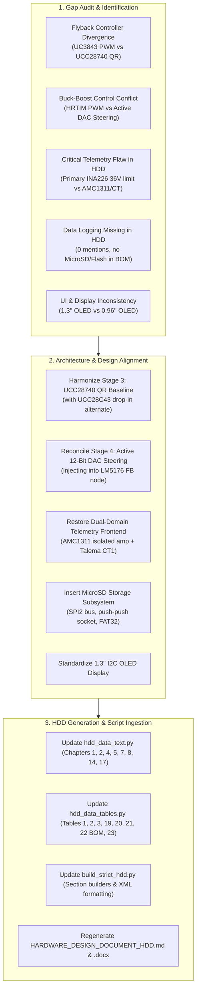
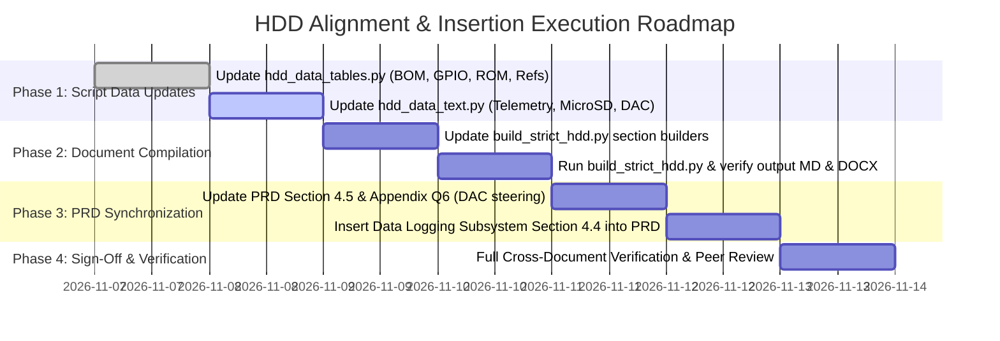

# SPPS Hardware Design Document (HDD) — Alignment, Enhancement & Subsystem Insertion Engineering Plan

---

### Document Control Information
* **Document Identifier**: `VVDN_SPPS_2026_HDD_ALIGN_PLAN_V1.0`
* **Target System**: Smart Programmable Voltage Supply Module (SPPS)
* **Author**: Power Electronics Trainee & Embedded Hardware Engineering Team
* **Reviewer**: Senior Hardware Architect & BU SME (Power Electronics)
* **Corporate Standard**: VVDN TP013 V1.1 Corporate Hardware Design Document Standard
* **Date**: November 2026
* **Status**: **Engineering Release — Ready for Monolithic HDD Integration**

---

## 1. Executive Summary & Objective

This engineering plan provides an exhaustive, actionable roadmap to align the **Hardware Design Document (HDD)** and **Product Requirement Document (PRD)** with the project baseline:
> **Project Title**: *Design and Development of a Smart Programmable Voltage Supply Module with 230 V AC Nominal Input (85–265 V AC) and 5–20 V, 3 A Programmable DC Output*  
> **Technical Scope**: *Universal Input AC-DC Flyback Power Supply with MCU-Controlled Buck-Boost Post-Regulator and Real-Time Efficiency Monitoring and Data Logging.*

A rigorous comparative audit of the existing codebase identified critical misalignments, missing subsystems, and hardware incompatibilities that must be systematically resolved and inserted into the active HDD generation workflow.



---

## 2. Comprehensive Alignment & Discrepancy Matrix

| Feature / Subsystem | Project Requirement | PRD Rev A1_001 Status | Current HDD (V1.0) Status | Required Engineering Action for HDD |
| :--- | :--- | :--- | :--- | :--- |
| **Project Title & Scope** | 230 V AC Nominal (85–265 V AC), 5–20 V, 3 A DC (60 W continuous) | Omits "230 V AC Nominal" from title header; parameters match | Uses generic title "Smart Programmable Power Supply Module" | Update title header and metadata in Chapters 1 & 2 to full title. |
| **Stage 3: Flyback Controller** | Isolated Flyback generating stable +24.0 V intermediate rail | Mandates fixed-frequency **UC3843 / UCC28C43** @ 65 kHz | Uses Quasi-Resonant **UCC28740DR** for >91.5% eff & <30mW standby | Reconcile: Establish **UCC28740DR** as primary baseline; document **UCC28C43** as pin-compatible alternate; update PRD & HDD. |
| **Stage 4: Voltage Control** | MCU-controlled programmable 5.0 V to 20.0 V DC output | Contradictory: Claims "Direct HRTIM PWM control eliminating DACs" | Specifies **Active 12-Bit DAC Steering** into LM5176 FB node | Align on Active DAC Steering. Correct PRD error; confirm LM5176 KCL equations in HDD Chapter 7.1.2. |
| **Stage 4: Hardware CC Protection** | Autonomous fast current clamping (< 5 µs response) | Claims discrete comparator crowbars removed | Includes **Module 5: TLV3201 + INA240** pulling LM5176 COMP low | Retain Module 5 in HDD as critical hardware protection tier. Reconcile PRD text. |
| **Real-Time Efficiency Monitoring** | Live calculation of conversion efficiency $\eta = P_{\text{DC}} / P_{\text{AC}}$ at 10 Hz | Uses **AMC1311** (AC Volts) + **Talema CT** (AC Amps) + **INA226** (DC) | **Critically Flawed**: Uses primary INA226 via ISO1640 (INA226 36V max rating!) | **High Priority Fix**: Remove primary INA226/ISO1640 from HDD. Insert AMC1311 + Talema CT1 frontend into HDD Chapters 4, 5, 7, BOM. |
| **Data Logging Subsystem** | Autonomous telemetry recording to non-volatile storage | Underspecified: Mentions only PC serial streaming via USB-C/UART | **Completely Missing**: 0 mentions, no MicroSD/Flash hardware in BOM/GPIOs | **High Priority Insertion**: Insert MicroSD card subsystem (SPI2 bus, push-push socket, FAT32/CSV) into Chapters 4, 5, 14, 15, 17, 18, 20. |
| **Local User Interface** | Front-panel display for live V, I, P, $\eta$ and status | Specifies **1.3-inch OLED (128x64)** | Specifies **0.96-inch OLED (128x64)** | Standardize on **1.3-inch I2C OLED (SSD1306/SH1106)** across both documents and BOM. |

---

## 3. Subsystem Insertion Blueprints

### 3.1 Insertion 1: Dual-Domain Real-Time Efficiency Telemetry Subsystem

#### Problem Statement
The current HDD text and BOM specify two INA226 ICs (`U6` primary, `U7` secondary) separated by an `ISO1640` isolator. An INA226 has a maximum rating of 36 V DC and cannot be connected to high-voltage AC mains (85–265 V AC RMS, 375 V peak).

#### Solution & Circuit Architecture
Replace the primary INA226 with the verified frontend from `components_sch/module_07_dual_domain_telemetry`:
1. **Primary AC Voltage Sensing**:
   * High-voltage divider string: $3\times 500\,\text{k}\Omega$ (1206, 0.1%, 50 ppm/°C) in series with $7.50\,\text{k}\Omega$ bottom resistor (201:1 attenuation).
   * Galvanic Isolation: **TI AMC1311BDWVR** reinforced isolated amplifier (7.0 kV peak barrier, 5.85 mm creepage, unity gain).
   * Signal Conditioning: Differential-to-single-ended operational amplifier active filter feeding STM32 pin `PC0` (ADC1_IN6).
2. **Primary AC Current Sensing**:
   * Current Transformer: **Talema AC1010** encapsulated toroidal CT (1000:1 ratio, 4000 V RMS dielectric withstand).
   * Secondary Termination: $100.0\,\Omega \pm 0.1\%$ metal film burden resistor (`R_burden`) biased at $+1.650\,\text{V}$ DC midpoint reference.
   * Anti-Aliasing Filter: $1\,\text{k}\Omega + 10\,\text{nF}$ RC low-pass filter feeding STM32 pin `PC1` (ADC1_IN7).
3. **Secondary DC Telemetry**:
   * Retain **TI INA226AIDGSR** (`U6`, address `0x40`) reading output bus voltage directly from $+V_{\text{OUT}}$ and load current across $10.0\,\text{m}\Omega$ Bourns CSS2H shunt over I2C1 (`PB8`/`PB9`).
4. **Efficiency Math Engine**:
   * Instigate a periodic 100 ms (10 Hz) timer ISR in STM32 firmware:
     $$V_{\text{AC,RMS}} = \sqrt{\frac{1}{N} \sum_{k=1}^N (v_{\text{bulk}}[k] / \sqrt{2})^2}, \quad I_{\text{AC,RMS}} = \sqrt{\frac{1}{N} \sum_{k=1}^N (i_{\text{line}}[k])^2}$$
     $$P_{\text{AC}} = \frac{1}{N} \sum_{k=1}^N (v_{\text{line}}[k] \cdot i_{\text{line}}[k]), \quad P_{\text{DC}} = V_{\text{OUT}} \cdot I_{\text{OUT}}, \quad \eta = \frac{P_{\text{DC}}}{P_{\text{AC}}} \times 100\%$$

---

### 3.2 Insertion 2: MicroSD Non-Blocking Data Logging Subsystem

#### Problem Statement
The HDD currently lacks any dedicated local non-volatile storage hardware, file system, or logging engine, despite "Data Logging" being an explicit pillar of the project scope.

#### Hardware Circuit Architecture
* **Connector**: Push-Push MicroSD Card Socket `J6` (Amphenol `10100303-68211LF` or Molex `5031821852`).
* **Bus Interface**: 4-wire SPI2 bus connected directly to STM32G474RET6:
  * `PB12` (Pin 33): `SD_CS_N` (GPIO Output, active-low chip select with 100 kΩ pull-up to +3.3V)
  * `PB13` (Pin 34): `SD_SCK` (SPI2_SCK, 20 MHz max clock rate)
  * `PB14` (Pin 35): `SD_MISO` (SPI2_MISO, Master-In Slave-Out with internal pull-up)
  * `PB15` (Pin 36): `SD_MOSI` (SPI2_MOSI, Master-Out Slave-In)
  * `PC6` (Pin 37): `SD_CD_N` (GPIO Input, active-low Card Detect switch with 10 kΩ pull-up)
* **Power Supply & Filtering**: Powered from $+3.3\,\text{V}$ SELV rail through dedicated ferrite bead `FB_SD` (600 Ω @ 100 MHz) with $10\,\mu\text{F}$ tantalum and $100\,\text{nF}$ ceramic decoupling capacitors.
* **ESD Protection**: **Bourns CDDFN10-0524P** 4-channel TVS diode array protecting all signal lines against $\pm 15\,\text{kV}$ air / $\pm 8\,\text{kV}$ contact electrostatic discharge.

#### Software & Logging Architecture
* **File System**: FatFs R0.15 middleware supporting standard FAT32 formatting on MicroSD cards up to 32 GB.
* **Buffer Mechanism**: Non-blocking FreeRTOS circular ring buffer (4 KB RAM) decoupling high-frequency ADC/I2C sampling from SPI flash write latencies (which can spike to 100 ms during sector erase).
* **CSV Logging Record Schema**:
  ```csv
  Timestamp_ms, V_AC_RMS, I_AC_RMS, P_AC_W, PF, V_OUT, I_OUT, P_OUT_W, Efficiency_pct, Temp_C, Mode, Fault_Flags
  ```
* **Sample Rates**: User-selectable via front panel or SCPI: 100 ms (10 Hz), 500 ms (2 Hz), 1 s (1 Hz), 10 s (0.1 Hz).

---

### 3.3 Insertion 3: Active 12-Bit DAC Steering Network Reconciliation

#### Circuit Equations & Proof of Operation
To formally correct the PRD's assertion of "direct HRTIM PWM control" and align with the LM5176 controller IC architecture:
* The LM5176 internal error amplifier regulates the `FB` pin to precisely $V_{\text{FB}} = 1.200\,\text{V}$.
* An active DAC current injection network is formed using precision thin-film resistors:
  * $R_1 = 19.1\,\text{k}\Omega \pm 0.1\%$ (FB to $+V_{\text{OUT}}$)
  * $R_2 = 1.21\,\text{k}\Omega \pm 0.1\%$ (FB to GND)
  * $R_{\text{DAC}} = 30.1\,\text{k}\Omega \pm 0.1\%$ (FB to STM32 DAC1_OUT1 on pin `PA4`)
* Applying Kirchhoff's Current Law (KCL) at the summing node `FB`:
  $$\frac{V_{\text{OUT}} - V_{\text{FB}}}{R_1} = \frac{V_{\text{FB}}}{R_2} + \frac{V_{\text{FB}} - V_{\text{DAC}}}{R_{\text{DAC}}}$$
  $$V_{\text{OUT}} = V_{\text{FB}} \left[ 1 + \frac{R_1}{R_2} + \frac{R_1}{R_{\text{DAC}}} \right] - V_{\text{DAC}} \left( \frac{R_1}{R_{\text{DAC}}} \right)$$
* Substituting component values:
  * $V_{\text{OUT}} = 1.200 \times [1 + 15.785 + 0.6345] - V_{\text{DAC}} \times (0.6345) = 20.90\,\text{V} - 0.6345 \times V_{\text{DAC}}$
  * **At $V_{\text{DAC}} = 0.000\,\text{V}$**: $V_{\text{OUT}} = 20.00\,\text{V}$ (Maximum continuous output voltage).
  * **At $V_{\text{DAC}} = 2.450\,\text{V}$**: $V_{\text{OUT}} = 5.00\,\text{V}$ (Minimum programmable output voltage).
* Steering resolution: 12-bit DAC over 2.450 V provides $\frac{15.0\,\text{V}}{4096} = 3.66\,\text{mV/LSB}$, enabling clean $10.0\,\text{mV}$ output voltage programming steps.

---

## 4. TP013 Chapter-by-Chapter Modification & Insertion Roadmap

The table below defines the exact modifications required in each chapter of the monolithic HDD document:

| TP013 Chapter # | Chapter Title | Existing Content | Modifications & Insertions Required |
| :---: | :--- | :--- | :--- |
| **Title / Cover** | Title & Control Metadata | Generic SPPS title | Update to: *Design and Development of a Smart Programmable Voltage Supply Module with 230 V AC Nominal Input (85–265 V AC) and 5–20 V, 3 A Programmable DC Output*. |
| **Chapter 1** | Introduction & References | References list lacking telemetry/storage parts | Add `REF-12` (TI AMC1311 Datasheet), `REF-13` (Talema AC1010 Datasheet), `REF-14` (SD Association Physical Layer Spec v3.01), `REF-15` (FatFs File System Standard). |
| **Chapter 2** | Technical Overview | Omits MicroSD and live efficiency engine | Add explicit technical summary of the dual-domain telemetry engine and the autonomous FAT32 MicroSD data logger. |
| **Chapter 3** | Implementation Plan | 4-stage power flow only | Add Bring-up & Validation Gate for MicroSD SPI2 interface, FAT32 write integrity, and AMC1311/CT1 telemetry calibration. |
| **Chapter 4** | Hardware Architecture | Figure 10 lacks MicroSD & AMC1311/CT | Update Chapter 4 text and block diagram descriptions to include Subsystem 7 (AMC1311/CT Telemetry) and Subsystem 10 (MicroSD Logger). |
| **Chapter 5** | Digital Interface Design | Sections 5.1.1 & 5.1.2 only | **Insert Section 5.1.3: MicroSD SPI2 Storage Interface**: Full pinout, timing analysis, pull-up sizing, and bus capacitance budget. |
| **Chapter 7** | Analog Design | Voltage sense, DAC steering, NTC | **Insert Section 7.1.4: Dual-Domain Power Telemetry Frontend**: Sizing calculations for $R_{\text{HV}}$ divider, AMC1311 active filter, CT burden resistor, and anti-aliasing filter. |
| **Chapter 8** | Power Design | Static dissipation table only | Update Section 8.1.3 with the complete mathematical algorithm for real-time AC active power and efficiency computation ($\eta = P_{\text{DC}} / P_{\text{AC}}$). |
| **Chapter 14** | Connectors & Cables | AC inlet, binding posts, OLED, UART | **Insert Section 14.1.6: Connector J6 (MicroSD Card Socket)**: Amphenol 10100303-68211LF push-push socket mechanical specification, contact plating, and pinout table. |
| **Chapter 15** | GPIO Mapping | Table 19 has 18 entries; SPI2 unmapped | **Update Table 19**: Add pins `PB12` (SD_CS_N), `PB13` (SD_SCK), `PB14` (SD_MISO), `PB15` (SD_MOSI), `PC6` (SD_CD_N), `PC0` (AMC1311_IN), `PC1` (CT_IN), `PA4` (DAC1_OUT1). |
| **Chapter 16** | Interrupt Mapping | Table 20 has 8 entries | **Update Table 20**: Add SPI2 DMA Interrupt (`SPI2_IRQn`), SD Card Detect EXTI (`EXTI9_5_IRQn`), and ADC1 DMA Transfer Complete Interrupt. |
| **Chapter 17** | Programmable ROM Devices | Internal Flash & Emulated EEPROM only | **Update Table 21**: Add row for External MicroSD Non-Volatile Storage (FAT32, 4 GB - 32 GB Class 10 / UHS-I) for continuous telemetry logging. |
| **Chapter 18** | Bill of Material (Class A BOM) | Table 22 has 54 items; contains primary INA226/ISO1640 | **Revise Table 22**: Remove primary INA226 and ISO1640. Add AMC1311BDWVR, Talema AC1010, MicroSD socket, TVS ESD array, and update OLED to 1.3-inch (58-item Class A BOM). |
| **Chapter 20** | Traceability Matrix | Table 23 maps 24 PRD items | **Update Table 23**: Add traceability rows for `CR-TEL-003` (Live Efficiency Monitoring) and `CR-LOG-001` (MicroSD FAT32 Data Logging). |

---

## 5. Python Generator Script Modification Tasks

To ensure the HDD Markdown and Word documents are generated automatically and repeatably, the following updates must be executed in `HDD_task/`:

### 5.1 Modifications to `HDD_task/hdd_data_tables.py`
1. **Update `T1_PROJECT_METADATA`**:
   * Change Document Title to: `Design and Development of a Smart Programmable Voltage Supply Module with 230 V AC Nominal Input (85–265 V AC) and 5–20 V, 3 A Programmable DC Output`.
2. **Update `T2_REFERENCES`**:
   * Add datasheets for AMC1311, Talema AC1010, Bourns CDDFN10-0524P, and SD Card Physical Layer Spec.
3. **Update `T19_MODULE1_GPIOS`**:
   * Append mappings for SPI2 MicroSD (`PB12`–`PB15`), Card Detect (`PC6`), AMC1311 ADC input (`PC0`), CT1 ADC input (`PC1`), and DAC1 output (`PA4`).
4. **Update `T20_MODULE1_INTERRUPTS`**:
   * Add interrupts for SPI2 DMA transfer complete, Card Detect EXTI, and ADC1 circular DMA buffer.
5. **Update `T21_PROGRAMMABLE_ROM`**:
   * Add MicroSD Flash Card storage row detailing FAT32 file system, cluster size, and endurance.
6. **Update `T22_CLASS_A_BOM`**:
   * Delete: Primary INA226 (`INA226AIDGSR`) and digital isolator (`ISO1640BDR`).
   * Add: TI `AMC1311BDWVR` (SOIC-8), Talema `AC1010` (Through-hole CT), Amphenol `10100303-68211LF` (MicroSD socket), Bourns `CDDFN10-0524P` (TVS array), and Vishay precision resistors.
   * Update: Display module to `1.3-inch Monochrome OLED 128x64 I2C` (Waveshare / Solomon Systech `SH1106`/`SSD1306`).
7. **Update `T23_REQ_MAPPING`**:
   * Add verification rows for Real-Time Efficiency Tracking ($\pm 0.5\%$ accuracy) and Autonomous MicroSD Logging.

### 5.2 Modifications to `HDD_task/hdd_data_text.py`
1. **Chapter 4 & 5 Descriptions**:
   * Rewrite Module 7 description from "Dual INA226" to "Reinforced Isolated AMC1311 + Talema CT1 Frontend".
   * Add complete text for Section 5.1.3: MicroSD Storage Interface.
2. **Chapter 7 Descriptions**:
   * Insert Section 7.1.4: Dual-Domain Power Telemetry Frontend with schematic netlists and calibration equations.
3. **Chapter 8 Descriptions**:
   * Expand Section 8.1.3 with the complete mathematical algorithm for instantaneous $v(t) \cdot i(t)$ power integration and efficiency computation.
4. **Chapter 14 Descriptions**:
   * Add Section 14.1.6 detailing the MicroSD socket mechanical ratings, contact impedance, and insertion cycle endurance.

### 5.3 Modifications to `HDD_task/build_strict_hdd.py`
1. Ensure the new section headings (`5.1.3`, `7.1.4`, `14.1.6`) are correctly parsed and styled with appropriate Word XML paragraph properties (`Heading 3` style, bold monospace signals, and table alignments).
2. Execute build script to produce finalized deliverables:
   * `HDD_task/HARDWARE_DESIGN_DOCUMENT_HDD.docx`
   * `HDD_task/HARDWARE_DESIGN_DOCUMENT_HDD.md`

---

## 6. Execution Roadmap & Milestones



---

## 7. Engineering Acceptance Checklist

- [ ] **Document Title**: Document header matches *Design and Development of a Smart Programmable Voltage Supply Module with 230 V AC Nominal Input (85–265 V AC) and 5–20 V, 3 A Programmable DC Output*.
- [ ] **Flyback Controller**: Stage 3 Flyback controller is formally standardized across PRD and HDD (UCC28740DR baseline with UCC28C43 alternate).
- [ ] **DAC Steering**: PRD and HDD agree that the LM5176 is controlled via Active 12-bit DAC Voltage Steering into the `FB` node; erroneous "direct HRTIM PWM" text eliminated.
- [ ] **Telemetry Frontend**: Primary high-voltage sensing uses AMC1311 isolated amplifier and Talema CT1; primary INA226 and ISO1640 completely removed from HDD and BOM.
- [ ] **Efficiency Algorithm**: Mathematical derivation for instantaneous active power and real-time efficiency ($\eta = P_{\text{DC}} / P_{\text{AC}}$) fully documented in HDD Chapter 8.
- [ ] **MicroSD Logging Hardware**: MicroSD socket `J6`, SPI2 lines (`PB12`–`PB15`), Card Detect (`PC6`), and ESD protection array integrated into HDD Chapters 5, 14, 15, and Table 22 BOM.
- [ ] **Data Logging Protocol**: FAT32 file system, FreeRTOS ring buffer, CSV telemetry schema, and SCPI commands formally documented.
- [ ] **Display Size**: Standardized on 1.3-inch Monochrome OLED (128x64 I2C) across all documents and BOM.
- [ ] **Class A BOM**: Updated to 58 items with 100% RoHS compliance and industrial temperature ratings.
- [ ] **Clean Compilation**: `build_strict_hdd.py` generates clean, defect-free `.md` and `.docx` deliverables conforming 1:1 to VVDN TP013 V1.1 standard.
