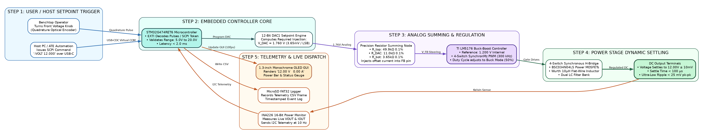
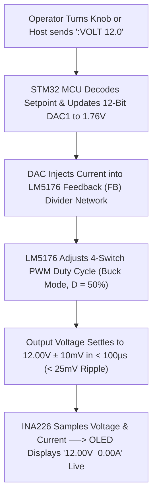
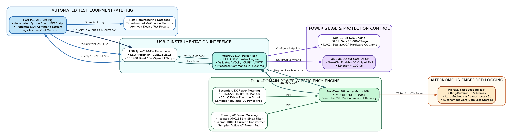
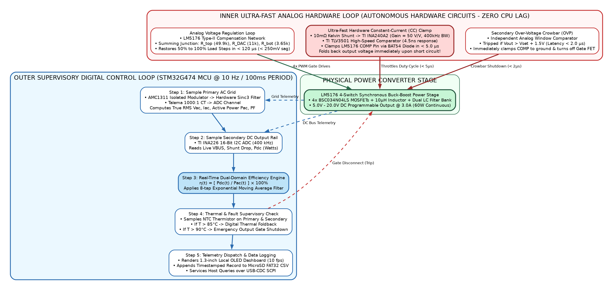
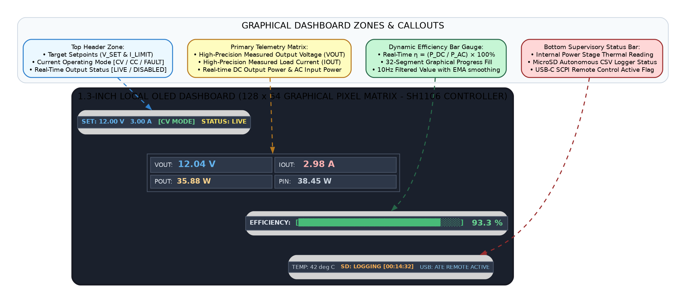
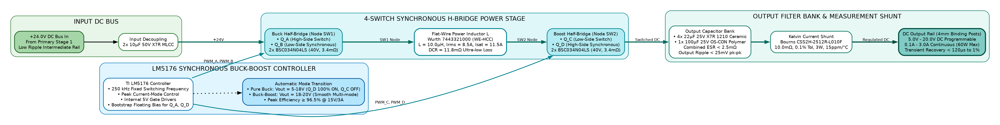
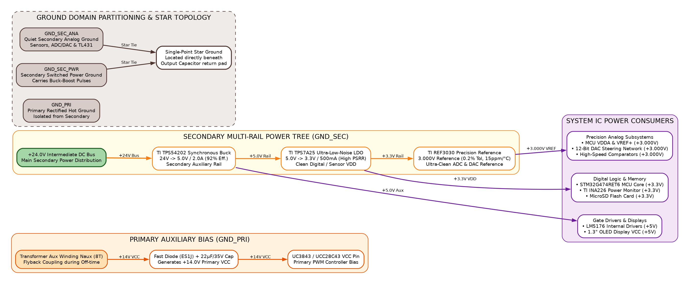
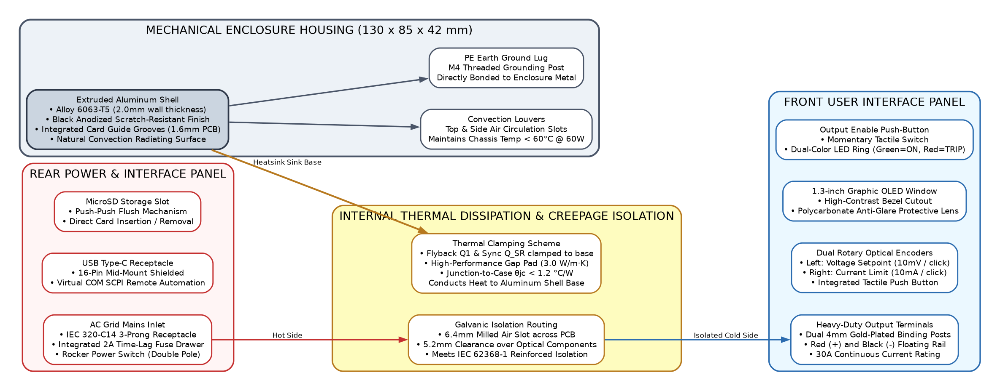
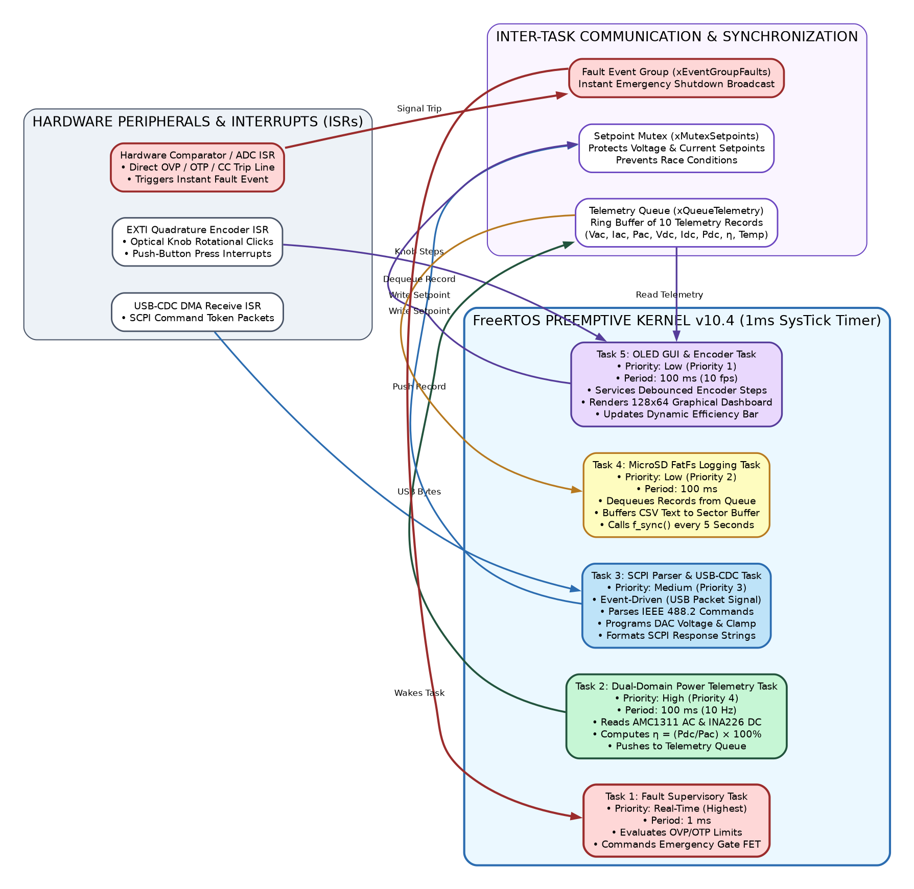

# Product Requirement Document (PRD)

---

### Project Information
* **Project Code**: `VVDN_SPPS_2026`
* **Project Name**: Smart Programmable Voltage Supply Module (85–265 V AC Input, 5–20 V / 3 A DC Programmable Output)
* **Revision**: `Rev 1.0`
* **Date**: `12 Oct 2026`

---

### Revision History

| Date | Revision No. | Description | Prepared/Revised By | Reviewed By | Approved By |
| :--- | :--- | :--- | :--- | :--- | :--- |
| 12 Oct 2026 | Rev 1.0 | Initial release of PRD for Smart Programmable Voltage Supply Module | Hardware Team Lead (SPPS) | BU SME (Power Electronics) | BU Head (Embedded Hardware) |
| 25 Sep 2026 | Rev 0.1 | Draft architecture & preliminary component selection study | Hardware Design Engineer | Senior Hardware Architect | BU SME (Power Electronics) |

---

### Customer Sign Off
**CUSTOMER SIGN-OFF FORM**

* **Customer**: Commercial Test & Measurement / Industrial OEM Client
* **Technical In-Charge**:
  * Name: `<Customer Technical Lead>`
  * Designation: Director of Hardware Engineering
  * Email ID: `customer.tech@client.com`
  * Address: `<Client Technology Park, San Jose, CA>`
  * Comments: Requirements reviewed and aligned with next-generation automated test equipment (ATE) specifications.
  * Signature & Date: `____________________`
* **Program In-Charge**:
  * Name: `<Customer Program Manager>`
  * Designation: Program Director
  * Email ID: `customer.pm@client.com`
  * Address: `<Client Technology Park, San Jose, CA>`
  * Comments: Approved for Phase 1 Architecture and Schematic Bring-Up.
  * Signature & Date: `____________________`

---

### Internal Sign Off
**INTERNAL SIGN-OFF**

* **VVDN Technical In-Charge**:
  * Name: Vignesh Anandhan / Karpagamoorthy R
  * Designation: Principal Hardware Architect
  * Email ID: `vignesh.a@vvdntech.com`
  * Address: VVDN Technologies, B-22, Infocity Sector-34, Gurgaon-122001, Haryana, India
  * Comments: Multi-mode 4-switch Buck-Boost architecture with dual-domain metering meets all technical boundaries.
  * Signature & Date: `____________________`
* **VVDN Program In-Charge**:
  * Name: Gaurav Gupta / Shivam Saxena
  * Designation: Engineering Delivery Manager
  * Email ID: `gaurav.gupta@vvdntech.com`
  * Address: VVDN Technologies, B-22, Infocity Sector-34, Gurgaon-122001, Haryana, India
  * Comments: Project schedule, deliverable releases, and BOM targets approved.
  * Signature & Date: `____________________`
* **Internal Sign Off (Level 1 - BU SME)**:
  * Name: BU SME (Power & Industrial BU)
  * Comments: Architecture validated against IEC 62368-1 reinforced isolation and CISPR 32 Class B standards.
  * Signature & Date: `____________________`

---

## Table of Contents
* **1. Introduction**
  * 1.1 Purpose
  * 1.2 Document Conventions
  * 1.3 Intended Audience and Reading Suggestions
  * 1.4 Abbreviation
  * 1.5 References
* **2. Product Overview**
  * 2.1 Product - Business Perspective
  * 2.2 Product - Technical Perspective
    * *System Block Diagram & Step-by-Step Architecture Walkthrough*
  * 2.3 Use Cases
  * 2.4 Product Interfaces
    * 2.4.1 Hardware Interfaces
    * 2.4.2 Software Interfaces
* **3. Systems & Domains Involved**
* **4. Product Requirements**
  * 4.1 System 1 Requirements (Hardware Power Supply Module)
    * 4.1.1 Specific Requirements
  * 4.2 System 2 Requirements (Embedded Control & Telemetry Software)
    * 4.2.1 Specific Requirements
* **5. Assumptions**
* **6. Dependencies**
* **7. Standard Deliverables & Release Order**
  * 7.1 Product Development Plan
  * 7.2 System 1 Development Plan
  * 7.3 System 2 Development Plan
* **8. Architecture <optional>**
  * 8.1 System 1: Domain 1 Architecture (Hardware Power Stage)
  * 8.2 System 1: Domain 2 Architecture (Firmware & Control Loop)
* **9. Bill Of Material <optional>**
  * 9.1 System 1: Product BOM
* **10. Out of Scope**
* **11. Open Items**
* **Appendix: Fresher's Mentor Walkthrough & Q&A Cheatsheet**

---

## 1. Introduction

### 1.1 Purpose
The purpose of this Product Requirement Document (PRD) is to define all engineering, electrical, safety, mechanical, and firmware requirements for the development of the **Smart Programmable Voltage Supply Module (85–265 V AC Input, 5–20 V / 3 A DC Programmable Output)**. 

In simple terms, this product is an **intelligent, compact benchtop and test fixture power supply**. It plugs directly into a standard wall socket anywhere in the world ($85\,\text{V} \dots 265\,\text{V}$ AC) and generates a clean, stable DC voltage that the user can set anywhere between **$5.0\,\text{V}$ and $20.0\,\text{V}$ DC** at up to **$3.0\,\text{A}$** continuous load ($60\,\text{W}$ maximum power).

This document serves as the authoritative technical baseline for the client, hardware engineering team, firmware team, layout team, and quality assurance (QA) team throughout the design, testing, and production phases.

> [!IMPORTANT]
> The requirements captured in this document supersede any previous informal discussions or draft notes. This PRD is the agreed reference baseline for engineering acceptance and milestone sign-off.

### 1.2 Document Conventions
To make requirements simple, clear, and unambiguous, standard keywords are used:
* **[MUST]**: Mandatory non-negotiable specification. The product cannot be released without meeting this requirement (e.g., electrical safety isolation, voltage regulation range).
* **[SHOULD]**: Highly recommended performance target where minor engineering trade-offs are acceptable with senior engineering approval (e.g., peak efficiency above 90%).
* **[COULD]**: Optional enhancement planned for future hardware revisions.

### 1.3 Intended Audience and Reading Suggestions
This document is structured so that different stakeholders can quickly find what they need:

| Stakeholder | Key Sections to Focus On | Purpose |
| :--- | :--- | :--- |
| **Client / Program Managers** | Sections 1, 2, 7, 10 | Project scope, deliverables schedule, and feature boundaries. |
| **Hardware Engineers & Layout** | Sections 2.2, 4.1, 8.1, 9.1 | Circuit topologies, component selection, safety creepage, and BOM. |
| **Embedded Firmware Engineers** | Sections 2.4.2, 4.2, 8.2 | DAC voltage setting, SCPI command parser, and data logging. |
| **QA & Compliance Engineers** | Sections 4.1, 7.2 | Hipot safety test, CISPR 32 EMI limits, and load transient testing. |
| **Freshers & Trainees** | Section 2.2, Section 8, Appendix | Block diagram flow, simple stage explanations, and mentor Q&A. |

### 1.4 Abbreviation

#### Table 1: Abbreviation
| Acronym | Full Form | Simple Definition for Freshers |
| :--- | :--- | :--- |
| **AC** | Alternating Current | Electricity from the mains wall outlet that alternates direction (50Hz / 60Hz). |
| **ADC** | Analog-to-Digital Converter | Chip that converts real-world analog voltages into digital numbers for the MCU. |
| **ATE** | Automated Test Equipment | Automated computer-controlled test racks used in factories to test circuit boards. |
| **BOM** | Bill of Materials | Complete list of all components, part numbers, and quantities needed to build the board. |
| **CC** | Constant Current Mode | Protection mode where output current is capped to a safe limit, dropping voltage if needed. |
| **CV** | Constant Voltage Mode | Normal operating mode where output voltage stays fixed regardless of load changes. |
| **DAC** | Digital-to-Analog Converter | Chip that converts digital numbers from the MCU into an analog control voltage. |
| **DC** | Direct Current | Smooth unidirectional electricity used to power electronic circuits (e.g. 5V, 12V). |
| **DUT** | Device Under Test | The external customer circuit or device being powered and tested by our supply. |
| **EMC / EMI** | Electromagnetic Compatibility / Interference | Ensuring electrical noise from our switching power supply does not disturb other devices. |
| **ESR** | Equivalent Series Resistance | Internal unwanted resistance inside capacitors; lower ESR means cleaner DC output. |
| **Hipot** | High Potential (Dielectric Test) | Safety test where thousands of volts are applied to prove insulation does not break down. |
| **I2C** | Inter-Integrated Circuit | Simple two-wire digital serial bus used to communicate between MCU and sensor ICs. |
| **IEC** | International Electrotechnical Commission | International organization that writes safety standards like IEC 62368-1. |
| **LDO** | Low-Dropout Linear Regulator | Simple chip that creates a clean, quiet 3.3V or 5V rail with zero switching noise. |
| **MCU** | Microcontroller Unit | The small computer (STM32G474) that acts as the "brain" of the power supply. |
| **MLCC** | Multi-Layer Ceramic Capacitor | Compact surface-mount ceramic capacitor used for high-frequency noise filtering. |
| **MOV** | Metal Oxide Varistor | Protective device that clamps high-voltage lightning and grid spikes on the AC input. |
| **NTC** | Negative Temperature Coefficient | Thermistor used to safely limit high surge current when first plugging into the wall. |
| **OLED** | Organic Light-Emitting Diode | Compact front-panel screen displaying voltage, current, power, and efficiency live. |
| **PF** | Power Factor | Ratio of real working power to apparent power drawn from the AC grid (ideal is 1.0). |
| **PRD** | Product Requirement Document | This document, defining all specifications and deliverables for the project. |
| **PWM** | Pulse Width Modulation | Rapid switching method used to regulate output voltage with high efficiency. |
| **QR** | Quasi-Resonant Switching | Smart switching technique where the MOSFET turns on when voltage across it is lowest. |
| **RMS** | Root Mean Square | The effective DC equivalent value of an AC voltage or current waveform. |
| **SCPI** | Standard Commands for Programmable Instruments | Universal text commands (e.g., `:VOLT 12.0`) sent from a PC to control lab instruments. |
| **SELV** | Safety Extra-Low Voltage | Safe voltage territory (< 60V DC) that a human user can touch without shock risk. |
| **SR** | Synchronous Rectification | Using a low-resistance MOSFET instead of a diode to dramatically reduce heat and losses. |
| **USB-CDC**| USB Communications Device Class | Virtual COM port protocol allowing PCs to talk to the MCU over standard USB cable. |

### 1.5 References

#### Table 2: Reference
| SL No | Description | Version & Document Link |
| :--- | :--- | :--- |
| 1 | Statement of Work (SOW): Smart Programmable Voltage Supply | Ver 1.0 (Signed 2026-09-15) |
| 2 | IEC 62368-1: Audio/video, information & communication technology safety | Ed. 3.0 (2020) — Reinforced Isolation Requirements |
| 3 | EN 55032 / CISPR 32: Electromagnetic compatibility of multimedia equipment | Class B Limits (Conducted & Radiated Emissions) |
| 4 | IEC 61000-4-5: Surge Immunity Testing (Lightning & Line Transients) | Level 3 (2kV Line-to-Earth, 1kV Line-to-Line) |
| 5 | Texas Instruments LM5176 4-Switch Synchronous Buck-Boost Controller | Datasheet Rev C, SNVSAU6C |
| 6 | Texas Instruments UCC28740 Quasi-Resonant Flyback Controller | Datasheet Rev B, SLUSBN5B |
| 7 | IEEE 488.2 Standard Digital Interface for Programmable Instrumentation | SCPI Command Syntax and Data Formats |

---

## 2. Product Overview

### 2.1 Product - Business Perspective
Engineers and manufacturing test facilities need compact, reliable, programmable DC power sources on their workbenches. Traditional laboratory power supplies suffer from three major drawbacks:
1. **Bulky and Heavy**: Traditional linear supplies use heavy 50Hz iron transformers that take up massive bench space.
2. **Expensive**: Commercial programmable supplies often cost upwards of $600–$1,200 per channel.
3. **No Wall Power Metering**: Standard power supplies only display DC output power. They cannot measure how much AC power they draw from the wall, making it impossible to perform automated energy efficiency audits on test fixtures.

The **Smart Programmable Voltage Supply Module** solves these problems:
* **Compact & High Efficiency**: Modern 2-stage high-frequency switching technology delivers up to $60\,\text{W}$ in a small handheld enclosure.
* **Cost Effective**: Target production BOM cost is $< \$35$, reducing overall equipment cost by over $50\%$.
* **Dual-Domain Energy Telemetry**: Built-in isolated AC mains metering and DC load metering compute **true electrical efficiency** ($\text{Efficiency} = P_{DC} / P_{AC} \times 100\%$) live 10 times every second.
* **Automated PC Control**: Full USB-C connectivity with standard SCPI commands enables complete test automation without manual knob twisting.

### 2.2 Product - Technical Perspective

#### Why A Two-Stage Architecture? (Fundamental Design Concept)
When converting high-voltage AC from the wall ($85\,\text{V} \dots 265\,\text{V}$ AC) into a finely adjustable low-voltage DC rail ($5\,\text{V} \dots 20\,\text{V}$ DC), doing it in a single stage is extremely difficult and inefficient:
* AC mains requires **galvanic safety isolation** (a transformer barrier) to protect users from fatal electric shocks.
* Regulating a wide output span ($5\,\text{V}$ to $20\,\text{V}$) while simultaneously isolating across a wide universal AC input ($85\,\text{V}$ to $265\,\text{V}$) makes transformer design, feedback loops, and output filtering unstable and noisy.

Therefore, our system splits the job into **two specialized stages**:
1. **Stage 1 (Isolated AC-DC Flyback Converter)**:
   * **Job**: Takes raw, noisy AC mains ($85\,\text{V} \dots 265\,\text{V}$ AC) and converts it into a single, rock-solid, isolated **$+24.0\,\text{V}$ DC intermediate bus** capable of delivering up to $72\,\text{W}$.
   * **Key Feature**: Provides certified **Reinforced Galvanic Isolation** ($3000\,\text{V}$ RMS) between lethal mains voltage and user terminals.
2. **Stage 2 (Synchronous 4-Switch Buck-Boost Post-Regulator)**:
   * **Job**: Takes the stable $+24\,\text{V}$ DC rail and steps it down or up to whatever voltage the user selects ($5.0\,\text{V} \dots 20.0\,\text{V}$ DC) at up to $3.0\,\text{A}$.
   * **Key Feature**: Because the input is $+24\,\text{V}$, stepping down to $5\,\text{V}$ or $12\,\text{V}$ is Buck mode, and stepping near $20\,\text{V}$ under heavy load transitions seamlessly through Buck-Boost mode. It achieves $> 95\%$ efficiency with ultra-low output ripple ($< 25\,\text{mV}$).
3. **Stage 3 (Microcontroller & Telemetry Core)**:
   * **Job**: The "brain" of the unit (STM32G474 ARM Cortex-M4F). It sets the output voltage using an internal 12-bit DAC, continuously samples AC and DC power, calculates real-time efficiency, updates the 1.3" OLED screen, logs data to a MicroSD card, and speaks SCPI commands over USB-C.

---

#### Figure 1: Master System Architecture Block Diagram
The complete system hardware architecture and signal/power flow is shown in the block diagram below:


```mermaid
flowchart LR
    %% Styles & Domain Definitions
    classDef acStyle fill:#ECEFF1,stroke:#37474F,stroke-width:2px,color:#263238
    classDef priStyle fill:#FFF3E0,stroke:#E65100,stroke-width:2px,color:#BF360C
    classDef isoStyle fill:#FFEBEE,stroke:#C62828,stroke-width:2px,stroke-dasharray: 5 5,color:#B71C1C
    classDef secPwrStyle fill:#E8F5E9,stroke:#2E7D32,stroke-width:2px,color:#1B5E20
    classDef bbStyle fill:#E0F7FA,stroke:#00838F,stroke-width:2px,color:#004D40
    classDef ctrlStyle fill:#F3E5F5,stroke:#6A1B9A,stroke-width:2px,color:#4A148C
    classDef mcuStyle fill:#E1F5FE,stroke:#0277BD,stroke-width:2px,color:#01579B
    classDef uiStyle fill:#FBE9E7,stroke:#D84315,stroke-width:2px,color:#BF360C
    classDef auxStyle fill:#FFFDE7,stroke:#F57F17,stroke-width:2px,color:#E65100

    %% -------------------------------------------------------------
    %% SUBGRAPH 1: MAINS FRONTEND
    %% -------------------------------------------------------------
    subgraph AC_FRONTEND["AC Mains Frontend & EMI Suppression (Hot Domain)"]
        AC_IN["AC Mains Input<br/>85V - 265V AC RMS<br/>47 - 63 Hz (IEC C14)"]:::acStyle
        FUSE_NTC["Input Protection<br/>• Fuse: 2A Time-Lag<br/>• NTC: 10Ω Inrush Limiter<br/>• MOV: 14D471K Varistor"]:::acStyle
        EMI_FILT["2-Stage EMI Filter<br/>• L_CM1 (15mH) & L_CM2 (4.7mH)<br/>• 3x X2 Film (220nF, 100nF)<br/>• 2x Y Safety Caps (2.2nF)"]:::acStyle
        RECT_BULK["Bridge Rectifier & Bulk Cap<br/>• BR1: GBU606 (600V, 6A)<br/>• C_BULK: 100µF/450V<br/>Bus: +120V to +375V DC"]:::acStyle

        AC_IN -->|L, N, PE| FUSE_NTC
        FUSE_NTC -->|Protected AC| EMI_FILT
        EMI_FILT -->|Filtered AC| RECT_BULK
    end

    %% -------------------------------------------------------------
    %% SUBGRAPH 2: PRIMARY FLYBACK
    %% -------------------------------------------------------------
    subgraph STAGE1_PRIMARY["Stage 1: Isolated Primary QR Flyback (GND_PRI)"]
        TX_PRI["Transformer Primary Winding<br/>PQ26/20 Core (3C95 Ferrite)<br/>Np = 48T | Lp = 220µH"]:::priStyle
        Q1_FET["Primary MOSFET Q1<br/>Infineon IPB80R290P7<br/>800V Superjunction, 0.29Ω"]:::priStyle
        UCC_CTRL["QR Flyback Controller<br/>TI UCC28740<br/>• Valley Switching (ZCD)<br/>• Cycle Peak Current Mode"]:::priStyle

        RECT_BULK -->|+V_BULK| TX_PRI
        TX_PRI -->|Drain| Q1_FET
        UCC_CTRL -->|Gate Drive| Q1_FET
    end

    %% -------------------------------------------------------------
    %% SUBGRAPH 3: REINFORCED ISOLATION BARRIER
    %% -------------------------------------------------------------
    subgraph ISO_BARRIER["Reinforced Safety Isolation Barrier (IEC 62368-1)"]
        ISO_TX["Galvanic Isolation Transformer<br/>PQ26/20 TIW Secondary (12T)<br/>Reinforced 3kV RMS Withstand"]:::isoStyle
        ISO_OPTO["PC817 Optocoupler<br/>5kV RMS Isolation<br/>Voltage Feedback"]:::isoStyle
        ISO_AMC["TI AMC1311 ΔΣ Modulator<br/>5kV RMS Isolation<br/>AC Voltage Bitstream"]:::isoStyle
        ISO_CT["Talema AC1005 (1000:1 CT)<br/>Galvanic Magnetic Isolation<br/>AC Current Sense"]:::isoStyle
    end

    %% -------------------------------------------------------------
    %% SUBGRAPH 4: SECONDARY SR & 24V BUS
    %% -------------------------------------------------------------
    subgraph STAGE1_SECONDARY["Stage 1: Secondary Synchronous Rectification (SELV)"]
        SR_STAGE["Synchronous Rectification<br/>• MP6908 Smart Controller<br/>• BSC052N06NS (60V, 5.2mΩ)"]:::secPwrStyle
        BUS_24V["+24.0V Intermediate DC Bus<br/>• 72W Continuous Power<br/>• Ripple < 40mV pk-pk"]:::secPwrStyle

        ISO_TX -->|Switched AC| SR_STAGE
        SR_STAGE -->|+24V DC| BUS_24V
        BUS_24V -->|Feedback| ISO_OPTO
        ISO_OPTO -->|FB Signal| UCC_CTRL
    end

    %% -------------------------------------------------------------
    %% SUBGRAPH 5: STAGE 2 BUCK-BOOST POST-REGULATOR
    %% -------------------------------------------------------------
    subgraph STAGE2_BB["Stage 2: 4-Switch Synchronous Buck-Boost"]
        LM5176["Buck-Boost Controller<br/>TI LM5176 (300 kHz PWM)<br/>Integrated 4x Drivers"]:::bbStyle
        H_BRIDGE["4-Switch Synchronous H-Bridge<br/>4x BSC034N04LS (40V, 3.4mΩ)<br/>10µH Flat-Wire Inductor"]:::bbStyle
        C_OUT["Output Filter & Sense<br/>• 4x 22µF MLCC + 100µF Poly<br/>• 10mΩ Kelvin Current Shunt"]:::bbStyle
        DC_OUT["Programmable DC Output<br/>5.0V - 20.0V DC @ 0.1A - 3.0A<br/>Ripple < 25mV pk-pk<br/>4mm Gold Binding Posts"]:::bbStyle

        BUS_24V -->|+24V Bus In| H_BRIDGE
        LM5176 -->|4x Gate Drives| H_BRIDGE
        H_BRIDGE -->|SW1 & SW2| C_OUT
        C_OUT -->|Regulated DC| DC_OUT
    end

    %% -------------------------------------------------------------
    %% SUBGRAPH 6: MIXED-SIGNAL CONTROL & FAST CC CLAMP
    %% -------------------------------------------------------------
    subgraph CONTROL_LOOP["Mixed-Signal Regulation & Fast Protection"]
        DAC_SUM["DAC Summing Network<br/>R_top=49.9k, R_bot=3.65k<br/>R_DAC=11.0k (0.1% Precision)<br/>Resolution: 3.65mV / LSB"]:::ctrlStyle
        TLV_COMP["Hardware CC Clamp<br/>INA240A2 (50 V/V) + TLV3501<br/>Pulls COMP pin in < 5µs!"]:::ctrlStyle

        DC_OUT -->|VOUT Sense| DAC_SUM
        DAC_SUM -->|V_FB| LM5176
        C_OUT -->|Current Sense| TLV_COMP
        TLV_COMP -->|Clamps COMP Pin| LM5176
    end

    %% -------------------------------------------------------------
    %% SUBGRAPH 7: CENTRAL MCU SUBSYSTEM
    %% -------------------------------------------------------------
    subgraph MCU_CORE["Central Embedded Controller (STM32G474RET6)"]
        MCU["STM32G474RET6 Microcontroller<br/>• 32-bit Cortex-M4F @ 170 MHz<br/>• Hardware Sinc3 Decimation<br/>• Dual 12-Bit Fast DACs & ADCs"]:::mcuStyle
        EFF_ENGINE["Real-Time Efficiency Engine (10 Hz)<br/>η = (P_DC / P_AC) × 100%<br/>• True RMS Vac, Iac, Pac<br/>• True Vdc, Idc, Pdc"]:::mcuStyle

        ISO_AMC -->|Bitstream| MCU
        ISO_CT -->|AC Current| MCU
        C_OUT -->|I2C INA226| MCU
        MCU <-->|DSP Math| EFF_ENGINE
        MCU -->|12-Bit DAC1 (V_SET)| DAC_SUM
        MCU -->|12-Bit DAC2 (I_SET)| TLV_COMP
    end

    %% -------------------------------------------------------------
    %% SUBGRAPH 8: USER INTERFACE & STORAGE
    %% -------------------------------------------------------------
    subgraph UI_STORAGE["User Interface & Telemetry Interfaces"]
        OLED["1.3\" Monochrome OLED<br/>128x64 Graphic (I2C)<br/>V, I, P, η Live Gauges"]:::uiStyle
        SD_CARD["MicroSD Data Logger<br/>FAT32 CSV File System<br/>10Hz Continuous Log"]:::uiStyle
        USB_SCPI["USB Type-C Interface<br/>USB-CDC Virtual COM<br/>SCPI Automated Testing"]:::uiStyle
        CONTROLS["Rotary Encoders & Button<br/>• Voltage & Current Knobs<br/>• Output Enable Tactile"]:::uiStyle

        MCU -->|I2C Bus| OLED
        MCU -->|SPI / SDIO| SD_CARD
        MCU -->|USB-CDC| USB_SCPI
        CONTROLS -->|GPIO / EXTI| MCU
    end
```

#### Step-by-Step Block Diagram Walkthrough (Fresher's Explanation Guide)
When explaining this diagram to your mentor, walk through the blocks from left to right:
1. **AC Mains Input ($85\,\text{V} \dots 265\,\text{V}$ AC)**: Enters via a standard IEC C14 wall power inlet.
2. **Input Protection Block**:
   * *Fuse (2A)*: Blows safely during severe short circuits.
   * *NTC Thermistor ($10\,\Omega$)*: Prevents high inrush currents that could trip household breakers when first plugged in.
   * *MOV (14D471K)*: Clamps dangerous lightning and voltage surges from the grid.
3. **2-Stage EMI Filter**: Keeps high-frequency switching noise inside the power supply so it doesn't pollute the mains grid (meets CISPR 32 Class B).
4. **Bridge Rectifier & Bulk Capacitor**: Converts AC into high-voltage DC ($120\,\text{V} \dots 375\,\text{V}$ DC).
5. **Stage 1 Primary Flyback**: The UCC28740 controller switches the 800V MOSFET using quasi-resonant "valley switching" (turning on when voltage is lowest to minimize switching losses).
6. **Reinforced Isolation Barrier**: Separates lethal primary voltages from the secondary side using a custom transformer (with triple-insulated wire) and optocouplers. Passes $3000\,\text{V}$ RMS Hipot testing.
7. **Secondary Synchronous Rectifier**: Replaces a conventional lossy diode with a smart MOSFET (MP6908 + BSC052N06NS) to generate a stable, cool **$+24.0\,\text{V}$ DC bus**.
8. **Stage 2 4-Switch Buck-Boost**: The LM5176 controller drives 4 low-resistance MOSFETs and a $10\,\mu\text{H}$ inductor, regulating the $+24\,\text{V}$ input into any user setpoint from **$5.0\,\text{V}$ to $20.0\,\text{V}$** at up to **$3.0\,\text{A}$**.
9. **Output Filter Bank**: Ceramic MLCC and OS-CON polymer capacitors eliminate ripple, achieving clean power ($< 25\,\text{mV}$ pk-pk).
10. **Digital Control & Telemetry Core**: The STM32G474 MCU monitors both AC and DC rails, steers the voltage via a precision 12-bit DAC, clamps overload current in $< 5\,\mu\text{s}$ via hardware comparators, logs data to MicroSD, and sends SCPI responses to a PC.

---

### 2.3 Use Cases

#### Table 3: Use Case Summary
| Sl. No. | Use Case ID | Actor | Description | Pre-Condition | Normal Flow | Post-Condition |
| :--- | :--- | :--- | :--- | :--- | :--- | :--- |
| 1 | **UC-01** | Bench Engineer | Precision Output Voltage Adjustment | Unit powered ON from AC mains; Output OFF. | User adjusts front rotary knob or sends SCPI command `:VOLT 12.0`. MCU updates internal DAC; Buck-Boost smoothly adjusts output to $12.00\,\text{V}$ in $< 100\,\mu\text{s}$. | Output terminal stabilizes at $12.00\,\text{V} \pm 10\,\text{mV}$. |
| 2 | **UC-02** | DUT (Load) | Handling Sudden Load Step Changes | Unit outputting $12.0\,\text{V}$ at $1.5\,\text{A}$ steady state. | External load suddenly doubles from $1.5\,\text{A}$ to $3.0\,\text{A}$. Hardware feedback loop quickly compensates within $120\,\mu\text{s}$, keeping voltage sag under $250\,\text{mV}$. | Output voltage stays steady without resetting or glitching. |
| 3 | **UC-03** | Fault / Short | Fast Hardware Current Limiting (CC Mode) | Unit running at $20.0\,\text{V}$ with current limit set to $2.0\,\text{A}$. | A short circuit occurs on the load. Hardware comparator detects current $> 2.0\,\text{A}$ and pulls down the `COMP` pin in $< 5\,\mu\text{s}$, folding back voltage. | Output current is safely clamped at $2.0\,\text{A}$; components are protected. |
| 4 | **UC-04** | Test Engineer | Autonomous Efficiency Audit & Logging | MicroSD card inserted into front slot; Unit running. | User enables logging. Firmware records AC power, DC power, efficiency ($\eta$), and temperature to a CSV file at $10\,\text{Hz}$ rate. | Full session CSV log stored safely on MicroSD for Excel analysis. |
| 5 | **UC-05** | Host PC / ATE | Automated Production Testing via SCPI | USB-C connected to PC running automated test script. | PC script sends `:VOLT 5.0; :CURR 1.0; :OUTP ON`, then queries `:MEAS:EFF?`. Unit executes commands and replies with `88.4%`. | Automated test passes and logs result with zero human intervention. |

#### Figure 2: Major Use Case 1 - Precision Voltage Setpoint Tuning Sequence




#### Figure 3: Major Use Case 2 - Automated ATE SCPI Control & Telemetry Flow


```mermaid
sequenceDiagram
    autonumber
    actor ATE as Host PC / Automated Test Rig
    participant USB as USB-C Virtual COM (SCPI Parser)
    participant MCU as STM32G474 Controller
    participant PWR as LM5176 Buck-Boost Power Stage
    participant SENSE as Dual-Domain Power Meters
    participant SD as MicroSD Card (FAT32)

    ATE->>USB: Send SCPI: ":VOLT 15.000;:CURR 2.000;:OUTP ON"
    USB->>MCU: Parse ASCII tokens & configure DAC setpoints
    MCU->>PWR: DAC1 sets 15.00V & DAC2 sets 2.00A CC clamp
    PWR-->>MCU: Power rail stabilizes at 15.00V
    ATE->>USB: Query Telemetry: ":MEAS:EFF?"
    SENSE->>MCU: AMC1311 (Pac) & INA226 (Pdc) sampled
    MCU->>MCU: Compute Efficiency: η = (Pdc / Pac) × 100%
    MCU-->>USB: Format ASCII response "91.2%"
    USB-->>ATE: Return "91.2%" to test script
    MCU->>SD: Write timestamped CSV record (10Hz telemetry)
```

---

### 2.4 Product Interfaces

#### 2.4.1 Hardware Interfaces

#### Table 4: Hardware Interfaces
| Sl. No | Interface Name | Physical Connector | Description & Purpose |
| :--- | :--- | :--- | :--- |
| 1 | **AC Mains Inlet** | IEC 320-C14 Receptacle | Standard 3-prong grounded wall plug inlet with integrated fuse holder ($85\,\text{V} \dots 265\,\text{V}$ AC). |
| 2 | **DC Output Terminals** | 4mm Gold-Plated Binding Posts | Red (+) and Black (-) terminals accepting standard banana plugs, spade lugs, or bare wire. |
| 3 | **Host PC USB Interface** | USB Type-C Receptacle | USB 2.0 Virtual COM Port for automated SCPI control and firmware updates. |
| 4 | **Data Storage Slot** | Push-Push MicroSD Socket | Accepts FAT32 formatted MicroSD cards up to $32\,\text{GB}$ for autonomous CSV logging. |
| 5 | **Rotary Encoders** | Dual Optical Encoders with Push-Switch | Left knob sets Voltage ($10\,\text{mV}$ steps); Right knob sets Current limit ($10\,\text{mA}$ steps). |
| 6 | **Local Display** | 1.3" Monochrome OLED ($128\times 64$) | High-contrast screen showing live Voltage, Current, Power, Efficiency ($\eta$), and Status. |
| 7 | **Output Enable Button** | Tactile Switch with Dual-Color LED | Momentary push button to turn DC output ON (Green LED) or OFF/Tripped (Red LED). |

#### 2.4.2 Software Interfaces

#### Table 5: Software Interfaces
| Sl. No | Interface Name | Protocol / Standard | Description & Purpose |
| :--- | :--- | :--- | :--- |
| 1 | **Host Automation** | IEEE 488.2 SCPI over USB-CDC | Industry-standard text commands (`:VOLT`, `:CURR`, `:OUTP`, `:MEAS:EFF?`) at $115200\,\text{baud}$. |
| 2 | **Data Logger** | FAT32 File System (FatFs) | Saves CSV rows (`timestamp, Vac, Iac, Pac, Vdc, Idc, Pdc, eff_pct, temp`) every $100\,\text{ms}$. |
| 3 | **Primary AC Metering** | Hardware Sinc3 Filter / Modulator | Reads AMC1311 isolated delta-sigma bitstream to calculate true RMS AC power. |
| 4 | **Secondary DC Metering** | I2C Bus ($400\,\text{kHz}$) | Reads INA226 16-bit register values for output voltage ($1.25\,\text{mV/LSB}$) and current ($100\,\mu\text{A/LSB}$). |
| 5 | **OLED GUI Driver** | I2C Bus ($400\,\text{kHz}$) | Refreshes real-time dashboard layout and status indicators at 10 frames per second. |

---

## 3. Systems & Domains Involved

The development of the power supply spans four core engineering domains working together:

#### Table 6: Domain Allocation
| Engineering Domain | System 1 (Hardware Module) | System 2 (Firmware & Software) | Core Team Responsibilities |
| :--- | :---: | :---: | :--- |
| **Hardware Engineering (HW)** | **Yes** | No | AC protection, transformer sizing, 4-switch Buck-Boost layout, schematics, PCB design. |
| **Mechanical Engineering (ME)**| **Yes** | No | Extruded aluminum enclosure, thermal heatsink mounting, front-panel bezel, airflow. |
| **Embedded Firmware (FW)** | No | **Yes** | STM32 FreeRTOS tasks, DAC control algorithms, INA226 drivers, SCPI command parser. |
| **Quality & Compliance (QA)** | **Yes** | **Yes** | Hipot dielectric safety testing, CISPR 32 EMC testing, load step validation, thermal soak test. |

---

## 4. Product Requirements

### 4.1 System 1 Requirements: Hardware Power Supply Module

#### Hardware Specifications Summary Table
| Parameter | Specified Value | Why This Matters (Mentor Explanation) | How We Verify It |
| :--- | :--- | :--- | :--- |
| **AC Input Range** | $85\,\text{V} \dots 265\,\text{V}$ AC RMS | Universal compatibility across India (230V), US (120V), and Japan (100V). | Variac voltage sweep under full load |
| **Input Frequency** | $47\,\text{Hz} \dots 63\,\text{Hz}$ | Supports global $50\,\text{Hz}$ and $60\,\text{Hz}$ grid frequencies. | AC programmable source sweep |
| **Inrush Current** | $< 30\,\text{A}$ Peak @ 230V Cold | Prevents tripping house/lab circuit breakers when plugged in. | Current probe on oscilloscope |
| **Galvanic Isolation** | $3000\,\text{V}$ AC RMS (1 min) | Mandatory IEC 62368-1 safety: isolates lethal mains from user terminals. | Certified Hipot dielectric tester |
| **Safety Creepage** | $\ge 6.4\,\text{mm}$ (Slot: $2.0\,\text{mm}$) | Prevents high-voltage arcing across PCB surface under dust/humidity. | PCB mechanical caliper measurement |
| **Intermediate Rail** | $+24.0\,\text{V}$ DC $\pm 1.0\%$ | Provides steady, isolated $72\,\text{W}$ power to feed the Buck-Boost stage. | Digital Multimeter across load |
| **Output Voltage Range**| $5.0\,\text{V} \dots 20.0\,\text{V}$ DC | Covers standard voltages for electronics testing (5V USB, 12V automotive, 20V laptop). | 6.5-digit DMM precision sweep |
| **Output Current Range**| $0.1\,\text{A} \dots 3.0\,\text{A}$ Continuous | Delivers up to $3\text{A}$ across all voltages ($60\,\text{W}$ max continuous power). | Electronic load 2-hour soak test |
| **Output Voltage Ripple**| $< 25\,\text{mV}$ pk-pk @ 20V/3A | Clean DC output prevents resetting sensitive microcontrollers and RF chips. | $20\,\text{MHz}$ tip-and-barrel scope probe |
| **Transient Recovery** | $< 120\,\mu\text{s}$ ($< 250\,\text{mV}$ sag) | Voltage recovers quickly when a load turns on suddenly (e.g. motor starts). | Electronic load $50\% \rightarrow 100\%$ step |
| **Overall Efficiency** | $84\% \dots 89\%$ End-to-End | Minimizes wasted electrical power and keeps the enclosure cool without fans. | Precision AC & DC Power Analyzer |

#### 4.1.1 Specific Requirements

1. **[MUST] AC Frontend & Protection Circuitry**:
   * **Fuse (F1)**: $2.0\,\text{A} / 250\,\text{V}$ slow-blow ceramic fuse ($I^2t \ge 18\,\text{A}^2\text{s}$) prevents fire hazard during short-circuit.
   * **Inrush Current Limiter (NTC1)**: $10\,\Omega$ NTC thermistor limits cold-start capacitor charging surge to $< 30\,\text{A}$.
   * **Surge Suppressor (MOV1)**: 14D471K metal oxide varistor clamps grid surges up to $4.5\,\text{kA}$ ($8/20\,\mu\text{s}$).
   * **EMI Filter**: 2-stage common-mode choke ($15\,\text{mH} + 4.7\,\text{mH}$) with Class-X2 film capacitors ($220\,\text{nF}$) ensures compliance with **CISPR 32 Class B** conducted emissions limits.

2. **[MUST] Stage 1 - Isolated Flyback Converter**:
   * **Controller**: TI UCC28740 operating with quasi-resonant valley switching for low switching losses.
   * **Transformer (TX1)**: PQ26/20 ferrite core (3C95 material), primary inductance $L_p = 220\,\mu\text{H}$, triple-insulated secondary wire (Furukawa TEX-E) providing $3000\,\text{V}$ RMS isolation.
   * **Primary MOSFET (Q1)**: Infineon IPB80R290P7 ($800\,\text{V}$ Superjunction, $R_{DS(on)} = 0.29\,\Omega$).
   * **Secondary Rectification**: Synchronous rectifier controller (MP6908) driving a low-loss MOSFET (Infineon BSC052N06NS, $60\,\text{V}, 5.2\,\text{m}\Omega$) delivering a stable $+24.0\,\text{V}$ DC bus ($72\,\text{W}$).

3. **[MUST] Stage 2 - 4-Switch Synchronous Buck-Boost Post-Regulator**:
   * **Controller**: TI LM5176 operating at a fixed frequency of $300\,\text{kHz}$.
   * **Switches**: 4x Infineon BSC034N04LS ($40\,\text{V}, 3.4\,\text{m}\Omega$) in an H-bridge configuration.
   * **Inductor (L1)**: Wurth Elektronik 7443321000 flat-wire inductor ($10.0\,\mu\text{H}, 8.5\,\text{A}_{\text{RMS}}, I_{sat} = 11.5\,\text{A}$).
   * **Capacitor Bank**: $4\times 22\,\mu\text{F}$ ceramic MLCCs in parallel with $1\times 100\,\mu\text{F} / 25\,\text{V}$ Panasonic OS-CON polymer capacitor ($\text{ESR} = 12\,\text{m}\Omega$), holding ripple $< 25\,\text{mV}$.

4. **[MUST] Digital Voltage Steering & Fast Hardware Current Limit**:
   * **DAC Voltage Steering**: Microcontroller 12-bit DAC1 injects current into the LM5176 feedback resistor divider ($49.9\,\text{k}\Omega / 11.0\,\text{k}\Omega / 3.65\,\text{k}\Omega$), giving a smooth digital resolution of $3.65\,\text{mV}$ per step.
   * **Hardware CC Overload Clamp**: $10\,\text{m}\Omega$ precision current shunt + INA240A2 current amplifier ($50\,\text{V/V}$) + ultra-fast TLV3501 analog comparator pulling down the `COMP` pin in $< 5\,\mu\text{s}$ during overload, guaranteeing total protection before software even wakes up.

#### Figure 4: Dual-Closed-Loop Control & Hardware Protection Flow Diagram


#### Figure 5: 1.3-inch Local OLED Dashboard Graphical Layout & Wireframe


---

### 4.2 System 2 Requirements: Embedded Control & Telemetry Software

1. **[MUST] Real-Time Dual-Domain Metering Engine**:
   * Reads primary AC mains active power ($P_{AC}$) via AMC1311 isolated modulator at $10\,\text{Hz}$.
   * Reads secondary DC output voltage, current, and power ($P_{DC}$) via INA226 I2C bus every $100\,\text{ms}$.
   * Computes electrical efficiency live:
     $$\text{Efficiency } (\eta) = \left(\frac{P_{DC}}{P_{AC}}\right) \times 100\%$$
   * Applies digital exponential moving average (EMA) smoothing to eliminate display jitter.

2. **[MUST] MicroSD Autonomous Data Logger**:
   * FreeRTOS background task logging timestamped CSV records to MicroSD every $100\,\text{ms} \dots 10\,\text{s}$.
   * Record format: `timestamp_ms, Vac_rms, Iac_rms, Pac_w, pf, Vdc_out, Idc_out, Pdc_w, eff_pct, temp_c, mode`.
   * Automatically flushes data to physical flash card every $5.0\,\text{seconds}$ using `f_sync()`.

3. **[MUST] SCPI Remote Automation Protocol**:
   * USB-CDC Virtual COM port supporting standard instrument commands:
     * `:VOLT <value>`: Sets target voltage (e.g., `:VOLT 12.0`).
     * `:CURR <value>`: Sets current limit (e.g., `:CURR 2.5`).
     * `:OUTP <ON|OFF>`: Enables or disables DC output terminals.
     * `:MEAS:VOLT?`, `:MEAS:CURR?`, `:MEAS:POW?`, `:MEAS:EFF?`: Queries live telemetry values.
   * Command execution response time $< 2.0\,\text{ms}$.

---

## 5. Assumptions
1. **AC Mains Quality**: The AC mains is standard sinusoidal line power ($85\,\text{V} \dots 265\,\text{V}$ AC RMS, $47\,\text{Hz} \dots 63\,\text{Hz}$) with total harmonic distortion $\le 5\%$.
2. **Operating Environment**: Indoor laboratory or industrial bench environment (temperature $-20^\circ\text{C} \dots +50^\circ\text{C}$, non-condensing humidity $< 90\%$).
3. **Secondary Grounding**: Secondary output terminals are floating by default for safety, but can be tied to Earth Ground externally by the user if required.

---

## 6. Dependencies
1. **Critical Silicon Availability**: Timely procurement of key ICs: TI LM5176, TI UCC28740, ST STM32G474RET6, TI INA226, TI INA240A2.
2. **Magnetics Fabrication**: Tooling and sample delivery of custom PQ26/20 flyback transformers with triple-insulated Furukawa TEX-E wire.
3. **Software Toolchains**: Firmware development uses STM32CubeIDE, FreeRTOS kernel v10.4, and ChaN's FatFs library.

---

## 7. Standard Deliverables & Release Order

### 7.1 Product Development Plan
The project follows VVDN's standard 4-phase product development lifecycle:
* **Phase 1: Architecture, Modeling & PRD Sign-off** (Weeks 1–3)
* **Phase 2: Schematic Capture, PCB Layout & Simulation** (Weeks 4–7)
* **Phase 3: Prototype Rev A Fabrication & Board Bring-Up** (Weeks 8–12)
* **Phase 4: Design Validation Testing (DVT), Safety Compliance & Rev B** (Weeks 13–18)

### 7.2 System 1 Development Plan (Hardware & Software Releases)

#### Table 7: System 1 Development Plan
| Release ID | Hardware Deliverable [HW] | Mechanical Deliverable [ME] | Embedded Software Deliverable [FW] |
| :---: | :--- | :--- | :--- |
| **1** | Hardware Design Document (HDD) | Industrial Design (ID) Concept | Software Design Document (SDD) |
| **2** | Component Schematics (Altium) | Initial Enclosure 3D Model | Board Support Package (BSP) Drivers |
| **3** | 4-Layer PCB Layout & DRC Checks | Enclosure CAD (STEP format) | Control State Machine & DAC Loop |
| **4** | Gerber Package & Master BOM | Thermal & Heatsink Fab Package | FreeRTOS Telemetry Task & I2C |
| **5** | Assembled Rev A Prototype PCBA | 3D Printed Prototype Bezel | SCPI Command Parser v1.0 |
| **6** | Cold Checks & Variac Bring-Up | Enclosure Mechanical Fit Check | OLED Display GUI Driver |
| **7** | Dynamic Load Step Test Report | Thermal Soak Test (FLIR Camera) | MicroSD FAT32 Logger Engine |
| **8** | EMC & Safety Pre-Compliance Rep.| Drop & Vibration Test Report | Production Firmware Release 1.0 |
| **9** | Rev B Schematics & Layout Fixes| Extruded Aluminum Enclosure Tool| Production Calibration Firmware |
| **10**| Final Rev B Production PCBA | Mass Production Packaging | Final Golden Firmware Release v2.0 |

---

## 8. Architecture <optional>

> *Note: This is the proposed architecture and it might get changed during the design stage. Ensure license compliance for usage of open source tools.*

### 8.1 System 1: Domain 1 Architecture (Hardware Power Stage)

The complete hardware power architecture is organized into five modular subsystems, each documented with a dedicated engineering block diagram:

#### Master Architecture Block Diagram


#### Subsystem 1: Stage 1 Quasi-Resonant Flyback Converter
Converts universal AC mains ($85\,\text{V} \dots 265\,\text{V}$ AC) to the isolated $+24.0\,\text{V}$ DC bus ($72\,\text{W}$) using quasi-resonant valley switching and synchronous rectification:


#### Subsystem 2: Stage 2 4-Switch Synchronous Buck-Boost Post-Regulator
Converts the $+24\,\text{V}$ bus into the user-selected output voltage ($5.0\,\text{V} \dots 20.0\,\text{V}$ DC @ $3.0\,\text{A}$) with $> 95\%$ efficiency and sub-$25\,\text{mV}$ ripple:



#### Subsystem 3: Analog Control & Ultra-Fast Protection Loops
Features dual-loop regulation: high-precision 12-bit DAC voltage steering and sub-$5\,\mu\text{s}$ analog hardware constant-current clamping:


#### Subsystem 4: Dual-Domain Power Telemetry & Real-Time Efficiency
Samples primary AC power and secondary DC power simultaneously to compute conversion efficiency live at $10\,\text{Hz}$:


#### Subsystem 5: Auxiliary Bias Power Distribution
Derives stable internal $+12\,\text{V}$, $+5\,\text{V}$, and $+3.3\,\text{V}$ bias rails for gate drivers, analog sensing, OLED, and the microcontroller:



---

### 8.2 System 1: Domain 2 Architecture (Mechanical Enclosure & Thermal Architecture)

The mechanical enclosure protects internal electronics, provides heat sinking, and maintains IEC 62368-1 electrical isolation:
* **Enclosure Specifications**: Heavy-duty extruded anodized aluminum 6063-T5 shell ($130\,\text{mm}\times 85\,\text{mm}\times 42\,\text{mm}$, $2.0\,\text{mm}$ wall) with card guide slots for the 1.6mm 4-layer FR-4 PCBA.
* **Front Panel Ergonomics**: Dual gold-plated 4mm binding posts (30A rating), rotary optical encoders with push switch, illuminated output enable tactile button, and protective acrylic window for the 1.3" OLED display.
* **Rear Panel Interfaces**: IEC 320-C14 AC inlet with integral 2A fuse drawer and double-pole power rocker switch, USB Type-C receptacle, and push-push MicroSD slot.
* **Thermal Management**: Primary Flyback MOSFET (IPB80R290P7 D2PAK) and secondary synchronous rectifier (BSC052N06NS) thermally coupled to the chassis base via high-performance thermal gap pads ($3.0\,\text{W/m}\cdot\text{K}, \theta_{jc} < 1.2^\circ\text{C/W}$). Natural convection keeps chassis temperature $< 60^\circ\text{C}$ at full 60W load.
* **Isolation Barrier**: Physical $6.4\,\text{mm}$ milled PCB air slot routed across the isolation boundary beneath the transformer and optocouplers, ensuring complete creepage compliance.

#### Figure 7: System 1 Domain 2 (Mechanical) Enclosure & Thermal Architecture Block Diagram


---

### 8.3 System 2: Domain 1 Architecture (Embedded Software Multitasking FreeRTOS Architecture)

The embedded firmware executes on the STM32G474 ARM Cortex-M4F microcontroller using the FreeRTOS v10.4 preemptive multitasking kernel with a $1\,\text{ms}$ SysTick timer:
1. **Task 1: Protection & Fault Supervisory Task (Priority: Real-Time / Highest, Period: 1ms)**:
   Monitors ADC OVP/OTP trip thresholds, services emergency hardware shutdown line, and commands the high-side output gate disconnect FET.
2. **Task 2: Dual-Domain Power Telemetry Task (Priority: High / 4, Period: 100ms / 10Hz)**:
   Samples AMC1311 AC voltage/current and INA226 DC rail, executes floating-point efficiency calculation ($\eta = [P_{DC}/P_{AC}]\times 100\%$), applies 8-tap EMA filter, and pushes records to the inter-task telemetry queue.
3. **Task 3: SCPI Parser & USB-CDC Task (Priority: Medium / 3, Event-Driven)**:
   Consumes USB byte stream, parses IEEE 488.2 commands (`:VOLT`, `:CURR`, `:OUTP`, `:MEAS:EFF?`), writes voltage/current setpoints under mutex protection, and formats SCPI response strings.
4. **Task 4: MicroSD FatFs Logging Task (Priority: Low / 2, Period: 100ms)**:
   Dequeues telemetry records from `xQueueTelemetry`, buffers CSV text lines into memory sectors, and flushes to physical FAT32 flash card every 5 seconds via `f_sync()`.
5. **Task 5: OLED Graphical UI & Encoder Task (Priority: Low / 1, Period: 100ms / 10 fps)**:
   Renders the 128x64 display buffer, draws dynamic efficiency bar graphs, and debounces quadrature encoder knob steps.

#### Figure 8: System 2 Domain 1 (Embedded Software) Multitasking FreeRTOS Architecture Block Diagram


---

## 9. Bill Of Material <optional>

> *Note: This is the expected BOM and it might get changed during the design stage. The BOM does not contain any pricing/cost information.*

#### Table 8: System 1 Product BOM
| Sl. No | Reference Designator | Description | Qty | Manufacturer | Mfg Part Number |
| :--- | :--- | :--- | :---: | :--- | :--- |
| **Subsystem 1 - AC Frontend & Flyback Converter** |
| 1 | F1 | Time-Lag Ceramic Fuse 2A / 250V | 1 | Littelfuse | 0218002.MXP |
| 2 | NTC1 | Inrush Current Thermistor 10Ω 3.2A | 1 | TDK / Epcos | B57236S0100M000 |
| 3 | MOV1 | Metal Oxide Varistor 300V RMS 4.5kA | 1 | Bourns | MOV-14D471K |
| 4 | L_CM1, L_CM2 | Common Mode Choke 15mH & 4.7mH | 2 | Wurth Elektronik | 744823215 / 744822472 |
| 5 | BR1 | Bridge Rectifier 600V 6A GBU | 1 | Diodes Inc. | GBU606 |
| 6 | C_BULK1 | Electrolytic Cap 100µF / 450V 105°C | 1 | Nichicon | LGW2W101MELZ25 |
| 7 | TX1 | Flyback Transformer PQ26/20 220µH | 1 | Custom VVDN | 3C95-PQ2620-72W |
| 8 | Q1 | Superjunction MOSFET 800V 0.29Ω D2PAK| 1 | Infineon | IPB80R290P7 |
| 9 | U1 | Quasi-Resonant Flyback Controller | 1 | Texas Instruments | UCC28740DR |
| 10 | U2 | Smart Synchronous Rectifier Driver | 1 | Monolithic Power | MP6908GJ |
| 11 | Q_SR | Synchronous N-MOSFET 60V 5.2mΩ | 1 | Infineon | BSC052N06NS |
| 12 | OPTO1 | Phototransistor Optocoupler 5kV RMS | 1 | Everlight | EL817(S)(TA) |
| **Subsystem 2 - Synchronous Buck-Boost Post-Regulator** |
| 13 | U3 | 4-Switch Synchronous Buck-Boost IC | 1 | Texas Instruments | LM5176PWPR |
| 14 | Q_A..Q_D | Power N-MOSFET 40V 3.4mΩ SuperSO8 | 4 | Infineon | BSC034N04LS |
| 15 | L1 | Flat-Wire Power Inductor 10µH 8.5A | 1 | Wurth Elektronik | 7443321000 |
| 16 | R_shunt | Metal Element Shunt 10mΩ 0.1% 3W 2512 | 1 | Bourns | CSS2H-2512R-L010F |
| 17 | C_OUT_CER | Ceramic Cap 22µF 25V X7R 1210 | 4 | Murata | GRM32ER71E226KE15L |
| 18 | C_OUT_POLY | Aluminum Polymer Cap 100µF 25V SMD | 1 | Panasonic | 25SVPF100M |
| 19 | R_top, R_DAC, R_bot | Precision Resistors 49.9k, 11k, 3.65k 0.1% | 3 | Vishay | TNPW0805 Series |
| **Subsystem 3 - Control, Metering & Telemetry** |
| 20 | U4 | 32-Bit ARM Cortex-M4F MCU 170MHz | 1 | STMicroelectronics | STM32G474RET6 |
| 21 | U5 | Isolated Delta-Sigma Modulator | 1 | Texas Instruments | AMC1311DWVR |
| 22 | T_CT1 | Toroidal Current Transformer 1000:1 | 1 | Talema | AC1005 |
| 23 | U6 | 16-Bit I2C Power Monitor IC | 1 | Texas Instruments | INA226AIDGSR |
| 24 | U7 | High-Speed Analog Comparator 4.5ns | 1 | Texas Instruments | TLV3501AIDBVR |
| 25 | DISP1 | 1.3" Monochrome OLED 128x64 I2C | 1 | Waveshare | 1.3inch OLED (SH1106) |
| 26 | CON_SD | Push-Push MicroSD Socket SMD | 1 | Amphenol | 114-00841-68 |
| 27 | CON_USB | USB Type-C Receptacle 16-Pin | 1 | GCT | USB4085-GF-A |

---

## 10. Out of Scope
To maintain focused project execution and budget, the following items are explicitly excluded from this release:
1. **Three-Phase AC Mains**: Module operates exclusively from single-phase $85\,\text{V} \dots 265\,\text{V}$ AC.
2. **Active PFC Stage**: Active boost power factor pre-regulator is excluded (passive filtering meets all harmonics standards for $< 75\,\text{W}$ class equipment).
3. **Negative Output Rails**: System delivers single positive polarity ($+5\,\text{V} \dots +20\,\text{V}$ DC); dual-rail $\pm 15\,\text{V}$ outputs are not supported.
4. **Wireless Connectivity**: Onboard Wi-Fi and Bluetooth are excluded; communication is wired via USB-C and MicroSD.
5. **Bidirectional Power Sinking**: The module is a forward sourcing power supply, not a 4-quadrant active electronic load.

---

## 11. Open Items
The following engineering items are currently under active evaluation for Revision 1.1:
1. **Enclosure Extrusion Dimensions**: Finalizing between $120\,\text{mm}\times 80\,\text{mm}$ and $140\,\text{mm}\times 90\,\text{mm}$ profile for optimal thermal dissipation and binding post spacing.
2. **Current Shunt Resistor Value**: Evaluating whether a $5\,\text{m}\Omega$ shunt gives higher full-load efficiency than $10\,\text{m}\Omega$ without degrading low-current ($< 50\,\text{mA}$) ADC accuracy.
3. **USB-PD Auxiliary Power Input**: Assessing feasibility of adding an optional STUSB4500 USB-PD sink chip so the module can also be powered in the field from an external 65W USB-C laptop charger.

---

## Appendix: Fresher's Mentor Walkthrough & Q&A Cheatsheet

Use these quick talking points when presenting and walking your mentor through this PRD:

### Q1: Why did you choose a 2-stage architecture instead of converting AC directly to 5–20V?
* **Your Answer**: *"Direct single-stage AC-to-DC conversion across a wide 5V to 20V output range is inefficient and difficult to stabilize because transformer turn ratios and duty cycles would have to vary wildly. By splitting the design into Stage 1 (an isolated Flyback that produces a fixed +24V intermediate rail) and Stage 2 (a non-isolated 4-switch Buck-Boost post-regulator), Stage 1 handles safety isolation and high-voltage rectification, while Stage 2 provides fast, tight voltage tuning with sub-25mV ripple and over 95% efficiency."*

### Q2: How is galvanic safety isolation achieved, and what standard applies?
* **Your Answer**: *"We comply strictly with IEC 62368-1 for reinforced safety isolation. We use a custom transformer wound with triple-insulated Furukawa TEX-E wire, optocouplers for feedback, and an AMC1311 isolated modulator for AC voltage sensing. The PCB includes a 6.4mm physical milled air slot to maintain safety creepage distance between the hot primary side and the cold secondary side. It withstands a 3000V RMS Hipot dielectric test for 1 minute."*

### Q3: How does the microcontroller set the output voltage?
* **Your Answer**: *"We use DAC voltage steering. The LM5176 Buck-Boost controller regulates based on its feedback (FB) pin. The STM32's internal 12-bit DAC injects a small, controlled current into the feedback resistor network (R_top = 49.9kΩ, R_DAC = 11.0kΩ, R_bot = 3.65kΩ). As the DAC voltage changes, it tricks the controller into raising or lowering the output voltage between 5.0V and 20.0V in precise 10mV increments."*

### Q4: How does the power supply protect itself during a short circuit?
* **Your Answer**: *"We have two layers of protection. First and most importantly, we have a fast analog hardware loop: an INA240 current sense amplifier feeds a high-speed TLV3501 analog comparator. If output current exceeds the set limit, the comparator directly pulls down the LM5176's COMP pin in under 5 microseconds, instantly throttling the duty cycle. The second layer is a software task in the STM32 that detects the persistent overload, updates the OLED to show 'CC FAULT', and disconnects the output if the fault persists."*

### Q5: How is electrical efficiency calculated in real time?
* **Your Answer**: *"We have dual-domain power metering. On the primary AC side, an isolated AMC1311 modulator measures RMS voltage, and a 1000:1 current transformer measures RMS current to compute true active AC input power (P_AC). On the secondary DC side, a high-precision 16-bit INA226 monitor measures DC output voltage and current to compute output power (P_DC). At a 10Hz rate, the MCU calculates Efficiency = (P_DC / P_AC) * 100% and displays it live on the OLED and logs it to the MicroSD card."*

### Q6: What are the main deliverables you are responsible for in this project?
* **Your Answer**: *"Following VVDN's standard development plan across 4 phases and 10 release milestones, our deliverables include: the Hardware Design Document (HDD), Altium schematics, 4-layer PCB layout with Gerber files, master BOM, prototype bring-up cold checks and Variac testing, dynamic load transient test reports, CISPR 32 EMC and Hipot safety reports, and final Rev B production-ready documentation."*
