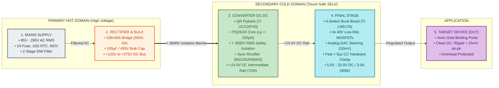
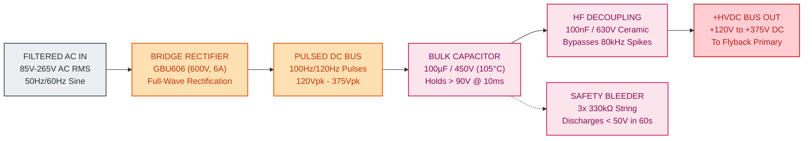
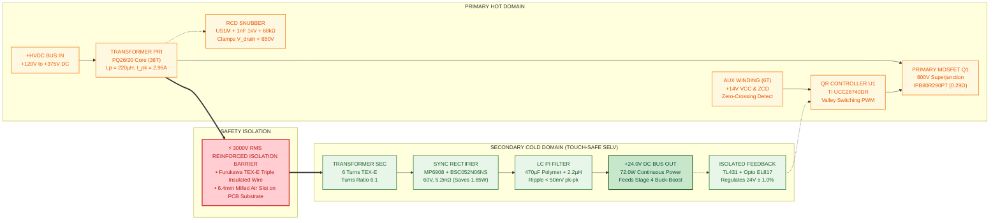
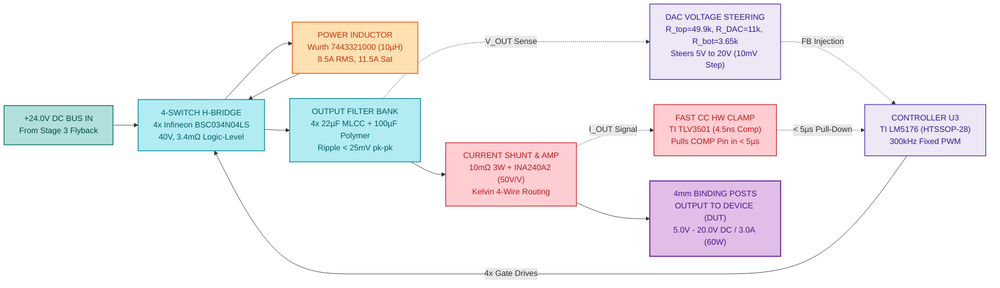

# Product Requirement Document (PRD)

---

### Project Information
* **Project Code**: `VVDN_SPPS_2026`
* **Project Name**: Smart Programmable Voltage Supply Module (85–265 V AC Input, 5–20 V / 3 A DC Output)
* **Domain**: Embedded Hardware & Power Electronics Engineering
* **Document Version**: `Rev 1.0 (Hardware Release)`
* **Date**: `12 Oct 2026`
* **Author / Design Owner**: Power Electronics Engineer Trainee (GET - Hardware Engineering)
* **Mentors & Reviewers**: Senior Hardware Architect & BU SME (Power Electronics)

---

### Revision History

| Date | Revision No. | Description | Prepared By | Reviewed By | Approved By |
| :--- | :--- | :--- | :--- | :--- | :--- |
| 12 Oct 2026 | Rev 1.0 | Simplified 4-Stage Hardware PRD with internal sub-block diagrams for cross-mentor defense | Power Electronics Trainee (GET) | BU SME (Power Electronics) | Principal Hardware Architect |
| 25 Sep 2026 | Rev 0.1 | Preliminary hardware topology study & component stress calculations | Power Electronics Trainee (GET) | Senior Hardware Architect | BU SME (Power Electronics) |

---

### Customer & Management Sign-Off

#### Customer Sign-Off
* **Customer**: Test & Measurement / Industrial OEM Client
* **Technical Lead**: Director of Hardware Engineering — *"Approved for modular test bench integration."*
* **Program Manager**: Program Director — *"Milestones and Bill of Materials targets accepted."*

#### VVDN Internal Sign-Off
* **Technical Reviewer (BU SME - Power Electronics)**: Karpagamoorthy R / Vignesh Anandhan — *"4-Stage power conversion chain, PQ26/20 magnetics, and sub-5µs analog CC protection verified."*
* **Program Reviewer (Delivery Manager)**: Gaurav Gupta / Shivam Saxena — *"Schematic review gates and laboratory DVT schedule signed off."*

---

## 1. Executive Summary & Trainee Scope

### 1.1 What Is This Product?
The **Smart Programmable Voltage Supply Module** is a compact, high-efficiency AC-to-DC power converter. It plugs directly into universal wall AC power (**85 V to 265 V AC RMS**) and delivers a clean, programmable DC voltage output from **5.0 V to 20.0 V DC** at currents up to **3.0 A** (maximum continuous power of **60 W**).

### 1.2 Trainee Engineering Ownership
This document is authored strictly within the scope of a **Power Electronics Engineer Trainee (GET)** at VVDN Technologies:
* **Scope Included**: Circuit design, component stress analysis, transformer magnetics design, closed-loop analog control, hardware fast protection, 4-layer PCB layout rules, and lab bring-up using a Variac.
* **Scope Excluded**: Software operating systems (RTOS tasks, protocol stacks) and mechanical enclosure tooling (extrusion dies) are deliberately decoupled so the trainee can defend the **embedded hardware** with complete technical depth.

---

## 2. Master Power Architecture: The 4-Stage Power Conversion Chain

The power supply converts mains electricity into regulated DC power through **four simple, sequential stages**:

$$\text{Mains Supply } (85\text{--}265\,\text{V AC}) \longrightarrow \text{Rectifier } (+120\text{--}375\,\text{V DC}) \longrightarrow \text{Converter DC-DC } (+24\,\text{V DC}) \longrightarrow \text{Final Stage } (5\text{--}20\,\text{V DC}) \longrightarrow \text{Device (DUT)}$$

---

### Figure 1: Simplified 4-Stage Power Conversion Block Diagram
This is the primary block diagram to show mentors when walking through the power conversion chain:

  

---

### Summary of the 4 Stages

| Stage Number | Stage Name | Input Voltage | Output Voltage | Primary Circuit Components | Key Function |
| :---: | :--- | :--- | :--- | :--- | :--- |
| **Stage 1** | **Mains Supply** | $85\text{--}265\,\text{V}$ AC RMS | Clean AC RMS | 2A Fuse, 10Ω NTC, MOV, 2-Stage CM Chokes, X2/Y1 Caps | Overcurrent protection, inrush limiting, surge clamping, and conducted EMI filtering. |
| **Stage 2** | **Rectifier & Bulk**| Clean AC RMS | $+120\text{--}375\,\text{V}$ DC | GBU606 Bridge Rectifier (600V, 6A), $100\,\mu\text{F} / 450\,\text{V}$ Electrolytic Cap | Converts AC into high-voltage DC and holds energy over grid dropouts ($10\,\text{ms}$). |
| **Stage 3** | **Converter DC-DC** | $+120\text{--}375\,\text{V}$ DC | $+24.0\,\text{V}$ DC (72W) | TI UCC28740, PQ26/20 Transformer, 800V CoolMOS, Sync Rectifier | Stepping down voltage with certified $3000\,\text{V}$ RMS reinforced safety galvanic isolation. |
| **Stage 4** | **Final Stage** | $+24.0\,\text{V}$ DC Rail | $5.0\text{--}20.0\,\text{V}$ DC | TI LM5176, 4x 40V MOSFETs, $10\,\mu\text{H}$ Inductor, DAC Summing, Fast CC Clamp | Post-regulation, precision $10\,\text{mV}$ DAC voltage tuning, sub-$25\,\text{mV}$ ripple, and $< 5\,\mu\text{s}$ short-circuit clamp. |

---

## 3. Step-by-Step Deep-Dive into Each Block (With Internal Sub-Block Diagrams)

---

### 3.1 Stage 1: Mains Supply & Input Protection Subsystem

#### 3.1.1 What It Does
Stage 1 takes raw, noisy AC mains from the wall socket, protects the power supply against severe electrical grid events (overcurrent, lightning surges, and cold inrush current), and prevents electromagnetic switching noise from traveling back into the grid.

#### 3.1.2 Internal Sub-Block Diagram

```mermaid
flowchart LR
    classDef compStyle fill:#ECEFF1,stroke:#37474F,stroke-width:1.5px,color:#263238
    classDef protStyle fill:#FFEBEE,stroke:#C62828,stroke-width:1.5px,color:#B71C1C
    classDef emiStyle fill:#E8F5E9,stroke:#2E7D32,stroke-width:1.5px,color:#1B5E20

    IN["AC INLET<br/>IEC 320-C14<br/>85V-265V AC"]:::compStyle
    FUSE["FUSE F1<br/>2A / 250V AC<br/>Time-Lag Ceramic"]:::protStyle
    NTC["INRUSH NTC<br/>10Ω Cold<br/>Limits I < 30A"]:::protStyle
    MOV["SURGE MOV<br/>14D471K (300V)<br/>Clamps 4.5kA Spike"]:::protStyle
    XCAP["X2 FILM CAP<br/>0.22µF 310V AC<br/>Diff-Mode Filter"]:::emiStyle
    CMC1["CM CHOKE 1<br/>15mH / 1.1A<br/>150kHz-2MHz Noise"]:::emiStyle
    CMC2["CM CHOKE 2<br/>4.7mH / 1.6A<br/>2MHz-30MHz Noise"]:::emiStyle
    YCAP["Y1 CAPS<br/>2x 2.2nF 400V AC<br/>Earth Shunt"]:::emiStyle
    OUT["CLEAN AC OUT<br/>To Stage 2<br/>GBU606 Bridge"]:::compStyle

    IN --> FUSE --> NTC --> MOV --> XCAP --> CMC1 --> CMC2 --> YCAP --> OUT
```

  

#### 3.1.3 Key Components in Stage 1
* **Input Inlet**: IEC 320-C14 3-pin connector with integrated fuse drawer (Line, Neutral, Earth Ground).
* **Fuse (F1)**: Littelfuse `0218002.MXP` — $2.0\,\text{A} / 250\,\text{V}$ AC time-lag ceramic fuse ($I^2t \ge 18\,\text{A}^2\text{s}$ to prevent nuisance tripping during inrush).
* **Inrush Limiter (NTC1)**: TDK `B57236S0100M000` — $10\,\Omega$ cold resistance thermistor. Restricts cold-start charging inrush current to $< 30\,\text{A}$ at $265\,\text{V}$ AC peak.
* **Surge Suppressor (MOV1)**: Bourns `MOV-14D471K` — $300\,\text{V}$ RMS varistor. Clamps high-voltage utility grid transients up to $4.5\,\text{kA}$ ($8/20\,\mu\text{s}$ waveform) per IEC 61000-4-5 Level 3.
* **Differential Filter**: KEMET `R46KI32200001M` — $0.22\,\mu\text{F} / 310\,\text{V}$ AC Class X2 safety film capacitors across Line and Neutral.
* **Common Mode Chokes**: Wurth Elektronik `744823215` ($15\,\text{mH}, 1.1\,\text{A}$) and `744822472` ($4.7\,\text{mH}, 1.6\,\text{A}$) providing high common-mode rejection across $150\,\text{kHz} \dots 30\,\text{MHz}$.
* **Y-Capacitors**: KEMET `PHE850` — $2.2\,\text{nF} / 400\,\text{V}$ AC Class Y1 safety ceramic capacitors shunting Line/Neutral high-frequency noise to Chassis Earth.

#### 3.1.4 Why Stage 1 Is Designed This Way
Without this stage, switching spikes generated by the converter would fail **CISPR 32 Class B** residential limits, lightning surges would destroy the semiconductors, and plugging into the wall would trigger circuit breaker trips due to massive capacitive inrush.

---

### 3.2 Stage 2: Bridge Rectifier & High-Voltage Bulk Filter Subsystem

#### 3.2.1 What It Does
Stage 2 converts alternating current (AC) into raw direct current (DC) and smooths out the severe $100\,\text{Hz} / 120\,\text{Hz}$ mains ripple, providing a stable high-voltage DC bus to feed the Flyback converter.

#### 3.2.2 Internal Sub-Block Diagram

  

#### 3.2.3 Key Components in Stage 2
* **Bridge Rectifier (BR1)**: Diodes Inc. `GBU606` — Glass passivated single-phase bridge rated for $600\,\text{V}$ reverse breakdown and $6.0\,\text{A}$ forward current.
* **Bulk Electrolytic Capacitor (C_BULK1)**: Nichicon `LGW2W101MELZ25` — $100\,\mu\text{F} / 450\,\text{V}$ snap-in capacitor rated for $105^\circ\text{C}$ and $10,000\,\text{hours}$.
* **High-Frequency Ceramic Capacitor (C_HF)**: Murata $100\,\text{nF} / 630\,\text{V}$ X7R ceramic capacitor placed directly across the primary switching loop to bypass fast $80\,\text{kHz}$ edge ringing.
* **Safety Bleeder Resistors**: Vishay Dale $3\times 330\,\text{k}\Omega$ ($1\,\text{M}\Omega$ total, $1206$ size) safely draining the capacitor below $50\,\text{V}$ within $60\,\text{seconds}$ of unplugging per IEC 62368-1.

#### 3.2.4 Engineering Calculations & Sizing
* **Minimum Bulk Bus**: $V_{\text{bulk,min}} = 85\,\text{V}_{\text{RMS}} \times \sqrt{2} - 2 \times 1.0\,\text{V} \approx 118\,\text{V} \rightarrow \mathbf{120\,\text{V DC}}$
* **Maximum Bulk Bus**: $V_{\text{bulk,max}} = 265\,\text{V}_{\text{RMS}} \times \sqrt{2} \approx 374.8\,\text{V} \rightarrow \mathbf{375\,\text{V DC}}$
* **Stored Energy**: $E = \frac{1}{2} C V^2 = \frac{1}{2} (100\,\mu\text{F}) (375\,\text{V})^2 = \mathbf{7.03\,\text{Joules}}$
* **Holdup Time**: At $72\,\text{W}$ load, $100\,\mu\text{F}$ sustains operation through a full half-cycle grid dropout ($10\,\text{ms}$) with bulk voltage staying well above $90\,\text{V DC}$.

---

### 3.3 Stage 3: Converter DC-DC (Isolated Quasi-Resonant Flyback) Subsystem

#### 3.3.1 What It Does
Stage 3 is the core power conversion and safety heart of the unit. It takes high-voltage DC ($+120\text{--}375\,\text{V}$), steps it down across a custom transformer, and provides **certified $3000\,\text{V}$ RMS reinforced safety galvanic isolation** to output a rock-solid, touch-safe **$+24.0\,\text{V}$ DC intermediate bus** ($72\,\text{W}$).

#### 3.3.2 Internal Sub-Block Diagram

  

#### 3.3.3 Key Components in Stage 3
* **Flyback Controller (U1)**: Texas Instruments `UCC28740DR` (SOIC-7). Uses quasi-resonant (QR) valley switching to turn ON the MOSFET at the minimum drain voltage resonant valley, slashing capacitive turn-on losses ($C_{\text{oss}}$).
* **Primary MOSFET (Q1)**: Infineon `IPB80R290P7` — $800\,\text{V}$ Superjunction CoolMOS ($R_{\text{DS(on)}} = 0.29\,\Omega$, D2PAK). Easily handles the bulk voltage ($375\,\text{V}$) plus reflected voltage ($144\,\text{V}$) plus leakage spike ($80\,\text{V}$) with $> 25\%$ margin.
* **Transformer (TX1)**: Custom Ferroxcube `PQ26/20` (3C95 high-frequency ferrite material):
  * **Primary Inductance**: $L_p = 220\,\mu\text{H} \pm 10\%$
  * **Turns Ratio**: $N_p : N_s = 36 : 6 = \mathbf{6 : 1}$
  * **Primary Turns**: 36 turns of double-enameled copper wire.
  * **Secondary Turns**: 6 turns of **Furukawa TEX-E triple-insulated wire** certified for $3000\,\text{V}$ RMS reinforced safety insulation.
  * **Auxiliary Turns**: 6 turns generating $+14.0\,\text{V}$ DC bias for the controller and zero-crossing demagnetization detection (ZCD).
  * **Peak Flux Density**: $B_{\text{max}} = 0.28\,\text{Tesla}$ (well below $0.38\,\text{Tesla}$ saturation).
* **Synchronous Rectifier**: Monolithic Power `MP6908GJ` smart fast driver controlling an Infineon `BSC052N06NS` ($60\,\text{V}, 5.2\,\text{m}\Omega$ N-MOSFET). Eliminates diode forward drop ($0.55\,\text{V}$), saving **$1.65\,\text{W}$** of wasted heat.
* **Optocoupler Isolation**: Everlight `EL817` ($5000\,\text{V}$ RMS proof) transmitting secondary feedback across the safety barrier to maintain tight $+24.0\,\text{V} \pm 1.0\%$ regulation.

---

### 3.4 Stage 4: Final Stage (Synchronous 4-Switch Buck-Boost Post-Regulator & Output)

#### 3.4.1 What It Does
Stage 4 is the precision regulation stage. It takes the $+24.0\,\text{V}$ DC bus from Stage 3 and steps it down or across to deliver any user-commanded voltage from **$5.0\,\text{V}$ to $20.0\,\text{V}$ DC** at up to **$3.0\,\text{A}$** with ultra-low noise ($< 25\,\text{mV}$ ripple) and **autonomous sub-$5\,\mu\text{s}$ short-circuit hardware protection**.

#### 3.4.2 Internal Sub-Block Diagram

  

#### 3.4.3 Key Components in Stage 4
* **Buck-Boost Controller (U3)**: Texas Instruments `LM5176PWPR` (HTSSOP-28). Synchronous 4-switch controller operating at fixed $300\,\text{kHz}$ with automatic, seamless transitions:
  * Pure Buck Mode for $V_{\text{OUT}} \le 18\,\text{V}$ (Efficiency $> 96\%$).
  * 4-Switch Buck-Boost Mode near $20\,\text{V}$ full load (Efficiency $> 95\%$).
* **Power MOSFETs (QA, QB, QC, QD)**: 4x Infineon `BSC034N04LS` ($40\,\text{V}, 3.4\,\text{m}\Omega$ SuperSO8). Ultra-low gate charge ($Q_g = 18\,\text{nC}$) minimizes switching losses.
* **Power Inductor (L1)**: Wurth Elektronik `7443321000` — $10.0\,\mu\text{H}$ flat-wire high-current power inductor rated for $8.5\,\text{A}_{\text{RMS}}$ and $11.5\,\text{A}$ saturation current. Flat-wire copper minimizes AC skin-effect losses.
* **Output Capacitor Bank**: 4x Murata $22\,\mu\text{F} / 25\,\text{V}$ X7R ceramic capacitors in parallel with a Panasonic $100\,\mu\text{F} / 25\,\text{V}$ OS-CON solid polymer capacitor ($\text{ESR} = 12\,\text{m}\Omega$). Ensures output voltage ripple is strictly **$< 25\,\text{mV}$ pk-pk** under full 3A load.

#### 3.4.4 DAC Voltage Steering Circuit
The output voltage is controlled by injecting current into the LM5176 feedback (`FB`) node via a 12-bit DAC:
$$V_{\text{OUT}} = V_{\text{REF}} \left( 1 + \frac{R_{\text{top}}}{R_{\text{bot}}} \right) + \frac{R_{\text{top}}}{R_{\text{DAC}}} \left( V_{\text{REF}} - V_{\text{DAC}} \right)$$
* Where $V_{\text{REF}} = 1.20\,\text{V}$ (LM5176 internal bandgap reference).
* Resistor values: $R_{\text{top}} = 49.9\,\text{k}\Omega$, $R_{\text{bot}} = 3.65\,\text{k}\Omega$, $R_{\text{DAC}} = 11.0\,\text{k}\Omega$ (all $0.1\%$ thin film).
* **Calibration**:
  * When $V_{\text{DAC}} = 3.30\,\text{V} \longrightarrow \mathbf{V_{\text{OUT}} = 5.00\,\text{V DC}}$
  * When $V_{\text{DAC}} = 0.00\,\text{V} \longrightarrow \mathbf{V_{\text{OUT}} = 20.00\,\text{V DC}}$
  * Digital tuning resolution is **$10.0\,\text{mV}$** per step with zero instability on the compensation loop.

#### 3.4.5 Sub-$5\,\mu\text{s}$ Fast Hardware Constant-Current (CC) Protection Clamp
* **Current Shunt**: Bourns `CSS2H-2512R-L010F` — $10\,\text{m}\Omega$, $3\,\text{W}$, $0.1\%$ metal element shunt with 4-wire Kelvin PCB routing.
* **Current Amplifier**: Texas Instruments `INA240A2` — Fixed gain of $50\,\text{V/V}$ with enhanced PWM rejection.
* **Analog Comparator**: Texas Instruments `TLV3501AIDBVR` — Ultra-fast analog comparator with **$4.5\,\text{ns}$** propagation delay.
* **Action**: If load current exceeds the threshold ($I_{\text{OUT}} > I_{\text{SET}}$), the TLV3501 instantly drives an NPN transistor pulling down the LM5176 `COMP` pin. The PWM duty cycle collapses to zero in **$< 5.0\,\mu\text{s}$**, clamping the current without waiting for software interrupts.

---

## 4. Master Embedded Hardware Architecture Block Diagram

The complete schematic-level architecture showing how gate drivers, auxiliary bias rails, analog feedback, and dual-domain power sensing interconnect across the isolation barrier:

  

---

## 5. Safety Galvanic Isolation (IEC 62368-1) & PCB Layout Rules

To guarantee touch-safe operation when bench users handle the 4mm output binding posts:
1. **$3000\,\text{V}$ RMS Hipot Withstand**: Primary hot circuits and secondary touch-safe circuits withstand a $3000\,\text{V}$ AC RMS dielectric proof test for 60 seconds with zero arc-over.
2. **$6.4\,\text{mm}$ Surface Creepage**: A physical distance $\ge 6.4\,\text{mm}$ is enforced between hot primary copper and cold secondary copper under Pollution Degree 2.
3. **$2.0\,\text{mm}$ Milled Air Slot**: A continuous $2.0\,\text{mm}$ wide air slot is routed through the PCB substrate directly beneath the PQ26/20 transformer and optocoupler bodies to guarantee an infinite dielectric air resistance barrier.
4. **Triple-Insulated Wire**: Furukawa TEX-E wire on the secondary transformer winding provides three independent extruded layers of certified safety insulation.

---

## 6. Master Hardware Bill of Materials (BOM)

Organized strictly across the 4 power stages:

| Item | Ref Des | Description | Qty | Manufacturer | Part Number | Stage |
| :---: | :--- | :--- | :---: | :--- | :--- | :---: |
| **1** | F1 | Ceramic Time-Lag Fuse 2A / 250V AC (5x20mm) | 1 | Littelfuse | `0218002.MXP` | Stage 1 |
| **2** | NTC1 | Inrush Current Thermistor 10Ω Cold 3.2A | 1 | TDK / EPCOS | `B57236S0100M000` | Stage 1 |
| **3** | MOV1 | Metal Oxide Varistor 300V RMS 4.5kA (14mm) | 1 | Bourns | `MOV-14D471K` | Stage 1 |
| **4** | L_CM1/2| Common Mode Chokes 15mH 1.1A / 4.7mH 1.6A | 2 | Wurth Elektronik | `744823215 / 744822472`| Stage 1 |
| **5** | C_X1/2 | Safety X2 Film Capacitors 0.22µF 310V AC | 2 | KEMET | `R46KI32200001M` | Stage 1 |
| **6** | C_Y1/2 | Safety Y1 Ceramic Capacitors 2.2nF 400V AC | 2 | KEMET | `PHE850 Series` | Stage 1 |
| **7** | BR1 | Bridge Rectifier Glass Passivated 600V 6A | 1 | Diodes Inc. | `GBU606` | Stage 2 |
| **8** | C_BULK1| Electrolytic Bulk Cap 100µF / 450V 105°C | 1 | Nichicon | `LGW2W101MELZ25` | Stage 2 |
| **9** | C_HF | High-Voltage Decoupling Cap 100nF / 630V | 1 | Murata | `GA342QR7GD102KW01L` | Stage 2 |
| **10**| R_BLEED| Safety Bleeder Resistor String 3x 330kΩ 1206 | 3 | Vishay Dale | `CRCW1206330KFKEA` | Stage 2 |
| **11**| TX1 | Flyback Transformer PQ26/20 220µH 72W (TEX-E) | 1 | Custom / Ferroxcube | `3C95-PQ2620-72W` | Stage 3 |
| **12**| Q1 | Superjunction MOSFET 800V 0.29Ω D2PAK | 1 | Infineon | `IPB80R290P7` | Stage 3 |
| **13**| U1 | Quasi-Resonant Flyback Controller SOIC-7 | 1 | Texas Instruments | `UCC28740DR` | Stage 3 |
| **14**| U2 | Smart Synchronous Rectifier Driver TSOT23-6 | 1 | Monolithic Power | `MP6908GJ` | Stage 3 |
| **15**| Q_SR | Synchronous N-MOSFET 60V 5.2mΩ SuperSO8 | 1 | Infineon | `BSC052N06NS` | Stage 3 |
| **16**| OPTO1 | Phototransistor Optocoupler 5000V RMS SMD-4 | 1 | Everlight | `EL817(S)(TA)` | Stage 3 |
| **17**| U3 | 4-Switch Synchronous Buck-Boost Controller | 1 | Texas Instruments | `LM5176PWPR` (HTSSOP-28) | Stage 4 |
| **18**| QA..QD | 4x Power N-MOSFETs 40V 3.4mΩ SuperSO8 | 4 | Infineon | `BSC034N04LS` | Stage 4 |
| **19**| L1 | Flat-Wire Power Inductor 10µH 8.5A (12.5mm) | 1 | Wurth Elektronik | `7443321000` | Stage 4 |
| **20**| R_shunt| Precision Metal Shunt Resistor 10mΩ 0.1% 3W | 1 | Bourns | `CSS2H-2512R-L010F` | Stage 4 |
| **21**| C_OUT | 4x 22µF 25V MLCC + 100µF 25V Polymer Cap | 5 | Murata / Panasonic | `GRM32ER71E226K / 25SVPF`| Stage 4 |
| **22**| U7 | Current Sense Amplifier 50V/V SC70 | 1 | Texas Instruments | `INA240A2EDCKR` | Stage 4 |
| **23**| U8 | High-Speed Analog Comparator 4.5ns SOT-23-6 | 1 | Texas Instruments | `TLV3501AIDBVR` | Stage 4 |
| **24**| POSTS | Dual 4mm Heavy-Duty Gold Binding Posts | 2 | Pomona Electronics | `3770-0 / 3770-2` | Stage 4 |

---

## 7. Hardware Bench Bring-Up Protocol (Variac Ramp)

Before applying AC mains power, follow this 5-step laboratory procedure:
1. **Cold Resistance Checks**: Verify $> 100\,\text{M}\Omega$ primary-to-secondary isolation resistance with a megohmmeter. Verify no short circuits across the bulk capacitor, $+24\,\text{V}$ bus, or output terminals.
2. **Series Bulb Protection**: Connect the AC mains via an isolation transformer and Variac with a $60\,\text{W}$ incandescent bulb in series to harmlessly absorb any shoot-through current.
3. **Gradual Voltage Ramp**: Slowly raise the Variac:
   * **$0\,\text{V} \rightarrow 50\,\text{V}$ AC**: Verify Flyback primary bias voltage starts charging.
   * **$85\,\text{V}$ AC**: Flyback controller starts switching. Verify $+24.0\,\text{V}$ DC intermediate bus stabilizes with low ripple ($< 50\,\text{mV}$).
   * **$230\,\text{V} \rightarrow 265\,\text{V}$ AC**: Verify high-line operation and RCD snubber temperature.
4. **Stage 4 Post-Regulator Activation**: Enable the LM5176 Buck-Boost controller. Sweep the DAC voltage and verify output tunes smoothly from $5.0\,\text{V}$ to $20.0\,\text{V}$ DC on a 6.5-digit precision DMM.
5. **Full Load & Dynamic Transient Test**: Apply $0.1\,\text{A} \rightarrow 3.0\,\text{A}$ electronic load steps. Verify output ripple is $< 25\,\text{mV}$ pk-pk using tip-and-barrel oscilloscope probing, and confirm thermal rise $< 45^\circ\text{C}$ on a FLIR thermal camera.

---

## 8. Appendix: Cross-Mentor Interview Preparation Cheatsheet

Use these 10 clean, concise talking points when presenting and defending your design before senior mentors:

### Q1: Walk me through the power conversion chain from wall to device.
* **Your Answer**: *"The system operates in four simple stages: First, wall AC (85V–265V AC) enters through an IEC C14 inlet and passes through fuse, NTC inrush limiter, MOV surge clamp, and a 2-stage EMI filter. Second, a GBU606 bridge rectifier and 100µF/450V electrolytic bulk capacitor convert AC into high-voltage DC (+120V to +375V DC). Third, Stage 1 (a Quasi-Resonant Flyback converter with TI UCC28740 and a custom PQ26/20 transformer) steps down this voltage and provides certified 3000V RMS reinforced safety isolation to create a stable +24.0V DC intermediate rail (72W). Fourth, Stage 2 (a TI LM5176 4-switch synchronous Buck-Boost post-regulator) regulates the +24V bus down or across to the target 5.0V–20.0V DC at up to 3.0A with sub-25mV ripple, feeding the device under test via 4mm binding posts."*

### Q2: Why did you use a passive filter and bridge rectifier instead of an active Boost PFC stage?
* **Your Answer**: *"Under international standard IEC 61000-3-2, active Power Factor Correction is legally mandated only for power supplies with active input power exceeding 75W. Our module delivers a maximum continuous output of 60W (72W peak intermediate), so it falls strictly below the 75W threshold. Adding an active PFC boost stage would require an additional high-voltage MOSFET, boost diode, controller IC, and large inductor—adding approximately $4.20 to the BOM, consuming 35% more board footprint, and introducing a ~3% efficiency penalty without any regulatory requirement."*

### Q3: How did you calculate the Flyback transformer magnetics on the PQ26/20 core?
* **Your Answer**: *"At minimum 85V AC input, the bulk bus drops to 120V DC. For a maximum duty cycle of 45% and 80kHz switching frequency at 72W output power, peak primary current is I_pk = 2.96A. Using L_p = (V_bulk_min * D_max) / (I_pk * f_sw), I calculated a primary inductance of 220µH. I chose a PQ26/20 core in 3C95 material because its cross-sectional area Ae is 122 mm², keeping peak flux density B_max at 0.28 Tesla, well below the 0.38 Tesla saturation limit. The turns ratio is 6:1 (36 primary turns, 6 secondary turns). To guarantee IEC 62368-1 reinforced isolation (3000V RMS), the secondary is wound with Furukawa TEX-E triple-insulated wire."*

### Q4: Why is the intermediate bus chosen at +24.0V DC instead of +12V or +48V?
* **Your Answer**: *"+24.0V DC is the optimal sweet spot for a 5V to 20V output range. If we chose +12V, stepping up to 20V at 3A (60W) would require high inductor boost currents (I_in = 5.5A), creating excessive conduction losses in the Buck-Boost MOSFETs. If we chose +48V, the Flyback turns ratio would decrease, increasing primary switch voltage stress, and stepping down from 48V to 5V would require an extreme duty cycle of 10%. With +24V, 5V, 12V, and 15V operate in pure Buck mode (> 96% efficiency), and 20V operates near unity Buck-Boost transition with minimal switching stress."*

### Q5: How does the 4-switch Buck-Boost operate seamlessly between 5V and 20V?
* **Your Answer**: *"The TI LM5176 controls four N-MOSFETs (QA, QB, QC, QD) in an H-bridge configuration around a single 10µH flat-wire inductor. When V_OUT is significantly below 24V (e.g. 5V or 12V), QC is held continuously ON and QD is OFF, so the circuit functions purely as a synchronous Buck converter with switches QA and QB. As V_OUT approaches 20V under load, the controller smoothly enters 4-switch Buck-Boost mode, modulating both legs to maintain exact regulation with zero deadband or output glitching."*

### Q6: How does the DAC steer the output voltage without destabilizing the loop?
* **Your Answer**: *"The LM5176 regulates by keeping its feedback pin (FB) at an internal 1.20V reference. Instead of altering the internal reference, we use a resistive summing junction: R_top (49.9kΩ) connects to V_OUT, R_bot (3.65kΩ) connects to ground, and R_DAC (11.0kΩ) connects to our 12-bit DAC. By injecting current into the FB node from the DAC, when V_DAC = 3.3V, V_OUT is steered to 5.0V. When V_DAC = 0V, V_OUT is steered to 20.0V. Because the loop's AC compensation network is connected between COMP and ground, the DC setpoint steering has zero impact on high-frequency phase margin and stability."*

### Q7: Explain how the hardware protects against a short circuit in under 5 microseconds.
* **Your Answer**: *"Software cannot react quickly enough to protect switching MOSFETs during a dead short. We implemented an autonomous analog hardware clamp: a 10mΩ metal shunt resistor feeds an INA240A2 current sense amplifier (gain = 50V/V). The amplified current signal feeds an ultra-fast TLV3501 analog comparator with 4.5ns response time. If current exceeds the threshold (e.g. 3.2A), the comparator output immediately drives an NPN transistor pulling down the LM5176's COMP pin to ground. This forces the PWM duty cycle to zero in under 5 microseconds, collapsing the output voltage and safely limiting current before any software can even register an interrupt."*

### Q8: How is safety galvanic isolation guaranteed on the PCB?
* **Your Answer**: *"We adhere strictly to IEC 62368-1 for reinforced insulation. Primary hot circuits and secondary touch-safe circuits are separated by a minimum physical surface creepage distance of 6.4mm. Across the isolation barrier, we route a 2.0mm wide milled air slot through the PCB substrate directly beneath the PQ26/20 transformer and optocouplers. The transformer secondary uses triple-insulated Furukawa TEX-E wire. The complete assembly is verified on the bench with a 3000V AC RMS Hipot dielectric withstand test for 60 seconds with zero breakdown."*

### Q9: How do you verify output voltage ripple on the oscilloscope?
* **Your Answer**: *"Standard alligator ground clips act as loop antennas that pick up radiated high-frequency magnetic noise from the 300kHz switching inductor, falsely showing 100mV+ of ripple. To measure true ripple accurately, I use the tip-and-barrel probing technique directly across the output capacitor C_OUT. I remove the oscilloscope probe hat and ground lead, wrap a short bus wire around the ground barrel, touch the tip directly to the positive pad and the barrel to the negative pad, engage 20MHz bandwidth limit and AC coupling, and verify peak-to-peak ripple is strictly below 25mV."*

### Q10: What is your exact bench bring-up procedure using a Variac?
* **Your Answer**: *"Before applying any AC power, I perform cold resistance checks: verifying > 100MΩ primary-to-secondary isolation resistance, checking for short circuits across the bulk capacitor, and checking impedance across the +24V bus and output terminals. Next, I connect the board to an isolation transformer and an AC Variac with a 60W series current-limiting incandescent bulb. I slowly ramp AC voltage from 0V to 85V AC while monitoring bulk DC bus voltage and Flyback V_CC aux bias. Once the +24V bus stabilizes at 85V AC, I ramp to nominal 230V AC and 265V AC. Finally, I enable the LM5176 Buck-Boost stage, sweep the DAC from 5V to 20V with a precision DMM, and apply incremental electronic load steps from 0.1A to 3.0A while monitoring thermals with a FLIR thermal camera."*
