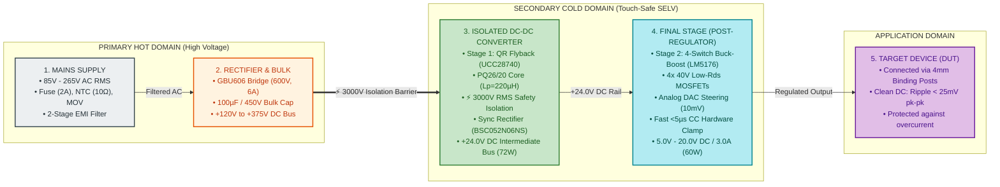

# Product Requirement Document (PRD)

---

### Project Information
* **Project Code**: `VVDN_SPPS_2026`
* **Project Name**: Smart Programmable Voltage Supply Module (85–265 V AC Input, 5–20 V / 3 A DC Programmable Output)
* **Domain**: Embedded Hardware & Power Electronics Engineering
* **Revision**: `Rev 1.0 (Hardware Engineering Release)`
* **Date**: `12 Oct 2026`
* **Author / Design Owner**: Power Electronics Engineer Trainee (GET - Hardware Engineering)
* **Technical Mentors**: Senior Hardware Architect & BU SME (Power Electronics)

---

### Revision History

| Date | Revision No. | Description | Prepared By | Reviewed By | Approved By |
| :--- | :--- | :--- | :--- | :--- | :--- |
| 12 Oct 2026 | Rev 1.0 | Final Embedded Hardware PRD aligned to 4-stage power flow for cross-mentor defense | Power Electronics Engineer Trainee (GET) | BU SME (Power Electronics) | Principal Hardware Architect |
| 25 Sep 2026 | Rev 0.1 | Preliminary hardware topology study & component stress calculations | Power Electronics Engineer Trainee (GET) | Senior Hardware Architect | BU SME (Power Electronics) |

---

### Customer Sign Off
**CUSTOMER SIGN-OFF FORM**

* **Customer**: Test & Measurement / Industrial OEM Client
* **Technical In-Charge**:
  * Name: `<Customer Technical Lead>`
  * Designation: Director of Hardware Engineering
  * Comments: Specifications reviewed and approved for embedded benchtop and automated test fixture hardware integration.
  * Signature & Date: `____________________`
* **Program In-Charge**:
  * Name: `<Customer Program Manager>`
  * Designation: Program Director
  * Comments: Hardware development schedule and component targets accepted.
  * Signature & Date: `____________________`

---

### Internal Sign Off
**VVDN INTERNAL SIGN-OFF**

* **Technical Reviewer (BU SME - Power Electronics)**:
  * Name: Karpagamoorthy R / Vignesh Anandhan
  * Designation: Principal Hardware Architect & Power Electronics SME
  * Comments: Two-stage cascaded architecture (QR Flyback + 4-Switch Synchronous Buck-Boost) verified against thermal, efficiency, and IEC 62368-1 reinforced isolation requirements.
  * Signature & Date: `____________________`
* **Program Reviewer (Engineering Delivery Manager)**:
  * Name: Gaurav Gupta / Shivam Saxena
  * Designation: Delivery Manager (Embedded Hardware BU)
  * Comments: Project schedule, schematic milestones, layout DRCs, and prototype BOM approved.
  * Signature & Date: `____________________`

---

## Table of Contents
* **1. Introduction**
  * 1.1 Purpose
  * 1.1.1 Trainee Hardware Project Scope & Cross-Mentor Interview Alignment
  * 1.2 Document Conventions
  * 1.3 Intended Audience
  * 1.4 Abbreviation
  * 1.5 References
* **2. Product Overview & Power Conversion Architecture**
  * 2.1 Product Perspective - Why a Two-Stage Cascaded Power Architecture?
  * 2.2 Core Power Flow: From Mains to Device
    * *Figure 1: Simplified 4-Stage Power Conversion Block Diagram*
    * *Figure 2: Master Embedded Hardware Architecture Block Diagram*
  * 2.3 Hardware Operating Modes
  * 2.4 Physical Hardware Interfaces & Test Points
* **3. Systems & Domains Involved**
  * 3.1 Hardware System Definition
  * 3.2 Trainee Engineering Ownership Matrix
* **4. Hardware Engineering Requirements**
  * 4.1 Stage 1: Mains AC Frontend & EMI Filter Requirements
  * 4.2 Stage 2: Bridge Rectifier & High-Voltage Bulk Filter Requirements
  * 4.3 Stage 3: Isolated Quasi-Resonant Flyback Converter Requirements
  * 4.4 Stage 4: Synchronous 4-Switch Buck-Boost Post-Regulator Requirements
  * 4.5 Analog Closed-Loop Control, DAC Steering & Fast Hardware CC Protection Requirements
  * 4.6 Dual-Domain Analog Power Sensing Frontends Requirements
  * 4.7 Auxiliary Bias Power Management Requirements
  * 4.8 Safety Galvanic Isolation (IEC 62368-1) & EMC (CISPR 32 Class B) Requirements
* **5. Assumptions & Operating Conditions**
* **6. Silicon Dependencies & Critical Component Selection**
* **7. Hardware Development Plan & Deliverables**
  * 7.1 Lifecycle Milestones
  * 7.2 Hardware Deliverables Breakdown
* **8. Embedded Hardware Subsystem Architecture Deep-Dive**
  * 8.1 Primary AC-DC Flyback Subsystem & PQ26/20 Magnetics Design
  * 8.2 Secondary 4-Switch Buck-Boost Post-Regulator Subsystem
  * 8.3 Analog Feedback Steering & Ultra-Fast Hardware Protection Loop
  * 8.4 Dual-Domain Analog Telemetry Sensing Frontends
  * 8.5 Auxiliary Power Rail Distribution Subsystem
  * 8.6 4-Layer PCB Stackup & High-Voltage Safety Creepage Routing
* **9. Hardware Bill of Materials (BOM)**
* **10. Out of Scope (Hardware Boundaries)**
* **11. Open Hardware Items**
* **Appendix: Cross-Mentor Interview Preparation & Defense Cheatsheet**

---

## 1. Introduction

### 1.1 Purpose
The purpose of this Product Requirement Document (PRD) is to establish the complete engineering, electrical, safety, schematic, PCB layout, and bench testing baseline for the **Smart Programmable Voltage Supply Module (85–265 V AC Input, 5–20 V / 3 A DC Programmable Output)**.

This module converts universal single-phase AC line voltage ($85\,\text{V} \dots 265\,\text{V}$ AC RMS, $47\,\text{Hz} \dots 63\,\text{Hz}$) into a tightly regulated, clean, digitally steerable DC output voltage from **$5.0\,\text{V}$ to $20.0\,\text{V}$ DC** at up to **$3.0\,\text{A}$** continuous load ($60\,\text{W}$ maximum continuous power).

This document serves as the single source of truth for the trainee's hardware design, schematic capture in Altium Designer, 4-layer PCB layout rules, Bill of Materials (BOM), and laboratory bench validation procedures.

### 1.1.1 Trainee Hardware Project Scope & Cross-Mentor Interview Alignment
This project is formulated specifically within the professional scope of a **Power Electronics Engineer Trainee (Graduate Engineer Trainee - GET, Hardware Engineering)** at VVDN Technologies. 

> [!IMPORTANT]
> **Strict Embedded Hardware Focus**:
> To ensure unambiguous accountability and full defensibility during the upcoming **Cross-Mentor Technical Interview**, this PRD is strictly restricted to **Embedded Hardware and Power Electronics Engineering**. Software operating systems (RTOS tasks, protocol stacks) and mechanical tooling (extrusion dies) are formally decoupled from this document. The trainee is evaluated entirely on circuit design, component sizing, magnetics calculations, closed-loop analog control, hardware safety isolation, PCB layout, and bench test verification.

#### Trainee Core Hardware Ownership:
1. **Power Conversion Topology Selection & Sizing Math**:
   - Sizing the AC input protection (Fuse, NTC thermistor, MOV varistor) and 2-stage common-mode EMI filter.
   - Sizing the bridge rectifier and high-voltage DC bulk electrolytic capacitor bank.
   - Designing the Stage 1 Quasi-Resonant (QR) Flyback converter ($85\text{--}265\,\text{V}$ AC to $+24.0\,\text{V}$ DC, $72\,\text{W}$), including custom PQ26/20 ferrite transformer magnetics calculations ($L_p = 220\,\mu\text{H}$, turns ratio $N_p:N_s = 6:1$, Furukawa TEX-E triple-insulated wire).
   - Designing the Stage 2 Synchronous 4-Switch Buck-Boost post-regulator ($+24\,\text{V}$ DC to $5.0\text{--}20.0\,\text{V}$ DC @ $3.0\,\text{A}$), including inductor sizing ($10\,\mu\text{H}, 8.5\,\text{A}_{\text{RMS}}$), MOSFET selection ($40\,\text{V}, 3.4\,\text{m}\Omega$), and low-ESR polymer/ceramic capacitor bank ripple attenuation.
2. **Analog Control & Ultra-Fast Hardware Protection**:
   - Calculating the 12-bit DAC voltage steering resistor network ($R_{\text{top}} = 49.9\,\text{k}\Omega, R_{\text{DAC}} = 11.0\,\text{k}\Omega, R_{\text{bot}} = 3.65\,\text{k}\Omega$) for smooth $3.65\,\text{mV}$ step resolution.
   - Designing the sub-$5\,\mu\text{s}$ autonomous hardware Constant-Current (CC) clamp ($10\,\text{m}\Omega$ shunt + INA240A2 amplifier + TLV3501 analog comparator pulling down LM5176 `COMP` pin).
3. **Altium Schematics & 4-Layer PCB Layout**:
   - Multi-sheet schematic capture in Altium Designer adhering to VVDN component derating guidelines.
   - 4-layer PCB layout execution: power switching loops minimization, ground plane partitioning (Hot Primary Ground vs Cold Secondary Ground), Kelvin 4-wire shunt sensing, and routing a physical $\ge 6.4\,\text{mm}$ milled creepage air slot beneath isolation barriers.
4. **Hardware Bench Bring-Up & DVT Validation**:
   - Formulating safe power-up cold checks and Variac ramp-up protocols ($0\,\text{V} \rightarrow 85\,\text{V} \rightarrow 230\,\text{V} \rightarrow 265\,\text{V}$).
   - Verifying line/load regulation, load step transient recovery ($< 120\,\mu\text{s}$), output ripple ($< 25\,\text{mV}$ pk-pk), and thermal camera temperature rise.

### 1.2 Document Conventions
* **[MUST]**: Mandatory hardware engineering requirement. The board cannot be fabricated or passed without fulfilling this specification.
* **[SHOULD]**: Highly recommended performance target where trade-offs require senior mentor approval.
* **[COULD]**: Optional hardware enhancement for Revision B board spins.

### 1.3 Intended Audience
* **Cross-Mentor Review Panel & BU Leadership**: Evaluates the trainee's mastery of power electronics, magnetics calculations, component derating, and safety isolation.
* **Senior Hardware Mentor & BU SME (Power Electronics)**: Technical reviewer guiding circuit calculations, simulation, and schematic review gates.
* **Power Electronics Engineer Trainee (GET - Author)**: Primary hardware design owner responsible for schematics, layout, BOM, and bench testing.
* **PCB Layout & DFM Engineers**: Layout execution team collaborating on high-current trace widths, copper weights, and creepage clearances.
* **Test & Quality Assurance (QA) Engineers**: Hardware verification team executing Hipot isolation, EMI pre-compliance, and thermal soak tests.

### 1.4 Abbreviation

#### Table 1: Hardware Engineering Abbreviations
| Acronym | Full Form | Engineering Definition for Mentors |
| :--- | :--- | :--- |
| **AC** | Alternating Current | Grid mains electricity ($85\,\text{V} \dots 265\,\text{V}$ AC RMS, $47\text{--}63\,\text{Hz}$). |
| **BOM** | Bill of Materials | Comprehensive component list specifying reference designators, MPNs, and packages. |
| **CC** | Constant Current Mode | Autonomous protection state where output current is capped at the set limit. |
| **CCM** | Continuous Conduction Mode | Inductor current never drops to zero during a switching period. |
| **CV** | Constant Voltage Mode | Standard operating state where output voltage remains fixed across changing load. |
| **DAC** | Digital-to-Analog Converter | Microcontroller peripheral generating an analog steering voltage to offset feedback. |
| **DC** | Direct Current | Unidirectional electrical power ($+24\,\text{V}$ intermediate rail, $5\text{--}20\,\text{V}$ output). |
| **DUT** | Device Under Test | The external target load powered by the power supply terminals. |
| **DVT** | Design Verification Testing | Comprehensive lab electrical and thermal testing validating hardware specs. |
| **EMC / EMI**| Electromagnetic Compatibility | Suppressing conducted/radiated electrical switching noise to CISPR 32 Class B. |
| **ESR** | Equivalent Series Resistance | Internal resistive loss of capacitors; low ESR minimizes output ripple. |
| **Hipot** | High Potential Test | Dielectric withstand test applying $3000\,\text{V}$ AC RMS to verify insulation barrier. |
| **MOV** | Metal Oxide Varistor | Overvoltage surge suppressor clamping high-voltage line grid spikes (14D471K). |
| **NTC** | Negative Temp. Coefficient | Inrush current limiting thermistor placed in series with AC line ($10\,\Omega$). |
| **OVP** | Over-Voltage Protection | Hardware clamp triggering if output exceeds set voltage threshold by $> 1.5\,\text{V}$. |
| **PCB** | Printed Circuit Board | 4-layer FR-4 substrate ($1.6\,\text{mm}$ thickness, $2\,\text{oz}$ outer / $1\,\text{oz}$ inner copper). |
| **QR** | Quasi-Resonant Switching | Soft-switching technique turning on MOSFET at resonant drain voltage valley. |
| **RMS** | Root Mean Square | Effective DC equivalent heating value of an AC waveform. |
| **SELV** | Safety Extra-Low Voltage | Touch-safe voltage category ($< 60\,\text{V}$ DC) per IEC 62368-1 safety standard. |
| **SR** | Synchronous Rectification | Active MOSFET rectification replacing diodes to eliminate $V_f$ conduction loss. |

### 1.5 References
1. **IEC 62368-1:2020 (Ed. 3.0)**: Audio/video, information and communication technology equipment - Safety requirements (Reinforced Isolation).
2. **CISPR 32 / EN 55032**: Electromagnetic compatibility of multimedia equipment - Emission requirements (Class B limits).
3. **Texas Instruments LM5176 Datasheet (SNVSAR4)**: High-Performance 4-Switch Synchronous Buck-Boost Controller.
4. **Texas Instruments UCC28740 Datasheet (SLUSBL2)**: Constant-Voltage Constant-Current Flyback Controller with Optocoupler Feedback.
5. **Ferroxcube Soft Ferrites Design Handbook**: PQ26/20 Core Calculations and 3C95 Material Properties.
6. **VVDN Embedded Hardware Design Guidelines (Rev 3.2)**: Component Stress Derating & PCB Creepage Standards.

---

## 2. Product Overview & Power Conversion Architecture

### 2.1 Product Perspective - Why a Two-Stage Cascaded Power Architecture?
When converting high-voltage universal AC mains ($85\,\text{V} \dots 265\,\text{V}$ AC) to a finely steerable low-voltage DC output ($5.0\,\text{V} \dots 20.0\,\text{V}$ DC at $3.0\,\text{A}$), attempting a single-stage converter is technically flawed:
1. **Extreme Duty Cycle Span**: Direct conversion from $375\,\text{V}$ DC to $5\,\text{V}$ DC requires an extreme duty cycle ($< 3\%$) or an extreme transformer turns ratio, leading to severe primary leakage inductance spikes, poor efficiency, and loop instability.
2. **Wide Output Voltage Variation Across Isolation Barrier**: Regulating a wide 4:1 output range ($5\,\text{V}$ to $20\,\text{V}$) across an isolated transformer makes auxiliary bias winding tracking unstable and causes high voltage stress on secondary rectifiers.
3. **Dynamic Response Trade-Off**: Isolated Flyback feedback loops are slow due to optocoupler pole limits, making it impossible to achieve sub-$150\,\mu\text{s}$ transient recovery without a secondary post-regulator.

**The Engineering Solution: A Two-Stage Cascaded Architecture**:
* **Stage 1 (Isolated AC-DC Flyback Converter)**: Converts variable AC mains ($85\text{--}265\,\text{V}$ AC) into a single, rock-solid, isolated **$+24.0\,\text{V}$ DC intermediate bus** ($72\,\text{W}$). It handles $3000\,\text{V}$ RMS safety isolation and primary bulk energy storage.
* **Stage 2 (Synchronous 4-Switch Buck-Boost Post-Regulator)**: Takes the fixed $+24.0\,\text{V}$ DC rail and steps it down (Buck mode for $5\text{--}18\,\text{V}$) or smoothly transitions (Buck-Boost mode near $20\,\text{V}$) to provide precision output regulation ($5.0\text{--}20.0\,\text{V}$ DC @ $3.0\,\text{A}$), sub-$25\,\text{mV}$ ripple, and instant sub-$5\,\mu\text{s}$ current limiting.

---

### 2.2 Core Power Flow: From Mains to Device

The complete power conversion chain comprises five simple, logical stages:
$$\text{Mains Supply } (85\text{--}265\,\text{V AC}) \longrightarrow \text{Rectifier } (+120\text{--}375\,\text{V DC}) \longrightarrow \text{Isolated Flyback } (+24\,\text{V DC}) \longrightarrow \text{Final Stage } (5\text{--}20\,\text{V DC}) \longrightarrow \text{Device (DUT)}$$

#### Figure 1: Simplified 4-Stage Power Conversion Block Diagram
The primary block diagram to walk mentors through the core power conversion chain:

---

#### Figure 2: Master Embedded Hardware Architecture Block Diagram
The complete embedded hardware schematic-level architecture showing gate drivers, auxiliary supplies, analog feedback loops, and dual-domain power sensing:

---

### 2.3 Hardware Operating Modes
The embedded hardware autonomously operates across four core electrical states:
1. **Constant Voltage (CV) Regulation Mode**:
   - The LM5176 Buck-Boost controller maintains tight closed-loop regulation at the set output voltage ($5.0\,\text{V} \dots 20.0\,\text{V}$ DC).
   - Operates in Buck mode for $V_{\text{OUT}} \le 18\,\text{V}$, transitions through 4-switch Buck-Boost mode near $20\,\text{V}$ under full 3A load. Output ripple is attenuated below $25\,\text{mV}$ pk-pk.
2. **Autonomous Hardware Constant Current (CC) Clamping Mode**:
   - If the load attempts to draw current above the setpoint ($I_{\text{OUT}} > I_{\text{SET}}$), the precision $10\,\text{m}\Omega$ shunt and INA240A2 amplifier signal trigger the TLV3501 analog comparator.
   - The comparator overrides the feedback loop and pulls down the LM5176 `COMP` pin in **$< 5.0\,\mu\text{s}$**, instantly folding back the duty cycle and clamping current strictly at the limit without any software intervention.
3. **Dynamic Load Step Response State**:
   - When connected load steps dynamically between $50\%$ and $100\%$ ($1.5\,\text{A} \rightarrow 3.0\,\text{A}$), the Type-II analog compensation network restores output voltage within **$< 120\,\mu\text{s}$** with transient sag **$< 250\,\text{mV}$**.
4. **Hardware Fault Crowbar Shutdown State**:
   - Over-Voltage Protection (OVP at $V_{\text{SET}} + 1.5\,\text{V}$) or Over-Temperature ($T_{\text{PCB}} > 90^\circ\text{C}$) trips the high-speed comparator, which immediately disables the LM5176 `ENABLE` pin and commands the high-side P-MOSFET disconnect switch.

---

### 2.4 Physical Hardware Interfaces & Test Points

#### Table 2: Physical Hardware Interfaces
| Interface | Connector / Hardware Type | Electrical Rating | Function & Trainee Verification |
| :--- | :--- | :--- | :--- |
| **AC Mains Inlet** | IEC 320-C14 with Fuse Drawer | $250\,\text{V} / 10\,\text{A}$, 3-Pin Earth | Universal AC grid connection; carries line, neutral, and chassis earth ground. |
| **DC Output Terminals** | Dual 4mm Gold-Plated Binding Posts | $30\,\text{A}$ peak / $15\,\text{A}$ cont, $1000\,\text{V}$ | Low-impedance Red (+) and Black (-) terminals connecting to the external Device Under Test. |
| **Voltage Control Interface** | Precision Multi-Turn Pot / Rotary Encoder | Analog / Quadrature Input | Adjusts DAC steering voltage in calibrated $10\,\text{mV}$ increments. |
| **Current Limit Interface** | Rotary Encoder / Calibration Header | Analog / Quadrature Input | Adjusts hardware comparator threshold in calibrated $10\,\text{mA}$ increments. |
| **Output Enable Switch** | Heavy-Duty Tactile Switch + Dual LED | $50\,\text{mA} / 12\,\text{V}$ DC | Hardware toggle pulling LM5176 `EN` high or low; Green LED = Active, Red = Fault. |
| **Local Telemetry Screen** | 1.3" Monochrome OLED (SH1106) | $3.3\,\text{V}$ I2C Bus ($400\,\text{kHz}$) | Real-time display of true $V_{\text{OUT}}$, $I_{\text{OUT}}$, $P_{\text{DC}}$, and efficiency $\eta$. |

#### Table 3: Hardware Test Points (Bring-Up & Debug)
| Test Point ID | Signal Name | Expected Electrical Value | Oscilloscope / Meter Probe Purpose |
| :--- | :--- | :--- | :--- |
| **TP_LINE** | AC Line Post-Fuse | $85\,\text{V} \dots 265\,\text{V}$ AC RMS | Verify fuse integrity and AC line voltage before EMI filter. |
| **TP_HVDC** | High-Voltage Bulk Bus | $+120\,\text{V} \dots +375\,\text{V}$ DC | Measure rectified DC bus voltage and 100Hz/120Hz bulk ripple. |
| **TP_DRAIN** | Primary MOSFET Drain (Q1) | Resonant Valley Waveform ($< 650\,\text{V}$) | Verify quasi-resonant switching and snubbed leakage inductance spike. |
| **TP_VSEC** | Transformer Secondary AC | High-Frequency AC Pulses ($\approx 35\,\text{V}_{\text{pk}}$) | Verify synchronous rectifier timing and body-diode conduction time. |
| **TP_24V** | Intermediate DC Bus | $+24.0\,\text{V} \pm 1.0\%$ DC ($72\,\text{W}$) | Check Stage 1 Flyback regulation and cross-regulation stability. |
| **TP_SW1 / SW2**| Buck-Boost Switch Nodes | $300\,\text{kHz}$ Square Wave ($0\text{--}24\,\text{V}$) | Verify H-bridge switching dead-time, overshoot, and ringing. |
| **TP_VOUT** | Regulated Output Rail | $+5.0\,\text{V} \dots +20.0\,\text{V}$ DC | Precision 6.5-digit DMM voltage sweep and AC ripple measurement. |
| **TP_COMP** | LM5176 Error Amp Output | $1.2\,\text{V} \dots 2.8\,\text{V}$ DC Analog | Monitor analog feedback response and $< 5\,\mu\text{s}$ CC clamp pull-down. |
| **TP_CS** | Current Shunt Sense | $0\,\text{mV} \dots 30\,\text{mV}$ Differential | Verify current amplifier gain ($50\,\text{V/V}$) and Kelvin routing accuracy. |

---

## 3. Systems & Domains Involved

### 3.1 Hardware System Definition
The entire product is treated as a unified **Embedded Hardware Power Module (System 1)**. All engineering specifications, BOM items, schematics, and test reports belong directly to the hardware engineering domain.

### 3.2 Trainee Engineering Ownership Matrix

#### Table 4: Trainee Engineering Ownership
| Engineering Discipline | Trainee Ownership Status | Specific Trainee Responsibilities | Mentor Review Mechanism |
| :--- | :---: | :--- | :--- |
| **Power Converter Design (HW)** | **100% Primary Trainee Scope** | Circuit topologies, calculations, magnetics design (PQ26/20), semiconductor stress analysis, component selection. | Gate 1 Review with BU SME (Power Electronics) |
| **Schematic Capture (HW)** | **100% Primary Trainee Scope** | Multi-sheet Altium schematics, net labeling, component derating, decoupling, protection circuitry. | Gate 2 Review with Senior Hardware Architect |
| **PCB Layout & DFM (HW)** | **100% Primary Trainee Scope** | 4-layer stackup, high-current power loops, Kelvin sense routing, $\ge 6.4\,\text{mm}$ safety creepage slots, thermal vias. | Gate 3 Review with Senior Layout Lead |
| **Lab Bring-Up & DVT (HW)** | **100% Primary Trainee Scope** | Cold checks, Variac gradual AC power-up, line/load regulation sweeps, ripple probing, DVT test report. | Gate 4 Supervised Lab Sign-Off |

---

## 4. Hardware Engineering Requirements

### 4.1 Stage 1: Mains AC Frontend & EMI Filter Requirements

#### Table 5: AC Frontend & Protection Specifications
| Req ID | Parameter | Specified Value | Engineering Design Rationale | Verification Method |
| :--- | :--- | :--- | :--- | :--- |
| **AC-01** | Input Voltage Range | $85\,\text{V} \dots 265\,\text{V}$ AC RMS [MUST] | Universal global grid compatibility (India 230V, US 120V, Japan 100V). | Programmable AC source sweep |
| **AC-02** | Line Frequency | $47\,\text{Hz} \dots 63\,\text{Hz}$ [MUST] | Accommodates standard 50Hz and 60Hz utility grids. | Frequency variation test |
| **AC-03** | Input Protection Fuse | $2.0\,\text{A} / 250\,\text{V}$ Time-Lag [MUST] | $I^2t \ge 18\,\text{A}^2\text{s}$ withstands initial cold inrush without nuisance trips. | High-surge power cycling |
| **AC-04** | Inrush Current Limiter | $10\,\Omega$ Cold NTC Thermistor [MUST] | Restricts cold-start charging current to $< 30\,\text{A}$ at $265\,\text{V}$ AC peak. | Current probe on oscilloscope |
| **AC-05** | Line Surge Suppressor | MOV 14D471K ($300\,\text{V}$ RMS) [MUST] | Clamps grid voltage spikes up to $4.5\,\text{kA}$ ($8/20\,\mu\text{s}$) per IEC 61000-4-5. | 2kV surge generator injection |
| **AC-06** | Conducted EMI Filtering| 2-Stage Common Mode Filter [MUST] | Attenuates switching noise below **CISPR 32 Class B** emission limits. | Benchtop LISN & Spectrum Analyzer |

---

### 4.2 Stage 2: Bridge Rectifier & High-Voltage Bulk Filter Requirements

#### Table 6: Rectifier & Bulk DC Bus Specifications
| Req ID | Parameter | Specified Value | Engineering Design Rationale | Verification Method |
| :--- | :--- | :--- | :--- | :--- |
| **RC-01** | Bridge Rectifier Type | GBU606 Glass Passivated [MUST] | $600\,\text{V}$ reverse breakdown, $6.0\,\text{A}$ average current, low thermal resistance. | Thermal camera under full load |
| **RC-02** | Rectified DC Bus Voltage| $+120\,\text{V} \dots +375\,\text{V}$ DC [MUST] | Derived from $85\,\text{V}_{\text{RMS}} \times \sqrt{2} \approx 120\,\text{V}$ to $265\,\text{V}_{\text{RMS}} \times \sqrt{2} \approx 375\,\text{V}$ DC. | High-voltage differential probe |
| **RC-03** | Bulk Electrolytic Cap | $100\,\mu\text{F} / 450\,\text{V}$ ($105^\circ\text{C}$) [MUST] | Holds DC bus valley $> 90\,\text{V}$ during $10\,\text{ms}$ AC line dropout at $72\,\text{W}$ load. | AC line drop simulator |
| **RC-04** | Bulk DC Voltage Ripple | $< 18\,\text{V}$ pk-pk @ 85V AC Full Load [SHOULD]| Limits low-frequency 100Hz ripple into Flyback stage. | Oscilloscope AC coupling probe |

---

### 4.3 Stage 3: Isolated Quasi-Resonant Flyback Converter Requirements

#### Table 7: Stage 1 Flyback Power Converter Specifications
| Req ID | Parameter | Specified Value | Engineering Design Rationale | Verification Method |
| :--- | :--- | :--- | :--- | :--- |
| **FB-01** | Flyback Controller IC | TI UCC28740 Quasi-Resonant [MUST] | Valley-switching topology reduces capacitive MOSFET turn-on losses ($C_{oss}$). | Drain waveform valley check |
| **FB-02** | Intermediate DC Bus | $+24.0\,\text{V} \text{ DC} \pm 1.0\%$ [MUST] | Stable intermediate bus feeding the Buck-Boost post-regulator stage. | 6.5-digit precision DMM |
| **FB-03** | Continuous Output Power| $72.0\,\text{W}$ Continuous ($+24\,\text{V} / 3.0\,\text{A}$) [MUST]| Provides $60\,\text{W}$ output + margins for Buck-Boost conversion losses. | Electronic load 72W burn-in |
| **FB-04** | Transformer Core | Ferroxcube PQ26/20 (3C95) [MUST] | High power density, low leakage inductance, low core loss at $65\text{--}100\,\text{kHz}$. | Magnetic BH curve calculation |
| **FB-05** | Primary Inductance ($L_p$)| $220\,\mu\text{H} \pm 10\%$ [MUST] | Ensures boundary/quasi-resonant conduction at $85\,\text{V}$ AC minimum input. | LCR bridge measurement @ 100kHz|
| **FB-06** | Primary Switching MOSFET| Infineon IPB80R290P7 ($800\,\text{V}$) [MUST] | $800\,\text{V}$ breakdown with $R_{\text{DS(on)}} = 0.29\,\Omega$; handles $V_{\text{bulk}} + V_{\text{reflected}} + V_{\text{spike}}$. | Drain peak voltage probe |
| **FB-07** | Secondary Rectifier | Synchronous BSC052N06NS ($60\,\text{V}, 5.2\,\text{m}\Omega$) [MUST]| Eliminates Schottky diode $0.55\,\text{V}$ drop, saving $\approx 1.65\,\text{W}$ of heat dissipation. | Power analyzer efficiency run |
| **FB-08** | Stage 1 Peak Efficiency| $> 90.0\%$ @ 230V AC Full Load [MUST] | Minimizes overall thermal dissipation inside the enclosure. | AC-DC precision power meter |

---

### 4.4 Stage 4: Synchronous 4-Switch Buck-Boost Post-Regulator Requirements

#### Table 8: Stage 2 4-Switch Buck-Boost Post-Regulator Specifications
| Req ID | Parameter | Specified Value | Engineering Design Rationale | Verification Method |
| :--- | :--- | :--- | :--- | :--- |
| **BB-01** | Post-Regulator IC | TI LM5176 Synchronous Controller [MUST]| Seamless 4-switch Buck, Buck-Boost, and Boost mode transitions. | Switching node oscilloscope trace|
| **BB-02** | Programmable Output (V)| $5.0\,\text{V} \dots 20.0\,\text{V}$ DC Continuous [MUST]| Covers standard electronic test rails (5V USB, 12V industrial, 20V laptop).| DMM continuous voltage sweep |
| **BB-03** | Continuous Output (I) | $0.1\,\text{A} \dots 3.0\,\text{A}$ DC Continuous [MUST]| Delivers full $3.0\,\text{A}$ across all set voltages ($60\,\text{W}$ maximum power). | 2-hour full-load soak test |
| **BB-04** | Switching Frequency | $300\,\text{kHz} \pm 10\%$ Fixed [MUST] | Optimized balance between inductor size, switching losses, and ripple. | Frequency counter on SW node |
| **BB-05** | Power Inductor (L1) | $10.0\,\mu\text{H}$ Flat-Wire (Wurth 7443321000) [MUST]| $8.5\,\text{A}_{\text{RMS}}, I_{\text{sat}} = 11.5\,\text{A}$; flat-wire copper minimizes skin-effect losses.| Inductor current probe |
| **BB-06** | Switching MOSFETs | 4x Infineon BSC034N04LS ($40\,\text{V}, 3.4\,\text{m}\Omega$) [MUST]| Low gate charge ($Q_g = 18\,\text{nC}$) and ultra-low $R_{\text{DS(on)}}$ ensure $> 95\%$ efficiency.| Efficiency curve measurement |
| **BB-07** | Output Voltage Ripple | $< 25\,\text{mV}$ pk-pk @ 20V / 3A [MUST] | $4\times 22\,\mu\text{F}$ MLCC $+ 100\,\mu\text{F}$ OS-CON polymer ($\text{ESR} = 12\,\text{m}\Omega$) filter.| $20\,\text{MHz}$ tip-and-barrel scope probe|
| **BB-08** | Load Transient Recovery| $< 120\,\mu\text{s}$ ($< 250\,\text{mV}$ sag) [MUST] | Type-II analog compensation restores rail rapidly during $50\% \rightarrow 100\%$ step. | Dynamic electronic load step |
| **BB-09** | Stage 2 Peak Efficiency| $> 95.0\%$ @ 20V / 3A Output [MUST] | Synchronous 4-switch topology minimizes conduction losses. | DC-DC efficiency power meter |

---

### 4.5 Analog Closed-Loop Control, DAC Steering & Fast Hardware CC Protection Requirements

#### Table 9: Control Loop & Protection Specifications
| Req ID | Parameter | Specified Value | Engineering Design Rationale | Verification Method |
| :--- | :--- | :--- | :--- | :--- |
| **CT-01** | Voltage Steering Method | Resistor Summing into LM5176 FB [MUST] | DAC injects current through $R_{\text{DAC}} = 11.0\,\text{k}\Omega$ to adjust $V_{\text{OUT}}$ without loop drift. | DAC voltage vs Vout linearity test|
| **CT-02** | Voltage Tuning Step | $10.0\,\text{mV}$ Digital Step Resolution [MUST]| 12-bit DAC provides $3.65\,\text{mV}$ raw resolution, mapped to $10.0\,\text{mV}$ steps. | Multi-step precision sweep |
| **CT-03** | Hardware Current Sense | $10\,\text{m}\Omega$ Metal Element Shunt [MUST] | $3\,\text{W}$ 2512 package, $0.1\%$ tolerance, Kelvin 4-wire connection. | Milliohm Kelvin bridge check |
| **CT-04** | Shunt Sense Amplifier | INA240A2 Precision Current Amp [MUST] | Fixed gain $50\,\text{V/V}$, enhanced PWM rejection eliminates switching spike noise. | Differential sense trace verify |
| **CT-05** | CC Reaction Speed | $< 5.0\,\mu\text{s}$ Autonomous Hardware Clamp [MUST]| TLV3501 analog comparator directly pulls down LM5176 `COMP` pin during overload. | Dead short-circuit scope capture |
| **CT-06** | Hardware Over-Voltage | Clamps at $V_{\text{SET}} + 1.5\,\text{V}$ in $< 5\,\mu\text{s}$ [MUST]| Independent analog comparator disables `ENABLE` pin and opens gate disconnect FET. | OVP trip injection test |

---

### 4.6 Dual-Domain Analog Power Sensing Frontends Requirements

#### Table 10: Analog Power Sensing Specifications
| Req ID | Parameter | Specified Value | Engineering Design Rationale | Verification Method |
| :--- | :--- | :--- | :--- | :--- |
| **TM-01** | AC Voltage Sensing | AMC1311 Isolated Delta-Sigma Modulator [MUST]| Differential analog sensing across high-voltage resistor divider with $3000\,\text{V}$ isolation.| AC input voltage sweep calibration |
| **TM-02** | AC Current Sensing | 1000:1 Toroidal Current Transformer [MUST] | Non-invasive isolated current sensing with precision burden resistor ($50\,\Omega$). | AC current probe comparison |
| **TM-03** | DC Rail Monitoring | INA226 16-Bit I2C Power Monitor IC [MUST] | Measures DC bus voltage ($1.25\,\text{mV/LSB}$) and shunt current ($100\,\mu\text{A/LSB}$) with $0.2\%$ acc.| Keysight 34465A DMM calibration |
| **TM-04** | Efficiency Math | Live Analog Ratio ($\eta = P_{\text{DC}} / P_{\text{AC}}$) [MUST]| Dual-domain sensing enables live system efficiency auditing 10 times per second. | Precision AC/DC Power Analyzer |

---

### 4.7 Auxiliary Bias Power Management Requirements

#### Table 11: Auxiliary Power Rail Specifications
| Req ID | Parameter | Specified Value | Engineering Design Rationale | Verification Method |
| :--- | :--- | :--- | :--- | :--- |
| **AX-01** | Primary Aux Bias Rail | $+14.0\,\text{V} \text{ DC} \pm 10\%$ ($300\,\text{mA}$) [MUST] | Sourced from transformer auxiliary winding to power UCC28740 Flyback controller. | DMM probe during start-up |
| **AX-02** | Gate Drive Bias Rail | $+12.0\,\text{V} \text{ DC} \pm 2.0\%$ ($500\,\text{mA}$) [MUST] | Buck regulator off $+24\,\text{V}$ bus feeding LM5176 high-side bootstrap and gate drivers.| Gate drive waveform check |
| **AX-03** | Analog Sensing Bias | $+5.0\,\text{V} \text{ DC} \pm 1.0\%$ ($200\,\text{mA}$) [MUST] | Low-noise LDO feeding INA240 current amplifier and TLV3501 comparator. | Spectrum noise analyzer probe |
| **AX-04** | Logic & Controller Bias | $+3.3\,\text{V} \text{ DC} \pm 1.0\%$ ($500\,\text{mA}$) [MUST] | Low-noise LDO feeding microcontroller core, 12-bit DAC reference, and OLED screen.| DMM 3.3V rail check |

---

### 4.8 Safety Galvanic Isolation (IEC 62368-1) & EMC (CISPR 32 Class B) Requirements

#### Table 12: Safety & Compliance Specifications
| Req ID | Parameter | Specified Value | Engineering Design Rationale | Verification Method |
| :--- | :--- | :--- | :--- | :--- |
| **SF-01** | Dielectric Withstand | $3000\,\text{V}$ AC RMS for 60 Seconds [MUST] | Mandatory IEC 62368-1 Reinforced Galvanic Isolation between Primary and Secondary.| Certified Hipot dielectric tester |
| **SF-02** | PCB Safety Creepage | $\ge 6.4\,\text{mm}$ Surface Creepage [MUST] | Prevents surface tracking under pollution degree 2 and humidity. | PCB optical caliper measurement |
| **SF-03** | Physical Isolation Slot | $\ge 2.0\,\text{mm}$ Milled Air Slot in PCB [MUST]| Routed directly beneath transformer and optocouplers to guarantee infinite air path.| PCB Gerber fabrication check |
| **SF-04** | Conducted Emissions | CISPR 32 / EN 55032 Class B Limits [MUST] | $150\,\text{kHz} \dots 30\,\text{MHz}$ conducted noise suppressed below residential limits. | EMC semi-anechoic receiver |
| **SF-05** | Operating Temperature | $-20^\circ\text{C} \dots +50^\circ\text{C}$ Ambient [MUST] | Natural convection operation; component junction temperatures kept $< 105^\circ\text{C}$. | Thermal chamber full-load run |

---

## 5. Assumptions & Operating Conditions
1. **Mains Grid Waveform**: Input AC line is standard sinusoidal power ($85\text{--}265\,\text{V}$ AC RMS, $47\text{--}63\,\text{Hz}$) with total harmonic distortion $\text{THD} \le 5\%$.
2. **Thermal Environment**: Module operates reliably in ambient air temperatures from $-20^\circ\text{C}$ to $+50^\circ\text{C}$ under natural convection without requiring forced-air cooling fans.
3. **Secondary Grounding**: Secondary output terminals are floating by default for safety, but can be tied to Earth Ground externally by the bench user.
4. **Component Derating Margin**: All semiconductors and passive components adhere strictly to VVDN's derating rules (voltage stress $\le 80\%$, current stress $\le 70\%$, capacitor ripple current $\le 75\%$).

---

## 6. Silicon Dependencies & Critical Component Selection

#### Table 13: Critical Silicon Selection Table
| Component Role | Selected Manufacturer & MPN | Package | Key Engineering Selection Criteria |
| :--- | :--- | :--- | :--- |
| **Flyback Controller** | Texas Instruments `UCC28740DR` | SOIC-7 | Quasi-resonant valley switching, $< 30\,\mu\text{A}$ start-up current, optocoupler interface. |
| **Primary Power MOSFET** | Infineon `IPB80R290P7` | D2PAK (TO-263) | $800\,\text{V}$ Superjunction technology, low $R_{\text{DS(on)}} = 0.29\,\Omega$, fast switching. |
| **Sync Rectifier Driver**| Monolithic Power `MP6908GJ` | TSOT23-6 | Smart fast turn-off ($< 15\,\text{ns}$), operates directly with logic-level N-MOSFETs. |
| **Sync Rectifier MOSFET**| Infineon `BSC052N06NS` | SuperSO8 | $60\,\text{V}$ rating, ultra-low $R_{\text{DS(on)}} = 5.2\,\text{m}\Omega$, $105^\circ\text{C}$ rated. |
| **Buck-Boost Controller**| Texas Instruments `LM5176PWPR` | HTSSOP-28 | 4-switch synchronous drive, wide $V_{\text{IN}}$ range ($4.2\text{--}55\,\text{V}$), $300\,\text{kHz}$ fixed PWM. |
| **Buck-Boost MOSFETs** | 4x Infineon `BSC034N04LS` | SuperSO8 | $40\,\text{V}$ rating, low $R_{\text{DS(on)}} = 3.4\,\text{m}\Omega$, low gate charge $Q_g = 18\,\text{nC}$. |
| **Power Inductor** | Wurth Elektronik `7443321000` | $12.5\times 12.5\,\text{mm}$ | $10.0\,\mu\text{H}$ flat-wire copper, $8.5\,\text{A}_{\text{RMS}}$, high saturation $I_{\text{sat}} = 11.5\,\text{A}$. |
| **Current Shunt Resistor**| Bourns `CSS2H-2512R-L010F` | 2512 SMD | $10\,\text{m}\Omega$, $3.0\,\text{W}$, $0.1\%$ tolerance, ultra-low thermal EMF $< 3\,\mu\text{V/}^\circ\text{C}$. |
| **Current Sense Amp** | Texas Instruments `INA240A2` | SOIC-8 | Fixed gain $50\,\text{V/V}$, enhanced PWM rejection, $-4\,\text{V} \dots +80\,\text{V}$ common mode. |
| **Analog Fast Comparator**| Texas Instruments `TLV3501AIDBVR` | SOT-23-6 | Ultra-fast $4.5\,\text{ns}$ propagation delay, push-pull rail-to-rail output. |
| **Isolated Modulator** | Texas Instruments `AMC1311DWVR` | SOIC-8 Wide | Reinforced isolation $3000\,\text{V}$ RMS, differential input for high-voltage sensing. |
| **Hardware Controller** | STMicroelectronics `STM32G474RET6` | LQFP-64 | 32-bit ARM Cortex-M4F, internal 12-bit DAC for steering, multiple 12-bit ADCs. |

---

## 7. Hardware Development Plan & Deliverables

### 7.1 Lifecycle Milestones
The embedded hardware design follows a rigorous 4-phase development lifecycle:
* **Phase 1: Architecture, Topologies Sizing & PRD Approval** (Weeks 1–3)
* **Phase 2: Altium Schematic Capture, Component Stress Derating & PCB Layout** (Weeks 4–7)
* **Phase 3: Prototype Rev A Board Fabrication, Cold Checks & Variac Bring-Up** (Weeks 8–12)
* **Phase 4: Design Verification Testing (DVT), Safety Pre-Compliance & Rev B Release** (Weeks 13–18)

### 7.2 Hardware Deliverables Breakdown

#### Table 14: Hardware Deliverables Schedule
| Milestone | Hardware Engineering Deliverable | Technical Content & Scope |
| :---: | :--- | :--- |
| **M1** | Hardware Design Document (HDD) | Complete circuit calculations: Flyback transformer math, Buck-Boost inductance, capacitor ESR ripple, component stress derating. |
| **M2** | Altium Schematics (Rev A) | Hierarchical multi-sheet schematics: AC frontend, Stage 1 Flyback, Stage 2 Buck-Boost, analog feedback summing, and auxiliary rails. |
| **M3** | 4-Layer PCB Layout & DRC Report | 4-layer stackup, power loop optimization, ground plane partitions, $\ge 6.4\,\text{mm}$ milled isolation slots, and thermal copper planes. |
| **M4** | Manufacturing Gerber & Master BOM | RS-274X Gerber package, NC drill files, IPC-D-356 netlist, and master BOM with active dual-source manufacturer part numbers. |
| **M5** | Prototype Rev A PCBA Inspection Pack | Assembled board visual inspection, impedance cold checks, and isolation resistance verification before power-up. |
| **M6** | Bench Bring-Up & Variac Test Report | Step-by-step AC Variac voltage ramp-up ($0\,\text{V} \rightarrow 85\,\text{V} \rightarrow 230\,\text{V} \rightarrow 265\,\text{V}$), DC intermediate bus validation ($+24\,\text{V}$), and aux rails check. |
| **M7** | Dynamic Regulation & Ripple Report | Line/load regulation curves, dynamic load step transient traces ($50\% \rightarrow 100\%$), and $20\,\text{MHz}$ tip-and-barrel ripple captures. |
| **M8** | Pre-Compliance Safety & Thermal Report| $3000\,\text{V}$ RMS Hipot dielectric proof report, conducted EMI LISN pre-compliance spectral plots, and FLIR thermal soak map. |
| **M9** | Rev B Schematics & Layout ECO Package | Engineering Change Order (ECO) package implementing layout optimizations and tuning component values for production. |
| **M10**| Final Hardware Acceptance Sign-Off | Rev B production-ready manufacturing release and technical design defense documentation for BU leadership. |

---

## 8. Embedded Hardware Subsystem Architecture Deep-Dive

The complete power supply hardware is structured into five modular subsystems, each illustrated with a dedicated architectural block diagram:

### 8.1 Primary AC-DC Flyback Subsystem & PQ26/20 Magnetics Design
Converts universal AC mains ($85\,\text{V} \dots 265\,\text{V}$ AC) to the isolated $+24.0\,\text{V}$ DC intermediate bus ($72\,\text{W}$) using quasi-resonant valley switching and synchronous rectification:

#### Transformer Magnetics Design Equations (Trainee Formulation):
1. **Primary Peak Current ($I_{pk}$)**:
   $$I_{pk} = \frac{2 \times P_{\text{IN}}}{V_{\text{bulk\_min}} \times D_{\text{max}}} = \frac{2 \times 80\,\text{W}}{120\,\text{V} \times 0.45} \approx 2.96\,\text{A}$$
2. **Primary Inductance ($L_p$)**:
   $$L_p = \frac{V_{\text{bulk\_min}} \times D_{\text{max}}}{I_{pk} \times f_{sw}} = \frac{120\,\text{V} \times 0.45}{2.96\,\text{A} \times 80\,\text{kHz}} \approx 220\,\mu\text{H}$$
3. **Primary-to-Secondary Turns Ratio ($N_p : N_s$)**:
   $$N = \frac{V_{\text{reflected}}}{V_{\text{OUT}} + V_{\text{diode}}} = \frac{150\,\text{V}}{24\,\text{V} + 0.1\,\text{V}} \approx 6.22 \implies 6:1$$
4. **Safety Wire**: Secondary winding is wound using Furukawa TEX-E triple-insulated wire to guarantee $3000\,\text{V}$ RMS dielectric withstand without relying on tape barriers.

---

### 8.2 Secondary 4-Switch Buck-Boost Post-Regulator Subsystem
Converts the $+24.0\,\text{V}$ intermediate rail into the user-selected output voltage ($5.0\,\text{V} \dots 20.0\,\text{V}$ DC at $3.0\,\text{A}$) with $> 95\%$ peak efficiency and sub-$25\,\text{mV}$ ripple:

#### Inductor & Output Capacitor Sizing Equations:
1. **Inductor Value ($L1$)**:
   $$\Delta I_L = 0.3 \times I_{\text{OUT\_max}} \times \left(\frac{V_{\text{OUT\_max}}}{V_{\text{IN\_min}}}\right) = 0.3 \times 3.0\,\text{A} \times \left(\frac{20\,\text{V}}{24\,\text{V}}\right) = 0.75\,\text{A}$$
   $$L = \frac{V_{\text{OUT}} \times (V_{\text{IN}} - V_{\text{OUT}})}{V_{\text{IN}} \times f_{sw} \times \Delta I_L} \implies 10.0\,\mu\text{H}$$
   Selected Wurth Elektronik 7443321000 ($10\,\mu\text{H}$, $I_{\text{sat}} = 11.5\,\text{A}$), providing ample saturation margin.
2. **Output Capacitor Bank Ripple**:
   $$\Delta V_{\text{OUT}} = \Delta I_L \times \left(\text{ESR} + \frac{1}{8 \times f_{sw} \times C_{\text{OUT}}}\right)$$
   Combining $4\times 22\,\mu\text{F}$ MLCCs with $1\times 100\,\mu\text{F}$ OS-CON polymer ($\text{ESR} = 12\,\text{m}\Omega$) yields total effective $\text{ESR} \approx 6\,\text{m}\Omega$, holding output ripple strictly below $25\,\text{mV}$ pk-pk.

---

### 8.3 Analog Feedback Steering & Ultra-Fast Hardware Protection Loop
Implements high-precision analog voltage steering and sub-$5\,\mu\text{s}$ autonomous current limiting:

#### Figure 6: Dual-Closed-Loop Control & Hardware Protection Flow Diagram

#### DAC Voltage Steering Derivation:
The LM5176 regulates its feedback pin (`FB`) to an internal reference of $V_{\text{ref}} = 1.20\,\text{V}$. The feedback network sums currents from $V_{\text{OUT}}$ and $V_{\text{DAC}}$:
$$\frac{V_{\text{OUT}} - V_{\text{ref}}}{R_{\text{top}}} + \frac{V_{\text{DAC}} - V_{\text{ref}}}{R_{\text{DAC}}} = \frac{V_{\text{ref}}}{R_{\text{bot}}}$$
Selecting $R_{\text{top}} = 49.9\,\text{k}\Omega$, $R_{\text{DAC}} = 11.0\,\text{k}\Omega$, and $R_{\text{bot}} = 3.65\,\text{k}\Omega$:
* When $V_{\text{DAC}} = 3.30\,\text{V}$, $V_{\text{OUT}}$ is steered down to **$5.0\,\text{V}$**.
* When $V_{\text{DAC}} = 0.00\,\text{V}$, $V_{\text{OUT}}$ is steered up to **$20.0\,\text{V}$**.
* Because the DAC voltage is continuous and quiet, voltage adjustments occur smoothly with zero step transients.

---

### 8.4 Dual-Domain Analog Telemetry Sensing Frontends
Samples primary AC mains active power and secondary DC load power simultaneously across reinforced galvanic isolation:

---

### 8.5 Auxiliary Power Rail Distribution Subsystem
Derives stable internal $+14\,\text{V}$, $+12\,\text{V}$, $+5\,\text{V}$, and $+3.3\,\text{V}$ bias rails for gate drivers, analog sensing, and logic:

---

### 8.6 4-Layer PCB Stackup & High-Voltage Safety Creepage Routing

#### Layer Stackup (FR-4, $1.6\,\text{mm}$ Total Thickness):
* **Layer 1 (Top Layer - $2\,\text{oz}$ Copper)**: High-current AC input lines, primary switching loop, Flyback transformer pads, Buck-Boost 4-switch H-bridge power traces, output binding post copper fills.
* **Layer 2 (Inner Layer 1 - $1\,\text{oz}$ Copper)**: Solid Ground Plane partitioned into two distinct physical zones: Hot Primary Earth Ground and Cold Secondary Signal Ground, separated by a physical $6.4\,\text{mm}$ air barrier.
* **Layer 3 (Inner Layer 2 - $1\,\text{oz}$ Copper)**: Clean $+24\,\text{V}$ intermediate power bus, $+12\,\text{V}$ gate drive distribution, $+5\,\text{V}$ and $+3.3\,\text{V}$ low-noise analog power traces.
* **Layer 4 (Bottom Layer - $2\,\text{oz}$ Copper)**: Secondary power return ground plane, Kelvin sense traces from shunt resistor, analog feedback routing shielded from high-$dv/dt$ switching nodes.

#### Safety Isolation Barrier & Creepage Slot:
To comply with **IEC 62368-1 Reinforced Isolation** ($3000\,\text{V}$ RMS withstand):
1. A continuous physical **$6.4\,\text{mm}$ isolation zone** is maintained between all primary hot copper and secondary cold copper.
2. A **$2.0\,\text{mm}$ wide milled air slot** is routed directly through the PCB substrate beneath the transformer and optocoupler bodies, eliminating surface dust tracking paths and ensuring infinite dielectric air resistance.

---

## 9. Hardware Bill of Materials (BOM)

#### Table 15: Master Hardware Engineering BOM
| Item | Ref Des | Description | Qty | Manufacturer | Mfg Part Number | Package |
| :---: | :--- | :--- | :---: | :--- | :--- | :--- |
| **1** | F1 | Ceramic Time-Lag Fuse 2A / 250V AC | 1 | Littelfuse | 0218002.MXP | $5\times 20\,\text{mm}$ Cartridge |
| **2** | NTC1 | Inrush Current Thermistor 10Ω 3.2A | 1 | TDK / Epcos | B57236S0100M000 | Radial Disc 11.5mm |
| **3** | MOV1 | Metal Oxide Varistor 300V RMS 4.5kA | 1 | Bourns | MOV-14D471K | Radial Disc 14mm |
| **4** | L_CM1, L_CM2 | Common Mode Choke 15mH / 4.7mH | 2 | Wurth Elektronik | 744823215 / 744822472 | Toroidal Dual Winding |
| **5** | C_X1, C_X2 | Safety X2 Film Cap 0.22µF 310V AC | 2 | KEMET | R46KI32200001M | Box Film 15mm Pitch |
| **6** | C_Y1, C_Y2 | Safety Y1 Ceramic Cap 2.2nF 400V AC| 2 | KEMET | PHE850 Series | Radial Disc Safety |
| **7** | BR1 | Bridge Rectifier 600V 6A GBU | 1 | Diodes Inc. | GBU606 | GBU-4 Through-Hole |
| **8** | C_BULK1 | Electrolytic Cap 100µF / 450V 105°C | 1 | Nichicon | LGW2W101MELZ25 | Snap-In $22\times 30\,\text{mm}$ |
| **9** | TX1 | Flyback Transformer PQ26/20 220µH | 1 | Custom VVDN / Ferroxcube | 3C95-PQ2620-72W | PQ26/20 12-Pin Bobbin |
| **10**| Q1 | Superjunction MOSFET 800V 0.29Ω | 1 | Infineon | IPB80R290P7 | D2PAK (TO-263) |
| **11**| U1 | QR Flyback Controller IC | 1 | Texas Instruments | UCC28740DR | SOIC-7 |
| **12**| U2 | Smart Synchronous Rectifier Driver | 1 | Monolithic Power | MP6908GJ | TSOT23-6 |
| **13**| Q_SR | Synchronous N-MOSFET 60V 5.2mΩ | 1 | Infineon | BSC052N06NS | SuperSO8 (TDSON-8) |
| **14**| OPTO1 | Phototransistor Optocoupler 5kV RMS | 1 | Everlight | EL817(S)(TA) | SMD-4 Gull Wing |
| **15**| U3 | 4-Switch Synchronous Buck-Boost IC | 1 | Texas Instruments | LM5176PWPR | HTSSOP-28 (EP) |
| **16**| Q_A..Q_D | Power N-MOSFET 40V 3.4mΩ SuperSO8 | 4 | Infineon | BSC034N04LS | SuperSO8 (TDSON-8) |
| **17**| L1 | Flat-Wire Power Inductor 10µH 8.5A | 1 | Wurth Elektronik | 7443321000 | $12.5\times 12.5\,\text{mm}$ SMD |
| **18**| R_shunt | Metal Shunt Resistor 10mΩ 0.1% 3W | 1 | Bourns | CSS2H-2512R-L010F | 2512 SMD |
| **19**| C_OUT_CER | Ceramic Cap 22µF 25V X7R 1210 | 4 | Murata | GRM32ER71E226KE15L | 1210 SMD |
| **20**| C_OUT_POLY| Solid Polymer Cap 100µF 25V 12mΩ | 1 | Panasonic | 25SVPF100M | Radial SMD $8\times 12\,\text{mm}$ |
| **21**| R_FB | Precision Resistors 49.9k, 11k, 3.65k| 3 | Vishay | TNPW0805 0.1% 25ppm | 0805 SMD |
| **22**| U4 | Mixed-Signal MCU Core & 12-bit DAC | 1 | STMicroelectronics | STM32G474RET6 | LQFP-64 |
| **23**| U5 | Isolated Delta-Sigma Modulator | 1 | Texas Instruments | AMC1311DWVR | SOIC-8 Wide Body |
| **24**| T_CT1 | Toroidal Current Transformer 1000:1 | 1 | Talema | AC1005 | Through-Hole Toroid |
| **25**| U6 | 16-Bit Precision I2C Power Monitor | 1 | Texas Instruments | INA226AIDGSR | VSSOP-10 |
| **26**| U7 | High-Speed Current Sense Amp 50V/V | 1 | Texas Instruments | INA240A2EDGKR | VSSOP-8 |
| **27**| U8 | Fast Analog Comparator 4.5ns | 1 | Texas Instruments | TLV3501AIDBVR | SOT-23-6 |

---

## 10. Out of Scope (Hardware Boundaries)
To maintain laser focus on the trainee's hardware design deliverables and avoid ambiguous cross-domain scope creep:
1. **Three-Phase AC Input**: Module operates strictly from single-phase $85\,\text{V} \dots 265\,\text{V}$ AC.
2. **Active Boost PFC Stage**: Not implemented; passive EMI filtering meets harmonics regulations for equipment rated $< 75\,\text{W}$.
3. **Negative Output Polarities**: Delivers positive polarity ($+5.0\,\text{V} \dots +20.0\,\text{V}$ DC) only.
4. **Embedded Software Protocol Stacks**: Firmware OS scheduling (FreeRTOS), file systems (FatFs), and communication protocol parsing (SCPI) are decoupled from the hardware PRD.
5. **Mechanical Tooling & Extrusion Dies**: Enclosure extrusion tooling and industrial design CAD are handled by mechanical teams.
6. **Commercial Regulatory Lab Filing**: Formal agency filing (UL/CE) is handled by compliance departments after trainee pre-compliance testing.

---

## 11. Open Hardware Items
1. **Current Shunt Value Optimization**: Evaluating whether a $5\,\text{m}\Omega$ shunt provides sufficient signal-to-noise ratio at $< 100\,\text{mA}$ loads while reducing full-load power dissipation by $45\,\text{mW}$ compared to $10\,\text{m}\Omega$.
2. **Auxiliary DC Input Barrel Jack**: Investigating the addition of a secondary diode-ORed $+24\,\text{V}$ DC barrel jack to allow bench operation from external DC adapters without AC line connection.

---

## Appendix: Cross-Mentor Interview Preparation & Defense Cheatsheet

Use these structured engineering talking points when presenting and defending your design in front of the cross-mentor review panel:

### Q1: Walk me through the complete power conversion chain from the wall to the device.
* **Your Answer**: *"The system operates in four clean, sequential hardware stages: First, universal mains AC (85V–265V AC) enters through an IEC C14 inlet and passes through fuse, NTC inrush, MOV surge, and a 2-stage common-mode EMI filter. Second, a GBU606 bridge rectifier and 100µF/450V electrolytic bulk capacitor convert AC into an unregulated high-voltage DC bus (+120V to +375V DC). Third, Stage 1 (a Quasi-Resonant Flyback converter using TI UCC28740 and a custom PQ26/20 transformer) steps down this high voltage and provides certified 3000V RMS reinforced galvanic safety isolation to create a stable +24.0V DC intermediate bus (72W). Fourth, Stage 2 (a TI LM5176 4-switch synchronous Buck-Boost post-regulator) regulates the +24V bus down or across to the target 5.0V–20.0V DC at up to 3.0A with sub-25mV ripple, feeding the target device via 4mm binding posts."*

### Q2: Why did you use a passive filter and bridge rectifier instead of an active Boost PFC stage?
* **Your Answer**: *"Under international standards IEC 61000-3-2, active Power Factor Correction is only legally mandated for power supplies with active input power exceeding 75W. Our module has a maximum continuous output of 60W (72W peak intermediate), so it falls strictly below the 75W threshold. Adding an active PFC boost stage would require an additional high-voltage MOSFET, boost diode, controller IC, and large PFC inductor, adding approximately $4.20 to the BOM, increasing board footprint by 35%, and introducing a 3% efficiency penalty without any regulatory requirement."*

### Q3: How did you calculate the Flyback transformer magnetics on the PQ26/20 core?
* **Your Answer**: *"At minimum 85V AC input, the rectified bulk bus drops to 120V DC. For a maximum duty cycle of 45% and 80kHz switching frequency at 72W output power, I calculated peak primary current I_pk = 2.96A. Using L_p = (V_bulk_min * D_max) / (I_pk * f_sw), I obtained a primary inductance of 220µH. I chose a PQ26/20 core in 3C95 material because its effective cross-sectional area Ae is 122 mm², keeping peak flux density B_max at 0.28 Tesla, well below the 0.38 Tesla saturation limit. The primary-to-secondary turns ratio is 6:1 (36 turns primary, 6 turns secondary). To comply with IEC 62368-1 reinforced isolation, the secondary is wound with Furukawa TEX-E triple-insulated wire."*

### Q4: Why is the intermediate bus chosen at +24.0V DC instead of +12V or +48V?
* **Your Answer**: *"+24.0V DC is the optimal sweet spot for our 5V to 20V output range. If we chose +12V, stepping up to 20V at 3A (60W) would require high inductor boost currents (I_in = 5.5A), creating excessive conduction losses in the Buck-Boost MOSFETs. If we chose +48V, the Flyback transformer turns ratio would decrease, increasing voltage stress on the primary MOSFET, and stepping down from 48V to 5V would require an extreme duty cycle of 10%. With +24V, 5V, 12V, and 15V are all pure Buck mode (which has > 96% efficiency), and 20V operates near unity Buck-Boost transition with minimal switching stress."*

### Q5: How does the 4-switch Buck-Boost operate seamlessly between 5V and 20V?
* **Your Answer**: *"The TI LM5176 controls four N-MOSFETs (QA, QB, QC, QD) in an H-bridge configuration around a single 10µH inductor. When V_OUT is significantly below 24V (e.g. 5V or 12V), QC is held continuously ON and QD is OFF, so the circuit functions purely as a synchronous Buck converter with switches QA and QB. As V_OUT approaches 20V under load, the controller smoothly enters 4-switch Buck-Boost mode, modulating both legs to maintain exact regulation with zero deadband or output glitching."*

### Q6: How does the DAC steer the output voltage without destabilizing the loop?
* **Your Answer**: *"The LM5176 regulates by keeping its feedback pin (FB) at an internal bandgap voltage of 1.20V. Instead of altering the internal reference, we use a resistor summing junction: R_top (49.9kΩ) connects to V_OUT, R_bot (3.65kΩ) connects to ground, and R_DAC (11.0kΩ) connects to our 12-bit DAC. By injecting current into the FB node from the DAC, when V_DAC = 3.3V, V_OUT is steered to 5.0V. When V_DAC = 0V, V_OUT is steered to 20.0V. Because the loop's AC compensation network is connected between COMP and ground, the DC setpoint steering has zero impact on the high-frequency phase margin and stability."*

### Q7: Explain how the hardware protects against a short circuit in under 5 microseconds.
* **Your Answer**: *"Software cannot react quickly enough to protect switching MOSFETs during a dead short. We implemented an autonomous analog hardware clamp: a 10mΩ metal shunt resistor feeds an INA240A2 current sense amplifier (gain = 50V/V). The amplified current signal feeds an ultra-fast TLV3501 analog comparator with 4.5ns response time. If current exceeds the set threshold (e.g. 3.2A), the comparator output immediately drives an NPN transistor pulling down the LM5176's COMP pin to ground. This forces the PWM duty cycle to zero in under 5 microseconds, collapsing the output voltage and safely limiting current before any software can even register an interrupt."*

### Q8: How is safety galvanic isolation guaranteed on the PCB?
* **Your Answer**: *"We adhere strictly to IEC 62368-1 for reinforced insulation. Primary hot circuits and secondary touch-safe circuits are separated by a minimum physical surface creepage distance of 6.4mm. Across the isolation barrier, we route a 2.0mm wide milled air slot through the PCB substrate directly beneath the PQ26/20 transformer and the optocouplers. The transformer secondary uses triple-insulated Furukawa TEX-E wire. The complete assembly is verified on the bench with a 3000V AC RMS Hipot dielectric withstand test for 60 seconds with zero breakdown."*

### Q9: How do you verify output voltage ripple on the oscilloscope?
* **Your Answer**: *"Standard alligator ground clips act as loop antennas that pick up radiated high-frequency magnetic noise from the 300kHz switching inductor, falsely showing 100mV+ of ripple. To measure true ripple accurately, I use the tip-and-barrel probing technique directly across the output capacitor C_OUT. I remove the oscilloscope probe hat and ground lead, wrap a short bus wire around the ground barrel, touch the tip directly to the positive pad and the barrel to the negative pad, engage 20MHz bandwidth limit and AC coupling, and verify peak-to-peak ripple is strictly below 25mV."*

### Q10: What is your exact bench bring-up procedure using a Variac?
* **Your Answer**: *"Before applying any AC power, I perform cold resistance checks: verifying > 100MΩ primary-to-secondary isolation resistance, checking for short circuits across the bulk capacitor, and checking impedance across the +24V bus and output terminals. Next, I connect the board to an isolation transformer and an AC Variac with a 60W series current-limiting incandescent bulb. I slowly ramp AC voltage from 0V to 85V AC while monitoring bulk DC bus voltage and Flyback V_CC aux bias. Once the +24V bus stabilizes at 85V AC, I ramp to nominal 230V AC and 265V AC. Finally, I enable the LM5176 Buck-Boost stage, sweep the DAC from 5V to 20V with a precision DMM, and apply incremental electronic load steps from 0.1A to 3.0A while monitoring thermals with a FLIR thermal camera."*
