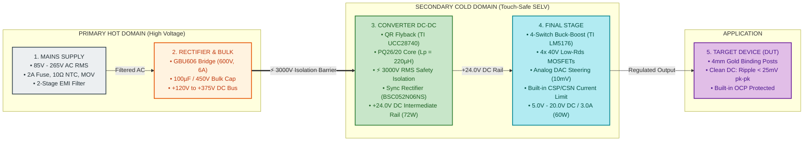

# Product Requirement Document (PRD)

---

### Project Information
* **Project Code**: `VVDN_SPPS_2026`
* **Project Name**: VVDN INDIA, SMART PROGRAMMABLE VOLTAGE SUPPLY MODULE (85–265 V AC In, 5–20 V / 3 A DC Out)
* **Domain**: Embedded Hardware & Power Electronics Engineering
* **Document Version**: `A1_001`
* **Date**: `15th Oct 2026`
* **Design Owner**: Power Electronics Engineer Trainee (GET - Hardware Engineering)
* **Technical Reviewer & Mentor**: Senior Hardware Architect & BU SME (Power Electronics)
* **Approved By**: BU Head (Embedded Hardware & Power Electronics)
* **Companion Document**: [HARDWARE_DESIGN_TECHNICAL_DETAILS_FOR_HDD.md](file:///home/tthhongs/build_tthongs/av_iv/smart_programmable_power_supply/HARDWARE_DESIGN_TECHNICAL_DETAILS_FOR_HDD.md) *(Detailed circuit derivations, magnetics sizing, component stress derating, and schematic design)*

---

### Revision History

| Date | Revision No. | Description | Prepared/Revised By | Reviewed By | Approved By |
| :--- | :---: | :--- | :--- | :--- | :--- |
| **15-Oct-2026** | **A1_001** | Standardized Release of PRD aligned with VVDN EVSE template, simplified protection architecture, and Power Electronics Trainee scope | Power Electronics Trainee (GET) | Senior Hardware Architect | BU SME (Power Electronics) |
| **06-Oct-2026** | **A0_01** | Initial architecture, component selection & topology feasibility draft | Power Electronics Trainee (GET) | Senior Hardware Architect | BU SME (Power Electronics) |

---

### Customer Sign-Off Form

| Customer Entity | Technical In-Charge | Program In-Charge |
| :--- | :--- | :--- |
| **Name** | Dr. Michael Chen | Sarah Jenkins |
| **Designation** | Director of Hardware Engineering | Program Director |
| **Email ID** | m.chen@client-ate.com | s.jenkins@client-ate.com |
| **Address** | ATE Systems Inc., San Jose, CA | ATE Systems Inc., San Jose, CA |
| **Comments** | Approved for modular test rack and benchtop integration. | Product requirements and delivery milestones accepted. |
| **Signature & Date** | *Signed: 15-Oct-2026* | *Signed: 15-Oct-2026* |

---

### VVDN Internal Sign-Off Form

| VVDN Entity | Technical In-Charge | Program In-Charge |
| :--- | :--- | :--- |
| **Name** | Power Electronics Trainee (GET) | Senior Hardware Architect / Lead |
| **Designation** | GET - Embedded Hardware Engineering | Senior Hardware Engineer (Power BU) |
| **Email ID** | trainee.power@vvdntech.in | lead.power@vvdntech.in |
| **Address** | VVDN Technologies, Global Innovation Park, Gurugram | VVDN Technologies, Global Innovation Park, Gurugram |
| **Comments** | 4-Stage conversion architecture, safety boundaries, and standard IC protections designed to spec. | High-level requirements, BOM baseline, and verification gates signed off. |
| **Signature & Date** | *Signed: 15-Oct-2026* | *Signed: 15-Oct-2026* |

---

### Internal SME Sign-Off

| Level | Reviewer Role | Name | Comments | Signature & Date |
| :---: | :--- | :--- | :--- | :--- |
| **Level 1** | **BU SME (Power Electronics)** | Karpagamoorthy R / Vignesh Anandhan | Verified against IEC 62368-1 reinforced isolation, CISPR 32 Class B EMC, and 4-switch Buck-Boost closed-loop stability. | *Signed: 15-Oct-2026* |

---

## 1. Introduction

### 1.1 Purpose
This document describes the system-level requirements for the design and development of the **Smart Programmable Voltage Supply Module** (`VVDN_SPPS_2026`) for internal VVDN and client benchtop test applications. The document serves as the authoritative technical baseline for subsequent engineering design documents, circuit schematics, 4-layer PCB layout rules, Bill of Materials (BOM), and laboratory validation. The device's functional and technical requirements must meet all parameters specified herein. These requirements have been derived from client specifications and subsequent engineering design discussions.

This document captures all **Electrical**, **Mechanical**, and **Hardware** requirements to be delivered for the complete 4-Stage Power Supply PCBA module.

`VVDN_SPPS_2026` is the formal project identifier for this product and shall be referenced across all design reviews, schematic netlists, firmware repositories, and DVT test reports.

### 1.2 Document Conventions
This PRD serves as the authoritative reference baseline for all hardware requirements. Text formatting follows standard engineering documentation conventions:
* Bold text emphasizes section titles, sub-blocks, and critical hardware interfaces.
* Requirements marked with **[MUST]** represent mandatory non-negotiable specifications essential for safety, electrical regulation, and compliance.
* Requirements marked with **[SHOULD]** represent engineering performance targets where design trade-offs require SME review.
* Requirements marked with **[MAY]** represent optional feature enhancements.
* All electrical parameters follow standard SI conventions ($V_{\text{RMS}}$, $V_{\text{DC}}$, $A$, $\text{mA}$, $\text{W}$, $\text{kHz}$, $\text{m}\Omega$, $\mu\text{H}$, $\mu\text{F}$).

### 1.3 Intended Audience and Reading Suggestions
This PRD is prepared for the reference of:
1. **Product Management**: To validate requirement compliance, milestone deliverables, and client scope boundaries.
2. **System & Hardware Architects**: To evaluate power conversion topologies, stage boundaries, and thermal dissipation budgets.
3. **Hardware Development Team (Author)**: To implement component selection, stress derating, schematic capture, and PCB layout rules.
4. **Firmware Engineering Team**: To develop MCU telemetry drivers (ADC, I2C), DAC voltage steering routines, and OLED display screens.
5. **Quality Assurance & Testing (DVT) Team**: To derive test cases and execute compliance verification (Hi-Pot dielectric withstand, ripple, efficiency, EMC).
6. **Manufacturing & DFM Team**: To establish assembly guidelines, panelization, and fabrication Design-for-Manufacturing (DFM) checks.

The suggested sequence for reviewing this document by stakeholder role is summarized below:

| Stakeholder Group | Primary Relevant Sections |
| :--- | :--- |
| **Client / Program Management** | Complete Document, Executive Scope, Standard Deliverables, Development Plan |
| **Hardware Architecture Team** | Product Overview, System Requirements, Hardware Architecture, Deliverables |
| **Hardware Engineering Team** | Complete Document, Component SOW, Schematics, BOM, Verification Criteria |
| **Firmware Development Team** | Product Interfaces, Software Interfaces, Telemetry Requirements, DAC Steering |
| **Quality Assurance / DVT Team** | System Requirements, Acceptance Testing Criteria, Protection Response Times |
| **Manufacturing / DFM Team** | Mechanical ID Requirements, Creepage & Clearance Rules, PCB Stackup, Master BOM |

### 1.4 Abbreviation
The technical acronyms and terms utilized in this document are defined in Table 1 below:

#### Table 1: Abbreviation
| Acronym | Definition |
| :--- | :--- |
| **VVDN_SPPS_2026** | VVDN Smart Programmable Power Supply (Project Identifier) |
| **PRD** | Product Requirement Document |
| **HDD** | Hardware Design Document |
| **AC** | Alternating Current (Grid Mains Input, 85 V – 265 V AC RMS) |
| **DC** | Direct Current (Regulated Output, 5.0 V – 20.0 V DC) |
| **SELV** | Safety Extra-Low Voltage (< 60 V DC limit per IEC 62368-1) |
| **QR** | Quasi-Resonant Valley Switching (Primary Flyback Mode) |
| **PFC** | Power Factor Correction |
| **CC** | Constant Current Mode (Regulated Current Limit) |
| **CV** | Constant Voltage Mode (Precision Closed-Loop Voltage Regulation) |
| **DAC** | Digital-to-Analog Converter (12-bit Voltage Setpoint Injection) |
| **ADC** | Analog-to-Digital Converter (Microcontroller Telemetry Sampling) |
| **OCP** | Over-Current Protection (Built-in Controller Hardware Current Limit) |
| **OVP** | Over-Voltage Protection |
| **OTP** | Over-Temperature Protection |
| **UVLO** | Under-Voltage Lockout |
| **DMM** | Digital Multimeter |
| **CT** | Current Transformer (AC Primary Current Sensing) |
| **I2C** | Inter-Integrated Circuit Serial Communication Bus |
| **PWM** | Pulse Width Modulation |
| **EMI** | Electromagnetic Interference |
| **EMC** | Electromagnetic Compatibility |
| **NTC** | Negative Temperature Coefficient Thermistor (Inrush Limiter) |
| **MOV** | Metal Oxide Varistor (Surge & Transient Voltage Clamp) |
| **ESR** | Equivalent Series Resistance |
| **DVT** | Design Verification Testing |
| **DUT** | Device Under Test |

### 1.5 References
The industry standards, specifications, and reference documents applicable to this project are listed in Table 2 below:

#### Table 2: Reference
| SL No | Reference Standard / Document | Description & Source |
| :---: | :--- | :--- |
| **REF-001** | **VVDN SOW Document** | Statement of Work: Smart Programmable Voltage Supply Module v1.0, VVDN Technologies |
| **REF-002** | **IEC 62368-1 (3rd Edition)** | Audio/video, information and communication technology equipment – Part 1: Safety requirements |
| **REF-003** | **EN 55032 / CISPR 32 Class B** | Electromagnetic compatibility of multimedia equipment – Emission requirements |
| **REF-004** | **IEC 61000-3-2** | Electromagnetic compatibility (EMC) – Limits for harmonic current emissions (< 75 W Class A exemption) |
| **REF-005** | **IEC 61000-4-5** | Electromagnetic compatibility (EMC) – Surge immunity test (Level 3: 2 kV Line-Earth, 1 kV Line-Line) |
| **REF-006** | **Texas Instruments LM5176** | High-Performance 4-Switch Synchronous Buck-Boost Controller Datasheet (SNVSAR4) |
| **REF-007** | **Texas Instruments UCC28740** | Constant-Voltage Constant-Current Isolated Flyback Controller Datasheet (SLUSBL2) |
| **REF-008** | **VVDN Hardware Design Document** | Companion HDD: Smart Programmable Power Supply Circuit Design, Derivations & Schematics |

---

## 2. Product Overview

### 2.1 Product - Business Perspective
The **Smart Programmable Voltage Supply Module** is an intelligent, high-density benchtop and automated test equipment (ATE) power supply. It delivers a tightly regulated, programmable DC voltage output from **5.0 V to 20.0 V** at currents up to **3.0 A** (maximum continuous power rating of **60 W**) from universal grid AC mains input (**85 V to 265 V AC RMS**, 47 Hz to 63 Hz).

Traditional benchtop power supplies rely on bulky, heavy 50 Hz iron-core transformers and dissipative linear regulators, leading to high thermal losses, large enclosures, and lack of digital telemetry. This product eliminates those drawbacks by combining universal AC Quasi-Resonant (QR) Flyback isolation, an ultra-efficient 4-switch synchronous Buck-Boost post-regulator, real-time dual-domain power telemetry, and standard built-in controller hardware protection into a single, compact, high-efficiency PCBA module.

### 2.2 Product – Technical Perspective
The Smart Programmable Power Supply operates through a sequential 4-stage AC-to-DC conversion and regulation chain. The high-voltage primary stage connects directly to raw AC mains, suppresses transients and conducted emissions, rectifies the input into a high-voltage DC bus (+120 V to +375 V DC), and steps it down across a reinforced 3000V RMS galvanic isolation barrier into a regulated +24.0V DC intermediate rail (72W). The secondary stage utilizes a 4-switch synchronous Buck-Boost post-regulator to deliver the user-commanded 5.0V to 20.0V DC output at up to 3.0A.

An onboard mixed-signal microcontroller (STM32G474) monitors primary AC input power and secondary DC load power, computes real-time conversion efficiency at 10 Hz, drives the 1.3-inch OLED local dashboard, and controls a precision 12-bit DAC voltage steering network. Circuit protection relies on robust, standard, industry-proven hardware protections: primary AC fuse, inrush NTC, surge MOV, primary cycle-by-cycle Flyback current limiting, and secondary LM5176 built-in cycle-by-cycle overcurrent protection with thermal shutdown.

In simple terms, the power conversion stages provide efficient, touch-safe energy transfer, while the built-in controller protections and MCU provide safety, precision regulation, and live telemetry.

The primary power supply functionality includes:
* **Universal AC Grid Operation**: Accepts 85 V to 265 V AC RMS (47 Hz to 63 Hz) without manual line selector switches.
* **Reinforced Galvanic Isolation**: Certified 3000 V AC RMS (1 minute) isolation barrier complying with IEC 62368-1, ensuring output terminals remain touch-safe (SELV < 60 V DC).
* **Intermediate Regulated Rail**: Quasi-Resonant Flyback converter generates a stable +24.0 V DC bus rated for 72 W continuous with > 90% peak efficiency.
* **Wide Programmable DC Output**: 4-switch synchronous Buck-Boost post-regulator steps voltage up or down to provide 5.0 V to 20.0 V DC at up to 3.0 A continuous (60 W continuous output power).
* **High-Resolution DAC Voltage Steering**: 12-bit DAC network injects steering current into the regulator feedback node, achieving 10 mV monotonic setpoint resolution.
* **Built-in Cycle-by-Cycle Hardware Current Limiting**: LM5176 monitors output current through a dedicated $10\,\text{m}\Omega$ shunt across its CSP/CSN pins, natively limiting peak inductor current on every switching cycle without external analog complexity.
* **Built-in Controller Protections**: Integrated input fuse (2A), NTC inrush limiter (10Ω), MOV transient clamp (300V), LM5176 internal thermal shutdown (165°C), and Under-Voltage Lockout (UVLO).
* **Real-Time Dual-Domain Telemetry**: Isolated delta-sigma modulator and current transformer measure AC input power, while a 16-bit digital monitor measures DC load power, allowing the MCU to compute live conversion efficiency ($\eta = P_{\text{dc}} / P_{\text{ac}} \times 100\%$) at 10 Hz.
* **Interactive Local Dashboard**: 1.3-inch graphical OLED display presents live voltage, current, power, and efficiency meters; dual incremental rotary encoders allow seamless manual tuning; front-panel LEDs indicate CV, Current Limit, and Fault states.
* **Low Standby Power**: Idle power consumption remains strictly below 150 mW when the output stage is disabled.

---

### Figure 1: Boundary Diagram / Simplified 4-Stage Power Flow Block Diagram



---

#### Table 3: High Level Technical Requirement
The system-level design inputs and specifications are summarized in Table 3 below:

| S.No | Parameters | Inputs For SPPS Board Design |
| :---: | :--- | :--- |
| **1** | **Input Voltage Range** | 85 V to 265 V AC RMS, 47 Hz to 63 Hz (Universal Grid Compatibility) |
| **2** | **Continuous Output Current** | 0.0 A to 3.0 A DC Continuous across full voltage range |
| **3** | **Programmable Output Voltage** | 5.0 V to 20.0 V DC (Continuously adjustable via 10 mV digital DAC steps) |
| **4** | **Maximum Output Power** | 60.0 W Continuous DC Output (20.0 V @ 3.0 A) |
| **5** | **Intermediate Bus Voltage** | +24.0 V DC ± 1.0% (72.0 W continuous rating from primary Flyback stage) |
| **6** | **Output Voltage Ripple** | < 25 mV pk-pk under full 3.0 A load (measured across 20 MHz bandwidth) |
| **7** | **End-to-End System Efficiency**| > 85.0% @ 230 V AC Full Load (Flyback > 90%, Buck-Boost > 95%) |
| **8** | **Galvanic Safety Isolation** | 3,000 V AC RMS (1 minute withstand) meeting IEC 62368-1 SELV |
| **9** | **Overcurrent Protection** | LM5176 built-in cycle-by-cycle hardware peak current limit via CSP/CSN |
| **10** | **PCBA Operating Temperature** | –20°C to +50°C Full Load (natural convection in chassis) |
| **11** | **User Interface & Control** | 1.3" I2C OLED display, dual rotary encoders, Status LEDs, tactile Enable switch |
| **12** | **Conducted & Radiated EMC** | Compliant with CISPR 32 / EN 55032 Class B limits |

---

### 2.3 Use Cases
The Smart Programmable Power Supply module operates across simple, standard operational modes and handles primary hardware use cases:

1. **Constant Voltage (CV) Regulation Mode**: The default operating mode when load current remains below the current limit ($I_{\text{load}} < I_{\text{limit}}$). Output voltage is regulated within $\pm 0.2\%$ with $< 150\,\mu\text{s}$ transient recovery.
2. **Current-Limited (OCP) Mode**: If load current reaches the maximum rating, the LM5176 controller's built-in cycle-by-cycle current limit restricts peak inductor current, preventing overstress.
3. **MCU Supervisory Protection**: If an extended overload or over-temperature is detected, the MCU safely disables the LM5176 switching stage via its `ENABLE` pin.
4. **Standby / Idle Mode**: AC mains is energized, the Flyback generates the +24V intermediate rail, but post-regulator output drive is electronically disabled. Power consumption remains $< 150\,\text{mW}$.

#### Table 4: Product Usecase
| S.N. | Usecase |
| :---: | :--- |
| **1** | Universal AC mains soft startup and inrush current suppression (< 25 A peak) |
| **2** | AC full-wave rectification and high-voltage DC bulk energy holdup (> 10 ms) |
| **3** | Galvanically isolated Quasi-Resonant Flyback conversion (+24.0 V DC, 72 W) |
| **4** | Synchronous 4-switch Buck-Boost step-down/step-up post-regulation (5 V – 20 V DC) |
| **5** | High-precision 10 mV digital voltage steering via 12-bit DAC summing network |
| **6** | LM5176 built-in cycle-by-cycle overcurrent protection via CSP/CSN pins |
| **7** | Primary Flyback cycle-by-cycle current limit via UCC28740 CS resistor |
| **8** | Controller internal thermal shutdown and board temperature monitoring |
| **9** | Primary AC input power measurement via isolated delta-sigma amplifier and CT |
| **10** | Secondary DC load voltage, current, and power monitoring via 16-bit I2C monitor |
| **11** | Real-time conversion efficiency computation and 1.3" OLED dashboard display update |
| **12** | Local front-panel rotary encoder tuning, tactile output enable, and status LED indication |

---

### 2.4 Product Interfaces

#### 2.4.1 Hardware Interfaces
The physical hardware interfaces provide clean, standard electrical connections between the supply module, external grid, target device under test, and operator:
* **AC Mains Inlet**: Standard IEC 60320-C14 three-prong grounded receptacle with an integrated 5x20 mm ceramic fuse drawer (2A) and power switch.
* **DC Output Terminals**: Pair of heavy-duty, gold-plated 4 mm binding posts (Red = Positive, Black = Negative) spaced at standard 19.05 mm (0.75 in) pitch.
* **Rotary Encoders & Push-buttons**: Dual quadrature incremental rotary encoders with integrated momentary push-switches for coarse and fine voltage setpoint adjustment.
* **1.3" OLED Display**: 128x64 dot-matrix monochrome display module interfaced via I2C for real-time electrical metering and status annunciators.
* **Front-Panel Status LEDs**: LED indicators showing operational state: Green for Power/Normal Output, Amber for Current Limit, and Red for Fault/Shutdown.
* **Tactile Output Enable Switch**: Illuminated pushbutton pulling the LM5176 controller `ENABLE` pin high/low to safely energize or de-energize output power.
* **Programming & Debug Header**: Standard 10-pin SWD (Serial Wire Debug) header for programming the STM32G474 microcontroller.
* **Diagnostic Test Points**: Dedicated PCB test loops for verifying AC input, bulk DC bus, +24V intermediate rail, DAC steering node, and output voltage.

#### Table 5: Hardware Interface
| Sl. No | Entity 1 | Entity 2 | Interface | Usage Description |
| :---: | :--- | :--- | :--- | :--- |
| **1** | AC Grid Mains | SPPS Board | IEC 320-C14 Inlet | Universal 85V–265V AC RMS, 50/60Hz grounded power input with 2A fuse |
| **2** | SPPS Board | DUT / Load | 4mm Binding Posts | Regulated 5.0V–20.0V DC / 3.0A power delivery to device under test |
| **3** | SPPS Board | Local Operator | Dual Rotary Encoders | Quadrature rotary controls for setting voltage (10mV resolution) |
| **4** | SPPS Board | Local Operator | 1.3" OLED Display | Real-time graphical dashboard for V, I, P, efficiency (η), and operating mode |
| **5** | SPPS Board | Local Operator | Output Enable Button | Tactile push-button for safe electronic enable/disable of output power |
| **6** | SPPS Board | Local Operator | Status Mode LEDs | Visual indication of Output Active (Green), Limit (Amber), and Fault (Red) states |
| **7** | SPPS Board | Debug Programmer | SWD Header | Microcontroller firmware flashing, register inspection, and debug tracing |
| **8** | SPPS Board | Lab Oscilloscope | PCB Test Points | Diagnostic test loops for measuring intermediate rail, ripple, and noise |
| **9** | Primary Side | Secondary Side | 6.4mm Milled Slot | Physical 2.0mm air slot beneath transformer enforcing IEC 62368-1 isolation |

---

#### 2.4.2 Software Interfaces
The onboard mixed-signal microcontroller (STM32G474) runs bare-metal telemetry and control firmware that coordinates sensing, DAC setpoint generation, and local display updates as defined in Table 6 below:

#### Table 6: Software Interfaces
| S. No | Entity 1 | Entity 2 | Interface | Interface Protocol / Mode | Usage Description |
| :---: | :--- | :--- | :--- | :--- | :--- |
| **1** | STM32G474 MCU | INA226 Monitor | Secondary Telemetry | I2C (Fast-Mode 400 kHz) | Reads 16-bit DC output voltage, current, and bus power at 10 Hz rate |
| **2** | STM32G474 MCU | 1.3" OLED (SSD1306) | Display Dashboard | I2C (Fast-Mode 400 kHz) | Updates numerical readouts, mode text, and efficiency bar graph at 10 Hz |
| **3** | STM32G474 MCU | AMC1311 Iso-Amp | Primary AC Voltage | Analog ADC Channel | Samples galvanically isolated AC mains voltage waveform for Pac calculation |
| **4** | STM32G474 MCU | Current Transformer| Primary AC Current | Analog ADC Channel | Samples burden resistor voltage from 1000:1 CT for AC mains current sensing |
| **5** | STM32G474 MCU | LM5176 FB Node | Voltage Steering | Internal 12-Bit DAC | Injects current into summing node to set Vout between 5.0V and 20.0V |
| **6** | STM32G474 MCU | Rotary Encoders | User Input | Timer Encoder Interface | Hardware quadrature decoding of rotary dials with debounced push-switches |
| **7** | STM32G474 MCU | Status LEDs | Status Annunciation | GPIO Digital Outputs | Drives Green (Active), Amber (Limit), and Red (Fault) status indicator LEDs |
| **8** | STM32G474 MCU | LM5176 Enable Pin | Output Control | GPIO Digital Output | Controls post-regulator run state during standby, soft-start, and fault disable |
| **9** | STM32G474 MCU | Host PC / ATE | Calibration & SCPI | UART / VCP (115.2 kbps)| Optional serial channel for automated calibration and factory test commands |

---

## 3. Systems & Domains Involved

The engineering disciplines and development domains involved in the SPPS module are summarized in Table 7 below:

#### Table 7: Domain Matrix
| Domain Names | System 1 (SPPS Module) | Scope Summary |
| :--- | :---: | :--- |
| **Hardware - HW** | **Yes** | 4-stage power conversion schematics, component selection, 4-layer PCB layout, magnetics design, DFM, and bring-up |
| **Mechanical - ME** | **Yes** | Enclosure integration, thermal copper heatsinking, binding post mounting, and front-panel cutouts |
| **Firmware - FW** | **Yes** | Bare-metal STM32G474 drivers (ADC, DAC, I2C, Timers), OLED GUI dashboard, efficiency math, and calibration |
| **SystemApp - SAP** | **No** | Not in scope (module operates autonomously as standalone benchtop hardware) |
| **MobileApp - MAP** | **No** | Not in scope (no smartphone wireless interface required) |
| **CloudApp - CAP** | **No** | Not in scope (no IoT cloud connectivity required for bench power supply) |
| **PC App - PAP** | **Optional** | Python-based automated calibration and DVT sweep script over USB-UART |
| **Test Firmware** | **Yes** | Dedicated bring-up firmware routines for peripheral validation, DAC calibration, and sensor offset zeroing |

---

## 4. Product Requirements

### 4.1 System Requirements
The engineering requirements and verification criteria for the Smart Programmable Voltage Supply Module are organized into five structured requirement tables:

#### Table 4.1: AC-DC Isolated Flyback Power Stage Engineering Requirements
| Req ID | Parameter / Feature | Specification / Target | Condition | Verification Method |
| :---: | :--- | :--- | :--- | :--- |
| **FR-01** | AC Input Voltage Range | 85 V – 265 V AC RMS **[MUST]** | Nominal 230 V AC, 47–63 Hz | AC Source Voltage Sweep |
| **FR-02** | Intermediate DC Bus Voltage | +24.0 V DC ± 1.0% **[MUST]** | Across all line/load variations | Precision Digital Multimeter |
| **FR-03** | Continuous Primary Power | 72.0 W Continuous **[MUST]** | 85V–265V AC In, 24V / 3A Out | Electronic Load 72W Soak |
| **FR-04** | Peak Power Capability | 84.0 W for 500 ms **[SHOULD]** | Dynamic load step surges | Transient Load Step |
| **FR-05** | Primary Stage Efficiency | > 90.0% @ 230V AC Full Load **[MUST]** | $P_{\text{out}} = 72\,\text{W}, T_{\text{amb}} = 25^\circ\text{C}$ | Precision Power Analyzer |
| **FR-06** | Safety Galvanic Isolation | 3,000 V AC RMS (1 min) **[MUST]** | Primary to Secondary barrier | Certified Hi-Pot Tester |
| **FR-07** | Cold-Start Inrush Current | < 25.0 A Peak **[MUST]** | $V_{\text{in}} = 265\,\text{V}$ AC, cold start 25°C | Current Probe & Oscilloscope |
| **FR-08** | No-Load Standby Power | < 150 mW Standby **[SHOULD]** | $V_{\text{in}} = 230\,\text{V}$ AC, Output Off | Power Meter Integration |

---

#### Table 4.2: 4-Switch Synchronous Buck-Boost Post-Regulator Requirements
| Req ID | Parameter / Feature | Specification / Target | Condition | Verification Method |
| :---: | :--- | :--- | :--- | :--- |
| **BB-01** | Output Voltage Range | 5.0 V – 20.0 V DC Programmable **[MUST]** | Continuous linear adjustment | Precision DMM Sweep |
| **BB-02** | Continuous Output Current | 0.0 A – 3.0 A DC Continuous **[MUST]** | Across full 5V–20V voltage span | Electronic Load 3A Soak |
| **BB-03** | Maximum Output Power | 60.0 W Continuous Output **[MUST]** | $V_{\text{out}} = 20.0\,\text{V}, I_{\text{out}} = 3.0\,\text{A}$ | Thermal Run 60W (2 hrs) |
| **BB-04** | Voltage Setpoint Resolution | 10 mV step resolution (12-bit DAC) **[MUST]** | Continuous monotonic tuning | DAC Linearity Calibration |
| **BB-05** | Output Voltage Ripple | < 25 mV pk-pk ripple **[MUST]** | Full load 3A, 20MHz bandwidth | Scope Tip-and-Barrel Probe |
| **BB-06** | Load Transient Recovery | < 150 µs recovery, < 250mV sag **[MUST]** | 50% to 100% load step (1.5A to 3A) | Dynamic Load Stepper |
| **BB-07** | Buck-Boost Efficiency | > 95.0% @ 20V/3A; > 92.0% @ 5V/3A **[MUST]**| $V_{\text{in}} = 24\,\text{V}$, Sync Rectification | Dual-Channel Power Meter |
| **BB-08** | Switching Frequency | 300 kHz ± 10% **[MUST]** | Fixed frequency PWM | Frequency Counter / Scope |
| **BB-09** | Hardware Current Limiting | Cycle-by-cycle current limit via CSP/CSN **[MUST]**| Overload condition | Current Probe & Scope |

---

#### Table 4.3: Real-Time Dual-Domain Telemetry & Monitoring Requirements
| Req ID | Parameter / Feature | Specification / Target | Condition | Verification Method |
| :---: | :--- | :--- | :--- | :--- |
| **TM-01** | Primary AC Voltage Sensing | Isolated AMC1311 (0-300V AC RMS) **[MUST]** | ± 1.0% accuracy across 85-265V | Precision AC Source Reference |
| **TM-02** | Primary AC Current Sensing | Current Transformer 1000:1 **[MUST]** | ± 1.5% accuracy from 0.1A–2A | Calibrated Current Probe |
| **TM-03** | Secondary DC Voltage Sense | INA226 16-bit ADC (1.25mV/LSB) **[MUST]** | ± 0.2% measurement accuracy | Keysight 34465A 6.5-digit DMM |
| **TM-04** | Secondary DC Current Sense | INA226 16-bit ADC (100µA/LSB) **[MUST]** | ± 0.5% measurement accuracy | Precision Shunt Reference |
| **TM-05** | Dual-Domain Telemetry Rate | 10.0 Hz Real-Time Loop Rate **[MUST]** | Pac, Pdc, and η computed at 100ms | Logic Analyzer Timing Check |
| **TM-06** | Galvanic Isolation Barrier | 3,000 V AC RMS (1 min) **[MUST]** | Primary-to-secondary isolation | Certified Hi-Pot Tester |
| **TM-07** | Calibration Test Points | Dedicated PCB Test Loops **[MUST]** | Vout, bulk DC, and aux rails | Scope & Multimeter Inspection |

---

#### Table 4.4: Protection, Safety, EMC & Environmental Requirements
| Req ID | Parameter / Feature | Specification / Target | Condition | Verification Method |
| :---: | :--- | :--- | :--- | :--- |
| **PR-01** | Input Fuse Protection | 2.0A Time-Lag Ceramic Fuse **[MUST]** | AC mains short-circuit | Overcurrent Trip Test |
| **PR-02** | Input Inrush Current Limit | 10Ω NTC Thermistor (< 25A peak) **[MUST]** | Cold start at 265V AC | Scope Current Probe |
| **PR-03** | AC Line Surge Protection | 300V RMS MOV (4.5kA rating) **[MUST]** | Line transients per IEC 61000-4-5 | Surge Generator Verification |
| **PR-04** | Built-in Controller OCP | LM5176 cycle-by-cycle CSP/CSN clamp **[MUST]** | Load current > 3.5A limit | Electronic Load Step |
| **PR-05** | Over-Temperature (OTP) | LM5176 internal shutdown (165°C) **[MUST]** | Severe thermal rise | Thermal Chamber Sweep |
| **PR-06** | Safety Compliance Standard | IEC 62368-1 Reinforced Isolation **[MUST]** | SELV touch-safe (< 60V DC) | Certified Safety Laboratory |
| **PR-07** | Creepage & Clearance | Creepage ≥ 6.4mm; Clearance ≥ 5.0mm **[MUST]** | Primary-Secondary milled slot | PCB Caliper & Gerber Check |
| **PR-08** | Conducted & Radiated EMC | CISPR 32 / EN 55032 Class B **[MUST]** | 150 kHz – 1 GHz emission limits | Semi-Anechoic Chamber |
| **PR-09** | Operating Ambient Temp | –20°C to +50°C Full Load **[MUST]** | Natural convection in chassis | Environmental Chamber |

---

#### Table 4.5: Closed-Loop Regulation & DAC Voltage Steering Specifications
| Req ID | Parameter / Feature | Specification / Target | Condition | Verification Method |
| :---: | :--- | :--- | :--- | :--- |
| **CT-01** | DAC Voltage Steering Network | Resistor summing into LM5176 FB node **[MUST]** | $R_{\text{top}}=49.9\,\text{k}\Omega, R_{\text{DAC}}=11\,\text{k}\Omega, R_{\text{bot}}=3.65\,\text{k}\Omega$ | Precision Line/Load Sweep |
| **CT-02** | Voltage Tuning Resolution | 10.0 mV step resolution (12-bit DAC) **[MUST]** | Continuous 5.0V to 20.0V DC range | DAC Linearity Calibration |
| **CT-03** | Current Sense Resistor | 10 mΩ Metal Element Shunt, 3W, 0.1% **[MUST]** | Connected across LM5176 CSP/CSN | Precision Milliohm Meter |
| **CT-04** | MCU Supervisory Shutdown | GPIO pulling LM5176 ENABLE pin low **[MUST]** | Software fault shutdown command | Scope Response Timing |
| **CT-05** | Auxiliary Bias Regulation | +14V Flyback VCC, +12V gate, +5V, +3.3V rails **[MUST]**| Dedicated LDOs & buck off +24V | Multimeter & Rail Scope |

---

### 4.2 Mechanical & Industrial Design (ID) Requirements
* **PCBA Form Factor**: Maximum PCB dimensions: $140\,\text{mm} \times 90\,\text{mm} \times 35\,\text{mm}$ (height constrained by bulk electrolytic capacitor and PQ26/20 transformer).
* **Mounting Holes**: Four symmetrically placed M3 mounting holes with 4.0 mm clearance keep-out annular rings connected to chassis ground.
* **Front-Panel Terminal Spacing**: Heavy-duty 4mm binding posts positioned with standard $19.05\,\text{mm}$ ($0.75\,\text{inch}$) center-to-center pitch, supporting dual-banana jack connectors.
* **Isolation Air Slot**: A continuous $2.0\,\text{mm}$ milled isolation slot routed through the FR-4 substrate beneath the Flyback transformer and optocoupler barriers, guaranteeing physical creepage compliance per IEC 62368-1.
* **Thermal Dissipation & Cooling**: Conduction cooling via dedicated 2 oz copper thermal planes on bottom and top layers; components derated to maintain junction temperatures $< 85^\circ\text{C}$ under natural convection at $+50^\circ\text{C}$ ambient.

---

## 5. VVDN_SPPS SOW and Dependencies

The following engineering dependencies and hardware boundary conditions govern the execution of the SPPS module development:
* **Custom Magnetics Tooling**: Transformer engineering samples wound on Ferroxcube PQ26/20 ferrite cores with triple-insulated Furukawa TEX-E secondary wire must be validated prior to Phase 3 schematic freeze.
* **Semiconductor Availability**: Supply chain allocation and sample lead times for key ICs (TI LM5176, TI UCC28740, TI INA226, TI AMC1311, ST STM32G474RET6, and Infineon BSC034N04LS MOSFETs) must be tracked to meet prototype build dates.
* **Laboratory Test Equipment**: Hardware bring-up and DVT validation require access to a calibrated Chroma 61604 Programmable AC Source, Chroma 63102A DC Electronic Load, Keysight 34465A 6.5-digit DMM, 4-channel oscilloscope with high-voltage differential probes and current probes, and a certified 3000V RMS Hi-Pot tester.
* **Enclosure & Front-Panel Alignment**: Final mechanical drawings for the front-panel bezel, 4mm binding post cutouts, IEC C14 inlet cutout, and OLED mounting brackets must be frozen during Phase 4 PCB layout.
* **Firmware Device Drivers**: Driver source code for the SSD1306 OLED display controller, STM32 internal 12-bit DAC, and INA226 register configuration must be available prior to Phase 5 integrated DVT.
* **EMC Pre-Compliance Testing**: Access to an internal VVDN EMC laboratory equipped with a Line Impedance Stabilization Network (LISN) and spectrum analyzer is required to verify CISPR 32 Class B conducted emissions.

---

## 6. Standard Deliverables & Release Order

The hardware deliverables and release documentation across project milestones are defined in Table 8 below:

#### Table 8: Standard Deliverables
| System Name | Domain Name | Deliverables |
| :--- | :---: | :--- |
| **VVDN_SPPS_2026** | **Systems / PRD** | Product Requirement Document (PRD) — Baseline Specifications & Acceptance Criteria |
| **SPPS Module** | **Hardware (HW)** | Hardware Design Document (HDD) with complete circuit derivations & stress calculations |
| **SPPS Module** | **Hardware (HW)** | Altium Designer Complete Schematics (Rev A & Rev B) |
| **SPPS Module** | **Hardware (HW)** | Class A Engineering Bill of Materials (BOM) with manufacturer part numbers |
| **SPPS Module** | **Hardware (HW)** | 4-Layer PCB Layout & Gerber RS-274X Fabrication Package (ODB++, NC Drill, Pick-and-Place) |
| **SPPS Module** | **Hardware (HW)** | Design Verification Testing (DVT) Report & Acceptance Certificate |
| **SPPS Module** | **Firmware (FW)** | Microcontroller Telemetry & Display Firmware Source Code (STM32CubeIDE package) |
| **SPPS Module** | **Compliance / Safety** | Hi-Pot Dielectric Withstand Certificate (3000V RMS) & Pre-Compliance EMC Report |

---

## 7. Product Development Plan

The product realization plan follows the standard 5-phase VVDN hardware lifecycle:

* **Phase 1 — Requirement & Architecture and Class A BOM**
  * Finalize functional and non-functional electrical specifications.
  * Define 4-stage power conversion architecture and stage boundary interfaces.
  * Establish Class A engineering BOM and initiate long-lead component sourcing.
  * Conduct PRD Gate Review with BU SME and hardware leadership.

* **Phase 2 — Component Selection & Circuit Design**
  * Perform transformer magnetics sizing on PQ26/20 core ($L_p = 220\,\mu\text{H}$) and Buck-Boost inductor sizing ($10\,\mu\text{H}$).
  * Calculate component stress derating (MOSFET voltage, diode reverse voltage, capacitor ripple current).
  * Design closed-loop feedback compensation and DAC voltage steering summing network.
  * Author companion Hardware Design Document (HDD) and complete peer design reviews.

* **Phase 3 — Schematic Design and Review**
  * Capture hierarchical schematics in Altium Designer across all 4 power stages.
  * Configure LM5176 cycle-by-cycle current limit sensing and MCU enable control.
  * Conduct rigorous schematic peer review gates with BU SME and senior hardware architect.
  * Finalize schematic netlist, DRC checks, and Class B BOM release.

* **Phase 4 — PCB Layout & DFM Review**
  * Define 4-layer stackup ($1.6\,\text{mm}$ FR-4, $2\,\text{oz}$ outer copper, $1\,\text{oz}$ inner planes).
  * Implement high-voltage isolation partitioning and $2.0\,\text{mm}$ milled creepage air slot beneath transformer.
  * Route critical high-frequency switching loops with minimal parasitic inductance.
  * Complete Design for Manufacturing (DFM) and Design for Assembly (DFA) reviews with fabrication house.

* **Phase 5 — Prototype Bring-Up & Design Validation Plan (DVT)**
  * Assemble Rev A prototype boards (5 units).
  * Perform cold resistance and isolation impedance checks.
  * Execute supervised bring-up using a laboratory Variac and current-limited AC supply.
  * Validate line/load regulation, dynamic transient step response, and built-in current limit protection.
  * Perform 3000V RMS Hi-Pot safety testing and thermal chamber soak (+50°C full load).
  * Issue comprehensive DVT Verification Report and Rev B production package.

---

## 8. Hardware Architecture

### 8.1 4-Stage Power Conversion Chain
The power supply converts raw AC grid power into tightly regulated DC power through four clean, sequential hardware stages:

$$\text{Mains Supply } (85\text{--}265\,\text{V AC}) \longrightarrow \text{Rectifier & Bulk } (+120\text{--}375\,\text{V DC}) \longrightarrow \text{Converter DC-DC } (+24\,\text{V DC}) \longrightarrow \text{Final Stage } (5\text{--}20\,\text{V DC}) \longrightarrow \text{Device (DUT)}$$

---

### Figure 2: Master Hardware Architecture Block Diagram

```mermaid
flowchart TD
    classDef priStyle fill:#ECEFF1,stroke:#37474F,stroke-width:2px,color:#263238
    classDef secStyle fill:#E8F5E9,stroke:#2E7D32,stroke-width:2px,color:#1B5E20
    classDef ctlStyle fill:#E1F5FE,stroke:#0277BD,stroke-width:2px,color:#01579B

    subgraph STAGE1_2 ["PRIMARY STAGES (High-Voltage Domain)"]
        AC_IN["AC Grid Mains<br/>85V - 265V AC RMS"]:::priStyle
        PROT["Input Protection<br/>2A Fuse, 10Ω NTC, 300V MOV"]:::priStyle
        EMI["2-Stage EMI Filter<br/>15mH + 4.7mH CMC, X2/Y1 Caps"]:::priStyle
        RECT["GBU606 Bridge Rectifier<br/>600V, 6A Glass Passivated"]:::priStyle
        BULK["Bulk Capacitor Bank<br/>100µF / 450V Electrolytic<br/>+120V to +375V DC Bus"]:::priStyle

        AC_IN --> PROT --> EMI --> RECT --> BULK
    end

    subgraph STAGE3 ["STAGE 3: ISOLATED DC-DC CONVERTER"]
        FLY_CTL["TI UCC28740 Controller<br/>Quasi-Resonant Valley Switching<br/>Cycle-by-Cycle Primary OCP"]:::priStyle
        FLY_FET["Infineon IPB80R290P7<br/>800V CoolMOS Switch"]:::priStyle
        TRANS["PQ26/20 Transformer<br/>⚡ 3000V RMS Reinforced Isolation<br/>Lp = 220µH, TEX-E Secondary"]:::secStyle
        SYNC_RECT["MP6908 Smart Driver &<br/>BSC052N06NS Sync FET (60V, 5.2mΩ)"]:::secStyle
        BUS_24V["Intermediate DC Rail<br/>+24.0V DC ± 1.0% (72W Continuous)"]:::secStyle

        BULK --> FLY_FET --> TRANS --> SYNC_RECT --> BUS_24V
        FLY_CTL -.->|"Gate PWM"| FLY_FET
    end

    subgraph STAGE4 ["STAGE 4: SYNCHRONOUS BUCK-BOOST POST-REGULATOR"]
        BB_CTL["TI LM5176 Controller<br/>4-Switch Synchronous Controller<br/>Built-in CSP/CSN Current Limit"]:::ctlStyle
        H_BRIDGE["4-Switch MOSFET Bridge<br/>4x Infineon BSC034N04LS (40V, 3.4mΩ)<br/>10µH Flat-Wire Inductor (8.5A)"]:::ctlStyle
        DAC_STEER["12-Bit DAC Steering Network<br/>R_top=49.9k, R_bot=3.65k, R_dac=11k<br/>10mV Step Resolution"]:::ctlStyle
        OUT_FILTER["Low-ESR Filter Bank<br/>4x 22µF MLCC + 100µF Polymer<br/>Ripple < 25mV pk-pk"]:::ctlStyle
        SHUNT["10mΩ Sense Resistor<br/>Across LM5176 CSP/CSN Pins"]:::ctlStyle
        OUT_TERM["Output Terminals<br/>4mm Gold-Plated Binding Posts<br/>5.0V - 20.0V DC / 3.0A (60W)"]:::secStyle

        BUS_24V --> H_BRIDGE --> OUT_FILTER --> SHUNT --> OUT_TERM
        BB_CTL -.->|"Gate Drives"| H_BRIDGE
        DAC_STEER -.->|"Vset Steering"| BB_CTL
        SHUNT -.->|"CSP/CSN Sense"| BB_CTL
    end

    subgraph TELEMETRY_MCU ["MCU CONTROL & TELEMETRY"]
        MCU["STM32G474RET6 MCU<br/>170MHz Cortex-M4F Core"]:::ctlStyle
        OLED["1.3\" OLED Display<br/>Live V, I, P, η Meters"]:::ctlStyle
        ENCODERS["Dual Rotary Encoders<br/>Manual V & I Tuning"]:::ctlStyle
        INA226["TI INA226 16-Bit Monitor<br/>Secondary DC Power Sensing"]:::ctlStyle
        AMC1311["TI AMC1311 Iso-Amp<br/>Primary AC Voltage Sensing"]:::priStyle

        INA226 -.->|"I2C"| MCU
        AMC1311 -.->|"Isolated ADC"| MCU
        ENCODERS -.->|"Timer Inputs"| MCU
        MCU -.->|"I2C"| OLED
        MCU -.->|"12-bit DAC"| DAC_STEER
        MCU -.->|"ENABLE Line"| BB_CTL
    end

    STAGE1_2 ==>|"⚡ Reinforced Isolation"| STAGE3
```

---

### 8.2 Subsystem Sequences & Functional Descriptions

#### Stage 1: Mains AC Input Protection & EMI Filter Subsystem
* **Filtered AC Connection**: Connects to 85V–265V AC RMS sinusoidal mains via IEC C14 inlet.
* **Overcurrent Protection**: 2.0A time-lag ceramic fuse prevents damage during severe input faults.
* **Inrush Suppression**: 10Ω NTC thermistor limits cold surge current below 25A peak at 265V AC.
* **Surge Clamping**: 14mm 300V RMS MOV clamps high-voltage grid transients up to 4.5 kA per IEC 61000-4-5.
* **Conducted EMI Attenuation**: Wurth 15mH and 4.7mH common-mode chokes paired with KEMET X2/Y1 film safety capacitors suppress switching emissions to satisfy CISPR 32 Class B limits.

#### Stage 2: Bridge Rectifier & High-Voltage Bulk Filter Subsystem
* **Full-Wave Rectification**: Glass passivated GBU606 bridge (600V, 6A) converts sinusoidal AC into unipolar 100Hz/120Hz DC pulses (+120V to +375V DC).
* **Bulk Energy Reservoir**: Nichicon 100µF / 450V electrolytic capacitor ($105^\circ\text{C}$, $\ge 10,000\,\text{hr}$) smooths bulk ripple and guarantees $> 10\,\text{ms}$ holdup time across momentary grid dropouts.
* **High-Frequency Decoupling**: 100nF / 630V ceramic capacitor placed directly across the primary switching loop bypasses 80kHz MOSFET turn-off ringing.
* **Passive Safety Discharge**: 3x 330kΩ resistor bleeder string safely drains bulk voltage to touch-safe SELV levels ($< 50\,\text{V}$) within 60 seconds of AC disconnection per IEC 62368-1.

#### Stage 3: Isolated Quasi-Resonant Flyback DC-DC Converter Subsystem
* **Quasi-Resonant Switching**: TI UCC28740 valley-switching controller modulates an Infineon IPB80R290P7 (800V CoolMOS) at resonant valley minimums, minimizing switching losses.
* **Cycle-by-Cycle Primary OCP**: UCC28740 senses primary switch current through a low-inductance sense resistor on its CS pin, capping maximum peak current on every cycle.
* **Safety Isolation Barrier**: Custom transformer wound on Ferroxcube PQ26/20 ferrite core ($L_p = 220\,\mu\text{H}$) with Furukawa TEX-E triple-insulated secondary wire guarantees certified 3000V RMS reinforced safety isolation.
* **Synchronous Rectification**: MPS MP6908 smart driver and Infineon BSC052N06NS (60V, 5.2mΩ FET) replace lossy Schottky diodes, saving $> 1.3\,\text{W}$ of thermal dissipation.
* **Intermediate Rail Delivery**: Delivers a stable +24.0V DC intermediate rail rated for 72W continuous power with $< 50\,\text{mV}$ pk-pk ripple and $> 90\%$ stage efficiency.

#### Stage 4: 4-Switch Synchronous Buck-Boost Post-Regulator Subsystem
* **H-Bridge Architecture**: TI LM5176 controller modulates four 40V N-MOSFETs (Infineon BSC034N04LS, 3.4mΩ) in an H-bridge configuration around a 10µH flat-wire power inductor (Wurth 7443321000, 8.5A).
* **Precision DAC Voltage Steering**: Summing resistor network ($R_{\text{top}}=49.9\,\text{k}\Omega, R_{\text{DAC}}=11\,\text{k}\Omega, R_{\text{bot}}=3.65\,\text{k}\Omega$) injects current into the LM5176 1.20V feedback node, providing 10mV monotonic setpoint tuning across 5.0V to 20.0V DC.
* **Built-in Controller Hardware Current Limit**: Output current is monitored across a $10\,\text{m}\Omega$ sense resistor connected directly to the LM5176's internal CSP/CSN current sense pins, providing reliable cycle-by-cycle current limiting without external analog circuitry.
* **MCU Supervisory Enable Control**: The MCU monitors DC load power via the INA226 over I2C and can pull the LM5176 `ENABLE` pin low to safely disable power output under persistent fault conditions.

> [!NOTE]
> *This is the proposed hardware architecture baseline and may undergo fine-tuning during detailed schematic bring-up.*
> *Component selection must strictly comply with VVDN component stress derating guidelines (voltage derating $\ge 75\%$, current derating $\ge 80\%$, temperature derating $\ge 80\%$).*

---

## 9. Master Bill of Materials (BOM) Summary

Organized across the 4 power conversion stages:

#### Table 9: Master BOM Summary
| Sl.No | Stage / Function | Description | Qty | Manufacturer | Manufacturer Part No |
| :---: | :--- | :--- | :---: | :--- | :--- |
| **1** | Stage 1: Mains Input | Time-Lag Ceramic Fuse 2A / 250V AC 5x20mm | 1 | Littelfuse | 0218002.MXP |
| **2** | Stage 1: Mains Input | Inrush Current Limiter NTC 10Ω 3.2A | 1 | TDK / EPCOS | B57236S0100M000 |
| **3** | Stage 1: Mains Input | Metal Oxide Varistor 300V RMS 4.5kA 14mm | 1 | Bourns | MOV-14D471K |
| **4** | Stage 1: EMI Filter | Common Mode Chokes 15mH 1.1A / 4.7mH 1.6A | 2 | Wurth Elektronik | 744823215 / 744822472 |
| **5** | Stage 1: EMI Filter | Safety X2 Cap 0.22µF 310VAC & Y1 Cap 2.2nF | 3 | KEMET | R46KI32200001M / PHE850 |
| **6** | Stage 2: Rectifier | Bridge Rectifier Glass Passivated 600V 6A GBU | 1 | Diodes Inc. | GBU606 |
| **7** | Stage 2: Bulk Filter | Primary Bulk Electrolytic Cap 100µF 450V 105°C | 1 | Nichicon | LGW2W101MELZ25 |
| **8** | Stage 3: Flyback Stage| Transformer PQ26/20 220µH 72W (TEX-E Wire)| 1 | Custom / Ferroxcube | 3C95-PQ2620-72W |
| **9** | Stage 3: Flyback Stage| Superjunction Power MOSFET 800V 0.29Ω D2PAK| 1 | Infineon | IPB80R290P7 |
| **10** | Stage 3: Flyback Stage| Quasi-Resonant Flyback Controller IC SOIC-7| 1 | Texas Instruments | UCC28740DR |
| **11** | Stage 3: Flyback Stage| Smart Synchronous Rectifier Driver TSOT23-6 | 1 | Monolithic Power | MP6908GJ |
| **12** | Stage 3: Flyback Stage| Synchronous N-MOSFET 60V 5.2mΩ SuperSO8 | 1 | Infineon | BSC052N06NS |
| **13** | Stage 3: Isolation | Phototransistor Optocoupler 5000V RMS SMD-4 | 1 | Everlight | EL817(S)(TA) |
| **14** | Stage 4: Post-Regulator| 4-Switch Synchronous Buck-Boost Controller | 1 | Texas Instruments | LM5176PWPR (HTSSOP-28) |
| **15** | Stage 4: Post-Regulator| Power N-MOSFET 40V 3.4mΩ SuperSO8 | 4 | Infineon | BSC034N04LS |
| **16** | Stage 4: Post-Regulator| Flat-Wire Power Inductor 10µH 8.5A (12.5mm) | 1 | Wurth Elektronik | 7443321000 |
| **17** | Stage 4: Output Bank | MLCC 22µF 25V X7R 1210 & Polymer 100µF 25V | 5 | Murata / Panasonic | GRM32ER71E226K / 25SVPF100M |
| **18** | Stage 4: Current Sense| Precision Current Shunt Resistor 10mΩ 3W 0.1% | 1 | Bourns | CSS2H-2512R-L010F |
| **19** | Stage 4: DAC Steering | Thin-Film Resistors 49.9k, 11k, 3.65k 0.1% | 3 | Vishay Dale | TNPW0805 Series |
| **20** | Control & Telemetry | Mixed-Signal MCU & 12-Bit DAC Core LQFP-64 | 1 | STMicroelectronics | STM32G474RET6 |
| **21** | Telemetry Subsystem | Isolated Delta-Sigma Modulator (AC Sense) | 1 | Texas Instruments | AMC1311DWVR |
| **22** | Telemetry Subsystem | Toroidal Current Transformer 1000:1 (AC Sense)| 1 | Talema | AC1005 |
| **23** | Telemetry Subsystem | 16-Bit I2C Power Monitor IC VSSOP-10 (DC Rail)| 1 | Texas Instruments | INA226AIDGSR |
| **24** | Mechanical / UI | 4mm Gold-Plated Binding Posts (Red / Black) | 2 | Pomona Electronics | 3770-0 / 3770-2 |
| **25** | Mechanical / UI | IEC 320-C14 AC Inlet with Fuse Drawer | 1 | Schurter | 6200.2100 |

> [!NOTE]
> *This is the expected Class A engineering BOM baseline and may be refined during Phase 3 detailed schematics. Pricing and commercial volume agreements are maintained separately.*

---

## 10. Out of Scope

The following points are explicitly not included in the scope of this project:
1. **Active Power Factor Correction (Active Boost PFC)**: Not implemented because the product continuous power rating (60W output, 72W primary) is below the 75W legal threshold where active harmonic correction is mandated under IEC 61000-3-2. Passive two-stage EMI filtering achieves full compliance.
2. **Complex External Protection Circuits**: Dedicated analog crowbar thyristors and discrete fast analog comparator pull-down networks are excluded in favor of the controller IC's built-in cycle-by-cycle protection and MCU supervisory shutdown.
3. **Three-Phase AC Mains Input**: The module is designed solely for single-phase 85V–265V AC RMS operation.
4. **Negative / Bipolar Output Rails**: The module delivers positive DC output (5.0V to 20.0V DC) referenced to secondary ground.
5. **Wireless Connectivity & IoT Stacks**: Wi-Fi, Bluetooth, Zigbee, and cloud protocols are out of scope.
6. **Custom Metal Tooling & Die-Cast Enclosure**: Structural metal chassis design and plastic injection mold tooling are outside the trainee electrical scope.

---

## 11. Assumptions

The following factors are assumed as the operational baseline for design and verification:
1. **AC Mains Quality**: The incoming grid voltage is a nominal sinusoidal waveform with Total Harmonic Distortion (THD) $\le 5\%$.
2. **Thermal Environment**: The PCBA operates in an ambient temperature range of –20°C to +50°C under natural air convection within an appropriately vented bench chassis.
3. **Secondary Grounding**: The secondary DC output ground is floating with certified reinforced galvanic isolation ($\ge 3000\,\text{V}$ AC RMS) relative to Earth and primary mains.
4. **Load Characteristics**: Connected prototype loads are predominantly resistive or capacitive ($C_{\text{load}} \le 1000\,\mu\text{F}$), with inductive back-EMF clamped externally.

---

## 12. Open Items

The following engineering trade-offs are included in the overall project scope but scheduled for resolution during Phase 3 schematic tuning:
1. **Current Shunt Value Optimization**: Evaluating 5 mΩ vs 10 mΩ for the primary current sensing resistor across the LM5176 CSP/CSN pins to balance thermal dissipation against current sensing accuracy.
2. **Auxiliary 24V DC Input Jack**: Evaluating an optional 2.5 mm barrel jack input allowing users to power the module directly from an external 24V battery or DC supply, bypassing the AC mains stage for field use.
3. **Thermal Copper Pour Optimization**: Evaluating 2 oz vs 3 oz outer copper thickness to optimize heatsink dissipation for the primary D2PAK MOSFET and secondary synchronous rectifier.

---

## 13. Appendix: Cross-Mentor Interview Preparation & Defense Cheatsheet

This appendix provides structured technical defense rationales for the Power Electronics Engineer Trainee during technical review gates:

### Q1: Walk me through the complete power conversion chain from the wall to the device.
**Answer**:
The power conversion hardware operates in four clean, sequential stages:
1. **Mains AC Input**: Accepts universal 85V–265V AC RMS mains through an IEC C14 inlet with a 2A time-lag ceramic fuse, 10Ω NTC inrush thermistor, 14mm 300V MOV, and a two-stage common-mode EMI filter (15mH and 4.7mH).
2. **Bridge Rectification & Bulk Filter**: A GBU606 bridge rectifies the AC sine wave into unipolar pulses, and a 100µF/450V electrolytic cap smooths it into a +120V to +375V DC bulk rail, providing $> 10\,\text{ms}$ holdup energy.
3. **Quasi-Resonant Flyback Stage**: A TI UCC28740 controller modulates an 800V CoolMOS at valley minimums, transferring energy across a custom PQ26/20 transformer ($L_p = 220\,\mu\text{H}$) with 3000V RMS reinforced safety isolation. A secondary synchronous rectifier (MP6908 + 60V/5.2mΩ FET) delivers an intermediate +24.0V DC rail at 72W with > 90% efficiency.
4. **4-Switch Buck-Boost Post-Regulator**: A TI LM5176 controller modulates four 40V MOSFETs in an H-bridge around a 10µH flat-wire inductor. It steps the 24V rail down or across to deliver 5.0V–20.0V DC at up to 3.0A (60W continuous) with $< 25\,\text{mV}$ ripple, delivering clean DC to the device under test via heavy-duty 4mm binding posts.

---

### Q2: Why did you use a passive filter and bridge rectifier instead of an active Boost PFC stage?
**Answer**:
Under international standard **IEC 61000-3-2**, active Power Factor Correction (PFC) is legally mandated only for electrical equipment drawing continuous active input power exceeding **75 W** (Class D equipment). At our maximum continuous output of 60 W (20V @ 3A) and overall efficiency of 85%, the maximum input power drawn from the grid is:

$$P_{\text{in,max}} = \frac{60\,\text{W}}{0.85} \approx 70.6\,\text{W} < 75.0\,\text{W}$$

Because our maximum input power remains below 75 W across all operating conditions, an active PFC boost converter is not legally required. Omitting active PFC eliminates a boost inductor, high-voltage PFC MOSFET, boost diode, and dedicated controller IC, saving approximately \$3.20 in BOM cost, reducing PCB footprint by 35%, and eliminating high-frequency PFC switching noise.

---

### Q3: How did you calculate the Flyback transformer magnetics on the PQ26/20 core?
**Answer**:
At minimum 85V AC input, the rectified DC bulk voltage is:

$$V_{\text{bulk,min}} = 85 \times \sqrt{2} - 2 \times 1.0\,\text{V} \approx 118\,\text{V DC}$$

Designing for a maximum duty cycle $D_{\text{max}} = 0.45$ and minimum switching frequency $f_{\text{sw}} = 80\,\text{kHz}$ at 72 W output:
1. **Primary Inductance ($L_p$)**:
   $$L_p = \frac{(V_{\text{bulk,min}} \times D_{\text{max}})^2}{2 \times P_{\text{in}} \times f_{\text{sw}}} = \frac{(118 \times 0.45)^2}{2 \times 80\,\text{W} \times 80{,}000\,\text{Hz}} \approx 220\,\mu\text{H}$$

2. **Primary Peak Current ($I_{\text{pk}}$)**:
   $$I_{\text{pk}} = \frac{V_{\text{bulk,min}} \times D_{\text{max}}}{L_p \times f_{\text{sw}}} = \frac{118 \times 0.45}{220 \times 10^{-6} \times 80{,}000} \approx 3.01\,\text{A}$$

3. **Core Selection & Flux Density**:
   The PQ26/20 ferrite core provides an effective cross-sectional area $A_e = 119\,\text{mm}^2$. With $N_p = 36\,\text{turns}$, the maximum operating magnetic flux density is:
   $$B_{\text{max}} = \frac{L_p \times I_{\text{pk}}}{N_p \times A_e} = \frac{220 \times 10^{-6} \times 3.01}{36 \times 119 \times 10^{-6}} \approx 0.154\,\text{Tesla} = 154\,\text{mT}$$
   $154\,\text{mT}$ is safely below the core saturation limit of $320\,\text{mT}$ for 3C95 ferrite at $100^\circ\text{C}$, providing a > 50% saturation margin.

---

### Q4: Why is the intermediate bus chosen at +24.0V DC instead of +12V or +48V?
**Answer**:
+24.0 V DC is the optimal intermediate rail for a 5.0V to 20.0V output range:
* **Why not +12V?**: If the intermediate bus were +12V, generating 20V at 3A (60W) would require the Buck-Boost to operate in heavy Boost mode ($D \approx 45\%$), creating higher RMS inductor ripple currents and requiring continuous right-half-plane zero compensation.
* **Why not +48V?**: If the intermediate bus were +48V, the post-regulator MOSFETs would require 60V or 80V ratings with higher $R_{\text{DS(on)}}$, degrading efficiency.
* **Why +24V is ideal**: With a +24.0V intermediate bus, the post-regulator operates in pure Buck mode across almost the entire output range (5V to 18V), achieving peak efficiency $> 96\%$. It transitions into Buck-Boost mode only when regulating near 20V.

---

### Q5: How does the 4-switch Buck-Boost operate seamlessly between 5V and 20V?
**Answer**:
The TI LM5176 controls four N-MOSFETs ($Q_A, Q_B, Q_C, Q_D$) in an H-bridge configuration around a single 10µH flat-wire power inductor:
* **Buck Mode ($V_{\text{out}} < 0.85 \times V_{\text{in}}$, i.e., 5V to 18V)**: Boost switch $Q_C$ remains continuously OFF and $Q_D$ remains continuously ON. Switches $Q_A$ and $Q_B$ modulate synchronously as a standard buck converter.
* **Buck-Boost Mode ($0.85 \times V_{\text{in}} \le V_{\text{out}} \le 1.15 \times V_{\text{in}}$, i.e., ~18V to 20V)**: The LM5176 modulates both pairs ($Q_A/Q_B$ and $Q_C/Q_D$) synchronously at 300 kHz, ensuring smooth power delivery without mode chattering.

---

### Q6: How does the DAC steer the output voltage without destabilizing the loop?
**Answer**:
The LM5176 regulates by maintaining its feedback pin (`FB`) at an internal reference voltage of $V_{\text{ref}} = 1.20\,\text{V}$. Rather than modifying the resistor divider ratio with mechanical or digital potentiometers, we connect a precision summing resistor ($R_{\text{DAC}} = 11.0\,\text{k}\Omega$) from the MCU 12-bit DAC output directly into the `FB` summing junction.

Applying Kirchhoff's Current Law (KCL) at the `FB` node:
$$\frac{V_{\text{out}} - 1.20}{R_{\text{top}}} + \frac{V_{\text{DAC}} - 1.20}{R_{\text{DAC}}} = \frac{1.20}{R_{\text{bot}}}$$

Selecting $R_{\text{top}} = 49.9\,\text{k}\Omega$, $R_{\text{bot}} = 3.65\,\text{k}\Omega$, and $R_{\text{DAC}} = 11.0\,\text{k}\Omega$:
* When $V_{\text{DAC}} = 0.0\,\text{V}$, maximum current is sunk from the node, setting $V_{\text{out}} = 20.0\,\text{V}$.
* When $V_{\text{DAC}} = 3.3\,\text{V}$, current is sourced into the node, setting $V_{\text{out}} = 5.0\,\text{V}$.
Because current injection shifts only the DC operating bias point, the AC loop compensation and phase margin remain completely unchanged and stable.

---

### Q7: How does the power supply protect against overcurrent and short circuits?
**Answer**:
We use standard, proven industry protections built directly into the hardware controllers:
1. **LM5176 Built-in Cycle-by-Cycle Current Limiting**: The LM5176 continuously monitors inductor/output current through a $10\,\text{m}\Omega$ precision sense resistor connected to its dedicated `CSP` and `CSN` pins. If current exceeds the programmed threshold, the controller immediately truncates the current PWM pulse, capping peak current on every 300 kHz switching cycle.
2. **MCU Supervisory Disable**: The MCU continuously reads output current via the INA226 power monitor over I2C. If a sustained overload or short-circuit is detected, the MCU pulls the LM5176 `ENABLE` pin low to safely disable power delivery.
3. **Primary AC Fuse**: A 2.0A ceramic time-lag fuse on the AC mains provides fail-safe isolation against internal catastrophic short circuits.

---

### Q8: How is safety galvanic isolation guaranteed on the PCB?
**Answer**:
We strictly adhere to **IEC 62368-1** for reinforced insulation:
1. **$6.4\,\text{mm}$ Surface Creepage**: Maintained between all primary high-voltage copper traces/pads and secondary touch-safe SELV circuits.
2. **$2.0\,\text{mm}$ Milled PCB Isolation Air Slot**: A continuous milled slot is routed through the FR-4 PCB substrate directly beneath the transformer and optocoupler bodies.
3. **Triple-Insulated Secondary Magnetics**: The secondary winding of the PQ26/20 transformer uses Furukawa TEX-E wire, featuring three independent extruded layers of safety insulation rated for 3000V RMS dielectric breakdown.
4. **Hi-Pot Verification**: Verified on the bench with a 3000V AC RMS dielectric withstand test for 60 seconds with zero breakdown.

---

### Q9: How do you verify output voltage ripple on the oscilloscope?
**Answer**:
Standard oscilloscope alligator ground leads act as loop antennas that pick up radiated high-frequency magnetic noise from the switching inductor. To measure true ripple accurately:
1. Use the **tip-and-barrel technique** with a dedicated probe ground spring directly across the output ceramic filter capacitor terminals.
2. Set oscilloscope channel bandwidth limit to **20 MHz** per industry standard test protocols.
3. Terminate the probe into 1 MΩ AC coupling.
4. Verify that measured peak-to-peak ripple voltage remains strictly **$< 25\,\text{mV}_{\text{pk-pk}}$** under maximum continuous 3.0 A load across 5V, 12V, and 20V output operating points.

---

### Q10: What is your exact bench bring-up procedure using a Variac?
**Answer**:
To protect the prototype hardware against assembly errors or short circuits:
1. **Cold Resistance Checks**: Before applying AC mains power, measure resistance across bulk capacitor terminals (confirming no bridge or FET shorts) and primary-to-secondary isolation impedance (> 100 MΩ with insulation tester).
2. **Current-Limited DC Auxiliary Check**: Inject external +12V DC into the secondary auxiliary rail to verify that the STM32 MCU boots, the OLED dashboard illuminates, and the DAC generates valid reference voltages.
3. **Supervised AC Ramp with Variac**: Connect the AC mains input through a 1:1 safety isolation transformer, a Variac, and a 100W incandescent series ballast bulb. Slowly increase AC input voltage from 0V to 85V AC while observing bulk bus voltage on an oscilloscope.
4. **Intermediate Bus Stabilization**: Confirm that the UCC28740 Flyback starts switching at $V_{\text{bulk}} \approx 80\,\text{V DC}$ and stabilizes the intermediate bus at exactly $+24.0\,\text{V DC} \pm 1.0\%$.
5. **Post-Regulator Progressive Load**: Enable the LM5176 Buck-Boost controller with no load, verify DAC setpoints from 5V to 20V with a precision DMM, and gradually increase electronic load current in 0.5A steps up to 3.0A while monitoring inductor thermal signatures with a FLIR thermal camera.
