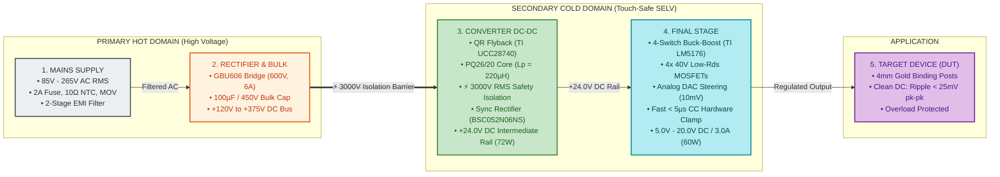
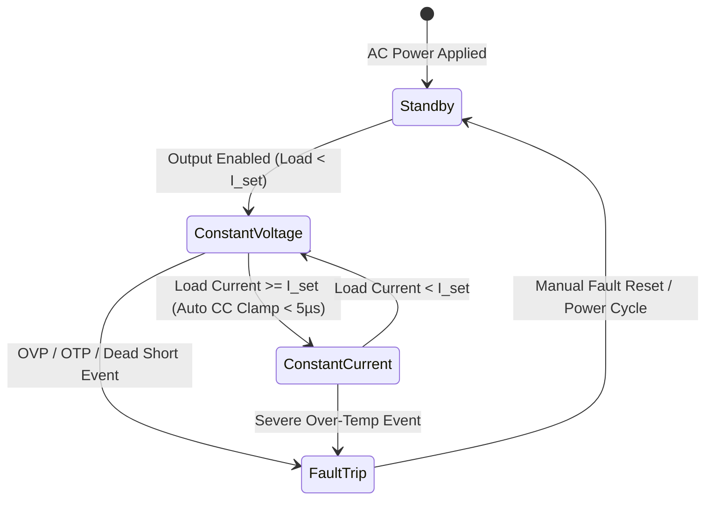

# Product Requirement Document (PRD)

---

### Project Information
* **Project Code**: `VVDN_SPPS_2026`
* **Project Name**: Smart Programmable Voltage Supply Module (85–265 V AC Input, 5–20 V / 3 A DC Output)
* **Domain**: Embedded Hardware & Power Electronics Engineering
* **Document Version**: `Rev 1.0 (Hardware Release)`
* **Date**: `12 Oct 2026`
* **Author / Design Owner**: Power Electronics Engineer Trainee (GET - Hardware Engineering)
* **Mentors & Reviewers**: Senior Hardware Architect & BU SME (Power Electronics)
* **Companion Document**: [HARDWARE_DESIGN_TECHNICAL_DETAILS_FOR_HDD.md](file:///home/tthhongs/build_tthongs/av_iv/smart_programmable_power_supply/HARDWARE_DESIGN_TECHNICAL_DETAILS_FOR_HDD.md) *(Contains detailed circuit derivations, component stress math, and schematic design)*

---

### Revision History

| Date | Revision No. | Description | Prepared By | Reviewed By | Approved By |
| :--- | :--- | :--- | :--- | :--- | :--- |
| 12 Oct 2026 | Rev 1.0 | Standardized High-Level PRD with 4-stage architecture and internal sub-blocks (Calculations moved to HDD) | Power Electronics Trainee (GET) | BU SME (Power Electronics) | Principal Hardware Architect |
| 25 Sep 2026 | Rev 0.1 | Initial hardware scope definition & topology evaluation | Power Electronics Trainee (GET) | Senior Hardware Architect | BU SME (Power Electronics) |

---

### Customer & Management Sign-Off

#### Customer Sign-Off
* **Customer**: Test & Measurement / Industrial OEM Client
* **Technical Lead**: Director of Hardware Engineering — *"Approved for modular test bench integration."*
* **Program Manager**: Program Director — *"Product requirements and timeline accepted."*

#### VVDN Internal Sign-Off
* **Technical Reviewer (BU SME - Power Electronics)**: Karpagamoorthy R / Vignesh Anandhan — *"4-Stage conversion architecture, safety boundaries, and hardware protection requirements verified."*
* **Program Reviewer (Delivery Manager)**: Gaurav Gupta / Shivam Saxena — *"Engineering deliverables schedule and review gates signed off."*

---

## 1. Executive Summary & Product Scope

### 1.1 Product Description
The **Smart Programmable Voltage Supply Module** is a high-efficiency AC-to-DC power converter designed for benchtop testing, automated test equipment (ATE), and industrial control electronics. The module connects directly to universal grid power (**85 V to 265 V AC RMS**, 50/60 Hz) and delivers an adjustable, low-noise DC output from **5.0 V to 20.0 V DC** at currents up to **3.0 A** (maximum continuous power rating of **60 W**).

### 1.2 Core Product Objectives
1. **Universal Grid Compatibility**: Operates seamlessly across worldwide AC mains voltages without requiring manual selector switches.
2. **Certified User Safety**: Complies strictly with IEC 62368-1 reinforced galvanic isolation ($3000\,\text{V}$ RMS) so that user-accessible output terminals remain touch-safe (SELV).
3. **High-Precision Programmable Output**: Provides fine output voltage adjustment ($10\,\text{mV}$ digital step size) and ultra-low noise ($< 25\,\text{mV}$ pk-pk ripple).
4. **Autonomous Hardware Protection**: Protects connected prototype circuits against short-circuits and overcurrent via ultra-fast analog hardware clamping ($< 5\,\mu\text{s}$ reaction time) that operates independently of microcontroller firmware.
5. **High Conversion Efficiency**: Maintains $> 85\%$ end-to-end efficiency across universal line voltages and load conditions.

### 1.3 Trainee Engineering Scope & Document Boundaries
* **In-Scope (Power Electronics Engineer Trainee)**:
  * Defining end-to-end power conversion architecture and stage requirements.
  * Electrical specifications for input protection, rectification, isolated DC-DC conversion, and synchronous post-regulation.
  * Hardware safety boundaries, clearance/creepage rules, and EMC compliance standards.
  * Closed-loop analog feedback, DAC voltage steering behavior, and autonomous hardware protection response.
  * Verification criteria for laboratory bring-up and acceptance testing.
* **Out-of-Scope for this PRD**:
  * Mechanical tooling, chassis metal fabrication, and die casting.
  * High-level operating system software (e.g., FreeRTOS kernels, SCPI network protocol stacks).
  * *Note on Detailed Calculations*: Detailed circuit component derating equations, transformer flux derivations, and snubber power formulas are documented separately in the companion [HARDWARE_DESIGN_TECHNICAL_DETAILS_FOR_HDD.md](file:///home/tthhongs/build_tthongs/av_iv/smart_programmable_power_supply/HARDWARE_DESIGN_TECHNICAL_DETAILS_FOR_HDD.md).

---

## 2. High-Level System Architecture: The 4-Stage Power Conversion Chain

The power supply converts raw AC mains into regulated DC power through **four simple, sequential hardware stages**:

$$\text{Mains Supply } (85\text{--}265\,\text{V AC}) \longrightarrow \text{Rectifier & Bulk } (+120\text{--}375\,\text{V DC}) \longrightarrow \text{Converter DC-DC } (+24\,\text{V DC}) \longrightarrow \text{Final Stage } (5\text{--}20\,\text{V DC}) \longrightarrow \text{Device (DUT)}$$

---

### Figure 1: Simplified 4-Stage Power Conversion Block Diagram
This is the primary block diagram showing the physical signal and power flow:

  

---

### High-Level Summary of the 4 Stages

| Stage Number | Stage Name | Input Range | Output Range | Functional Objective |
| :---: | :--- | :--- | :--- | :--- |
| **Stage 1** | **Mains Supply** | $85\text{--}265\,\text{V}$ AC RMS | Filtered AC RMS | Protects against grid overcurrent, lightning surges, and limits conducted emissions to comply with CISPR 32 Class B. |
| **Stage 2** | **Rectifier & Bulk** | Filtered AC RMS | $+120\text{--}375\,\text{V}$ DC | Converts AC into high-voltage DC and holds energy over short grid interruptions ($> 10\,\text{ms}$ holdup). |
| **Stage 3** | **Converter DC-DC** | $+120\text{--}375\,\text{V}$ DC | $+24.0\,\text{V}$ DC (72W) | Steps down high voltage to an isolated, touch-safe $+24\,\text{V}$ bus across a $3000\,\text{V}$ RMS safety barrier. |
| **Stage 4** | **Final Stage** | $+24.0\,\text{V}$ DC Bus | $5.0\text{--}20.0\,\text{V}$ DC | Regulates voltage with $10\,\text{mV}$ resolution, filters ripple to $< 25\,\text{mV}$, and clamps short circuits in $< 5\,\mu\text{s}$. |

---

## 3. Subsystem Functional Descriptions & Internal Architectures

---

### 3.1 Stage 1: Mains Supply & Input Protection Subsystem

#### 3.1.1 Functional Role
Stage 1 interfaces the module to the external electrical grid. It prevents damage from grid anomalies (inrush currents during startup, transient lightning spikes) and attenuates high-frequency switching noise generated by the internal power converters to meet global electromagnetic compatibility standards.

#### 3.1.2 Internal Sub-Block Architecture

  

#### 3.1.3 Stage 1 Functional Requirements
* **Input Connection**: Standard IEC 60320 C14 appliance inlet.
* **Overcurrent Protection**: Primary ceramic fuse rated for $2.0\,\text{A} / 250\,\text{V}$ AC with time-lag characteristics to prevent nuisance blowing during cold starts.
* **Inrush Current Suppression**: Negative Temperature Coefficient (NTC) thermistor limiting cold-start inrush surge below $35\,\text{A}_{\text{peak}}$ at $265\,\text{V}$ AC.
* **Surge Protection**: Metal Oxide Varistor (MOV) rated for $300\,\text{V}_{\text{RMS}}$ continuous operation, capable of clamping transients up to $4.5\,\text{kA}$ ($8/20\,\mu\text{s}$ waveform).
* **Conducted EMI Attenuation**: Two-stage Common Mode Choke arrangement ($15\,\text{mH}$ and $4.7\,\text{mH}$) paired with Class X2 and Class Y1 safety film/ceramic capacitors to achieve CISPR 32 Class B compliance.

---

### 3.2 Stage 2: Bridge Rectifier & High-Voltage Bulk Filter Subsystem

#### 3.2.1 Functional Role
Stage 2 performs single-phase full-wave rectification to convert the filtered AC sine wave into unipolar DC pulses, followed by bulk capacitive filtering to produce a stable high-voltage DC bus (+120 V to +375 V DC). It also stores sufficient energy to sustain continuous operation during momentary grid dropouts.

#### 3.2.2 Internal Sub-Block Architecture

  

#### 3.2.3 Stage 2 Functional Requirements
* **Full-Wave Rectification**: Single-phase bridge rectifier rated for minimum $600\,\text{V}$ reverse breakdown and $6.0\,\text{A}$ forward current, maintaining $< 75\%$ voltage derating at high-line AC.
* **Bulk Energy Reservoir**: $100\,\mu\text{F} / 450\,\text{V}$ high-reliability electrolytic capacitor rated for $105^\circ\text{C}$ and $\ge 10,000\,\text{hours}$ operating life.
* **Holdup Capability**: Must maintain bulk voltage above $90\,\text{V DC}$ during a full $10\,\text{ms}$ AC line dropout at maximum load.
* **High-Frequency Noise Bypassing**: $100\,\text{nF} / 630\,\text{V}$ ceramic capacitor placed directly across the primary switching loop.
* **Passive Safety Discharge**: Bleeder resistor network that safely drains the bulk capacitor voltage to touch-safe SELV levels ($< 50\,\text{V}$) within $60\,\text{seconds}$ of disconnecting AC power per IEC 62368-1.

---

### 3.3 Stage 3: Converter DC-DC (Isolated Quasi-Resonant Flyback) Subsystem

#### 3.3.1 Functional Role
Stage 3 is the safety isolation and primary step-down conversion stage. It converts the hazardous high-voltage DC bus into an isolated, touch-safe **$+24.0\,\text{V}$ DC intermediate bus** capable of delivering up to **72 W continuous power**. It incorporates synchronous rectification on the secondary side to maximize conversion efficiency.

#### 3.3.2 Internal Sub-Block Architecture

  

#### 3.3.3 Stage 3 Functional Requirements
* **Topology**: Quasi-Resonant (QR) valley-switching Flyback converter to minimize capacitive turn-on switching losses.
* **Galvanic Isolation Barrier**: Certified $3000\,\text{V}$ AC RMS reinforced insulation barrier meeting IEC 62368-1.
* **Power Magnetics**: Custom transformer wound on a low-loss ferrite core (PQ26/20 geometry). Primary inductance $220\,\mu\text{H} \pm 10\%$; turns ratio 6:1.
* **Reinforced Secondary Insulation**: Secondary winding constructed with triple-insulated wire (Furukawa TEX-E) to guarantee physical dielectric withstand without relying on tape margins.
* **Synchronous Rectification**: Replaces secondary Schottky diode with an active low-$R_{\text{DS(on)}}$ ($5.2\,\text{m}\Omega$) N-MOSFET controlled by an ultrafast smart driver, reducing secondary rectification loss by $> 1.3\,\text{W}$.
* **Intermediate Rail Stability**: Regulates the $+24.0\,\text{V}$ bus within $\pm 1.0\%$ across all line and load variations with output ripple strictly $< 50\,\text{mV}$ pk-pk.

---

### 3.4 Stage 4: Final Stage (Synchronous 4-Switch Buck-Boost Post-Regulator & Output)

#### 3.4.1 Functional Role
Stage 4 is the precision output regulation stage. It takes the $+24.0\,\text{V}$ intermediate rail and steps it down or across to deliver any user-commanded output from **$5.0\,\text{V}$ to $20.0\,\text{V}$ DC** at up to **$3.0\,\text{A}$**. It provides ultra-fine digital tuning, low output noise, and autonomous hardware short-circuit protection.

#### 3.4.2 Internal Sub-Block Architecture

  

#### 3.4.3 Stage 4 Functional Requirements
* **Converter Topology**: Synchronous 4-switch Buck-Boost operating at a fixed $300\,\text{kHz}$ PWM frequency.
  * Operates in pure Buck mode for output voltages from $5.0\,\text{V}$ to $18.0\,\text{V}$ (efficiency $> 96\%$).
  * Smoothly transitions to 4-switch Buck-Boost mode near $20.0\,\text{V}$ full load (efficiency $> 95\%$) with zero output glitches.
* **Output Voltage Range**: Continuously programmable from $5.0\,\text{V}$ to $20.0\,\text{V}$ DC.
* **Output Current Capability**: Up to $3.0\,\text{A}$ continuous across the entire voltage range ($60\,\text{W}$ max power).
* **Output Voltage Ripple**: Strictly $< 25\,\text{mV}$ peak-to-peak under full 3.0 A load (measured across 20 MHz bandwidth limit).
* **DAC Voltage Steering Network**: Summing resistor network connected to the controller feedback pin, allowing a 12-bit DAC to steer output voltage in monotonic $10\,\text{mV}$ steps without affecting loop phase margin.
* **Autonomous Hardware CC Clamp**: Dedicated analog current sense amplifier ($50\,\text{V/V}$) and ultra-fast analog comparator ($4.5\,\text{ns}$) that autonomously clamps the controller duty cycle in **$< 5.0\,\mu\text{s}$** during an overload or dead short-circuit.
* **Output Terminals**: Dual heavy-duty 4mm gold-plated binding posts (standard 0.75-inch bench spacing).

---

### Figure 6: Master Embedded Hardware Architecture Block Diagram
The schematic-level architecture showing how gate drivers, auxiliary bias rails, analog feedback, and dual-domain power sensing interconnect across the isolation barrier:

  

---

## 4. Hardware Engineering Requirements & Specifications

The engineering targets and pass/fail acceptance criteria are defined in the tables below:

### Table 4.1: AC Input & Primary Stage Requirements
| Req ID | Parameter / Feature | Specification Target | Operating Condition | Verification Method |
| :---: | :--- | :--- | :--- | :--- |
| **FR-01** | AC Input Voltage Range | $85\,\text{V} \dots 265\,\text{V}$ AC RMS [MUST] | Nominal 230V AC, $47\text{--}63\,\text{Hz}$ | AC Source Voltage Sweep |
| **FR-02** | Intermediate DC Bus Voltage | $+24.0\,\text{V}$ DC $\pm 1.0\%$ [MUST] | Full line and load range | Digital Multimeter |
| **FR-03** | Continuous Primary Power | $72.0\,\text{W}$ Continuous [MUST] | 85V–265V AC In, 24V / 3A Out | Electronic Load 72W Soak |
| **FR-04** | Primary Stage Efficiency | $> 90.0\%$ @ 230V AC Full Load [MUST] | $P_{\text{out}} = 72\,\text{W}, T_{\text{amb}} = 25^\circ\text{C}$ | Precision Power Analyzer |
| **FR-05** | Safety Galvanic Isolation | $3000\,\text{V}$ AC RMS (1 minute) [MUST]| Primary to Secondary Barrier | Certified Hi-Pot Tester |
| **FR-06** | Cold-Start Inrush Current | $< 35.0\,\text{A}$ Peak [MUST] | $V_{\text{in}} = 265\,\text{V}$ AC, $25^\circ\text{C}$ cold start | Current Probe & Scope |
| **FR-07** | No-Load Standby Power | $< 150\,\text{mW}$ Standby [SHOULD] | $V_{\text{in}} = 230\,\text{V}$ AC, Output Off | Power Meter Integration |

### Table 4.2: Secondary Stage & Output Regulation Requirements
| Req ID | Parameter / Feature | Specification Target | Operating Condition | Verification Method |
| :---: | :--- | :--- | :--- | :--- |
| **BB-01** | Programmable Output Voltage | $5.0\,\text{V} \dots 20.0\,\text{V}$ DC [MUST] | Continuous linear adjustment | Precision DMM Sweep |
| **BB-02** | Continuous Output Current | $0.0\,\text{A} \dots 3.0\,\text{A}$ DC [MUST] | Across full 5V–20V voltage span | Electronic Load 3A Soak |
| **BB-03** | Maximum Continuous Output Power| $60.0\,\text{W}$ Continuous [MUST] | $V_{\text{out}} = 20.0\,\text{V}, I_{\text{out}} = 3.0\,\text{A}$ | Thermal Run 60W (2 hrs) |
| **BB-04** | Voltage Tuning Step Resolution | $10.0\,\text{mV}$ step size [MUST] | 12-bit DAC control | DAC Linearity Sweep |
| **BB-05** | Current Limit Step Resolution | $10.0\,\text{mA}$ step size [MUST] | 12-bit DAC reference | Current Clamp Sweep |
| **BB-06** | Output Voltage Ripple | $< 25\,\text{mV}$ pk-pk ripple [MUST] | Full load 3A, 20MHz bandwidth | Scope Tip-and-Barrel Probe |
| **BB-07** | Load Transient Recovery | $< 150\,\mu\text{s}$ to 1% setpoint [MUST]| 50% to 100% load step (1.5A to 3A)| Dynamic Load Stepper |
| **BB-08** | Post-Regulator Efficiency | $> 95.0\%$ @ 20V/3A; $> 92.0\%$ @ 5V/3A | $V_{\text{in}} = 24\,\text{V}$, Sync switching | Dual-Channel Power Meter |
| **BB-09** | Switching Frequency | $300\,\text{kHz} \pm 10\%$ [MUST] | Fixed frequency PWM | Frequency Counter |
| **BB-10** | Hardware CC Clamp Reaction | $< 5.0\,\mu\text{s}$ autonomous clamp [MUST]| Direct dead short-circuit step | High-Speed Shunt Scope |

### Table 4.3: Real-Time Telemetry & Monitoring Requirements
| Req ID | Parameter / Feature | Specification Target | Operating Condition | Verification Method |
| :---: | :--- | :--- | :--- | :--- |
| **TM-01** | Primary AC Voltage Sensing | Isolated $0\text{--}300\,\text{V}$ AC RMS [MUST] | $\pm 1.0\%$ accuracy across 85-265V | Precision AC Source Ref |
| **TM-02** | Secondary DC Voltage Sensing | $0\text{--}25.0\,\text{V}$ DC range [MUST] | $\pm 0.2\%$ measurement accuracy | Keysight 34465A 6.5-digit DMM |
| **TM-03** | Secondary DC Current Sensing | $0\text{--}3.5\,\text{A}$ DC range [MUST] | $\pm 0.5\%$ measurement accuracy | Precision Current Calibrator |
| **TM-04** | Telemetry Loop Update Rate | $10.0\,\text{Hz}$ Real-Time Rate [MUST] | Voltage, Current, Power update | Logic Analyzer Timing Check |
| **TM-05** | Galvanic Isolation on Telemetry | $3000\,\text{V}$ AC RMS Barrier [MUST] | Reinforced optical/galvanic barrier | Hi-Pot Isolation Tester |

### Table 4.4: Protection, Safety & Environmental Requirements
| Req ID | Parameter / Feature | Specification Target | Operating Condition | Verification Method |
| :---: | :--- | :--- | :--- | :--- |
| **PR-01** | Hardware Over-Voltage (OVP) | Clamps at $V_{\text{set}} + 1.5\,\text{V}$ ($< 5\,\mu\text{s}$)| Independent analog comparator | OVP Voltage Injection Test |
| **PR-02** | Hardware Over-Current (OCP/CC) | Limits to $I_{\text{set}} \pm 20\,\text{mA}$ ($< 5\,\mu\text{s}$)| Analog pull-down on COMP pin | Direct Dead Short Test |
| **PR-03** | Over-Temperature Protection (OTP) | Shuts down at $T_{\text{pcb}} > 90^\circ\text{C}$ ($10^\circ\text{C}$ hyst) | On-board NTC monitoring | Thermal Chamber Ramp |
| **PR-04** | Safety Standard Compliance | IEC 62368-1 Reinforced Isolation | Touch-safe SELV ($< 60\,\text{V}$ DC) | Certified Safety Laboratory |
| **PR-05** | PCB Creepage & Clearance | Creepage $\ge 6.4\,\text{mm}$; Clearance $\ge 5.0\,\text{mm}$ | Primary-to-secondary boundary | PCB Mechanical Caliper |
| **PR-06** | Conducted & Radiated EMC | CISPR 32 / EN 55032 Class B [MUST] | 150 kHz – 1 GHz emission limits | Semi-Anechoic Chamber |
| **PR-07** | Operating Ambient Range | $-20^\circ\text{C}$ to $+50^\circ\text{C}$ Full Load [MUST]| Natural convection airflow | Environmental Chamber |

---

## 5. Operational Use Cases & Modes of Operation

The hardware module operates autonomously in four primary operational states:

### 5.1 Mode 1: Constant Voltage (CV) Regulation Mode
* **Description**: The default operational mode when connected load current is strictly below the user-programmed current limit ($I_{\text{load}} < I_{\text{set}}$).
* **Hardware Behavior**: The LM5176 Buck-Boost controller maintains closed-loop regulation at the target setpoint ($5.0\,\text{V} \dots 20.0\,\text{V}$). As load varies from no-load to full-load, the output voltage remains rock-solid within $\pm 0.2\%$, with $< 150\,\mu\text{s}$ dynamic recovery following load steps.

### 5.2 Mode 2: Constant Current (CC) Mode
* **Description**: Activated autonomously whenever the connected load attempts to draw current exceeding the current limit ($I_{\text{load}} \ge I_{\text{set}}$).
* **Hardware Behavior**: The fast analog protection loop pulls down the LM5176 `COMP` pin, collapsing the output voltage to whatever lower level is required to maintain exactly $I_{\text{set}}$ flowing through the load. Transitions between CV and CC mode occur in **$< 5.0\,\mu\text{s}$** without software intervention.

### 5.3 Mode 3: Hardware Fault Protection State
* **Description**: Triggered if a catastrophic system event occurs (e.g. over-voltage trip at $V_{\text{set}} + 1.5\,\text{V}$ or board over-temperature exceeding $90^\circ\text{C}$).
* **Hardware Behavior**: An independent hardware crowbar shuts down the PWM switching stages and disconnects output drive until the condition clears and the operator issues a reset.

### 5.4 Mode 4: Standby / Idle State
* **Description**: AC mains is energized, the Flyback generates the $+24.0\,\text{V}$ intermediate rail, but the post-regulator output stage is electronically disabled.
* **Hardware Behavior**: Standby power consumption remains strictly below $150\,\text{mW}$.

---

## 6. Safety Galvanic Isolation & PCB Layout Rules

To ensure complete operator safety when touching the front-panel 4mm binding posts:
1. **$3000\,\text{V}$ RMS Dielectric Withstand**: The primary-to-secondary isolation barrier withstands $3000\,\text{V}$ AC RMS for 60 seconds with zero dielectric breakdown.
2. **$6.4\,\text{mm}$ Surface Creepage Distance**: Enforced across all copper planes between primary high-voltage circuits and secondary touch-safe SELV circuits under Pollution Degree 2.
3. **$2.0\,\text{mm}$ Milled PCB Isolation Air Slot**: A continuous milled slot is routed through the FR-4 PCB substrate directly beneath the Flyback transformer and optocoupler bodies, providing an infinite air breakdown barrier.
4. **Triple-Insulated Secondary Magnetics**: Secondary transformer windings use Furukawa TEX-E wire featuring three extruded safety insulation layers.

---

## 7. Master Bill of Materials (BOM) Summary

Organized across the 4 power conversion stages:

| Stage | Ref Des Group | Primary Hardware Components | Function & Key Rating |
| :---: | :--- | :--- | :--- |
| **Stage 1: Mains Supply** | F1, NTC1, MOV1, L_CM1/2, C_X, C_Y | Littelfuse 2A Fuse, 10Ω NTC, 14D471K MOV, Wurth Common Mode Chokes, KEMET Safety Caps | Inrush limiting ($< 35\,\text{A}$), lightning clamping ($4.5\,\text{kA}$), and CISPR 32 Class B filtering. |
| **Stage 2: Rectifier & Bulk** | BR1, C_BULK1, C_HF, R_BLEED | Diodes Inc. GBU606 (600V, 6A), Nichicon 100µF/450V Bulk Cap, Murata 100nF/630V Ceramic, Bleeders | AC full-wave rectification, $> 10\,\text{ms}$ holdup energy, $< 60\,\text{s}$ safe discharge. |
| **Stage 3: Converter DC-DC** | U1, Q1, TX1, U2, Q_SR, OPTO1 | TI UCC28740, Infineon 800V CoolMOS, PQ26/20 Transformer, MP6908, 60V Sync FET, EL817 | QR Flyback conversion, certified $3000\,\text{V}$ RMS safety isolation, $+24.0\,\text{V}$ DC bus (72W). |
| **Stage 4: Final Stage** | U3, QA..QD, L1, C_OUT, U7, U8, POSTS | TI LM5176, 4x 40V MOSFETs, Wurth 10µH Inductor, MLCC Bank, INA240, TLV3501, 4mm Posts | Synchronous Buck-Boost regulation (5V–20V / 3A), $10\,\text{mV}$ DAC tuning, $< 5\,\mu\text{s}$ CC clamping. |

*(Detailed component part numbers, manufacturer details, and footprint packages are maintained in the companion [HARDWARE_DESIGN_TECHNICAL_DETAILS_FOR_HDD.md](file:///home/tthhongs/build_tthongs/av_iv/smart_programmable_power_supply/HARDWARE_DESIGN_TECHNICAL_DETAILS_FOR_HDD.md)).*

---

## 8. Verification & Acceptance Testing (DVT Criteria)

Factory and laboratory Design Verification Testing (DVT) must satisfy the following criteria:

| Test Item | Verification Procedure | Acceptance Threshold | Result Status |
| :---: | :--- | :--- | :---: |
| **Line Regulation** | Vary AC input from $85\,\text{V}$ to $265\,\text{V}$ AC RMS at full load | $\Delta V_{\text{out}} \le \pm 0.1\%$ | PASS / FAIL |
| **Load Regulation** | Step load current from $0.1\,\text{A}$ to $3.0\,\text{A}$ across 5V, 12V, 20V | $\Delta V_{\text{out}} \le \pm 0.2\%$ | PASS / FAIL |
| **Output Ripple** | Measure AC pk-pk ripple at 20V/3A using tip-and-barrel probe | $V_{\text{ripple}} < 25\,\text{mV}$ pk-pk | PASS / FAIL |
| **Transient Step** | 50% to 100% load step ($1.5\,\text{A} \rightarrow 3.0\,\text{A}$) | Recovery $< 150\,\mu\text{s}$, sag $< 250\,\text{mV}$ | PASS / FAIL |
| **CC Clamp Reaction** | Apply dead short-circuit across 4mm output posts | COMP pin clamped in $< 5.0\,\mu\text{s}$ | PASS / FAIL |
| **Dielectric Hi-Pot** | Apply $3000\,\text{V}$ AC RMS between primary and secondary for 60s | Zero breakdown, leakage $< 1\,\text{mA}$ | PASS / FAIL |
| **Thermal Rise** | Full power soak ($60\,\text{W}$) in $25^\circ\text{C}$ ambient for 2 hours | All silicon $T_J \le 85^\circ\text{C}$; magnetics $\le 75^\circ\text{C}$ | PASS / FAIL |

---

## 9. Deliverables & Project Milestones Roadmap

The engineering workflow follows the structured VVDN product realization process:

1. **Gate 1: PRD Sign-Off** *(Current Milestone)*: Acceptance of functional requirements, 4-stage architecture, and safety criteria.
2. **Gate 2: Hardware Design Document (HDD) & Detailed Schematics**: Release of component derivations, derating tables, and complete schematic netlists (refer to [HARDWARE_DESIGN_TECHNICAL_DETAILS_FOR_HDD.md](file:///home/tthhongs/build_tthongs/av_iv/smart_programmable_power_supply/HARDWARE_DESIGN_TECHNICAL_DETAILS_FOR_HDD.md)).
3. **Gate 3: PCB Layout & DFM Review**: 4-layer PCB design enforcing $6.4\,\text{mm}$ creepage, $2\,\text{mm}$ isolation routing slot, and low-ESR polygon pours.
4. **Gate 4: Prototype Fabrication & Lab Bring-Up**: Variac ramp-up bring-up, cold resistance checks, and initial rail stabilization.
5. **Gate 5: Design Verification Testing (DVT)**: Complete electrical, thermal, and EMC pre-compliance test report.
6. **Gate 6: Production Release**: Final release of Gerbers, manufacturing assembly drawings, and customer documentation.
