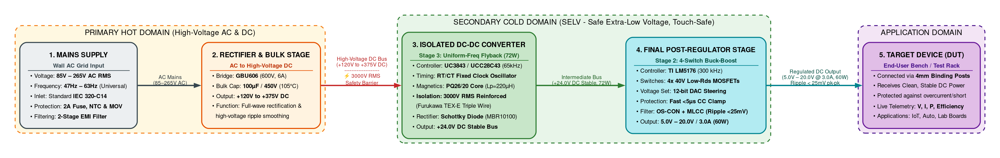
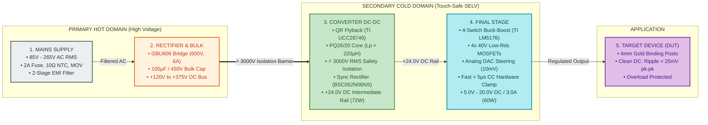
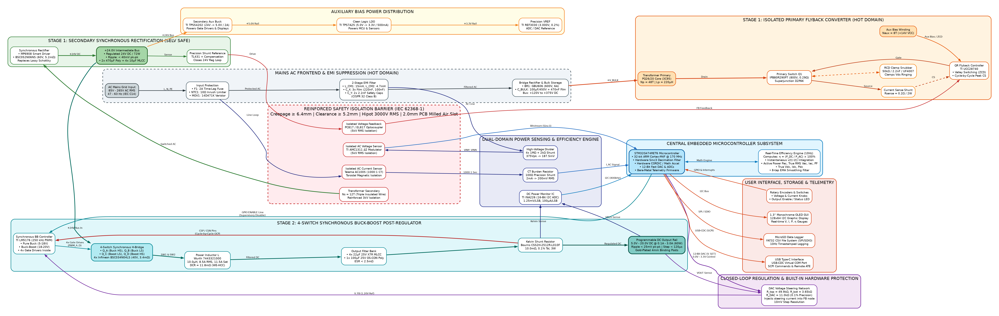
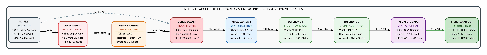
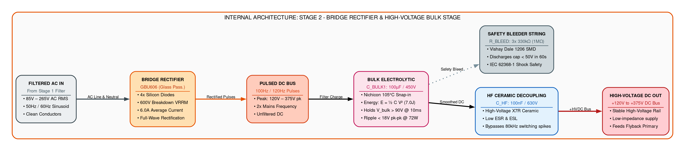
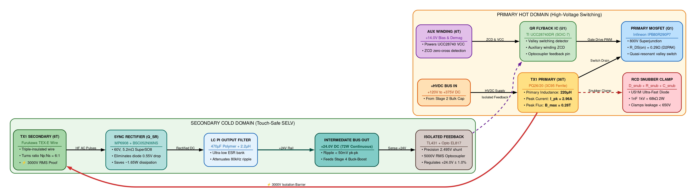
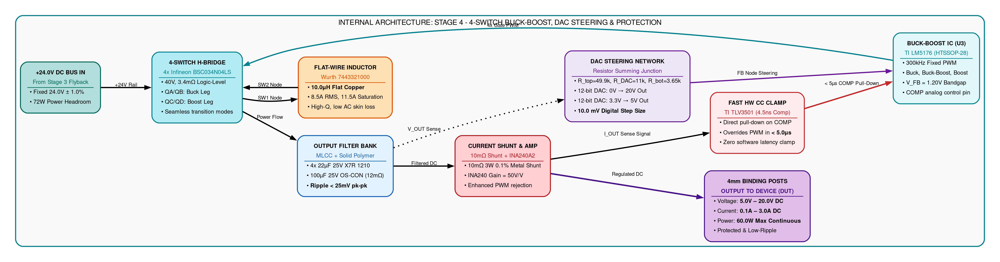

# Smart Programmable Power Supply Module: 85–265 V AC Input, 5–20 V / 3 A DC Output

Welcome to the **VVDN Engineering Hub Smart Programmable Power Supply (SPPS) Knowledge Base**. This repository serves as the definitive engineering design, mathematical formulation, hardware schematic, firmware implementation, and testing reference for a high-efficiency **Universal AC-DC Flyback Converter with MCU-Controlled Synchronous Buck-Boost Post-Regulator, Real-Time Dual-Domain Efficiency Monitoring, and MicroSD Data Logging**.

---

## 1. Project Executive Summary & System Specifications

The **Smart Programmable Power Supply Module** is an intelligent, digitally controlled bench/industrial power supply engineered to provide a tightly regulated, programmable DC voltage output from $5.0\,\text{V}$ to $20.0\,\text{V}$ at currents up to $3.0\,\text{A}$ ($60\,\text{W}$ maximum continuous output power) from a universal mains AC input ($85\,\text{V} \dots 265\,\text{V}$ AC RMS, $47\,\text{Hz} \dots 63\,\text{Hz}$).

```text
┌───────────────────────────────────────────────────────────────────────────────────┐
│               Smart Programmable Power Supply Key Engineering Specs               │
├────────────────────────────┬─────────────────────────────┬────────────────────────┤
│ Parameter / Specification  │ Value Range / Unit          │ Design Condition       │
├────────────────────────────┼─────────────────────────────┼────────────────────────┤
│ **AC Input Voltage Range** │ 85 V – 265 V AC (Nom. 230V) │ Universal Mains (RMS)  │
│ **AC Input Frequency**     │ 47 Hz – 63 Hz               │ Global Grid Compatible │
│ **Inrush Current Limit**   │ < 30 A Peak                 │ Cold start via NTC     │
│ **Primary Topology**       │ Quasi-Resonant (QR) Flyback │ Galvanic Isolation 3kV │
│ **Intermediate DC Bus**    │ +24.0 V DC (Fixed, 72W max) │ Low ripple (< 50mV pk) │
│ **Post-Regulator Topology**│ 4-Switch Synchronous BB     │ High efficiency > 95%  │
│ **Programmable Output (V)**│ 5.0 V – 20.0 V DC           │ 10 mV digital step size│
│ **Programmable Output (I)**│ 0.1 A – 3.0 A Continuous    │ 10 mA step (CC mode)   │
│ **Maximum Output Power**   │ 60.0 W Continuous           │ Convection / fanless   │
│ **Output Voltage Ripple**  │ < 25 mV pk-pk @ 20V/3A      │ Full load 20MHz BW     │
│ **Transient Recovery**     │ < 150 µs to 1%              │ 50% to 100% load step  │
│ **Overall System Eff (η)** │ 84% – 89% (End-to-End)      │ Across 115V/230V mains │
│ **Real-Time Metering**     │ Dual AC (RMS) + DC (True V,I│ Efficiency update 10Hz │
│ **Data Logging Engine**    │ MicroSD FAT32 (CSV format)  │ Timestamp, V, I, P, η  │
│ **Isolation & Safety**     │ Reinforced (IEC 62368-1)    │ Creepage >= 6.4mm      │
│ **EMC Compliance**         │ EN 55032 / CISPR 32 Class B │ Conducted/Radiated EMI │
└────────────────────────────┴─────────────────────────────┴────────────────────────┘
```

---

## 2. High-Level Architectural Block Diagram

The module adopts a two-stage cascaded conversion architecture with isolated primary control and intelligent secondary digital regulation:

$$\text{Mains Supply } (85\text{--}265\,\text{V AC}) \longrightarrow \text{Rectifier } (+120\text{--}375\,\text{V DC}) \longrightarrow \text{Converter DC-DC (Flyback } +24\,\text{V}) \longrightarrow \text{Final Stage (Buck-Boost } 5\text{--}20\,\text{V}) \longrightarrow \text{Device (DUT)}$$

### Figure 1: Simplified 4-Stage Power Conversion Block Diagram
The primary block diagram for mentor reviews and cross-mentor technical defense:

<p align="center">
  
</p>



---

### Figure 2: Master Embedded Hardware Architecture Block Diagram
The complete embedded hardware schematic-level architecture showing gate drivers, auxiliary supplies, analog feedback loops, and dual-domain power sensing:

<p align="center">
  
</p>

---

### 2.1 Internal Sub-Block Diagrams (The 4 Stages in Detail)

#### Stage 1: Mains Supply & Input Protection Subsystem
Takes raw AC mains (85V–265V AC RMS), provides inrush current limiting (10Ω NTC), lightning surge suppression (14D471K MOV), and conducted EMI suppression (2-Stage Common Mode Chokes + X2/Y1 filter caps).
<p align="center">
  
</p>

#### Stage 2: Bridge Rectifier & High-Voltage Bulk Filter Subsystem
Full-wave rectification via GBU606 bridge (600V, 6A) and energy smoothing via 100µF/450V 105°C electrolytic bulk capacitor, generating a high-voltage DC bus (+120V to +375V DC) with > 10ms holdup.
<p align="center">
  
</p>

#### Stage 3: Converter DC-DC (Isolated Quasi-Resonant Flyback Subsystem)
TI UCC28740 QR valley-switching controller, 800V CoolMOS IPB80R290P7, and custom PQ26/20 transformer stepping down power with certified 3000V RMS reinforced safety isolation to a +24.0V DC intermediate rail (72W) using synchronous rectification (MP6908 + BSC052N06NS).
<p align="center">
  
</p>

#### Stage 4: Final Stage (Synchronous 4-Switch Buck-Boost Post-Regulator Subsystem)
TI LM5176 modulating four 40V MOSFETs (BSC034N04LS) through a 10µH flat-wire power inductor. Features 10mV DAC voltage steering (5V–20V DC), sub-25mV ripple, and < 5µs autonomous hardware CC clamping feeding 4mm gold binding posts.
<p align="center">
  
</p>

---

## 3. Two-Stage Power Architecture Rationale

Why is a two-stage cascaded architecture (**Universal AC-DC Flyback + Synchronous Buck-Boost**) vastly superior to a single-stage variable flyback for a precision programmable bench supply?

```text
┌───────────────────────────────────────────────────────────────────────────────────┐
│             Single-Stage Variable Flyback vs. Cascaded Two-Stage Topology         │
├───────────────────────┬───────────────────────────┬───────────────────────────────┤
│ Design Dimension      │ Single-Stage Var. Flyback │ Cascaded Two-Stage (Chosen)   │
├───────────────────────┼───────────────────────────┼───────────────────────────────┤
│ **Dynamic Range**     │ Very difficult to maintain│ Flyback is fixed at +24V DC.  │
│                       │ stability and auxiliary   │ Auxiliary bias winding stays  │
│                       │ VCC over a 4:1 (5V-20V)   │ rock-solid across all loads!  │
│                       │ output voltage range.     │                               │
├───────────────────────┼───────────────────────────┼───────────────────────────────┤
│ **Transformer Design**│ Extreme primary turns vs. │ Optimized for a single 24V    │
│                       │ saturation trade-off; poor│ operating point; maximum core │
│                       │ winding utilization.      │ utilization and peak eff.     │
├───────────────────────┼───────────────────────────┼───────────────────────────────┤
│ **Output Ripple & BW**│ 100 Hz/120 Hz mains ripple│ Buck-Boost post-regulator     │
│                       │ bleeds into output; slow  │ switches at 250 kHz, yielding │
│                       │ optocoupler control loop. │ sub-25mV ripple & fast step.  │
├───────────────────────┼───────────────────────────┼───────────────────────────────┤
│ **Secondary Sensing** │ High-voltage isolation    │ Secondary MCU handles CV/CC   │
│                       │ crossing required for DAC │ locally on secondary ground.  │
│                       │ voltage adjustment.       │ No isolated DAC required!     │
├───────────────────────┼───────────────────────────┼───────────────────────────────┤
│ **Transient Response**│ Sluggish (> 5 ms) due to  │ Ultra-fast (< 150 µs) dynamic │
│                       │ optocoupler low bandwidth.│ loop response under 3A steps. │
└───────────────────────┴───────────────────────────┴───────────────────────────────┘
```

---

## 4. Key Subsystems & Functional Blocks

1. **AC-DC Primary Flyback Converter Stage**:
   - Universal mains rectification ($85\,\text{V} \dots 265\,\text{V}$ AC) with EMI Pi-filtering (common-mode choke + differential film caps) compliant with CISPR 32 Class B.
   - Quasi-Resonant (QR) zero-voltage valley switching controller (TI UCC28740 / ON Semi NCP1342) driving an $800\,\text{V}$ Superjunction MOSFET.
   - Precision transformer design on PQ26/20 ferrite core with triple-insulated secondary wire ($\ge 3\,\text{kV}_{\text{RMS}}$ reinforced barrier).
   - Synchronous rectification on the secondary using an MP6908 fast SR controller and $40\,\text{V}$ low-$R_{DS(on)}$ N-channel MOSFET, achieving $> 91\%$ stage efficiency.
   - Regulated $+24.0\,\text{V}$ intermediate DC bus output with optocoupler isolation (PC817) and TL431 reference.

2. **MCU-Controlled Synchronous Buck-Boost Post-Regulator**:
   - 4-switch non-inverting synchronous Buck-Boost topology seamlessly stepping down ($24\,\text{V} \rightarrow 5\,\text{V}$) or boosting ($24\,\text{V} \rightarrow 20\,\text{V}$) with up to $97\%$ efficiency.
   - Controlled by high-frequency PWM or dedicated multi-mode controller (e.g., LM5176 / LTC3789) driven by an embedded 32-bit microcontroller (STM32G474 / ESP32-S3).
   - Digital feedback summing node: An on-chip 12-bit DAC injects offset current into the voltage divider node, steering the output voltage from $5.0\,\text{V}$ to $20.0\,\text{V}$ with $10\,\text{mV}$ precision.
   - Hardware Constant Current (CC) control loop: Fast low-side/high-side shunt sense amplifier clamps the error amplifier when load current reaches the programmable current limit ($0.1\,\text{A} \dots 3.0\,\text{A}$).

3. **Dual-Domain Real-Time Power Metering & Efficiency Engine**:
   - **Primary AC Metering**: Galvanically isolated AC voltage divider + current transformer (or isolated $\Delta\Sigma$ modulator AMC1311 + AMC1300) measuring true RMS voltage ($V_{AC,rms}$), true RMS current ($I_{AC,rms}$), real power ($P_{AC}$ in Watts), and power factor ($\cos\phi$).
   - **Secondary DC Metering**: High-precision I2C digital power monitor (INA226 / INA228) measuring true output voltage ($V_{DC}$), load current ($I_{DC}$), and output power ($P_{DC}$).
   - **Real-Time Efficiency ($\eta$)**: Microcontroller computes true end-to-end efficiency at $10\,\text{Hz}$:
     $$\eta(t) = \frac{P_{DC}(t)}{P_{AC}(t)} \times 100\%$$

4. **Telemetry, Data Logging & User Interface**:
   - **MicroSD Card Data Logger**: Automatic continuous CSV logging of timestamped records (`timestamp_ms`, `Vac_rms`, `Iac_rms`, `Pac_w`, `Vdc_out`, `Idc_out`, `Pdc_w`, `eff_pct`, `temp_primary_c`, `temp_secondary_c`).
   - **Local Display**: 1.3-inch $128\times 64$ OLED displaying real-time V/I meters, power, efficiency bar-graph, and fault status.
   - **Digital Control & SCPI Protocol**: USB-C virtual serial interface accepting industry-standard SCPI commands (`:VOLT 12.0`, `:CURR 2.5`, `:OUTP ON`, `:MEAS:EFF?`).

---

## 5. Documentation Suite Roadmap

This project is organized into four specialized, comprehensive technical dossiers accompanied by Microsoft Word (`.docx`) deliverables:

```text
smart_programmable_power_supply/
├── README.md (.docx)                                      # Master Hub, system specs, block diagrams & roadmap
├── ac-dc-flyback-stage-design.md (.docx)                  # Universal AC frontend, QR Flyback, transformer & SR
├── mcu-buck-boost-post-regulator.md (.docx)               # 4-switch Buck-Boost, digital CV/CC loops & DAC control
├── efficiency-monitoring-and-telemetry.md (.docx)         # Dual AC/DC metering, real-time η, MicroSD & SCPI
└── system-schematics-and-pcb-design.md (.docx)            # Complete system schematics, BOM, isolation & bring-up
```

### [1. AC-DC Flyback Stage Design & Magnetic Engineering](file:///home/tthhongs/build_tthongs/tasks_aa_ii/vvdn/smart_programmable_power_supply/ac-dc-flyback-stage-design.md)
- Universal AC input frontend ($85\,\text{V} \dots 265\,\text{V}$ AC): Fuse, NTC thermistor, MOV surge clamp (14D471K), and 2-stage EMI filter.
- Bridge rectification and bulk capacitor calculation ($C_{bulk} = 100\,\mu\text{F} / 450\,\text{V}$) for $10\,\text{ms}$ holdup time.
- Quasi-Resonant (QR) Flyback operation, valley-switching physics, and primary peak current formulations.
- Complete Transformer Design (PQ26/20 core, 3C95 ferrite): Primary turns ($N_p$), secondary turns ($N_s$), auxiliary turns ($N_{aux}$), air gap ($l_g$), and primary inductance ($L_p$).
- Primary $800\,\text{V}$ Superjunction MOSFET selection and RCD clamp snubber calculation ($R_{snub}, C_{snub}, D_{snub}$).
- Secondary synchronous rectification (MP6908 + $40\,\text{V}$ MOSFET) and TL431/PC817 optocoupler feedback loop design for stable $+24\,\text{V}$ DC bus.
- Complete component-level ASCII schematic of the AC-DC Flyback stage.

### [2. MCU-Controlled Synchronous Buck-Boost Post-Regulator](file:///home/tthhongs/build_tthongs/tasks_aa_ii/vvdn/smart_programmable_power_supply/mcu-buck-boost-post-regulator.md)
- 4-switch non-inverting synchronous Buck-Boost power stage topology ($24\,\text{V} \rightarrow 5\,\text{V} \dots 20\,\text{V}$ @ $3\,\text{A}$).
- Inductor sizing ($L = 10\,\mu\text{H}$) and input/output ceramic MLCC filter sizing for $< 25\,\text{mV}$ ripple.
- High-side and low-side gate driver architecture with bootstrap capacitors.
- Digital closed-loop regulation: 12-bit DAC current-injection network into the feedback node for $5\,\text{V} \dots 20\,\text{V}$ programming ($10\,\text{mV}$ step).
- Fast analog Constant Current (CC) control loop using high-side current sense amplifier (INA240 / INA282) and precision reference clamp.
- Complete component-level ASCII schematic of the Synchronous Buck-Boost post-regulator.

### [3. Real-Time Efficiency Monitoring, Data Logging & Telemetry](file:///home/tthhongs/build_tthongs/tasks_aa_ii/vvdn/smart_programmable_power_supply/efficiency-monitoring-and-telemetry.md)
- Primary AC side isolated power metering: Isolated $\Delta\Sigma$ modulator (AMC1311/AMC1300) or dedicated metering IC (ADE7953) for true RMS AC voltage, current, active power, and power factor.
- Secondary DC side digital power monitor: INA226 with $10\,\text{m}\Omega$ $0.1\%$ Kelvin shunt for millivolt/milliamp measurement.
- Real-time digital efficiency algorithm ($\eta = P_{DC} / P_{AC}$) with low-pass filtering and rolling average buffers.
- MicroSD SPI/SDIO data logging architecture: FAT32 filesystem, ring buffers, non-blocking FreeRTOS tasks, and CSV data schema.
- Embedded firmware architecture, SCPI command parser over USB-CDC, and OLED GUI display state machine.

### [4. Complete System Schematics, Safety & PCB Design](file:///home/tthhongs/build_tthongs/tasks_aa_ii/vvdn/smart_programmable_power_supply/system-schematics-and-pcb-design.md)
- Complete end-to-end system interconnection schematic uniting AC input, Flyback, Buck-Boost, MCU, and Telemetry.
- Creepage and clearance rules: IEC 62368-1 / UL 60950 compliance ($\ge 6.4\,\text{mm}$ creepage, $\ge 5.0\,\text{mm}$ clearance, Y1 safety caps).
- High-voltage 4-layer PCB stackup and layout guidelines (Primary high $di/dt$ loop, Secondary power ground vs. sensitive analog ground separation).
- Comprehensive Bill of Materials (BOM) with manufacturer part numbers and footprints.
- Bench bring-up sequence, calibration procedure, and Root Cause Analysis (RCA) troubleshooting matrix.

---

## 6. CLI Engineering Utility: `tools/psu_calc.py`

A dedicated Python CLI calculation utility is provided in [**`tools/psu_calc.py`**](file:///home/tthhongs/build_tthongs/tasks_aa_ii/vvdn/tools/psu_calc.py) to automate power stage sizing:

```bash
# 1. Size QR Flyback transformer (universal 85-265V AC in, 24V/3A out, 65kHz, PQ26/20 core):
python3 tools/psu_calc.py --flyback --vin-min 85 --vin-max 265 --vout 24 --iout 3.0 --fsw 65000

# 2. Size Flyback primary RCD clamp snubber:
python3 tools/psu_calc.py --snubber --vin-max 265 --vout 24 --turns-ratio 3.5 --leakage-ind 15e-6 --ipeak 1.8 --fsw 65000

# 3. Size 4-switch Buck-Boost inductor and capacitors (24V in, 5V-20V out, 3A, 250kHz):
python3 tools/psu_calc.py --buckboost --vin 24 --vout-min 5.0 --vout-max 20.0 --iout 3.0 --fsw 250000

# 4. Calculate DAC feedback summing resistor network for 5V-20V programming:
python3 tools/psu_calc.py --feedback --vout-min 5.0 --vout-max 20.0 --vdac-max 3.3 --vref 1.2
```

---

## 7. Alternative Converter Topologies & Sizing Dossier

For alternative system designs exploring different converter architectures (including **Active PFC + Half-Bridge LLC Resonant**, **Two-Switch Forward**, **High-Bus Pure Synchronous Buck @ 36V**, **Coupled-Inductor SEPIC**, **Synchronous Zeta**, **Tracking Buck + LDO**, and **Direct Single-Stage Variable Flyback**), refer to the dedicated alternative topology knowledge base:

* [**`smart_programmable_power_supply_alternatives/README.md`**](file:///home/tthhongs/build_tthongs/tasks_aa_ii/vvdn/smart_programmable_power_supply_alternatives/README.md)
* [**`smart_programmable_power_supply_alternatives/isolated-ac-dc-topologies.md`**](file:///home/tthhongs/build_tthongs/tasks_aa_ii/vvdn/smart_programmable_power_supply_alternatives/isolated-ac-dc-topologies.md)
* [**`smart_programmable_power_supply_alternatives/non-isolated-dc-dc-topologies.md`**](file:///home/tthhongs/build_tthongs/tasks_aa_ii/vvdn/smart_programmable_power_supply_alternatives/non-isolated-dc-dc-topologies.md)
* [**`smart_programmable_power_supply_alternatives/comparative-analysis-and-benchmarking.md`**](file:///home/tthhongs/build_tthongs/tasks_aa_ii/vvdn/smart_programmable_power_supply_alternatives/comparative-analysis-and-benchmarking.md)
* [**`smart_programmable_power_supply_alternatives/tools/alternative_converter_calc.py`**](file:///home/tthhongs/build_tthongs/tasks_aa_ii/vvdn/smart_programmable_power_supply_alternatives/tools/alternative_converter_calc.py)

